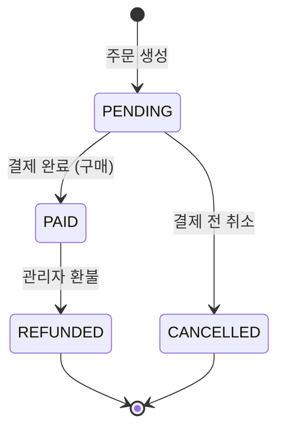
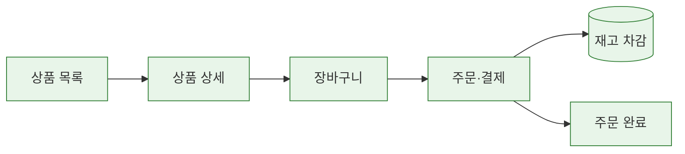
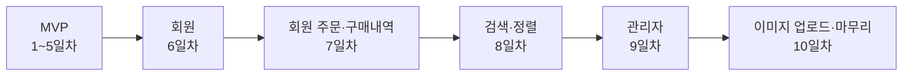

# 1. 요구사항 명세서

> 이 문서는 "무엇을 만들 것인가"를 정리한 문서입니다. 실습 첫날(1일차) 이 문서를 같이 읽으면서 시작합니다.
> 개발은 코드를 치기 전에 **무엇을 만들지 먼저 글로 정하는 것**에서 시작합니다.

---

## 1. 프로젝트 개요

| 항목 | 내용 |
|---|---|
| 프로젝트 이름 | miniShop (음료 쇼핑몰) |
| 한 줄 설명 | 음료를 골라 장바구니에 담고, 회원으로 주문·결제하고, 구매내역을 확인하는 작은 쇼핑몰 |
| 만드는 사람 | 수강생 (실습) |
| 만드는 기간 | 10일 (하루 8시간) |
| 실행 환경 | 내 컴퓨터(로컬). 배포는 다루지 않는다 |
| 학습 목표 | 기능 하나를 **DB → 서버(API) → 화면** 순서로 끝까지 만들어 보는 개발 과정을 경험한다 |

### 왜 쇼핑몰인가

쇼핑몰에는 웹 서비스의 핵심 요소가 거의 다 들어 있습니다.

- 데이터를 **보여 주는** 기능 (상품 목록, 상세)
- 데이터를 **저장하는** 기능 (주문, 회원가입)
- 누가 하는지 **확인하는** 기능 (로그인)
- 같은 것을 여러 명이 동시에 사면 어떻게 되는지 (재고)
- 일반 사용자와 관리자의 **권한 차이**

---

## 2. 용어 정리

혼동하기 쉬운 용어를 아래처럼 **정확하게** 구분해서 씁니다. 코드의 상태값(`status`)과 연결됩니다.

| 용어 | 뜻 | DB 상태값 |
|---|---|---|
| 주문 | 결제하기 **전**의 임시 상태 | `PENDING` |
| 구매 | 결제가 **끝난** 주문 (환불된 것은 구매가 아님) | `PAID` |
| 환불 | 구매를 취소하고 돈을 돌려준 상태 | `REFUNDED` |
| 취소 | 결제 전에 주문을 없앤 상태 | `CANCELLED` |
| 구매내역 | 내가 산 것의 목록. **`PAID` 만** 나온다 | |
| 판매중지 | 상품을 삭제하지 않고 화면에서만 숨긴 상태 | `products.is_active = 0` |

> 이 프로젝트의 `POST /orders` 는 주문과 결제를 한 번에 처리하므로, 만들어지자마자 `PAID` 가 됩니다.
> (실제 결제 회사(PG)와 연결하지 않기 때문입니다.)

---

## 3. 사용자 유형

| 유형 | 할 수 있는 일 |
|---|---|
| 방문자 (로그인 전) | 상품 목록/검색/상세 보기, 장바구니 담기, 회원가입, 로그인 |
| 회원 (`USER`) | 방문자가 하는 일 + 주문/결제, 구매내역, 배송지 저장 |
| 관리자 (`ADMIN`) | 회원이 하는 일 + 상품 등록/수정/삭제(판매중지), 이미지 업로드, 전체 주문 조회, 환불 |

---

## 4. 기능 요구사항

**우선순위** 는 두 가지입니다.

- **MVP** : 이것만 있어도 "쇼핑몰이다"라고 말할 수 있는 최소 기능. **먼저** 만든다.
- **확장** : MVP가 동작한 뒤에 하나씩 덧붙이는 기능.

### 4-1. 상품 (카탈로그)

| ID | 요구사항 | 우선순위 | 일차 |
|---|---|---|---|
| FR-01 | 판매 중인 상품의 목록을 이미지·이름·가격·재고와 함께 보여 준다 | MVP | 2 |
| FR-02 | 상품을 누르면 상세 화면(이미지 여러 장, 설명, 가격, 수량 선택)을 보여 준다 | MVP | 3 |
| FR-03 | 판매중지(`is_active=0`) 상품은 목록과 상세에 나오지 않는다 | MVP | 2 |
| FR-04 | 품절(재고 0) 상품은 "품절"로 표시하고 담을 수 없다 | MVP | 2~3 |
| FR-05 | 카테고리 버튼으로 상품을 걸러 본다 | 확장 | 8 |
| FR-06 | 상품명 검색(1차)과 결과 안에서 다시 검색(2차)을 할 수 있다 | 확장 | 8 |
| FR-07 | 추천순 / 판매 인기순 / 신규순 / 낮은 가격순 / 높은 가격순으로 정렬한다 | 확장 | 8 |
| FR-08 | 목록을 12개씩 나누어 보여 준다 (페이지 번호) | 확장 | 8 |

### 4-2. 장바구니

| ID | 요구사항 | 우선순위 | 일차 |
|---|---|---|---|
| FR-10 | 상세 화면에서 수량을 골라 장바구니에 담는다 | MVP | 3 |
| FR-11 | 장바구니에서 수량 변경, 개별 삭제, 선택 삭제를 할 수 있다 | MVP | 3 |
| FR-12 | 장바구니는 새로고침해도 유지된다 (브라우저 `localStorage`) | MVP | 3 |
| FR-13 | 헤더의 🛒 배지에 담은 상품 수를 보여 준다 | MVP | 3 |

### 4-3. 주문·결제

| ID | 요구사항 | 우선순위 | 일차 |
|---|---|---|---|
| FR-20 | 장바구니(또는 "구매하기")에서 선택한 상품을 주문한다 | MVP | 4 |
| FR-21 | 결제하면 구매 수량만큼 재고가 줄어든다 | MVP | 4 |
| FR-22 | 재고가 부족하면 주문이 실패하고 아무것도 바뀌지 않는다 (전부 성공 or 전부 취소) | MVP | 4 |
| FR-23 | 여러 명이 동시에 사도 재고가 0 밑으로 내려가지 않는다 | MVP | 5 |
| FR-24 | 결제 금액은 서버가 DB의 가격으로 계산한다 (화면이 보낸 금액을 믿지 않는다) | MVP | 4 |
| FR-25 | 결제가 끝나면 주문 완료 화면을 보여 준다 | MVP | 4 |
| FR-26 | 배송지(받는 사람, 연락처, 주소, 요청사항)를 입력한다. 주소는 우편번호 검색을 쓴다 | 확장 | 7 |
| FR-27 | 입력한 배송지를 내 배송지로 저장한다 (기본 배송지) | 확장 | 7 |

### 4-4. 회원

| ID | 요구사항 | 우선순위 | 일차 |
|---|---|---|---|
| FR-30 | 이메일로 6자리 인증 코드를 받아 이메일 주인임을 확인한다 | 확장 | 6 |
| FR-31 | 인증된 이메일로 가입한다 (이메일, 비밀번호, 이름) | 확장 | 6 |
| FR-32 | 이메일·비밀번호로 로그인한다 (토큰 발급, 12시간 유효) | 확장 | 6 |
| FR-33 | 새로고침해도 로그인이 유지된다 | 확장 | 6 |
| FR-34 | 로그인해야 주문할 수 있다. 로그인 안 했으면 로그인 화면으로 보낸다 | 확장 | 7 |
| FR-35 | 비밀번호를 잊었을 때 이메일 코드로 재설정한다 | 선택 | 10 |

### 4-5. 구매내역

| ID | 요구사항 | 우선순위 | 일차 |
|---|---|---|---|
| FR-40 | 내가 구매한(PAID) 주문만 최근순으로 보여 준다. 환불된 주문은 나오지 않는다 | 확장 | 7 |
| FR-41 | 기간(1개월/3개월/6개월/1년)으로 거른다 | 확장 | 7 |
| FR-42 | 주문을 펼치면 상품 목록과 배송지를 보여 준다 | 확장 | 7 |

### 4-6. 관리자

| ID | 요구사항 | 우선순위 | 일차 |
|---|---|---|---|
| FR-50 | 관리자만 관리자 화면(`/manage`)과 관리자 API에 접근한다 (일반 회원은 403) | 확장 | 9 |
| FR-51 | 상품을 등록·수정한다 (이름, 가격, 재고, 카테고리, 설명, 추천 여부) | 확장 | 9 |
| FR-52 | 상품을 "삭제"하면 판매중지로 바뀐다 (지난 주문 내역을 지키기 위해 행을 지우지 않는다) | 확장 | 9 |
| FR-53 | 전체 주문을 상태·검색어로 조회하고 상세를 본다 | 확장 | 9 |
| FR-54 | 구매(PAID)를 환불 처리하면 재고가 되돌아온다 | 확장 | 9 |
| FR-55 | 상품 이미지를 올린다 (대표 3장, 상세 10장). 서버가 크기를 줄이고 썸네일을 만든다 | 확장 | 10 |

---

## 5. 화면 목록

| 화면 | 주소 | 로그인 | 일차 |
|---|---|---|---|
| 상품 목록 | `/` | 불필요 | 2 |
| 상품 상세 | `/product/:id` | 불필요 | 3 |
| 장바구니 | `/cart` | 불필요 | 3 |
| 주문·결제 | `/checkout` | 4일차 불필요 → 7일차부터 필요 | 4 |
| 주문 완료 | `/order-complete` | 필요(7일차~) | 4 |
| 로그인 | `/login` | | 6 |
| 회원가입 | `/signup` | | 6 |
| 비밀번호 재설정 | `/password-reset` | | 10 |
| 구매내역 | `/mypage/purchases` | 필요 | 7 |
| 관리자 - 상품 관리 | `/manage/products` | 관리자 | 9 |
| 관리자 - 상품 등록/수정 | `/manage/products/new`, `/manage/products/:id/edit` | 관리자 | 9~10 |
| 관리자 - 주문 관리 | `/manage/orders` | 관리자 | 9 |

> 화면 주소는 서버 API 주소(`/products`, `/orders`, `/purchases` …)와 **겹치지 않게** 정했습니다.
> 겹치면 개발 서버의 프록시가 화면 요청을 서버로 보내 버리기 때문입니다. (2일차에 설명합니다)

---

## 6. 업무 규칙 (코드가 지켜야 하는 약속)

| ID | 규칙 | 이유 |
|---|---|---|
| BR-01 | 가격·합계는 **서버가** DB 값으로 계산한다. 화면이 보낸 가격은 받지 않는다 | 브라우저는 누구나 조작할 수 있다 |
| BR-02 | 재고 확인과 차감은 **한 문장의 SQL**로 한다 (`UPDATE ... WHERE stock >= 수량`) | 동시에 주문해도 재고가 음수가 되지 않게 |
| BR-03 | 주문의 여러 단계(재고 차감, 주문 저장, 상품 저장)는 **한 트랜잭션**이다. 하나라도 실패하면 전부 되돌린다 | 재고만 줄고 주문은 없는 상태 방지 |
| BR-04 | 한 상품의 주문 수량은 1~99개이다 | 오입력·악용 방지 |
| BR-05 | 판매중지 상품은 목록·검색·상세·주문에서 모두 제외한다 | |
| BR-06 | 상품은 행을 지우지 않고 `is_active=0` 으로 바꾼다 | 지난 주문(order_items)이 상품을 참조한다 |
| BR-07 | `order_items.unit_price` 에 **주문 당시 가격**을 저장한다 | 나중에 가격이 바뀌어도 지난 주문 금액은 그대로 |
| BR-08 | 주문의 배송지는 주문 시점의 값을 `orders` 에 **복사**해 저장한다 | 회원이 배송지를 고쳐도 지난 주문은 그대로 |
| BR-09 | 구매내역은 `PAID` 만, 기간은 결제 시각(`paid_at`) 기준 | 환불된 주문은 소유권이 없다 |
| BR-10 | 환불하면 구매 수량만큼 재고를 되돌리고 상태를 `REFUNDED` 로 바꾼다. 이미 환불된 주문은 다시 환불할 수 없다(409) | |
| BR-11 | 비밀번호는 원문을 저장하지 않는다 (scrypt 해시). 8자 이상, 영문+숫자 포함 | 유출돼도 원문이 드러나지 않게 |
| BR-12 | 이메일 인증 코드: 6자리, 5분 유효, 60초 뒤 재발송, 5회까지 입력 시도, 인증 후 30분 안에 가입 | 무작위 대입 공격 방지 |
| BR-13 | 로그인 실패 시 "이메일 또는 비밀번호가 올바르지 않습니다"로만 알려 준다 (어느 쪽이 틀렸는지 알려 주지 않는다) | 가입 여부 노출 방지 |
| BR-14 | 이미지는 JPG/PNG/WEBP, 2MB 이하만. 확장자가 아니라 **파일 내용**으로 판단하고, 파일 이름은 서버가 정한다 | 위장 파일, 경로 조작 방지 |

---

## 7. 비기능 요구사항

| 구분 | 요구사항 |
|---|---|
| 보안 | SQL 은 `%s` 파라미터 바인딩으로만 값을 넣는다 (SQL 인젝션 방지) |
| 보안 | 관리자 API는 서버에서 권한을 확인한다 (화면에서 버튼을 숨기는 것만으로는 부족) |
| 보안 | 비밀번호·DB 접속 정보·JWT 비밀키는 `.env` 에 두고 깃허브에 올리지 않는다 |
| 성능 | 목록 정렬에 쓰는 컬럼에는 인덱스를 둔다 |
| 사용성 | 로딩 중, 오류, 결과 없음 상태를 화면에 각각 보여 준다 |
| 유지보수 | 기능별로 파일을 나눈다 (`product.py`, `order.py`, `auth.py` …) |

---

## 8. 범위 밖 (이번 실습에서 하지 않는 것)

| 항목 | 이유 |
|---|---|
| 실제 결제(PG) 연동 | "결제하기" 버튼으로 구매를 확정하는 것으로 대신한다 |
| 쿠폰, 적립금 | 화면에 가상 값만 보여 준다 |
| 상품평(리뷰) | 데이터가 없어 "상품평 많은순" 정렬은 만들지 않았다 |
| 배포 (서버에 올리기) | 로컬에서만 실행한다 |
| 간편 로그인 (구글 등) | "준비 중" 버튼만 있다 |
| 회원 직접 환불/취소 | 환불은 관리자만 처리한다 |
| 배송지 관리 화면 | 주문할 때 자동 저장만 한다 |

---

## 9. MVP 정의 (먼저 만드는 범위)

> **MVP = 상품을 보고(FR-01~04) → 장바구니에 담고(FR-10~13) → 주문하면 재고가 줄어든다(FR-20~25).**

MVP는 **1~5일차**에 완성합니다. 이후 확장 기능은 아래 순서로 덧붙입니다.

이렇게 나누는 이유:

1. **1주 안에 "돌아가는 쇼핑몰"을 본다** → 이후 동기가 생긴다.
2. 회원 기능은 **주문 기능이 먼저 있어야** 필요성이 보인다 ("누가 샀는지 알아야 하네").
3. 검색·정렬·관리자는 있으면 좋지만, 없어도 쇼핑몰은 돌아간다.
