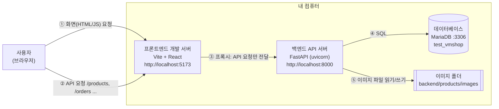
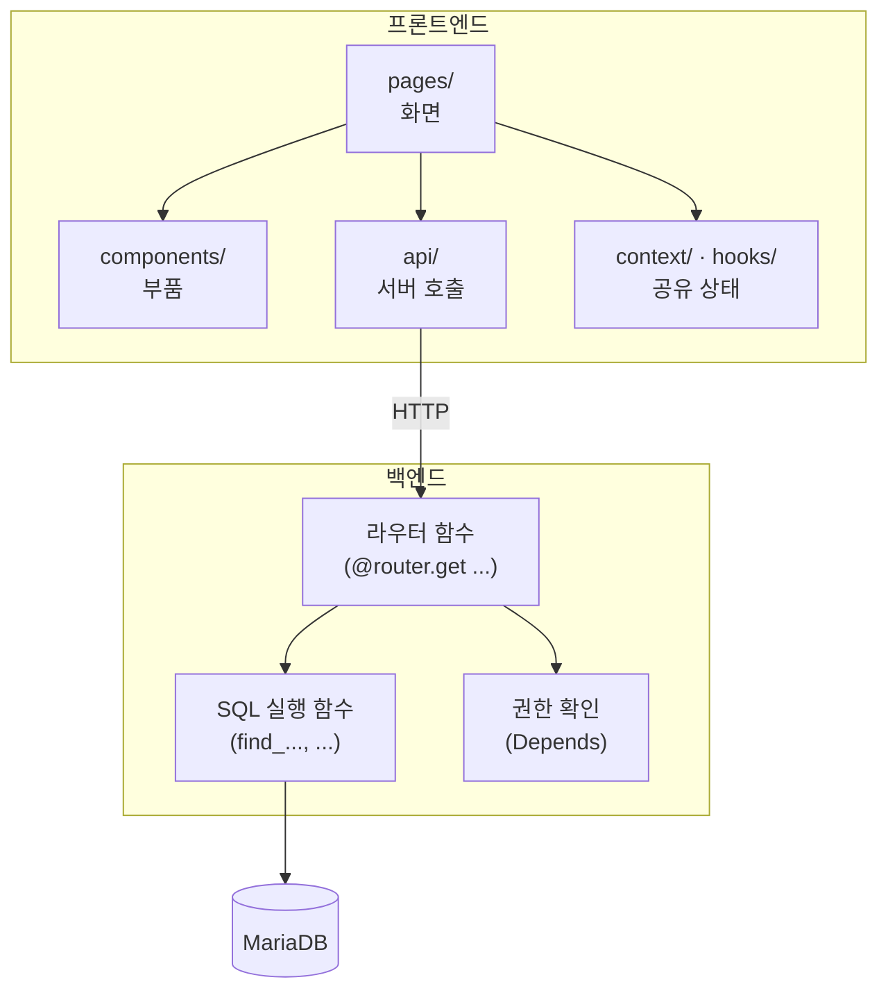
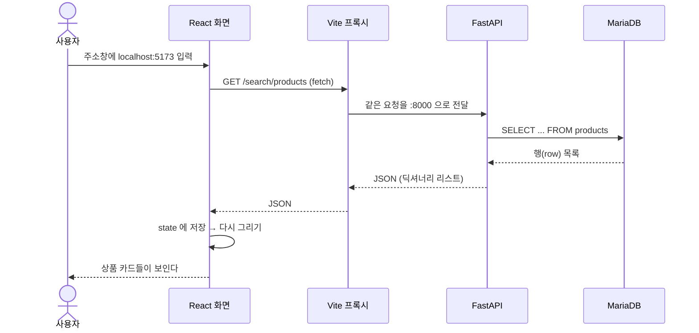
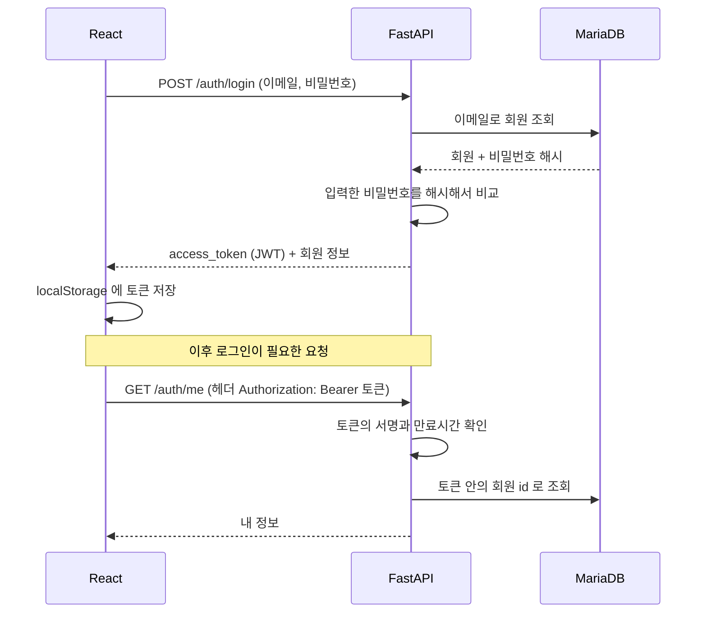
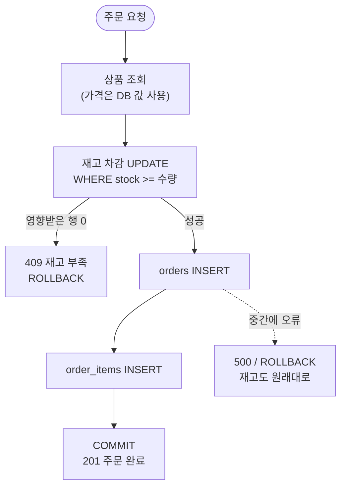
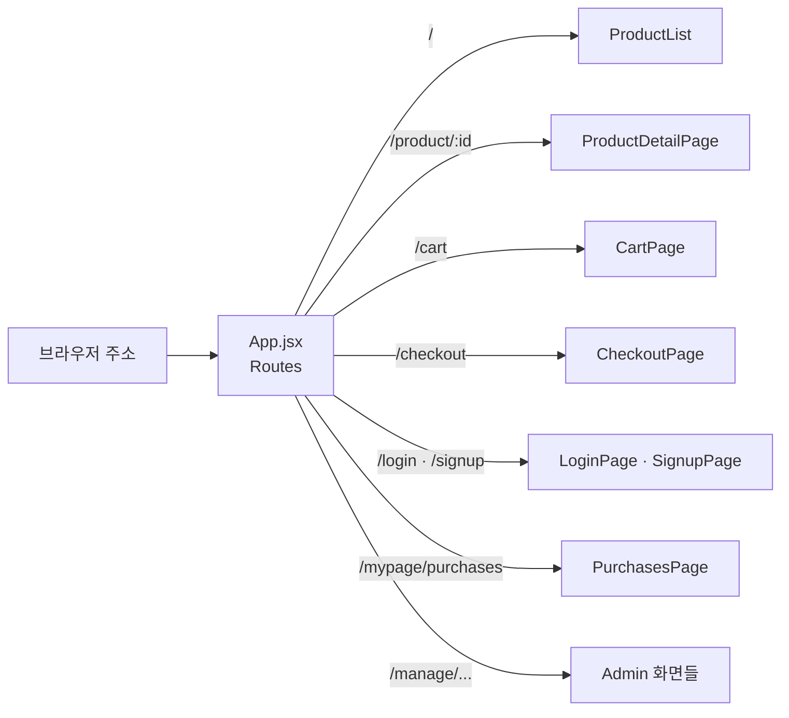
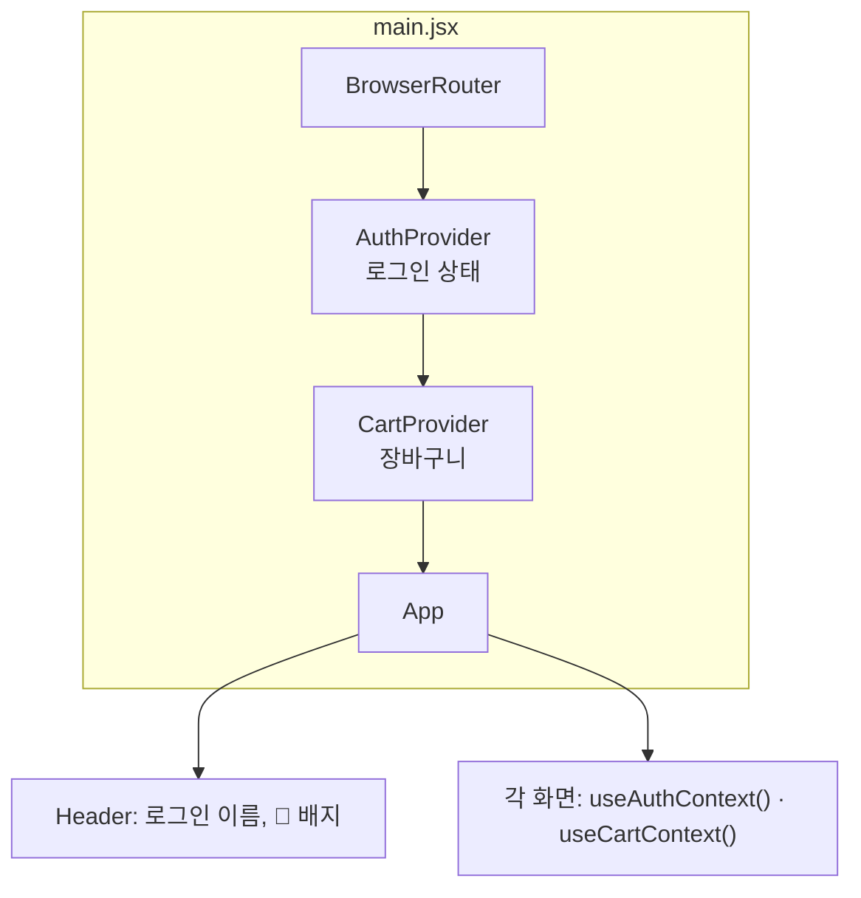
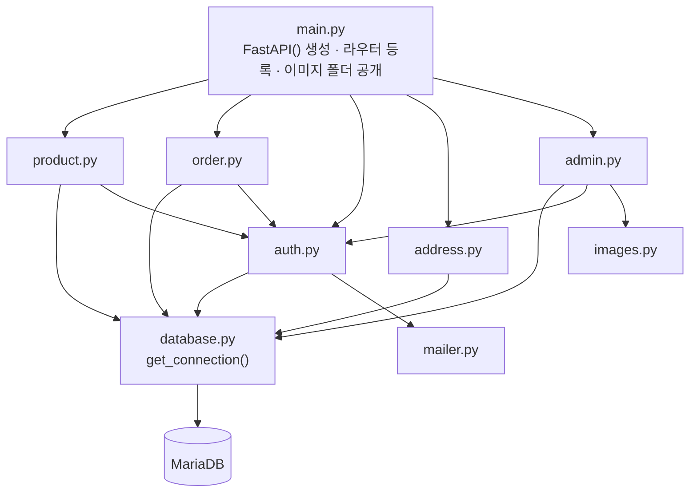

# 2. 시스템 구조 및 기술스택

---

## 1. 한 장으로 보는 전체 구조

내 컴퓨터 안에서 **프로그램 3개**가 따로 실행되고, 서로 요청을 주고받습니다.



| 프로그램 | 하는 일 | 비유 |
|---|---|---|
| 프론트엔드 (React) | 화면을 그리고, 버튼을 누르면 서버에 요청한다 | 식당의 **홀** (손님이 보는 곳) |
| 백엔드 (FastAPI) | 요청을 받아 규칙을 확인하고 DB를 읽고 쓴다 | 식당의 **주방장** |
| 데이터베이스 (MariaDB) | 데이터를 저장한다 | 식당의 **창고·장부** |

> 브라우저는 DB에 **직접 접근하지 않습니다.** 반드시 백엔드를 거칩니다. 그래야 "가격은 서버가 정한다", "관리자만 가능" 같은 규칙을 지킬 수 있습니다.

---

## 2. 기술 스택

| 영역 | 기술 | 버전(완성본 기준) | 쓰는 이유 |
|---|---|---|---|
| 언어 | Python | 3.11 이상 (3.12 사용) | 이미 배운 언어 |
| 백엔드 프레임워크 | FastAPI | 0.162 | 함수 하나가 API 하나. 자동 문서(`/docs`)가 있어 실습에 좋다 |
| 서버 실행기 | uvicorn | 0.54 | FastAPI 앱을 실제로 띄운다 |
| DB 접속 | PyMySQL | 1.2 | 파이썬에서 SQL 을 실행한다 |
| 환경 변수 | python-dotenv | 1.2 | `.env` 파일의 비밀 설정을 읽는다 |
| 파일 업로드 | python-multipart | 0.0.33 | 이미지 파일을 받는다 (10일차) |
| 이미지 처리 | Pillow | 13 | 이미지 검증·크기 줄이기 (10일차) |
| 데이터베이스 | MariaDB | 10.x 이상 | 이미 설치되어 있음 |
| 프론트엔드 | React | 19 | 이미 배운 라이브러리 |
| 화면 이동 | react-router-dom | 7 | 주소(URL)에 따라 화면을 바꾼다 (3일차) |
| 개발 서버/빌드 | Vite | 8 | 빠른 개발 서버, API 프록시 |
| 우편번호 | 다음(Daum) 우편번호 서비스 | 외부 스크립트 | 주소 검색 (7일차) |
| 메일 | Gmail SMTP | | 이메일 인증 코드 발송 (6일차) |

### 패키지는 "필요할 때" 설치합니다

처음부터 전부 설치하지 않습니다. 기능을 만들다가 **"이게 필요하구나"** 할 때 설치합니다.

| 일차 | 백엔드 `pip install` | 프론트 `npm install` |
|---|---|---|
| 1 | `fastapi` `uvicorn` | (Vite 템플릿이 react 를 설치) |
| 2 | `pymysql` `python-dotenv` | |
| 3 | | `react-router-dom` |
| 4~5 | | |
| 6 | | |
| 10 | `python-multipart` `pillow` | |

> 회원 기능(6일차)에는 새 패키지가 필요 없습니다. 비밀번호 해시(`hashlib.scrypt`)와 토큰(JWT) 만들기, 메일 발송(`smtplib`)을 모두 **파이썬 기본 기능**으로 구현했기 때문입니다. "라이브러리 없이도 원리를 이해할 수 있다"를 보여 주는 부분입니다.

---

## 3. 폴더 구조 (완성본)

```text
miniShop_ver1.0/
├─ backend/
│  ├─ app/
│  │  ├─ main.py        앱 시작점: 라우터 등록, 이미지 폴더 공개
│  │  ├─ database.py    DB 연결 함수
│  │  ├─ product.py     상품 API (목록/상세/검색/등록/수정/삭제)
│  │  ├─ order.py       주문·구매 API
│  │  ├─ auth.py        회원 API (이메일 인증, 가입, 로그인, 권한 확인)
│  │  ├─ address.py     배송지 API
│  │  ├─ admin.py       관리자 API (상품/주문 관리, 환불, 이미지 저장)
│  │  ├─ images.py      이미지 업로드 처리
│  │  └─ mailer.py      이메일 발송
│  ├─ products/images/  상품 이미지 파일
│  ├─ sql/              DB 만드는 SQL
│  ├─ .env              비밀 설정 (깃에 올리지 않음)
│  └─ requirements.txt  필요한 패키지 목록
└─ frontend/
   ├─ vite.config.js    개발 서버 설정 (프록시)
   └─ src/
      ├─ main.jsx       React 시작점
      ├─ App.jsx        주소 → 화면 연결표(라우팅)
      ├─ api/           서버 호출 함수 모음
      ├─ pages/         화면 한 장 단위 (ProductList, CartPage ...)
      ├─ components/    여러 화면이 같이 쓰는 부품 (ProductCard, Dialog)
      ├─ layout/        머리글/바닥글/카테고리 메뉴
      ├─ context/       앱 전체가 공유하는 상태 (로그인, 장바구니)
      ├─ hooks/         상태 로직 모음 (useCart)
      └─ utils/         작은 도구 함수
```

### 파일을 나누는 기준



---

## 4. 요청 하나가 지나가는 길

"상품 목록 보기"를 예로 들면 다음과 같습니다.



### 왜 프록시를 쓰나요? (CORS)

브라우저는 **주소(포트)가 다른 서버**에 요청하면 보안상 막습니다. (이것을 CORS 라고 합니다)
화면은 `:5173`, API는 `:8000` 이라 서로 다른 주소입니다.

Vite 개발 서버가 `/products`, `/orders` … 로 시작하는 요청만 `:8000` 으로 **대신 전달**해 주면, 브라우저 입장에서는 같은 주소(`:5173`)로만 통신하므로 문제가 없습니다.

| 요청 주소 | 처리하는 곳 |
|---|---|
| `/` , `/cart`, `/product/3` ... (화면) | Vite → React 가 화면을 그린다 |
| `/products/3`, `/orders`, `/auth/login` ... (API) | Vite 가 FastAPI 로 전달 |

> 그래서 **화면 주소와 API 주소가 겹치면 안 됩니다.** 화면 주소를 `/product/3`(단수), API 를 `/products/3`(복수)로 나눈 이유입니다.

---

## 5. 로그인(JWT) 흐름

서버는 "누가 요청했는지" 기억하지 않습니다. 대신 로그인할 때 **입장권(토큰)** 을 주고, 이후 요청마다 입장권을 같이 받아 확인합니다.



**JWT 는 점(.)으로 나뉜 3조각**입니다: `헤더.내용.서명`

- 내용에는 `회원 id`, `권한(role)`, `만료시각`이 들어 있습니다. (누구나 읽을 수 있다 → 비밀번호 같은 건 넣지 않는다)
- 서명은 서버의 비밀키(`JWT_SECRET`)로 만듭니다. 내용을 바꾸면 서명이 맞지 않아 서버가 거부합니다.

---

## 6. 주문 처리의 안전장치

주문은 이 프로젝트에서 **가장 중요한 코드**입니다. 아래 세 가지를 지킵니다.



| 장치 | 지키는 것 |
|---|---|
| 조건부 UPDATE | 동시에 주문해도 재고가 음수가 되지 않는다 (5일차에 직접 실험) |
| 트랜잭션 | 중간에 실패하면 재고 차감까지 전부 되돌린다 |
| 서버 계산 | 화면이 조작된 금액을 보내도 영향이 없다 |

---

## 7. 프론트엔드 구조

### 화면(라우팅)

`App.jsx` 는 "주소 → 화면" 연결표입니다.



### 앱 전체가 공유하는 상태



- **장바구니**: `useCart` 훅 → `CartProvider` 가 한 번만 만들고, 헤더·상세·장바구니 화면이 같이 씁니다. 브라우저 `localStorage` 에 저장해서 새로고침해도 유지됩니다.
- **로그인**: `AuthProvider` 가 토큰과 회원 정보를 들고 있습니다.

---

## 8. 백엔드 구조



- `auth.py` 의 `get_current_user`(로그인 확인)와 `require_admin`(관리자 확인)을 다른 파일이 가져다 씁니다.
  함수 파라미터에 `user = Depends(get_current_user)` 한 줄만 쓰면 **그 API 는 로그인이 필수**가 됩니다.

### 라우터가 하는 일 한 줄 요약

| 파일 | 담당 | 대표 주소 |
|---|---|---|
| `product.py` | 상품 조회·검색, 관리자용 등록/수정/삭제 | `/products`, `/search/products` |
| `order.py` | 주문(구매), 내 주문, 구매내역 | `/orders`, `/purchases` |
| `auth.py` | 이메일 인증, 가입, 로그인, 내 정보, 비밀번호 재설정 | `/auth/...` |
| `address.py` | 내 배송지 목록/기본 지정/삭제 | `/addresses` |
| `admin.py` | 관리자용 상품·주문 목록, 환불, 이미지 저장 | `/admin/...` |

---

## 9. API 전체 목록

| 메서드 | 주소 | 설명 | 권한 | 일차 |
|---|---|---|---|---|
| GET | `/` | 서버 동작 확인 | 누구나 | 1 |
| GET | `/products` | 상품 목록 (판매중, 가격순) | 누구나 | 2 |
| GET | `/products/{id}` | 상품 상세 + 이미지 | 누구나 | 3 |
| POST | `/orders` | 주문(구매) | 4일차 누구나 → 7일차부터 로그인 | 4 |
| POST | `/auth/email/send` | 인증 코드 메일 발송 | 누구나 | 6 |
| POST | `/auth/email/verify` | 인증 코드 확인 | 누구나 | 6 |
| POST | `/auth/signup` | 회원가입 | 누구나 | 6 |
| POST | `/auth/login` | 로그인 (토큰 발급) | 누구나 | 6 |
| GET | `/auth/me` | 내 정보 | 로그인 | 6 |
| GET | `/orders`, `/orders/{id}` | 내 주문 목록/상세 | 로그인 | 7 |
| GET | `/purchases` | 구매내역 (PAID, 기간) | 로그인 | 7 |
| GET/PUT/DELETE | `/addresses...` | 배송지 | 로그인 | 7 |
| GET | `/search/products` | 검색·정렬·페이지 | 누구나 | 8 |
| GET | `/search/categories` | 카테고리 목록 | 누구나 | 8 |
| GET | `/search/sort-options` | 정렬 옵션 목록 | 누구나 | 8 |
| POST/PUT/DELETE | `/products...` | 상품 등록/수정/판매중지 | 관리자 | 9 |
| GET | `/admin/products`, `/admin/orders` ... | 관리자 목록·상세 | 관리자 | 9 |
| POST | `/admin/orders/{id}/refund` | 환불 | 관리자 | 9 |
| PUT | `/admin/products/{id}/images` | 이미지 저장 | 관리자 | 10 |
| POST | `/auth/password/send`, `/auth/password/reset` | 비밀번호 재설정 | 누구나 | 10 |

> 서버를 켜고 `http://localhost:8000/docs` 에 들어가면 이 목록이 **자동으로** 만들어져 있고, 화면에서 바로 호출해 볼 수 있습니다. (FastAPI의 큰 장점)

---

## 10. 보안 체크리스트 (코드에서 어디에 있나)

| 위협 | 대응 | 코드 위치 |
|---|---|---|
| SQL 인젝션 | `%s` 바인딩, 정렬은 화이트리스트(`ORDER_BY_SQL`) | `product.py` 전체 |
| 비밀번호 유출 | scrypt 해시 + 무작위 salt | `auth.py` `hash_password` |
| 토큰 위조 | HMAC-SHA256 서명 + 만료 시각 | `auth.py` `create_token`, `decode_token` |
| 권한 없는 접근 | 서버에서 `require_admin` 확인 | `auth.py`, `admin.py` |
| 가격 조작 | 서버가 DB 가격으로 계산 | `order.py` `create_order` |
| 인증 코드 무작위 대입 | 5회 제한, 5분 만료, 해시 저장 | `auth.py` `verify_code` |
| 위장 이미지 | 파일 내용 검사, 이름은 서버가 정함 | `images.py` |
| 비밀 노출 | `.env` + `.gitignore` | `database.py`, `.gitignore` |
