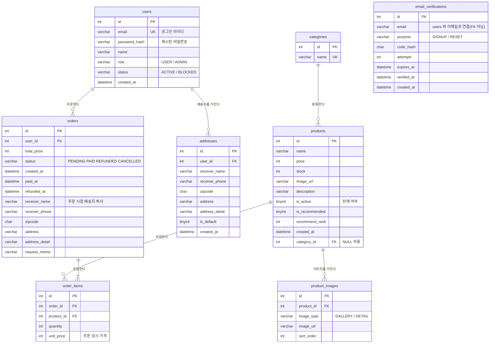
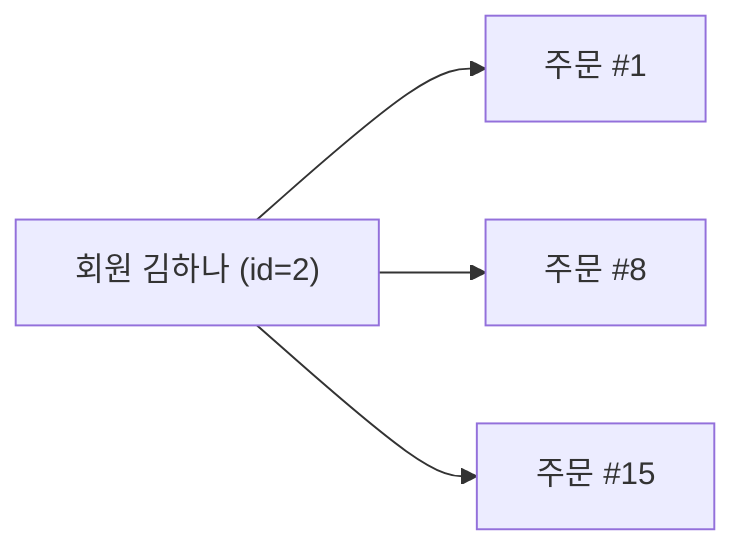
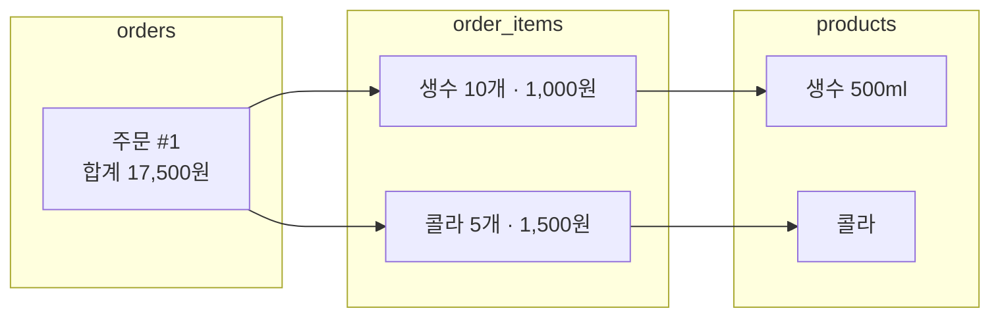
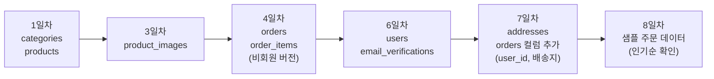

# 3. DB E-R 다이어그램

> ER 다이어그램은 **"어떤 데이터를 어느 표(테이블)에 나눠 담고, 표들이 어떻게 이어지는지"** 를 그린 설계도입니다.
> 테이블 하나하나의 컬럼 설명은 [4. 테이블 설명과 SQL](04_tables_and_sql.md) 에 있습니다.

---

## 1. 전체 ER 다이어그램

### 선(관계) 읽는 법

| 표기 | 뜻 | 예 |
|---|---|---|
| `\|\|--o{` | **1 대 0개 이상** | 회원 1명은 주문을 0개 이상 가진다 |
| `\|\|--\|{` | **1 대 1개 이상** | 주문 1건은 주문상품을 반드시 1개 이상 가진다 |
| PK | Primary Key (기본키) | 행을 구분하는 번호. 중복 불가 |
| FK | Foreign Key (외래키) | 다른 테이블의 PK 를 가리키는 번호 |
| UK | Unique Key | 중복 불가 (이메일이 같은 회원 2명 불가) |

---

## 2. 핵심 관계 3가지

### ① 회원 1 : 주문 N

`orders.user_id` 가 `users.id` 를 가리킵니다. "한 회원의 주문 모두 보기" = `WHERE user_id = 2`.

### ② 주문 1 : 주문상품 N : 상품 1 (다대다를 풀어낸 구조)

주문과 상품은 **다대다** 관계입니다. (한 주문에 여러 상품, 한 상품이 여러 주문에)
DB 에서는 다대다를 직접 표현할 수 없어서, 가운데에 **연결 테이블 `order_items`** 를 둡니다.

### ③ 카테고리 1 : 상품 N

`products.category_id` 가 `categories.id` 를 가리킵니다. 카테고리가 없는 상품도 있을 수 있어 `NULL` 을 허용합니다.

---

## 3. 설계에서 눈여겨볼 점 (강의 포인트)

| 질문 | 답 | 이유 |
|---|---|---|
| 주문 합계(`total_price`)는 계산하면 되는데 왜 저장하나? | 저장한다 | 주문 당시 금액 기록이 필요하고, 목록에서 매번 계산하면 느리다 |
| `order_items.unit_price` 는 `products.price` 와 중복 아닌가? | 일부러 복사한다 | 나중에 상품 가격이 바뀌어도 **지난 주문 금액은 그대로**여야 한다 |
| `orders` 에 배송지 컬럼을 또 두는 이유는? | 주문 시점 값을 복사 | 회원이 배송지를 고치거나 지워도 지난 주문의 배송지는 그대로여야 한다 |
| 상품을 지우면 안 되나? | `is_active=0` 으로 숨긴다 | `order_items` 가 상품을 참조하므로 행을 지우면 외래키 오류 + 구매내역이 깨진다 |
| `email_verifications` 는 왜 `users` 와 선이 없나? | 가입 **전**에 쓰는 표다 | 아직 회원이 아니므로 `user_id` 가 없다. 이메일 글자로만 연결한다 |
| 비밀번호를 그대로 저장하면? | 절대 안 됨 | DB 가 유출되면 모든 회원의 비밀번호가 노출된다. 해시만 저장한다 |
| `status` 를 숫자가 아닌 글자(`'PAID'`)로 저장한 이유? | 읽기 쉬워서 | SQL 을 봐도 뜻을 알 수 있다. `CHECK` 로 허용 값을 제한한다 |

---

## 4. 테이블이 만들어지는 순서

한꺼번에 만들지 않고 **기능이 필요해지는 순서대로** 늘려 갑니다.
(**외래키가 있는 표는 부모 표가 먼저 있어야** 만들 수 있습니다.)

| 일차 | SQL 파일 | 하는 일 |
|---|---|---|
| 1 | `step-01_catalog.sql` | DB 생성, `categories`, `products` + 기초 데이터 35개 |
| 3 | `step-03_product_images.sql` | `product_images` + 이미지 정보 |
| 4 | `step-04_orders.sql` | `orders`(user_id 없음), `order_items` |
| 6 | `step-06_users.sql` | `users`, `email_verifications` + 테스트 회원 |
| 7 | `step-07_member_orders.sql` | `addresses` 생성, `orders` 에 `user_id`·배송지 컬럼 **ALTER** |
| 8 | `step-08_sample_orders.sql` | 판매 인기순 확인용 샘플 주문 16건 |

> **4일차 → 7일차에 `orders` 가 바뀌는 것**이 중요한 학습 포인트입니다.
> 실무에서는 설계를 완벽하게 끝내고 시작하지 않습니다. 만들면서 "아, 누가 샀는지가 필요하네" 하고 **테이블을 고쳐 나갑니다.**
> 이때 쓰는 명령이 `ALTER TABLE` 입니다.

---

## 5. 인덱스 (찾기를 빠르게)

책의 "찾아보기"처럼, 자주 찾는 컬럼에 인덱스를 만들어 둡니다.

| 테이블 | 인덱스 | 쓰는 곳 |
|---|---|---|
| `users` | `uq_users_email (email)` UNIQUE | 로그인 조회, 이메일 중복 방지 |
| `products` | `(is_active, created_at)` | 신규순 정렬 |
| `products` | `(is_active, price)` | 가격순 정렬 |
| `products` | `(is_active, is_recommended, recommend_rank)` | 추천순 정렬 |
| `product_images` | `uq_pimg_order (product_id, image_type, sort_order)` UNIQUE | 같은 순서 번호 중복 방지 |
| `orders` | `(user_id, status, paid_at)` | 구매내역(내 PAID 주문, 기간) 조회 |
| `email_verifications` | `(email)` | 이메일로 최근 인증 코드 조회 |

> 인덱스는 **읽기는 빠르게, 쓰기는 약간 느리게** 만듭니다. 그래서 "자주 찾는 컬럼"에만 만듭니다.
