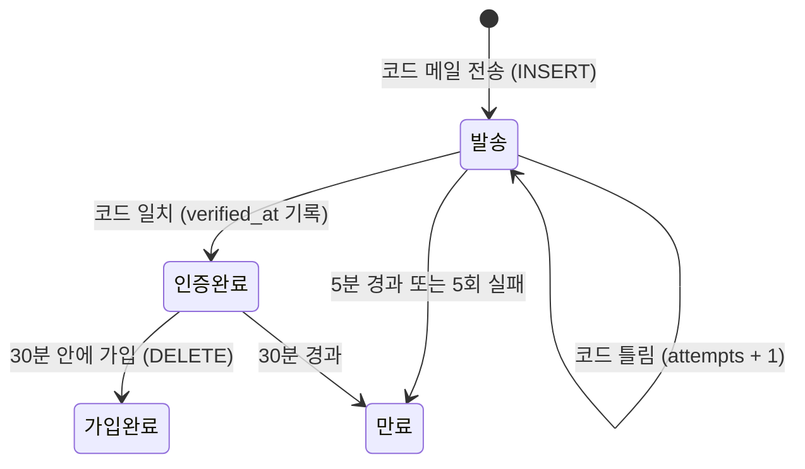

# 4. 테이블 설명과 SQL

> DB 가 **아무것도 없는 상태에서** 시작한다고 가정하고, 만드는 순서대로 정리했습니다.
> 상품 이미지는 현재 프로젝트의 `backend/products/images/` 폴더에 있는 그림 파일을 그대로 씁니다. (DB 에는 파일이 아니라 **경로 글자**만 저장합니다)

---

## 0. 준비 : DB 계정과 접속 확인

MariaDB 는 이미 설치되어 있다고 가정합니다. **관리자(root)** 로 접속해서 이 프로젝트 전용 DB 와 계정을 한 번만 만듭니다.

### 0-1. mysql 접속

```bash
mysql --default-character-set=utf8mb4 -u root -p
```

> `--default-character-set=utf8mb4` 를 붙여야 한글이 깨지지 않습니다.
> `mysql` 명령을 찾을 수 없다고 나오면 MariaDB 설치 폴더의 `bin` 을 Windows 환경 변수 `Path` 에 추가하거나, HeidiSQL 같은 프로그램을 쓰세요.

### 0-2. 전용 계정 만들기

```sql
-- 프로젝트 전용 DB (이미 있으면 건너뜀)
CREATE DATABASE IF NOT EXISTS test_vmshop
  DEFAULT CHARACTER SET utf8mb4
  COLLATE utf8mb4_general_ci;

-- 전용 계정 (비밀번호는 각자 정한다. 이 값을 backend/.env 의 DB_PASSWORD 에 쓴다)
CREATE USER IF NOT EXISTS 'vmshop_user'@'localhost' IDENTIFIED BY '여기에_비밀번호';

-- 이 DB 안에서만 모든 권한을 준다 (다른 DB 는 건드릴 수 없다)
GRANT ALL PRIVILEGES ON test_vmshop.* TO 'vmshop_user'@'localhost';
FLUSH PRIVILEGES;
```

> **왜 root 로 직접 쓰지 않나요?** 앱이 해킹되거나 코드에 실수가 있어도 피해를 이 DB 하나로 제한하기 위해서입니다. "최소 권한 원칙"입니다.

### 0-3. 접속 확인

```bash
mysql --default-character-set=utf8mb4 -u vmshop_user -p test_vmshop
```

```sql
SELECT DATABASE();      -- test_vmshop 이 나오면 성공
```

### 0-4. SQL 파일 실행하는 방법

이 폴더의 `sql/` 안에 **단계별 SQL 파일**이 있습니다. mysql 에 접속한 상태에서 `source` 로 실행하는 것이 가장 안전합니다.

```sql
source F:/simple/AX_working/miniShop_ver1.0/docs/sql/step-01_catalog.sql
```

> 경로는 역슬래시(`\`)가 아니라 **슬래시(`/`)** 로 씁니다. 각자 폴더 위치에 맞게 고치세요.
> 터미널에서 한 줄로 실행하는 방법도 있습니다. (cmd 에서만 동작하고, PowerShell 은 `<` 를 지원하지 않습니다)
> `mysql --default-character-set=utf8mb4 -u vmshop_user -p < docs\sql\step-01_catalog.sql`

---

## 1. 단계별 SQL 파일

| 일차 | 파일 | 만드는 것 |
|---|---|---|
| 1 | `sql/step-01_catalog.sql` | `categories`, `products` + 카테고리 7개, 상품 35개, 대표 이미지 경로 |
| 3 | `sql/step-03_product_images.sql` | `product_images` + 상품별 이미지 정보 |
| 4 | `sql/step-04_orders.sql` | `orders`(비회원 버전), `order_items` |
| 6 | `sql/step-06_users.sql` | `users`, `email_verifications` + 테스트 회원 8명 |
| 7 | `sql/step-07_member_orders.sql` | `addresses`, `orders` 에 회원·배송지 컬럼 추가 |
| 8 | `sql/step-08_sample_orders.sql` | 인기순 확인용 샘플 주문 |

> 모든 파일은 **여러 번 실행해도 됩니다.** (해당 테이블을 지우고 다시 만듭니다.) 실습 중 데이터가 엉망이 되면 해당 단계 파일을 다시 실행하면 됩니다.
> ⚠️ 단, `step-01` 은 **모든 테이블을 지우고 처음부터** 만듭니다. 이미 진행한 단계가 있다면 순서대로 다시 실행해야 합니다.

### 전부 초기화하고 현재 일차까지 복구하는 법

`step-01` → `step-03` → `step-04` → `step-06` → `step-07` → `step-08` 중 **현재 일차까지** 순서대로 실행합니다.
(예: 7일차 도중에 꼬였다면 01, 03, 04, 06, 07 을 차례로 실행)

---

## 2. 테이블 상세

### 2-1. categories (카테고리) — 1일차

**기능** : 상품을 묶는 분류 (탄산, 주스, 물 ...). 상단 카테고리 버튼의 원본이다.

| 컬럼 | 타입 | 용도 | 제약 |
|---|---|---|---|
| `id` | INT | 카테고리 번호 | PK, 자동 증가 |
| `name` | VARCHAR(30) | 카테고리 이름 | NOT NULL, UNIQUE (같은 이름 불가) |

**데이터** : 1 탄산 / 2 주스 / 3 물 / 4 커피 / 5 차 / 6 우유 / 7 기타

```sql
CREATE TABLE categories (
  id   INT         NOT NULL AUTO_INCREMENT,
  name VARCHAR(30) NOT NULL,
  PRIMARY KEY (id),
  UNIQUE KEY uq_categories_name (name)
) ENGINE=InnoDB DEFAULT CHARSET=utf8mb4 COLLATE=utf8mb4_general_ci;
```

---

### 2-2. products (상품) — 1일차

**기능** : 판매하는 상품. 이 프로젝트의 중심 테이블이다.

| 컬럼 | 타입 | 용도 | 제약 / 비고 |
|---|---|---|---|
| `id` | INT | 상품 번호 | PK, 자동 증가 |
| `name` | VARCHAR(50) | 상품 이름 | NOT NULL |
| `price` | INT | 가격(원) | NOT NULL, `CHECK price >= 0` |
| `stock` | INT | 재고 수량 | NOT NULL, 기본 0, `CHECK stock >= 0` ← **음수가 되면 DB 가 거부** |
| `image_url` | VARCHAR(255) | 목록 카드에 쓰는 이미지 경로 | NULL 허용 (없으면 화면이 임시 이미지) |
| `description` | VARCHAR(255) | 상품 설명 | NULL 허용 |
| `is_active` | TINYINT(1) | 판매 여부. 1 판매중 / 0 판매중지 | 기본 1 |
| `is_recommended` | TINYINT(1) | 추천 상품 여부 | 기본 0 (8일차 추천순) |
| `recommend_rank` | INT | 추천 순서 (클수록 위) | 기본 0 |
| `created_at` | DATETIME | 등록 시각 | 기본값 현재 시각 (신규순 정렬) |
| `category_id` | INT | 카테고리 번호 | **FK → categories.id**, NULL 허용 |

```sql
CREATE TABLE products (
  id             INT          NOT NULL AUTO_INCREMENT,
  name           VARCHAR(50)  NOT NULL,
  price          INT          NOT NULL,
  stock          INT          NOT NULL DEFAULT 0,
  image_url      VARCHAR(255) DEFAULT NULL,
  description    VARCHAR(255) DEFAULT NULL,
  is_active      TINYINT(1)   NOT NULL DEFAULT 1,
  is_recommended TINYINT(1)   NOT NULL DEFAULT 0 COMMENT '추천 상품 여부',
  recommend_rank INT          NOT NULL DEFAULT 0 COMMENT '추천 순서 (클수록 위)',
  created_at     DATETIME     NOT NULL DEFAULT CURRENT_TIMESTAMP,
  category_id    INT          DEFAULT NULL COMMENT '카테고리',
  PRIMARY KEY (id),
  CONSTRAINT chk_products_price CHECK (price >= 0),
  CONSTRAINT chk_products_stock CHECK (stock >= 0),
  CONSTRAINT fk_products_category FOREIGN KEY (category_id) REFERENCES categories (id)
) ENGINE=InnoDB DEFAULT CHARSET=utf8mb4 COLLATE=utf8mb4_general_ci;
```

**기초 데이터의 의도** (`step-01` 의 35개 상품)

| 데이터 | 확인하려는 기능 |
|---|---|
| 재고 0 상품 5개 | 품절 표시, 담기 막기 |
| `is_active=0` 상품 2개 (33, 34번) | 판매중지는 화면에 나오면 안 된다 |
| "100% 오렌지주스", "언더바_테스트 음료" | 검색에서 `%` `_` 가 특수문자로 오작동하지 않는지 (8일차) |
| 카테고리 NULL 상품 (35번) | 분류 없는 상품도 나오는지 |
| 가격 1,000~3,200원 | 가격순 정렬 |

---

### 2-3. product_images (상품 이미지) — 3일차

**기능** : 상세 화면에서 보여 줄 이미지 여러 장. 상품 1개에 이미지 N개.

| 컬럼 | 타입 | 용도 | 제약 |
|---|---|---|---|
| `id` | INT | 이미지 번호 | PK |
| `product_id` | INT | 어느 상품의 이미지인지 | **FK → products.id**, 상품이 지워지면 함께 삭제(`ON DELETE CASCADE`) |
| `image_type` | VARCHAR(10) | `GALLERY`(대표+썸네일) / `DETAIL`(상세 설명 이미지) | `CHECK` 로 두 값만 허용 |
| `image_url` | VARCHAR(255) | 이미지 경로 | NOT NULL |
| `sort_order` | INT | 보여 줄 순서 (작을수록 먼저, 1 = 대표) | UNIQUE(product_id, image_type, sort_order) |

```sql
CREATE TABLE product_images (
  id         INT          NOT NULL AUTO_INCREMENT,
  product_id INT          NOT NULL,
  image_type VARCHAR(10)  NOT NULL DEFAULT 'GALLERY' COMMENT 'GALLERY / DETAIL',
  image_url  VARCHAR(255) NOT NULL,
  sort_order INT          NOT NULL DEFAULT 1         COMMENT '보여 줄 순서 (작을수록 먼저)',
  PRIMARY KEY (id),
  UNIQUE KEY uq_pimg_order (product_id, image_type, sort_order),
  CONSTRAINT fk_pimg_product FOREIGN KEY (product_id) REFERENCES products (id) ON DELETE CASCADE,
  CONSTRAINT chk_pimg_type   CHECK (image_type IN ('GALLERY', 'DETAIL'))
) ENGINE=InnoDB DEFAULT CHARSET=utf8mb4 COLLATE=utf8mb4_general_ci;
```

**이미지 파일 규칙** (현재 프로젝트의 파일 이름)

| 용도 | 경로 | 예 |
|---|---|---|
| 목록 카드 | `/products/images/{이름}.jpg` | `/products/images/cola.jpg` |
| 상세 대표·썸네일 (GALLERY) | `/products/images/{이름}_thumb.jpg`, `_thumb_2.jpg` 또는 `_angle_1.jpg` … | `/products/images/cola_angle_1.jpg` |
| 상세 설명 (DETAIL) | `/products/images/detail/{이름}_detail.jpg` | `/products/images/detail/cola_detail.jpg` |

---

### 2-4. orders (주문) — 4일차 → 7일차에 확장

**기능** : 주문 1건의 "머리말" (합계, 상태, 시각, 배송지). 어떤 상품을 몇 개 샀는지는 `order_items` 에 있다.

#### 4일차 버전 (비회원)

| 컬럼 | 타입 | 용도 |
|---|---|---|
| `id` | INT | 주문 번호 (PK) |
| `total_price` | INT | 주문 합계 금액 |
| `status` | VARCHAR(10) | `PENDING`/`PAID`/`REFUNDED`/`CANCELLED` (`CHECK` 로 제한) |
| `created_at` | DATETIME | 주문 생성 시각 |
| `paid_at` | DATETIME | 결제(구매) 시각. 구매내역 기간 조회 기준 |
| `refunded_at` | DATETIME | 환불 시각 |

#### 7일차에 추가되는 컬럼 (`ALTER TABLE`)

| 컬럼 | 타입 | 용도 |
|---|---|---|
| `user_id` | INT | 구매한 회원. **FK → users.id**, NOT NULL |
| `receiver_name` | VARCHAR(50) | 받는 사람 (주문 시점 값을 복사) |
| `receiver_phone` | VARCHAR(20) | 연락처 |
| `zipcode` | CHAR(5) | 우편번호 |
| `address` | VARCHAR(255) | 주소 |
| `address_detail` | VARCHAR(100) | 상세주소 |
| `request_memo` | VARCHAR(100) | 배송 요청사항 |

```sql
-- 4일차
CREATE TABLE orders (
  id          INT         NOT NULL AUTO_INCREMENT,
  total_price INT         NOT NULL,
  status      VARCHAR(10) NOT NULL DEFAULT 'PENDING',
  created_at  DATETIME    NOT NULL DEFAULT CURRENT_TIMESTAMP,
  paid_at     DATETIME    NULL,
  refunded_at DATETIME    NULL,
  PRIMARY KEY (id),
  KEY idx_orders_created_at (created_at),
  CONSTRAINT chk_orders_status CHECK (status IN ('PENDING', 'PAID', 'REFUNDED', 'CANCELLED'))
) ENGINE=InnoDB DEFAULT CHARSET=utf8mb4 COLLATE=utf8mb4_general_ci;

-- 7일차 : 이미 있는 테이블을 고친다
ALTER TABLE orders
  ADD COLUMN user_id        INT          NOT NULL AFTER id,
  ADD COLUMN receiver_name  VARCHAR(50)  NULL,
  ADD COLUMN receiver_phone VARCHAR(20)  NULL,
  ADD COLUMN zipcode        CHAR(5)      NULL,
  ADD COLUMN address        VARCHAR(255) NULL,
  ADD COLUMN address_detail VARCHAR(100) NULL,
  ADD COLUMN request_memo   VARCHAR(100) NULL,
  ADD KEY idx_orders_user_id (user_id),
  ADD KEY idx_orders_purchase (user_id, status, paid_at),
  ADD CONSTRAINT fk_orders_user FOREIGN KEY (user_id) REFERENCES users (id);
```

---

### 2-5. order_items (주문 상품) — 4일차

**기능** : 주문에 포함된 상품 한 줄 한 줄. (주문 #1 = 생수 10개 + 콜라 5개 → 2행)

| 컬럼 | 타입 | 용도 | 제약 |
|---|---|---|---|
| `id` | INT | 행 번호 | PK |
| `order_id` | INT | 어느 주문의 상품인지 | **FK → orders.id** |
| `product_id` | INT | 어떤 상품인지 | **FK → products.id** |
| `quantity` | INT | 수량 | `CHECK quantity > 0` |
| `unit_price` | INT | **주문 당시 단가** (상품 가격이 바뀌어도 변하지 않음) | NOT NULL |

```sql
CREATE TABLE order_items (
  id         INT NOT NULL AUTO_INCREMENT,
  order_id   INT NOT NULL,
  product_id INT NOT NULL,
  quantity   INT NOT NULL,
  unit_price INT NOT NULL,
  PRIMARY KEY (id),
  KEY fk_items_order (order_id),
  KEY fk_items_product (product_id),
  CONSTRAINT fk_items_order   FOREIGN KEY (order_id)   REFERENCES orders (id),
  CONSTRAINT fk_items_product FOREIGN KEY (product_id) REFERENCES products (id),
  CONSTRAINT chk_items_quantity CHECK (quantity > 0)
) ENGINE=InnoDB DEFAULT CHARSET=utf8mb4 COLLATE=utf8mb4_general_ci;
```

---

### 2-6. users (회원) — 6일차

**기능** : 가입한 회원. 로그인과 권한(일반/관리자)의 원본이다.

| 컬럼 | 타입 | 용도 | 제약 |
|---|---|---|---|
| `id` | INT | 회원 번호 | PK |
| `email` | VARCHAR(100) | 로그인 아이디 | NOT NULL, **UNIQUE** (중복 가입 방지) |
| `password_hash` | VARCHAR(255) | 비밀번호를 해시한 값 (`scrypt$...`) | NOT NULL. **원문은 저장하지 않는다** |
| `name` | VARCHAR(50) | 이름 | NOT NULL |
| `role` | VARCHAR(10) | `USER`(일반) / `ADMIN`(관리자) | 기본 `USER`, `CHECK` |
| `status` | VARCHAR(10) | `ACTIVE`(정상) / `BLOCKED`(이용 제한) | 기본 `ACTIVE`, `CHECK` |
| `created_at` | DATETIME | 가입 시각 | 기본값 현재 시각 |

```sql
CREATE TABLE users (
  id            INT          NOT NULL AUTO_INCREMENT,
  email         VARCHAR(100) NOT NULL,
  password_hash VARCHAR(255) NOT NULL,
  name          VARCHAR(50)  NOT NULL,
  role          VARCHAR(10)  NOT NULL DEFAULT 'USER',
  status        VARCHAR(10)  NOT NULL DEFAULT 'ACTIVE',
  created_at    DATETIME     NOT NULL DEFAULT CURRENT_TIMESTAMP,
  PRIMARY KEY (id),
  UNIQUE KEY uq_users_email (email),
  CONSTRAINT chk_users_role   CHECK (role IN ('USER', 'ADMIN')),
  CONSTRAINT chk_users_status CHECK (status IN ('ACTIVE', 'BLOCKED'))
) ENGINE=InnoDB DEFAULT CHARSET=utf8mb4 COLLATE=utf8mb4_general_ci;
```

**테스트 계정** (비밀번호는 모두 `test1234!`)

| 이메일 | 권한 |
|---|---|
| `admin@test.local` | 관리자 |
| `user1@test.local` ~ `user7@test.local` | 일반 회원 |

> `password_hash` 값 예: `scrypt$16384$8$1$<salt>$<해시>` — 알고리즘, 비용 값, 무작위 salt, 결과가 `$` 로 이어져 있습니다. 같은 비밀번호라도 salt 가 다르면 해시가 달라집니다.

---

### 2-7. email_verifications (이메일 인증) — 6일차

**기능** : 회원가입 전에 "이 이메일이 진짜 본인 것인지" 확인하는 6자리 코드를 임시로 저장한다.

| 컬럼 | 타입 | 용도 |
|---|---|---|
| `id` | INT | PK |
| `email` | VARCHAR(100) | 인증받는 이메일 (인덱스) |
| `purpose` | VARCHAR(10) | `SIGNUP`(가입) / `RESET`(비밀번호 재설정) |
| `code_hash` | CHAR(64) | 6자리 코드의 **해시** (코드 원문은 저장하지 않는다) |
| `attempts` | INT | 코드를 틀린 횟수 (5회까지) |
| `expires_at` | DATETIME | 만료 시각 (발송 후 5분, 인증 후에는 30분으로 연장) |
| `verified_at` | DATETIME | 인증에 성공한 시각 (NULL = 아직 인증 전) |
| `created_at` | DATETIME | 코드 발송 시각 (60초 재발송 제한에 사용) |

```sql
CREATE TABLE email_verifications (
  id          INT          NOT NULL AUTO_INCREMENT,
  email       VARCHAR(100) NOT NULL,
  purpose     VARCHAR(10)  NOT NULL DEFAULT 'SIGNUP',
  code_hash   CHAR(64)     NOT NULL,
  attempts    INT          NOT NULL DEFAULT 0,
  expires_at  DATETIME     NOT NULL,
  verified_at DATETIME     NULL,
  created_at  DATETIME     NOT NULL DEFAULT CURRENT_TIMESTAMP,
  PRIMARY KEY (id),
  KEY idx_email_verifications_email (email)
) ENGINE=InnoDB DEFAULT CHARSET=utf8mb4 COLLATE=utf8mb4_general_ci;
```

**한 줄의 일생**



---

### 2-8. addresses (회원 배송지) — 7일차

**기능** : 회원이 주문할 때 입력한 배송지를 저장해 두고, 다음 주문에 불러 쓴다. 회원 1 : 배송지 N.

| 컬럼 | 타입 | 용도 | 제약 |
|---|---|---|---|
| `id` | INT | PK | |
| `user_id` | INT | 배송지 주인 | **FK → users.id**, 회원 삭제 시 함께 삭제 |
| `receiver_name` | VARCHAR(50) | 받는 사람 | |
| `receiver_phone` | VARCHAR(20) | 연락처 | |
| `zipcode` | CHAR(5) | 우편번호 | |
| `address` | VARCHAR(255) | 주소 | |
| `address_detail` | VARCHAR(100) | 상세주소 | NULL 허용 |
| `is_default` | TINYINT(1) | 기본 배송지 여부 (회원당 1개) | 서버 코드가 보장 |
| `created_at` | DATETIME | 저장 시각 | |

```sql
CREATE TABLE addresses (
  id             INT          NOT NULL AUTO_INCREMENT,
  user_id        INT          NOT NULL,
  receiver_name  VARCHAR(50)  NOT NULL,
  receiver_phone VARCHAR(20)  NOT NULL,
  zipcode        CHAR(5)      NOT NULL,
  address        VARCHAR(255) NOT NULL,
  address_detail VARCHAR(100) NULL,
  is_default     TINYINT(1)   NOT NULL DEFAULT 0,
  created_at     DATETIME     NOT NULL DEFAULT CURRENT_TIMESTAMP,
  PRIMARY KEY (id),
  KEY idx_addresses_user (user_id),
  CONSTRAINT fk_addresses_user FOREIGN KEY (user_id) REFERENCES users (id) ON DELETE CASCADE
) ENGINE=InnoDB DEFAULT CHARSET=utf8mb4 COLLATE=utf8mb4_general_ci;
```

---

## 3. 기능별로 쓰는 핵심 SQL

> 서버 코드(`python`)에서 실행하는 SQL 입니다. `%s` 는 값이 들어갈 **빈칸**입니다. 값을 문자열로 이어 붙이지 않는 것이 보안의 기본입니다.

### 3-1. 상품 목록 (2일차)

```sql
SELECT id, name, price, stock, image_url
FROM products
WHERE is_active = 1          -- 판매중지 상품 제외
ORDER BY price;
```

### 3-2. 상품 상세 (3일차)

```sql
SELECT id, name, price, stock, image_url, description
FROM products
WHERE id = %s AND is_active = 1;

SELECT image_type, image_url
FROM product_images
WHERE product_id = %s
ORDER BY sort_order, id;
```

### 3-3. 주문 : 재고 차감 + 주문 저장 (4~5일차)

```sql
-- 재고 확인과 차감을 한 문장으로. 영향받은 행이 0이면 재고 부족이다.
UPDATE products SET stock = stock - %s WHERE id = %s AND stock >= %s;

INSERT INTO orders (total_price, status, paid_at) VALUES (%s, 'PAID', NOW());

INSERT INTO order_items (order_id, product_id, quantity, unit_price) VALUES (%s, %s, %s, %s);
```

### 3-4. 이메일 인증 (6일차)

```sql
-- 코드 저장 (5분 유효). 코드는 해시로 저장한다.
INSERT INTO email_verifications (email, purpose, code_hash, expires_at)
VALUES (%s, 'SIGNUP', %s, NOW() + INTERVAL 5 MINUTE);

-- 가장 최근 코드를 잠그고(FOR UPDATE) 조회
SELECT id, code_hash, attempts, (expires_at < NOW()) AS expired, verified_at
FROM email_verifications
WHERE email = %s AND purpose = 'SIGNUP'
ORDER BY id DESC LIMIT 1 FOR UPDATE;
```

### 3-5. 로그인 (6일차)

```sql
SELECT id, email, name, role, status, password_hash FROM users WHERE email = %s;
```

### 3-6. 구매내역 (7일차) — JOIN 과 GROUP BY

```sql
SELECT o.id AS order_id, o.total_price, o.paid_at,
       MIN(p.name) AS first_product_name, COUNT(oi.id) AS item_count
FROM orders o
JOIN order_items oi ON oi.order_id = o.id
JOIN products p     ON p.id = oi.product_id
WHERE o.user_id = %s AND o.status = 'PAID' AND o.paid_at >= %s   -- PAID 만, 기간 안
GROUP BY o.id, o.total_price, o.paid_at
ORDER BY o.paid_at DESC, o.id DESC
LIMIT %s OFFSET %s;
```

### 3-7. 검색·정렬·페이지 (8일차)

```sql
-- 판매량 집계를 붙여서 "판매 인기순" 정렬
SELECT p.id, p.name, p.price, p.stock, p.image_url, p.created_at,
       p.category_id, c.name AS category_name,
       COALESCE(s.sold_qty, 0) AS sold_qty
FROM products p
LEFT JOIN categories c ON c.id = p.category_id
LEFT JOIN (
    SELECT oi.product_id, SUM(oi.quantity) AS sold_qty
    FROM order_items oi
    JOIN orders o ON o.id = oi.order_id
    WHERE o.status = 'PAID'
    GROUP BY oi.product_id
) s ON s.product_id = p.id
WHERE p.is_active = 1 AND p.name LIKE %s          -- %s 는 '%콜라%' 같은 값
ORDER BY sold_qty DESC, p.id DESC
LIMIT %s OFFSET %s;
```

### 3-8. 환불 (9일차)

```sql
-- 환불할 주문을 잠그고 조회
SELECT id, status FROM orders WHERE id = %s FOR UPDATE;

-- 상태 변경
UPDATE orders SET status = 'REFUNDED', refunded_at = NOW() WHERE id = %s;

-- 재고 되돌리기
UPDATE products SET stock = stock + %s WHERE id = %s;
```

---

## 4. DB 작업 확인용 SQL 모음

```sql
-- 테이블 목록
SHOW TABLES;

-- 테이블 구조 보기
DESCRIBE products;
SHOW CREATE TABLE orders;

-- 상품 / 카테고리별 개수
SELECT c.name, COUNT(*) AS 상품수
FROM products p JOIN categories c ON c.id = p.category_id
WHERE p.is_active = 1 GROUP BY c.id, c.name;

-- 재고가 적은 상품
SELECT id, name, stock FROM products WHERE is_active = 1 ORDER BY stock LIMIT 5;

-- 최근 주문
SELECT id, total_price, status, created_at FROM orders ORDER BY id DESC LIMIT 5;

-- 주문 하나의 상세 (주문 번호 1)
SELECT oi.order_id, p.name, oi.quantity, oi.unit_price, oi.quantity * oi.unit_price AS 금액
FROM order_items oi JOIN products p ON p.id = oi.product_id
WHERE oi.order_id = 1;

-- 관리자 계정 확인
SELECT id, email, role FROM users WHERE role = 'ADMIN';
```

### 같은 DB를 보는 다른 방법

mysql 명령 대신 **HeidiSQL**, **DBeaver**, **VS Code 확장(MySQL)** 등 화면이 있는 프로그램을 써도 됩니다. 접속 정보는 `.env` 와 같습니다. (호스트 localhost, 포트 3306, 계정 `vmshop_user`, DB `test_vmshop`)
