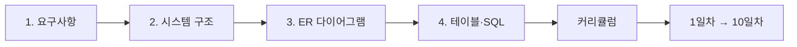

# miniShop 실습 교재

> 음료 쇼핑몰을 **열흘 동안 처음부터 만들어 보는** 풀스택(FastAPI + MariaDB + React) 실습 교재입니다.
> 하루 8시간, 파이썬과 React 를 배운 비전공자를 대상으로 합니다. 핵심은 **개발 과정을 경험하는 것**입니다.

---

## 먼저 읽을 문서 (공통)

| # | 문서 | 내용 |
|---|---|---|
| 1 | [요구사항 명세서](01_requirements.md) | 무엇을 만들 것인가 · 기능 요구사항 · 업무 규칙 · **MVP 정의** |
| 2 | [시스템 구조와 기술스택](02_architecture.md) | 전체 구조, 요청 흐름, 로그인(JWT), 폴더 구조, API 목록 |
| 3 | [DB E-R 다이어그램](03_erd.md) | 테이블 관계, 설계 이유, 테이블이 만들어지는 순서 |
| 4 | [테이블 설명과 SQL](04_tables_and_sql.md) | 테이블·컬럼 용도, DB 준비(계정), 기능별 핵심 SQL |

## 실습 문서 (10일)

| 일 | 문서 |
|---|---|
| — | [**커리큘럼과 진행 방식**](practice/00_curriculum.md) ← 먼저 읽기 |
| 1 | [시작하기 : 요구사항 · 구조 · 환경 · 첫 화면](practice/day01_setup.md) |
| 2 | [MVP-1 상품 목록 : DB → API → 화면](practice/day02_product_list.md) |
| 3 | [MVP-1 상품 상세 · 화면 이동 · 장바구니](practice/day03_detail_cart.md) |
| 4 | [MVP-2 주문 · 결제 · 재고 차감](practice/day04_order.md) |
| 5 | [MVP 완성 : 동시 주문 실험과 재고 지키기](practice/day05_concurrency.md) |
| 6 | [회원 : 이메일 인증 · 가입 · 로그인](practice/day06_member.md) |
| 7 | [회원과 주문 연결 : 구매내역 · 배송지](practice/day07_member_order.md) |
| 8 | [찾기 : 카테고리 · 검색 · 정렬 · 페이지](practice/day08_search.md) |
| 9 | [관리자 : 상품 관리 · 주문 관리 · 환불 · 권한](practice/day09_admin.md) |
| 10 | [이미지 업로드 · 마무리 · 발표](practice/day10_images_wrapup.md) |

## 가이드

| 문서 | 내용 |
|---|---|
| [Gmail 이메일 인증 가이드](guide_gmail_smtp.md) | 앱 비밀번호 만들기, `.env` 설정, 문제 해결 (6일차) |
| [강사 가이드](instructor_guide.md) | 준비, 일차별 시연, 시간 부족 시 생략 순서, FAQ, 루브릭 |

## 자료 폴더

| 폴더 | 내용 |
|---|---|
| `sql/` | **단계별 SQL** (`step-01` ~ `step-08`). DB 가 없는 상태에서 순서대로 실행 |
| `steps/` | **일차별 코드 스냅샷** (`day01` ~ `day10`). 그날 새로 만들거나 바뀐 파일. 복구·제공 파일용 |

---

## 읽는 순서

## 시각 자료

문서의 그림(mermaid)은 GitHub, VS Code(Markdown Preview Mermaid 확장), 대부분의 마크다운 뷰어에서 보입니다.
구조·ER·흐름을 **눌러 보면서** 익히는 **시각 자료 사이트**는 [`site/index.html`](site/index.html) 을 브라우저로 열면 됩니다. (로드맵, 일차별 ER, 요청 흐름, 동시 주문 실험, 토큰 위조 체험, API 지도)

단, 글꼴은 인터넷에서 불러오므로 오프라인에서는 기본 글꼴로 보입니다.

## 완성본

이 교재는 **완성본**(`miniShop_ver1.0`)의 코드를 바탕으로 단계별로 나눈 것입니다. `steps/day10` 까지 겹치면 완성본과 같은 기능이 됩니다.

| 테스트 계정 (비밀번호 모두 `test1234!`) | 권한 |
|---|---|
| `admin@test.local` | 관리자 |
| `user1@test.local` ~ `user7@test.local` | 일반 회원 |
