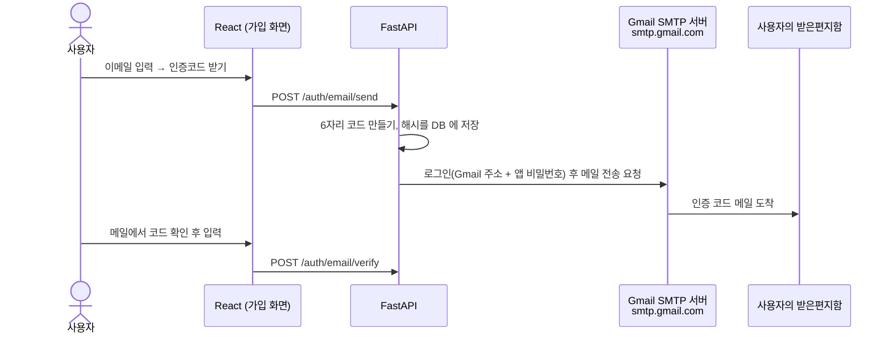

# 가이드. 구글(Gmail)로 이메일 인증 코드 보내기

> 6일차 회원가입의 **이메일 인증 코드**를 실제 Gmail 로 보내는 방법입니다.
> 코드는 이미 `mailer.py` 에 있습니다. 여러분이 할 일은 **구글 계정에서 "앱 비밀번호"를 만들고 `.env` 에 적는 것**뿐입니다.

| 항목 | 내용 |
|---|---|
| 소요 시간 | 약 15분 |
| 필요한 것 | 구글(Gmail) 계정, 휴대폰(2단계 인증용) |
| 바꾸는 파일 | `backend/.env` (코드는 바꾸지 않는다) |
| 안 되면? | 맨 아래 **"개발 모드"** 로 서버 콘솔에서 코드를 확인할 수 있다 |

---

## 0. 먼저 알아 둘 것

### 0-1. 이메일은 어떻게 보내나요?

우리 서버(FastAPI)가 **구글의 메일 서버(SMTP)** 에 로그인해서 "이 편지를 이 사람에게 보내 주세요"라고 부탁합니다.



### 0-2. 왜 "앱 비밀번호"가 필요한가요?

- 내 구글 **로그인 비밀번호를 코드나 `.env` 에 쓰면 안 됩니다.** 새어 나가면 메일, 드라이브, 사진 등 **내 구글 전체**가 위험해집니다. 구글도 이 방식(일반 비밀번호로 SMTP 로그인)을 막아 두었습니다.
- 대신 **"이 프로그램만 메일을 보낼 수 있는 16자리 전용 비밀번호"** 를 따로 만들 수 있습니다. 이것이 **앱 비밀번호**입니다.
- 문제가 생기면 이 앱 비밀번호만 **삭제**하면 되고, 내 진짜 비밀번호는 그대로 안전합니다.

> ⚠️ 앱 비밀번호를 만들려면 **2단계 인증**이 켜져 있어야 합니다.

### 0-3. 계정 선택 권장

| 선택 | 설명 |
|---|---|
| ✅ **실습용 새 Gmail 계정** (권장) | 실수로 노출돼도 피해가 없다. 하나 만들어 두세요 |
| ⚠️ 평소 쓰는 개인 계정 | 가능하지만 `.env` 관리에 각별히 주의 |
| ❌ 학교/회사(Google Workspace) 계정 | 관리자가 앱 비밀번호를 막아 둔 경우가 많다 |

---

## 1. 2단계 인증 켜기

이미 켜져 있다면 2장으로 넘어갑니다.

1. 브라우저에서 https://myaccount.google.com 에 접속해 로그인
2. 왼쪽 메뉴 **보안** 선택
3. **Google에 로그인하는 방법** 영역의 **2단계 인증** 선택
4. **시작하기** → 안내에 따라 휴대폰 번호 인증 후 **사용 설정**

> 화면 구성이나 메뉴 이름은 구글이 바꿀 수 있습니다. 안 보이면 계정 설정 상단의 **검색창**에 "2단계 인증"을 입력하세요.

---

## 2. 앱 비밀번호 만들기

1. https://myaccount.google.com/apppasswords 로 이동 (또는 계정 설정 검색창에 **"앱 비밀번호"** 검색)
2. 구글 비밀번호를 다시 입력하면 **앱 비밀번호** 화면이 열립니다.
3. **앱 이름**에 알아볼 이름을 적습니다. 예 : `miniShop`
4. **만들기** 를 누르면 **16자리 비밀번호**가 한 번만 보입니다.

   ```text
   abcd efgh ijkl mnop        ← 4글자씩 공백으로 나뉘어 보이지만 공백은 없는 16글자
   ```

5. 이 값을 **지금 복사**해 둡니다. 창을 닫으면 다시 볼 수 없습니다. (잊으면 지우고 새로 만들면 됩니다)

> 🔒 **이 16자리는 비밀번호와 같습니다.**
> - 카카오톡, 메신저, 이슈, 채팅 AI 창 등에 **붙여넣지 않습니다.**
> - 깃허브에 올리지 않습니다. (`.env` 는 `.gitignore` 에 들어 있습니다)
> - 실수로 노출했다면 **즉시** 같은 화면에서 해당 앱 비밀번호를 **삭제(취소)** 하세요.

> "앱 비밀번호" 메뉴가 **보이지 않으면** → 2단계 인증이 꺼져 있거나, Workspace 계정이거나, **고급 보호 프로그램**에 가입된 계정일 수 있습니다. 다른 Gmail 계정을 쓰세요.

---

## 3. `.env` 에 적기

`backend/.env` 의 SMTP 항목을 채웁니다. (처음에는 비어 있었습니다)

```ini
# 이메일 인증 코드 발송용 SMTP
SMTP_HOST=smtp.gmail.com
SMTP_PORT=587
SMTP_USER=내계정@gmail.com
SMTP_PASSWORD=abcdefghijklmnop
SMTP_FROM=내계정@gmail.com
```

| 항목 | 값 | 설명 |
|---|---|---|
| `SMTP_HOST` | `smtp.gmail.com` | 구글 메일 서버 주소. **이 값이 비어 있으면 개발 모드**(메일을 안 보내고 콘솔에 출력) |
| `SMTP_PORT` | `587` | STARTTLS(접속 후 암호화) 방식 포트. `465`(SSL)도 지원 |
| `SMTP_USER` | Gmail 주소 | 앱 비밀번호를 만든 **그 계정** 전체 주소 |
| `SMTP_PASSWORD` | 16자리 | **공백 없이** 붙여서. 따옴표 없이 |
| `SMTP_FROM` | Gmail 주소 | 받는 사람 화면의 "보낸 사람". 비워도 `SMTP_USER` 를 쓴다 |

> ⚠️ `.env` 를 저장한 뒤 **백엔드 서버를 껐다 켜야** 적용됩니다. (`.env` 는 서버가 시작할 때 한 번만 읽습니다)

---

## 4. 시험하기

1. 백엔드 서버 재시작
2. http://localhost:5173/signup 접속
3. **받은편지함을 직접 확인할 수 있는** 이메일 주소(예: 본인 Gmail)를 입력하고 **인증코드 받기**
4. 받은편지함에서 메일 확인 (제목 : `[음료 쇼핑몰] 이메일 인증 코드`)
5. 6자리 코드를 입력하고 **확인**

```text
제목 : [음료 쇼핑몰] 이메일 인증 코드
본문 : 인증 코드 : 483920

       5분 안에 입력해 주세요. 본인이 요청하지 않았다면 무시하세요.
```

> 메일이 안 보이면 **스팸함**과 **프로모션 탭**도 확인하세요. 처음 보내는 주소는 스팸으로 분류되는 경우가 있습니다. (도착까지 몇 초~1분 걸릴 수 있습니다)

---

## 5. 코드는 어떻게 되어 있나요? (`mailer.py`)

완성본 `backend/app/mailer.py` 는 아래 한 가지 일만 합니다.

```python
"""이메일 발송

SMTP 설정(.env 의 SMTP_HOST 등)이 있으면 실제로 메일을 보낸다.
설정이 없으면(개발 모드) 메일을 보내지 않고 **서버 콘솔 로그**에 내용을 출력한다.
  → 인증 코드를 서버 콘솔에서 확인해 가입 흐름을 시험할 수 있다.
"""
import logging
import os
import smtplib
import ssl
from email.message import EmailMessage

logger = logging.getLogger(__name__)


def send_mail(to: str, subject: str, body: str) -> None:
    host = os.getenv("SMTP_HOST")
    if not host:
        logger.warning("[개발 모드: 메일 미발송] to=%s subject=%s\n%s", to, subject, body)
        return

    msg = EmailMessage()
    msg["From"] = os.getenv("SMTP_FROM") or os.getenv("SMTP_USER") or "noreply@localhost"
    msg["To"] = to
    msg["Subject"] = subject
    msg.set_content(body)

    port = int(os.getenv("SMTP_PORT", "587"))
    user, password = os.getenv("SMTP_USER"), os.getenv("SMTP_PASSWORD")
    context = ssl.create_default_context()

    if port == 465:                                   # SSL 로 바로 접속
        with smtplib.SMTP_SSL(host, port, context=context, timeout=10) as smtp:
            if user:
                smtp.login(user, password)
            smtp.send_message(msg)
    else:                                             # 587 : 접속 후 STARTTLS 로 암호화
        with smtplib.SMTP(host, port, timeout=10) as smtp:
            smtp.starttls(context=context)
            if user:
                smtp.login(user, password)
            smtp.send_message(msg)
```

핵심만 풀어 보면 :

| 코드 | 의미 |
|---|---|
| `if not host: ... return` | `SMTP_HOST` 가 비어 있으면 **개발 모드**. 메일을 보내지 않고 서버 로그에 내용을 출력 |
| `EmailMessage()` | 편지 만들기 (보낸 사람, 받는 사람, 제목, 본문) |
| `smtplib.SMTP(host, port)` | 구글 메일 서버에 접속 |
| `smtp.starttls(...)` | 접속 후 **암호화**를 시작 (비밀번호가 평문으로 오가지 않게) |
| `smtp.login(user, password)` | **앱 비밀번호**로 로그인 |
| `smtp.send_message(msg)` | 편지 전송 |

> `smtplib`, `ssl`, `email` 은 **파이썬에 기본으로 들어 있는** 도구라서 `pip install` 이 필요 없습니다.

### 인증 코드는 DB 에 어떻게 저장되나요?

메일로는 **코드 원문**이 가지만, DB(`email_verifications`)에는 **해시**만 저장합니다. DB 가 유출돼도 코드를 알 수 없고, 서버는 사용자가 입력한 코드를 같은 방식으로 해시해서 **비교**만 합니다.

---

## 6. 안 될 때 (문제 해결)

화면에는 "인증 메일을 보내지 못했습니다. 잠시 후 다시 시도해 주세요." (502)라고만 나오고, **자세한 원인은 서버 터미널**의 `[ERROR]` 줄에 있습니다.

| 서버 로그 | 원인 | 해결 |
|---|---|---|
| `(535, ... Username and Password not accepted ... BadCredentials)` | 앱 비밀번호가 틀림 | 16자리를 **공백 없이** 다시 복사. 안 되면 앱 비밀번호를 지우고 새로 만들기 |
| 위와 같고 계정 주소도 의심될 때 | `SMTP_USER` 오타 | 앱 비밀번호를 만든 **전체 주소** 확인 |
| `(534, ... Application-specific password required)` | 일반 비밀번호를 넣음 | **앱 비밀번호**를 넣는다 |
| `timed out` / `Connection timed out` | 네트워크(학교, 회사, 공용 와이파이)가 **587 포트를 차단** | `SMTP_PORT=465` 로 바꿔 보기. 그래도 안 되면 휴대폰 핫스팟으로 시도 |
| `getaddrinfo failed` | 인터넷이 끊겼거나 `SMTP_HOST` 오타 | `smtp.gmail.com` 확인 |
| `SMTPSenderRefused` / 한도 관련 문구 | 구글의 **하루 발송 한도**에 걸림 (일반 계정은 하루 약 500통) | 하루 뒤 재시도, 다른 계정 사용 |
| 화면은 성공인데 메일이 안 옴 | 스팸함, 또는 `SMTP_HOST` 가 비어 있어 **개발 모드**로 동작 중 | 스팸함 확인. 서버 콘솔에 `[개발 모드: 메일 미발송]` 이 찍히는지 확인 |
| 수정했는데도 같은 오류 | 서버를 재시작하지 않음 | `.env` 수정 후 서버 **재시작** |
| `60초 후에 다시 요청해 주세요` (429) | 같은 이메일로 너무 빨리 재요청 | 정상 동작. 기다렸다가 다시 |

### 로그 보는 법

```text
2026-11-15 17:50:01 [ERROR] app.auth: 인증 메일 발송 실패: (535, b'5.7.8 Username and Password not accepted...')
```

오류 번호(`535`)와 영어 문구를 그대로 검색하면 대부분 해결 방법이 나옵니다.

---

## 7. 개발 모드 (메일 없이 실습하기)

네트워크가 막혀 있거나 계정을 만들 수 없을 때는 **메일을 보내지 않고** 진행할 수 있습니다.

```ini
SMTP_HOST=          # 비워 둔다
```

서버를 재시작하고 가입 화면에서 **인증코드 받기**를 누르면, **서버 터미널**에 이렇게 출력됩니다.

```text
[WARNING] app.mailer: [개발 모드: 메일 미발송] to=test@example.com subject=[음료 쇼핑몰] 이메일 인증 코드
인증 코드 : 483920
```

그 6자리를 화면에 입력하면 됩니다. 나머지 흐름(5분 만료, 5회 제한, 재발송 60초)은 **똑같이** 동작합니다.

> 💡 이 방식 덕분에 **메일 설정 없이도** 가입 기능을 만들고 시험할 수 있습니다. 실제 서비스에서는 메일이 필수이므로, 시간이 되면 Gmail 연동까지 해 봅니다.

---

## 8. 실습이 끝난 뒤 (정리)

- [ ] https://myaccount.google.com/apppasswords 에서 `miniShop` 앱 비밀번호를 **삭제**한다
- [ ] `.env` 의 `SMTP_PASSWORD` 를 지운다 (파일을 공유하거나 깃에 올릴 일이 생기기 전에)
- [ ] 비밀번호가 담긴 화면 캡처를 공유하지 않는다

---

## 📌 강사 메모

- **수강생이 많으면** 각자 계정으로 만드는 것이 가장 안전합니다. 하나의 공용 앱 비밀번호를 단체 채팅방에 공유하면 **노출 사고**가 나기 쉽고, 하루 한도도 공유됩니다.
- 수업 **전날** 수강생에게 "실습용 Gmail 계정 + 2단계 인증 + 앱 비밀번호 생성"을 숙제로 안내하면 6일차 오전 시간을 아낄 수 있습니다.
- 교실 네트워크에서 **587/465 포트가 막혀** 있는지 미리 확인하세요. 막혀 있으면 핫스팟을 쓰거나 개발 모드로 진행합니다.
- 진행 팁 : 6일차는 **먼저 개발 모드로 가입 흐름을 완성**한 뒤, 오후에 Gmail 연동을 얹는 순서를 권합니다. 메일 문제로 오전 전체를 잃지 않습니다.
- 메일 설정 시연 중에는 **앱 비밀번호가 화면에 노출되지 않게** 주의하세요. (프로젝터 화면에 `.env` 를 열어 두지 않기)
