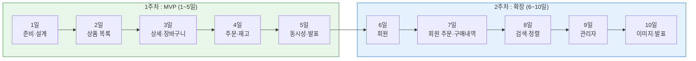
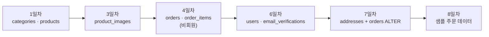
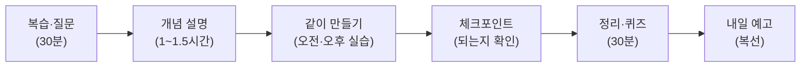

# 10일 실습 커리큘럼과 진행 방식

> 이 문서는 **수강생과 강사가 함께 보는 로드맵**입니다. 열흘 동안 무엇을, 어떤 순서로, 왜 그 순서로 만드는지를 정리했습니다.

---

## 1. 과정 개요

| 항목 | 내용 |
|---|---|
| 대상 | 파이썬과 React 를 학습한 비전공자(대학생) |
| 기간 | 10일 × 하루 8시간 |
| 목표 | **하나의 서비스를 요구사항부터 DB, 서버, 화면까지 직접 만들어 보는 개발 과정을 경험한다** |
| 결과물 | 음료 쇼핑몰 miniShop (FastAPI + MariaDB + React) |
| 하지 않는 것 | 배포, 실제 결제 연동, 상품평, 간편 로그인 |

> 핵심은 **"코딩을 잘하는 것"보다 "개발 과정을 경험하는 것"** 입니다. 모든 줄을 외우지 않아도, **무엇을 왜 이렇게 나눴는지**를 설명할 수 있으면 성공입니다.

---

## 2. 진행 원칙 : MVP 먼저, 기능은 나중에

### 2-1. MVP 란?

> **MVP (Minimum Viable Product)** = 이것만 있어도 "쓸 수 있다"고 말할 수 있는 **최소한의 제품**

우리의 MVP 는 **"상품을 보고 → 장바구니에 담고 → 구매하면 재고가 줄어든다"** 입니다. 회원도, 관리자도, 검색도 없어도 **물건은 팔 수 있습니다.**



### 2-2. 왜 이 순서인가?

| 순서 | 이유 |
|---|---|
| 1주차에 "돌아가는 쇼핑몰"을 본다 | 일주일 만에 완성품을 보면 **동기**가 생긴다 |
| 회원은 주문 **다음**에 | "누가 샀는지 알아야 하네"라는 **필요**를 먼저 느끼고 만든다 |
| 주문을 **먼저 단순하게**, 나중에 고친다 | 처음부터 완벽한 설계는 없다. `ALTER TABLE` 로 고쳐 나가는 경험이 현실적이다 |
| 검색·정렬은 8일차 | 상품이 쌓여 "찾기"가 필요해진 뒤에 만든다 |
| 이미지 업로드는 마지막 | 가장 어렵지만, 없어도 쇼핑몰은 돌아간다 |

### 2-3. 패키지는 필요할 때 설치한다

처음부터 전부 설치하지 않습니다. **"이게 필요하구나"** 하는 순간에 설치합니다.

| 일차 | 백엔드 (`pip install`) | 프론트 (`npm install`) | 설치 이유 |
|---|---|---|---|
| 1 | `fastapi` `uvicorn` | (Vite 템플릿) | 서버 만들기 / 화면 만들기 |
| 2 | `pymysql` `python-dotenv` | | DB 접속 / 비밀 설정 읽기 |
| 3 | | `react-router-dom` | 화면이 여러 개가 됨 |
| 4~9 | **없음** | **없음** | 있는 도구로 충분 |
| 10 | `python-multipart` `pillow` | | 파일 업로드 / 이미지 처리 |

> 4~9일차에 새 패키지가 **없다**는 점이 의미 있습니다. 회원 기능(해시·토큰·메일)도 파이썬 **기본 기능**으로 만들며 원리를 이해합니다.

### 2-4. 테이블도 필요할 때 만든다



---

## 3. 하루의 리듬

모든 날이 같은 틀로 진행됩니다.



| 단계 | 하는 일 |
|---|---|
| **복습·질문** | 전날 과제와 퀴즈. 오늘의 **질문 하나**를 던진다 ("서버는 내가 누군지 어떻게 알까?") |
| **개념** | 코드를 치기 전에 **그림(mermaid)과 비유**로 먼저 설명 |
| **같이 만들기** | DB → 서버 → 화면 순서로 **강사 시연 → 따라 하기 → 시험** |
| **체크포인트** | 문서 끝의 체크리스트로 "오늘 목표를 달성했는지" 스스로 확인 |
| **정리·퀴즈** | 핵심 정리 + 퀴즈로 개념을 말로 설명해 보기 |
| **예고** | 다음 날로 이어지는 **궁금증**(복선)을 남긴다 |

---

## 4. 문서의 표시 규칙

| 표시 | 뜻 |
|---|---|
| ✍️ | **직접 입력**합니다 (코드를 보며 따라 칩니다) |
| 📦 | **제공 파일**을 복사해서 씁니다. 길거나 학습 목표가 아닌 부분 (CSS 등). **읽고 이해**합니다 |
| 🔍 | **복선** — 뒤에서 문제가 드러나는 코드나 질문 |
| ⚠️ | 자주 하는 실수, 주의 |
| 💡 | 한 걸음 더 (왜 그런지) |
| 🔐 | 보안 포인트 |
| 🧪 | 시연 / 실험 |

각 일차 문서는 **같은 순서**로 되어 있습니다.

1. 오늘의 목표 / 표 / 시간표
2. 개념 설명 (그림)
3. DB → 백엔드 → 프론트엔드 실습 (코드 + 줄 단위 설명)
4. 체크포인트
5. 자주 하는 실수
6. 핵심 정리 · 퀴즈 · 과제
7. 내일 예고
8. 📌 강사 메모

---

## 5. 일차별 한눈에 보기

| 일 | 주제 | 오늘 만드는 것 | 새 개념 | 설치 | 새 테이블 |
|---|---|---|---|---|---|
| [1](day01_setup.md) | 시작하기 | Hello 서버·화면, DB | 개발 과정, MVP, 3계층 구조 | fastapi, uvicorn, vite | categories, products |
| [2](day02_product_list.md) | 상품 목록 | `GET /products`, 카드 목록 | DB→API→화면, `.env`, fetch, state | pymysql, dotenv | |
| [3](day03_detail_cart.md) | 상세·장바구니 | 상세 API·화면, 라우팅, 장바구니 | 라우팅, 404/422, Context, localStorage | react-router-dom | product_images |
| [4](day04_order.md) | 주문·결제 | `POST /orders`, 결제 화면 | **트랜잭션**, 서버 계산 | | orders, order_items |
| [5](day05_concurrency.md) | 동시성 | 재고 안전 차감, MVP 발표 | **경쟁 상태**, 조건부 UPDATE, 잠금 | | |
| [6](day06_member.md) | 회원 | 이메일 인증, 가입, 로그인 | **해시**, **JWT**, Depends | | users, email_verifications |
| [7](day07_member_order.md) | 회원 주문 | 구매내역, 배송지 | **ALTER TABLE**, JOIN/GROUP BY, 내 데이터만 | | addresses |
| [8](day08_search.md) | 검색 | 카테고리·검색·정렬·페이지 | **SQL 인젝션 방어**, LIKE, LEFT JOIN, URL 상태 | | |
| [9](day09_admin.md) | 관리자 | 상품 CRUD, 주문 관리, 환불 | **권한(403)**, 소프트 삭제 | | |
| [10](day10_images_wrapup.md) | 이미지·마무리 | 이미지 업로드, 최종 발표 | 파일 업로드 보안, 롤백 | python-multipart, pillow | |

---

## 6. 코드 스냅샷 (`docs/steps/`)

`docs/steps/dayNN/` 에는 **그날 새로 만들거나 바뀐 파일**이 들어 있습니다. 쓰임새는 세 가지입니다.

| 쓰임 | 설명 |
|---|---|
| **복구** | 진도를 놓쳤거나 코드가 꼬인 수강생은 해당 일차 폴더를 **겹쳐 복사**해 같은 출발선으로 돌아온다 |
| **제공 파일** | 길어서 직접 치지 않는 파일(CSS, 큰 화면 컴포넌트)을 거기서 복사한다 |
| **정답 확인** | 내 코드와 비교한다 |

**겹쳐 복사하는 순서** : `day01` → `day02` → … → 원하는 일차까지 **차례대로** 같은 위치에 덮어씁니다. (뒤의 일차가 앞 일차의 파일을 새 버전으로 바꾸기 때문입니다.) `day10` 까지 겹치면 **완성본과 같은 기능**이 됩니다.

```text
docs/steps/day04/backend/app/order.py   →   내 프로젝트의  backend/app/order.py
docs/steps/day04/frontend/src/...       →   내 프로젝트의  frontend/src/...
```

> 단, `backend/.env`(비밀 설정)와 이미지 폴더(`backend/products/images`)는 스냅샷에 없습니다. `.env` 는 직접 만들고, 이미지 폴더는 **완성본에서 통째로** 복사합니다.

---

## 7. 과제와 점검 방식

| 종류 | 설명 |
|---|---|
| **체크포인트** | 매일. 목표 달성 여부를 스스로 확인 (제출 없음) |
| **퀴즈** | 매일. 개념을 말로 설명 (토의) |
| **기본 과제** | 매일. 오늘 배운 것을 한 번 더 (필수) |
| **도전 과제** | 선택. 빠른 학생용 |
| **발표** | 5일차(MVP), 10일차(최종). 조별 |

### 평가가 아닌 **되돌아보기**

- "무엇을 만들었나"보다 **"왜 그렇게 만들었나"** 를 설명할 수 있는지를 봅니다.
- 요구사항 명세서와 실제 결과를 비교하고, **가장 많이 고친 코드**를 돌아봅니다.

---

## 8. 수업 전 준비물 (수강생)

수업 **전날**까지 아래를 확인합니다.

- [ ] Python 3.11 이상, Node.js 20 이상, MariaDB 가 설치되어 있고 `--version` 이 나온다
- [ ] VS Code 설치 (Python 확장)
- [ ] MariaDB 의 root 접속이 된다 (비밀번호를 알고 있다)
- [ ] 크롬 브라우저
- [ ] **실습용 Gmail 계정** + 2단계 인증 (6일차 메일 인증용, [가이드](../guide_gmail_smtp.md))
- [ ] `docs/` 폴더 전체와 완성본(`miniShop_ver1.0`)을 받아 두었다 (이미지 폴더 복사용)
