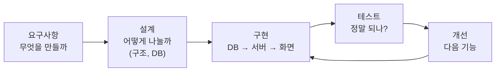
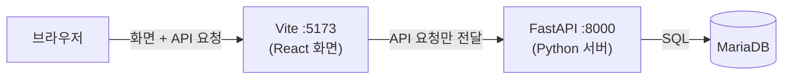
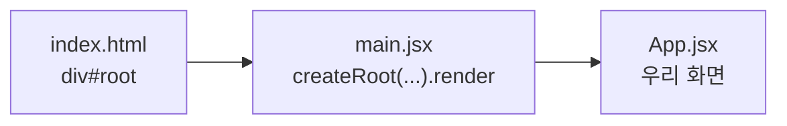

# 1일차. 프로젝트 시작하기 : 요구사항, 구조, 환경, 첫 화면

> **오늘의 한 줄 목표** : 서버와 화면과 DB 가 **각각 살아 있고**, 오늘 만들 상품 데이터가 DB 에 들어 있다.

| 항목 | 내용 |
|---|---|
| 만드는 것 | 백엔드 "서버 동작 중" 응답, 프론트 첫 화면, DB 에 `categories` + `products` |
| 새로 설치 | `pip install fastapi uvicorn` , Vite(React) 프로젝트 |
| 새 테이블 | `categories`, `products` (`sql/step-01_catalog.sql`) |
| 관련 요구사항 | 문서 [1. 요구사항 명세서](../01_requirements.md) 전체 |
| 끝나면 | 브라우저 3곳이 열려 있다 : `localhost:8000/docs`, `localhost:5173`, DB 프로그램 |

---

## 시간표 (8시간)

| 시간 | 내용 | 방식 |
|---|---|---|
| 09:00 ~ 09:40 | 오리엔테이션 + **완성본 시연** ("우리가 열흘 뒤에 만들 것") | 강의 |
| 09:40 ~ 10:40 | 개발 과정이란? 요구사항 명세서 읽기, **MVP 정하기 활동** | 강의 + 활동 |
| 10:40 ~ 12:00 | 시스템 구조 : 브라우저 - 서버 - DB, API 란? | 강의 (그림) |
| 12:00 ~ 13:00 | 점심 | |
| 13:00 ~ 14:00 | 환경 점검, 프로젝트 폴더, `.gitignore` | 실습 |
| 14:00 ~ 15:30 | 백엔드 첫 서버 (FastAPI), 자동 문서 `/docs` | 실습 |
| 15:30 ~ 16:30 | 프론트 첫 화면 (Vite + React) | 실습 |
| 16:30 ~ 17:40 | **DB 설계**(표 직접 설계해 보기) → `step-01` 실행 → SELECT 연습 | 활동 + 실습 |
| 17:40 ~ 18:00 | 오늘 정리, 내일 예고, 질문 | |

---

## 1. 개발은 어떤 순서로 하나요?



- 코딩은 전체 과정의 **일부**입니다. 오늘은 앞의 두 칸(요구사항, 설계)과 "환경 준비"를 합니다.
- 우리는 **기능 하나를 `DB → 서버(API) → 화면`** 순서로 끝까지 만드는 일을 반복합니다. 이 반복이 개발 과정의 핵심입니다.

### 활동 ① MVP 정하기 (15분)

[요구사항 명세서](../01_requirements.md) 4장의 기능 목록을 보고, 조별로 토의합니다.

> **질문 : 이 중 "이것만 있어도 쇼핑몰이다"라고 할 최소한은 무엇일까요?**
> 포스트잇(또는 종이)에 기능 번호를 5개 안쪽으로 골라 보세요. 그리고 **왜 그 기능이 꼭 필요한지** 한 문장으로 적습니다.

정답은 없습니다. 조별 선택을 비교한 뒤, 강사가 이 프로젝트의 MVP(문서 9장)를 소개합니다.
**"회원가입이 없어도 물건은 팔 수 있다"** 는 점이 의외로 많이 나옵니다. 그래서 우리는 회원 기능을 6일차에 만듭니다.

---

## 2. 시스템 구조 한눈에

[2. 시스템 구조](../02_architecture.md) 1장의 그림을 같이 봅니다.



### 용어 먼저

| 용어 | 쉬운 설명 | 이 프로젝트에서 |
|---|---|---|
| 프론트엔드 | 사용자가 보는 화면 | React |
| 백엔드 | 규칙을 지키고 DB를 다루는 서버 | FastAPI |
| API | 서버가 열어 둔 "주문 창구". 주소 + 방법(GET/POST ...) | `GET /products` |
| JSON | 프로그램끼리 주고받는 데이터 글자 모양 | `{"name": "콜라", "price": 1500}` |
| DB | 데이터를 표로 저장하는 프로그램 | MariaDB |

### HTTP 메서드는 "동사"

| 메서드 | 뜻 | 예 |
|---|---|---|
| GET | 가져온다 | 상품 목록 보기 |
| POST | 새로 만든다 | 주문하기, 회원가입 |
| PUT | 통째로 고친다 | 상품 수정 |
| DELETE | 지운다 | 상품 삭제 |

---

## 3. 환경 점검

PowerShell(또는 VS Code 터미널)에서 하나씩 실행해 버전이 나오는지 확인합니다.

```powershell
python --version      # Python 3.11 이상
node --version        # v20 이상
npm --version
mysql --version       # MariaDB 클라이언트
git --version         # (선택)
```

> `python` 이 안 되면 `py --version` 을 시도합니다. `mysql` 이 안 되면 04번 문서의 0-1 안내를 따르세요.

### 에디터

VS Code 를 쓰고, 확장 **Python**, **ES7+ React snippets**(선택)를 설치합니다.

---

## 4. 프로젝트 폴더 만들기

원하는 위치(예: `C:\work`)에 아래처럼 만듭니다.

```text
miniShop/
├─ backend/
└─ frontend/        ← 5-3 에서 Vite 가 만들어 준다
```

```powershell
mkdir C:\work\miniShop
cd C:\work\miniShop
mkdir backend
```

### `.gitignore` (프로젝트 맨 위 폴더에)

비밀번호나 설치 파일은 깃(Git)에 올리지 않습니다. `miniShop/.gitignore` 파일을 만들고 아래를 붙여 넣습니다.

```gitignore
# 비밀 설정 (DB 비밀번호 등)
.env

# Python
.venv/
__pycache__/
*.pyc

# Node
node_modules/
dist/
```

> 💡 **왜 `.env` 를 올리면 안 되나요?** 깃허브에 올라간 비밀번호는 몇 분 만에 자동 수집 프로그램이 가져갑니다. 한 번 올라가면 지워도 기록에 남습니다.

---

## 5. 백엔드 : 첫 서버

### 5-1. 가상환경 만들기

프로젝트마다 패키지를 따로 관리하기 위해 **가상환경(venv)** 을 만듭니다.

```powershell
cd C:\work\miniShop\backend
python -m venv .venv
.\.venv\Scripts\Activate.ps1
```

프롬프트 앞에 `(.venv)` 가 보이면 성공입니다.

> ⚠️ **"이 시스템에서 스크립트를 실행할 수 없으므로…" 오류**가 나면 한 번만 아래를 실행하고 다시 시도합니다.
> ```powershell
> Set-ExecutionPolicy -Scope CurrentUser RemoteSigned
> ```
> 그래도 어렵다면 활성화 없이, 항상 `.\.venv\Scripts\python.exe -m ...` 으로 실행해도 똑같이 동작합니다.

### 5-2. 패키지 설치 (필요한 것만)

오늘은 **서버 본체(fastapi)와 서버 실행기(uvicorn)** 만 설치합니다.

```powershell
python -m pip install fastapi uvicorn
```

| 패키지 | 역할 |
|---|---|
| `fastapi` | API 를 함수로 만드는 도구 |
| `uvicorn` | 만든 앱을 실제 서버로 띄우는 실행기 |

### 5-3. 첫 코드

`backend/app` 폴더를 만들고 그 안에 파일 2개를 만듭니다.

**`backend/app/__init__.py`** — 내용 없이 **빈 파일**로 만듭니다. (`app` 폴더를 "파이썬 패키지"로 인식시키는 표시)

**`backend/app/main.py`**

```python
from fastapi import FastAPI

# FastAPI 앱 객체 : 모든 API 를 여기에 붙인다
app = FastAPI(title="음료 쇼핑몰")


# @app.get("/") : "GET 방식으로 / 주소를 요청하면 아래 함수를 실행하라"
@app.get("/")
def root():
    return {"message": "서버가 실행중입니다"}
```

### 5-4. 서버 실행

```powershell
# backend 폴더에서
python -m uvicorn app.main:app --reload --port 8000
```

| 부분 | 뜻 |
|---|---|
| `app.main:app` | `app` 폴더의 `main.py` 안의 `app` 객체를 실행하라 |
| `--reload` | 코드를 저장하면 서버가 자동으로 다시 시작 |
| `--port 8000` | 8000번 문으로 연다 |

**브라우저로 확인**

| 주소 | 보이는 것 |
|---|---|
| http://localhost:8000/ | `{"message":"서버가 실행중입니다"}` |
| http://localhost:8000/docs | **자동으로 만들어진 API 문서** ← FastAPI 의 자랑 |

`/docs` 에서 `GET /` 를 펼치고 **Try it out → Execute** 를 눌러 보세요. 브라우저 주소창 없이 API 를 시험할 수 있습니다. 앞으로 서버 기능을 만들 때마다 여기서 먼저 확인합니다.

> 💡 서버를 끄려면 터미널에서 `Ctrl + C`.

---

## 6. 프론트엔드 : 첫 화면

### 6-1. Vite 로 React 프로젝트 만들기

`miniShop` 폴더(backend 와 같은 위치)에서 실행합니다.

```powershell
cd C:\work\miniShop
npm create vite@latest frontend -- --template react
```

질문이 나오면 기본값(Enter)을 고릅니다. 끝나면:

```powershell
cd frontend
npm install
npm run dev
```

브라우저에서 터미널에 나온 주소(보통 http://localhost:5173)를 열면 Vite + React 로고 화면이 나옵니다.

### 6-2. 청소하기

템플릿의 예제 화면과 스타일은 우리 프로젝트에 필요 없으므로 비웁니다.

1. `src/App.css` 파일을 **삭제**합니다.
2. `src/assets/` 폴더 안 파일도 필요 없으니 삭제해도 됩니다.
3. `src/index.css` 의 내용을 **전부 지우고** 아래로 바꿉니다.

```css
body {
  margin: 0;
  font-family: "Malgun Gothic", sans-serif;
  background: #f5f5f5;
}
```

4. `src/App.jsx` 를 아래로 바꿉니다.

```jsx
function App() {
  return (
    <div>
      <h1>🥤 음료 쇼핑몰</h1>
      <p>곧 상품이 여기에 나옵니다.</p>
    </div>
  )
}

export default App
```

저장하면 브라우저가 **자동으로** 바뀝니다. (HMR : 저장 즉시 반영)

### 6-3. 파일 구조 이해

| 파일 | 역할 |
|---|---|
| `index.html` | 빈 `<div id="root">` 하나만 있는 껍데기 |
| `src/main.jsx` | React 를 `#root` 에 붙이는 시작점 |
| `src/App.jsx` | 우리가 만드는 화면의 맨 위 컴포넌트 |



---

## 7. DB : 설계하고 만들기

### 7-1. 활동 ② 표 직접 설계해 보기 (20분)

SQL 을 보기 **전에** 먼저 생각해 봅니다. 종이나 메모장에 적어 보세요.

> **"상품" 하나를 저장하려면 어떤 정보(컬럼)가 필요할까요?**
> 화면(쇼핑몰 사이트 하나를 떠올려 보세요)에 보이는 것들을 하나씩 적고, 각각의 **타입**(숫자/글자/날짜)도 정해 봅니다.

예상 답: 이름, 가격, 재고, 이미지, 설명 ... 거기에 **판매 여부**, **분류(카테고리)**, **등록일** 은 의외로 빠뜨리기 쉽습니다.

> **질문 : 카테고리 이름을 `products` 표에 글자로 같이 넣으면 안 될까요?**
> (예: 상품마다 `category = '탄산'`)
> → 오타가 나면 같은 분류가 두 개가 되고, 이름을 바꾸려면 모든 상품 행을 고쳐야 합니다. 그래서 **표를 나누고 번호로 연결**합니다. ([3. ER 다이어그램](../03_erd.md) 참고)

### 7-2. DB 계정 만들기

[4. 테이블 설명과 SQL](../04_tables_and_sql.md) **0장**을 보고 전용 DB 계정(`vmshop_user`)을 만듭니다. (이미 만들어 둔 경우 건너뜁니다)

### 7-3. step-01 실행

mysql 에 접속한 상태에서 실행합니다.

```powershell
mysql --default-character-set=utf8mb4 -u vmshop_user -p
```

```sql
source C:/work/miniShop/docs/sql/step-01_catalog.sql
```

> 경로는 각자 `docs/sql` 폴더 위치에 맞게 바꾸세요. 슬래시(`/`)를 씁니다.

마지막에 `categories 7`, `products 35` 가 보이면 성공입니다.

### 7-4. SELECT 연습 (30분)

```sql
USE test_vmshop;

-- 1) 전체 보기
SELECT * FROM products;

-- 2) 필요한 컬럼만
SELECT id, name, price FROM products;

-- 3) 조건 : 판매중이고 재고가 있는 것
SELECT id, name, price, stock FROM products WHERE is_active = 1 AND stock > 0;

-- 4) 정렬 : 가격 낮은 순
SELECT name, price FROM products WHERE is_active = 1 ORDER BY price ASC;

-- 5) 개수
SELECT COUNT(*) FROM products WHERE is_active = 1;

-- 6) 글자 검색 : 이름에 '주스' 가 들어간 것
SELECT name, price FROM products WHERE name LIKE '%주스%';

-- 7) 두 표 합치기 (JOIN) : 카테고리 이름과 함께 보기
SELECT p.name, c.name AS category
FROM products p JOIN categories c ON c.id = p.category_id
WHERE p.is_active = 1;
```

> **퀴즈**
> 1. 판매중지(`is_active = 0`) 상품은 몇 개인가요? (2개)
> 2. **판매중인 상품 중** 재고가 0 인 것은 몇 개인가요? 이름을 찾아보세요. (5개)
> 3. 가장 비싼 판매중 상품은 무엇인가요?
> 4. `JOIN` 결과에서 35번 "언더바_테스트 음료"가 **안 나오는** 이유는? (→ 카테고리가 NULL 이라서. 나오게 하려면 `LEFT JOIN`)

---

## 8. 체크포인트

아래 4가지가 모두 되면 오늘 목표 달성입니다.

- [ ] http://localhost:8000/docs 가 열리고 `GET /` 가 동작한다
- [ ] http://localhost:5173 에 "🥤 음료 쇼핑몰" 이 보인다
- [ ] `SELECT COUNT(*) FROM products;` 결과가 35 이다
- [ ] 터미널 2개가 동시에 열려 있다 (서버, 화면)

### 지금 폴더 모습

```text
miniShop/
├─ .gitignore
├─ backend/
│  ├─ .venv/
│  └─ app/
│     ├─ __init__.py
│     └─ main.py
└─ frontend/
   ├─ package.json
   └─ src/
      ├─ main.jsx
      ├─ App.jsx
      └─ index.css
```

---

## 9. 자주 하는 실수

| 증상 | 원인 | 해결 |
|---|---|---|
| `No module named 'app'` | `backend` 폴더가 아닌 곳에서 uvicorn 실행 | `cd backend` 후 실행 |
| `Error loading ASGI app` | `app/__init__.py` 가 없거나 파일 이름 오타 | 파일 위치와 이름 확인 |
| `'uvicorn'은(는) 내부 또는 외부 명령...` | 가상환경 비활성화 상태 | `python -m uvicorn ...` 으로 실행 |
| 화면이 안 바뀜 | 저장을 안 했거나 파일을 다른 곳에 만듦 | `Ctrl + S`, 경로 확인 |
| SQL 실행 시 한글이 `???` | `--default-character-set=utf8mb4` 누락 | 옵션 붙여 다시 접속 후 step-01 재실행 |
| `Access denied for user` | 계정/비밀번호 오타 | 04번 문서 0장 다시 확인 |
| 5173 포트가 이미 사용 중 | 이전 Vite 가 아직 켜져 있음 | 이전 터미널을 `Ctrl + C` 로 끄기 (새 포트로 열려도 동작은 같다) |

---

## 10. 오늘의 핵심 정리

1. 개발은 **요구사항 → 설계 → 구현 → 테스트** 의 반복이다.
2. 우리 프로젝트는 **브라우저 - 서버 - DB** 3부분이고, 브라우저는 DB 에 직접 접근하지 않는다.
3. **MVP** 는 "이것만 있어도 쓸 수 있는" 최소 기능이다. 먼저 만든다.
4. 패키지는 **필요할 때** 설치한다.
5. FastAPI 는 `/docs` 에서 API 를 바로 시험할 수 있다.

## 과제

- **기본** : `/docs` 에서 `GET /` 응답 메시지를 `"서버가 실행중입니다"` 에서 **본인 이름이 들어간 문장**으로 바꾸고, 저장 후 `/docs` 에서 다시 실행해 보기. (`--reload` 가 자동 반영해 주는지 확인)
- **기본** : 아래 SQL 결과를 캡처해 오기 — 카테고리별 판매중 상품 수 (`GROUP BY`).
- **도전** : `products` 표에 만약 `brand`(브랜드) 컬럼을 추가한다면 어떤 타입·제약이 좋을지 한 문장으로 적어 오기. (실제로 추가하지는 않는다)

## 내일 예고

2일차에는 **서버가 DB 에서 상품을 꺼내 JSON 으로 주고, 화면이 그걸 받아 카드로 그립니다.** 오늘 만든 세 부분이 처음으로 서로 이어집니다.

---

## 📌 강사 메모

- **오프닝 시연** : 완성본(`miniShop_ver1.0`)을 띄워 상품 목록 → 장바구니 → 로그인 → 구매 → 관리자 상품 등록까지 5분 안에 보여 줍니다. "열흘 뒤 이걸 여러분이 만든다"를 보여 주는 것이 가장 큰 동기 부여입니다.
- **환경 점검에 시간이 가장 많이 듭니다.** 수업 **전날** 수강생에게 `python/node/mysql` 버전 확인 캡처를 받아 두면 좋습니다.
- **DB 접속 문제**는 `source` 방식으로 해결되는 경우가 많습니다. 터미널 한 줄 방식(`<`)은 PowerShell 에서 안 됩니다.
- **막히는 학생이 있으면** 5-3 코드를 그대로 복사해 먼저 살려 놓고, 원리는 나중에 설명하세요. 오늘의 성공 기준은 "세 가지가 켜졌다"입니다.
- 이 단계에서 `venv`, `Activate.ps1` 오류가 가장 흔합니다. 시간 낭비를 줄이려면 `python -m uvicorn` 방식을 기본으로 안내하세요.
