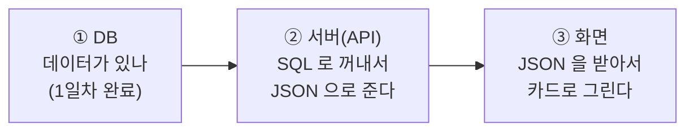
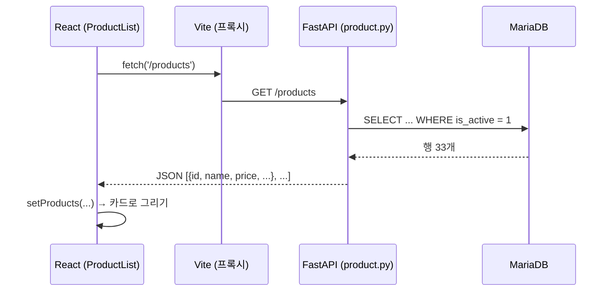
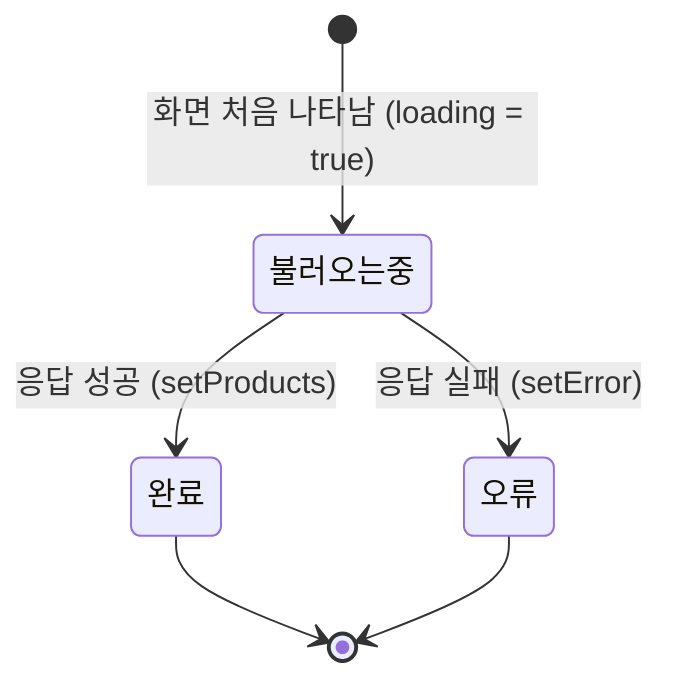

# 2일차. MVP-1 상품 목록 : DB → API → 화면

> **오늘의 한 줄 목표** : DB 에 있는 상품 35개 중 **판매 중인 33개**가 브라우저 화면에 카드로 나온다.

| 항목 | 내용 |
|---|---|
| 만드는 것 | `GET /products` API, 상품 목록 화면 (상품 카드) |
| 새로 설치 | 백엔드 `pymysql` `python-dotenv` (프론트는 없음) |
| 새 테이블 | 없음 (1일차의 `products` 사용) |
| 관련 요구사항 | FR-01 상품 목록, FR-03 판매중지 제외, FR-04 품절 표시 |
| 끝나면 | 이미지·이름·가격·재고가 있는 카드 33개 |

완성 스냅샷 : `docs/steps/day02/` (오늘 새로 만들거나 바꾸는 파일들)

---

## 시간표 (8시간)

| 시간 | 내용 | 방식 |
|---|---|---|
| 09:00 ~ 09:30 | 1일차 복습, 오늘 흐름 설명 | 강의 |
| 09:30 ~ 10:30 | 서버가 DB 와 이야기하는 법 (`pymysql`, 커서, 연결 닫기) | 강의 + 시연 |
| 10:30 ~ 12:00 | **`GET /products` 만들기** (`.env`, `database.py`, `product.py`) | 실습 |
| 12:00 ~ 13:00 | 점심 | |
| 13:00 ~ 14:00 | 이미지 공개, `/docs` 로 시험, 오류 상황 실험 | 실습 |
| 14:00 ~ 15:00 | 화면이 서버를 부르는 법 (프록시, `fetch`, `useEffect`) | 강의 + 시연 |
| 15:00 ~ 17:30 | **상품 카드, 목록 화면 만들기** | 실습 |
| 17:30 ~ 18:00 | 정리, 퀴즈, 과제 안내 | |

---

## 1. 오늘의 흐름

기능 하나를 만드는 순서는 **언제나 같습니다.**





---

## 2. 백엔드

### 2-1. 패키지 설치

`backend` 폴더, 가상환경이 켜진 터미널에서 실행합니다. (서버가 켜져 있다면 새 터미널을 엽니다)

```powershell
python -m pip install pymysql python-dotenv
```

| 패키지 | 역할 |
|---|---|
| `pymysql` | 파이썬에서 MariaDB 에 접속해 SQL 을 실행한다 |
| `python-dotenv` | `.env` 파일의 설정값을 읽어 온다 |

### 2-2. 접속 정보는 `.env` 에

DB 비밀번호를 코드에 직접 쓰면 깃에 올라갈 위험이 있습니다. **`.env` 파일**에 따로 두고 코드에서는 읽어 쓰기만 합니다.

`backend/.env` 파일을 만듭니다. (`.env.example` 을 복사해서 비밀번호만 채워도 됩니다)

```ini
# 이 파일을 .env 로 복사한 뒤 값을 채운다.  (copy .env.example .env)
# .env 는 비밀번호가 들어 있으므로 깃허브에 올리지 않는다. (.gitignore 에 등록됨)

DB_HOST=localhost
DB_PORT=3306
DB_USER=vmshop_user
DB_PASSWORD=여기에_비밀번호
DB_NAME=test_vmshop
```

> `DB_PASSWORD` 에는 1일차에 만든 `vmshop_user` 의 비밀번호를 씁니다. 따옴표는 붙이지 않습니다.

### 2-3. DB 연결 함수 — `backend/app/database.py`

```python
from dotenv import load_dotenv
import os
import pymysql
from pymysql.cursors import DictCursor


# .env 파일에 설정된 환경변수를 메모리에 로드
load_dotenv()

def get_connection():
    """DB 연결(전화 연결 같은 것)을 새로 만들어서 돌려준다.

    사용하는 쪽에서 다 쓴 뒤에는 반드시 conn.close() 로 연결을 끊어야 한다.
    (연결을 끊지 않으면 DB 가 감당할 수 있는 연결 수를 다 써 버려 서버가 멈출 수 있다)
    """
    return pymysql.connect(
        # os.getenv("이름", "기본값") : 환경변수 값을 읽는다. 없으면 기본값을 쓴다.
        host=os.getenv("DB_HOST", "localhost"),        # DB 가 있는 컴퓨터 주소
        port=int(os.getenv("DB_PORT", "3306")),        # DB 포트 (MariaDB 기본값 3306), 환경변수는 문자열이라 int 로 변환
        user=os.getenv("DB_USER"),                     # DB 계정 (vmshop_user)
        password=os.getenv("DB_PASSWORD"),             # DB 비밀번호
        database=os.getenv("DB_NAME"),                 # 사용할 DB 이름 (vmShop)
        charset="utf8mb4",                             # 한글, 이모지가 깨지지 않게 하는 문자 인코딩
        cursorclass=DictCursor,                        # 결과를 딕셔너리로 받는다
    )
```

| 줄 | 설명 |
|---|---|
| `load_dotenv()` | `.env` 의 값을 읽어 "환경 변수"로 등록한다 |
| `os.getenv("DB_HOST", "localhost")` | 환경 변수를 읽는다. 없으면 두 번째 값(기본값) |
| `cursorclass=DictCursor` | 결과를 `(1, '콜라', 1500)` 같은 튜플이 아니라 `{"id": 1, "name": "콜라", ...}` **딕셔너리**로 받는다 |
| `charset="utf8mb4"` | 한글이 깨지지 않게 하는 글자 인코딩 |

> 💡 **연결(connection)은 전화 연결과 같습니다.** 쓰고 나면 반드시 끊어야(`close()`) 합니다. 끊지 않으면 DB 가 받을 수 있는 연결 수가 다 차서 서버가 멈춥니다. 그래서 다음 코드에서 `try ... finally` 를 씁니다.

### 2-4. 상품 API — `backend/app/product.py`

```python
"""상품 API (2일차) : 상품 목록  GET /products"""
import logging

from fastapi import APIRouter, HTTPException

from .database import get_connection

logger = logging.getLogger(__name__)

# 라우터 : 관련 있는 API 들을 한 묶음으로 만든다. main.py 에서 앱에 붙인다.
router = APIRouter(tags=["product"])


# -----------------------------------------------------------------------------
# DB 에서 판매 중인 상품을 꺼내는 함수 (SQL 실행)
#   ① DB 연결  ②  SQL 실행  ③ 결과 받기  ④ 연결 닫기
# -----------------------------------------------------------------------------
def find_all_products():
    conn = get_connection()
    try:
        with conn.cursor() as cursor:
            sql = """
                SELECT id, name, price, stock, image_url
                FROM products
                WHERE is_active = 1
                ORDER BY price
            """
            cursor.execute(sql)
            return cursor.fetchall()      # 딕셔너리의 리스트 : [{"id": 1, "name": "콜라", ...}, ...]
    finally:
        conn.close()                      # 오류가 나도 연결은 반드시 닫는다


# GET /products : 상품 목록
@router.get("/products")
def list_products():
    try:
        products = find_all_products()
    except Exception as e:
        logger.error("상품 목록 조회 실패: %s", e)
        raise HTTPException(status_code=500, detail="상품 목록 조회 에러")
    logger.info("상품 목록 조회 : %s개", len(products))
    return products
```

코드를 **세 덩어리**로 나눠서 읽어 봅니다.

| 덩어리 | 하는 일 |
|---|---|
| `router = APIRouter(...)` | 상품 관련 API 를 담는 **묶음 통**. 파일마다 하나씩 만든다 |
| `find_all_products()` | **SQL 담당**. DB 에서 꺼내 리스트로 돌려준다. HTTP 는 모른다 |
| `list_products()` | **API 담당**. 주소와 연결하고, 오류가 나면 HTTP 오류(500)로 바꿔 준다 |

> 💡 **왜 두 함수로 나눴나요?** "DB 에서 꺼내는 일"과 "HTTP 로 응답하는 일"을 따로 두면, 나중에 같은 SQL 을 다른 곳에서 다시 쓰기 쉽고, 고장 났을 때 어디가 문제인지 찾기 쉽습니다.

**SQL 읽기**

```sql
SELECT id, name, price, stock, image_url   -- 필요한 컬럼만 (화면에 안 쓰는 것은 가져오지 않는다)
FROM products
WHERE is_active = 1                        -- 판매중지 상품(33, 34번)은 제외 ← FR-03
ORDER BY price                             -- 싼 것부터
```

### 2-5. 앱에 연결 — `backend/app/main.py`

1일차의 `main.py` 를 아래로 **바꿉니다.**

```python
import logging
from pathlib import Path

from fastapi import FastAPI
from fastapi.staticfiles import StaticFiles

from .product import router as product_router

# 로그 설정 : "시간 [레벨] 파일: 메시지" 모양으로 터미널에 출력한다
logging.basicConfig(
    level=logging.INFO,
    format="%(asctime)s [%(levelname)s] %(name)s: %(message)s",
)

app = FastAPI(title="음료 쇼핑몰")

# -----------------------------------------------------------------------------
# 상품 이미지 파일 공개 : backend/products/images 폴더를 주소 /products/images 로 내려준다.
#   DB 의 image_url("/products/images/cola.jpg") 이 곧 실제 접속 주소가 된다.
#   ※ 라우터 등록보다 먼저 해야 한다. (3일차의 GET /products/{id} 가 "/products/images/.." 를 가로채지 않게)
# -----------------------------------------------------------------------------
IMAGES_DIR = Path(__file__).resolve().parent.parent / "products" / "images"
app.mount("/products/images", StaticFiles(directory=IMAGES_DIR), name="product-images")

app.include_router(product_router)   # 상품 API (/products)


@app.get("/")
def root():
    return {"message": "서버가 실행중입니다"}
```

바뀐 점은 세 가지입니다.

1. `app.include_router(product_router)` — 방금 만든 상품 API 묶음을 앱에 붙인다.
2. `app.mount("/products/images", ...)` — 이미지 폴더를 인터넷 주소로 공개한다.
3. 이미지 공개를 **라우터보다 먼저** 한다. (이유는 3일차에 만나는 `GET /products/{id}` 때문. 지금은 순서만 지키세요.)

### 2-6. 이미지 폴더 가져오기

상품 이미지는 직접 만들지 않고 **완성본의 이미지**를 그대로 씁니다.

```text
완성본  miniShop_ver1.0/backend/products/images/   ← 이 폴더 통째로 복사
내 것   miniShop/backend/products/images/
```

DB 의 `image_url` 이 `/products/images/cola.jpg` 라면, 서버가 `backend/products/images/cola.jpg` 파일을 그 주소로 내려 줍니다.

### 2-7. 서버 다시 실행하고 시험

`--reload` 로 켜 두었다면 자동으로 다시 시작합니다. (`.env` 를 새로 만들었다면 `Ctrl + C` 후 다시 실행)

```powershell
python -m uvicorn app.main:app --reload --port 8000
```

| 확인 | 주소 | 기대 결과 |
|---|---|---|
| 상품 목록 JSON | http://localhost:8000/products | 상품 33개의 JSON |
| 이미지 | http://localhost:8000/products/images/cola.jpg | 콜라 사진 |
| 자동 문서 | http://localhost:8000/docs | `GET /products` 가 추가됨 |

JSON 이 한 줄로 나와 읽기 힘들다면 `/docs` 에서 **Try it out → Execute** 로 보세요. 보기 좋게 정리해 줍니다.

### 2-8. 오류 상황 실험 (강사 시연 → 따라하기)

개발에서는 "잘 될 때"보다 **"안 될 때 무슨 일이 일어나는지"** 를 아는 것이 더 중요합니다.

| 실험 | 방법 | 결과 확인 |
|---|---|---|
| ① DB 비밀번호 틀리기 | `.env` 의 `DB_PASSWORD` 를 일부러 틀리게 고치고 서버 재시작 → `/products` 호출 | `500` + `"상품 목록 조회 에러"`, 터미널에 `[ERROR]` 로그 |
| ② 판매중지 확인 | MariaDB 에서 `UPDATE products SET is_active = 0 WHERE id = 1;` 후 `/products` | 콜라(1번)가 목록에서 사라진다. **확인 후 `is_active = 1` 로 되돌린다** |
| ③ 재고 바꾸기 | `UPDATE products SET stock = 0 WHERE id = 1;` | `stock: 0` 으로 바뀌어 나온다. 되돌리기 |

> 실험이 끝나면 `.env` 와 데이터를 **반드시 원래대로** 되돌립니다. (데이터가 꼬였다면 `step-01_catalog.sql` 을 다시 실행)

---

## 3. 프론트엔드

### 3-1. 프록시 설정 — `frontend/vite.config.js`

화면(`5173`)에서 서버(`8000`)로 곧바로 요청하면 브라우저가 **CORS** 로 막습니다. Vite 가 대신 전달해 주도록 설정합니다.

```javascript
import react from '@vitejs/plugin-react'
import { defineConfig } from 'vite'

// https://vite.dev/config/
export default defineConfig({
  plugins: [react()],
  server: {
    // 프록시 : 아래 주소로 시작하는 요청은 Vite 가 백엔드(8000)로 대신 전달한다.
    //   브라우저는 항상 5173 하고만 통신하므로 CORS 오류가 생기지 않는다.
    proxy: {
      // 상품 API (/products) + 상품 이미지 (/products/images/...)
      '/products': 'http://localhost:8000',
    },
  },
})
```

> ⚠️ **`vite.config.js` 를 바꾸면 Vite 를 껐다 켜야 합니다.** (`Ctrl + C` 후 `npm run dev`) 저장만 해서는 적용되지 않습니다. 오늘 가장 많이 놓치는 부분입니다.

### 3-2. 서버 호출 함수 — `frontend/src/api/products.js`

`src/api` 폴더를 만들고 파일을 만듭니다.

```javascript
// 백엔드 상품 API 를 부르는 함수 모음
//   화면(컴포넌트)은 fetch 를 직접 쓰지 않고 이 파일의 함수만 부른다.
//   → 서버 주소가 바뀌어도 이 파일만 고치면 된다.

// 공통 요청 함수 : 실패하면 서버가 준 메시지로 Error 를 던진다
async function request(url) {
    const res = await fetch(url)

    if (!res.ok) {
        // 서버 오류 응답은 {"detail": "메시지"} 모양이다
        const body = await res.json().catch(() => ({}))
        throw new Error(body.detail || `서버 오류 (${res.status})`)
    }

    return res.json()
}

// 상품 목록 : GET /products
export function fetchProducts() {
    return request('/products')
}
```

**왜 화면에서 `fetch` 를 직접 쓰지 않고 파일을 따로 두나요?**
서버 주소가 바뀌거나 오류 처리 방식이 바뀌어도 **이 파일 하나만 고치면** 되기 때문입니다.

> `async / await` 를 이미 배웠다면 `request` 함수를 읽어 보세요. `fetch` 는 "응답이 왔다"와 "성공했다"가 다릅니다. 서버가 500 을 줘도 `fetch` 자체는 성공이라, `res.ok` 를 직접 확인해야 합니다.

### 3-3. 이미지 경로 도우미 — `frontend/src/utils/image.js` (제공)

상품 중 `image_url` 이 비어 있는 경우를 대비해, **캔 모양 임시 그림**을 만들어 주는 도우미입니다. 길어서 **완성본에서 그대로 복사**합니다.

```text
완성본  frontend/src/utils/image.js  →  내 것  frontend/src/utils/image.js
```

화면에서는 이 함수 하나만 씁니다.

```jsx
toImagePath(p.image_url, p.id, p.name)   // 그림이 있으면 그 주소, 없으면 임시 그림
```

### 3-4. 상품 카드 — `frontend/src/components/ProductCard.jsx`

`src/components` 폴더를 만들고 카드 한 장을 그리는 **부품**을 만듭니다.

```jsx
import "./ProductCard.css";

// props: product (상품 1개 : { id, name, price, stock, image_url })
function ProductCard({ product }) {
  const soldOut = product.stock === 0;

  return (
    <div className={soldOut ? "card sold-out" : "card"}>
      
      <h3 className="card-name">{product.name}</h3>
      {/* toLocaleString() : 1500 → "1,500" */}
      <p className="card-price">{product.price.toLocaleString()}원</p>
      <p className="card-stock">{soldOut ? "품절" : `재고 ${product.stock}개`}</p>
    </div>
  );
}

export default ProductCard;
```

그리고 카드 모양(CSS)은 **완성본에서 복사**합니다.

```text
완성본  frontend/src/components/ProductCard.css  →  내 것 같은 위치
```

| 개념 | 이 코드에서 |
|---|---|
| **props** | `{ product }` — 부모(목록)가 카드에게 넘겨 주는 데이터 |
| 조건부 클래스 | `soldOut ? "card sold-out" : "card"` — 품절이면 흐리게 (FR-04) |
| 조건부 문구 | 품절이면 "품절", 아니면 "재고 N개" (`soldOut ? ... : ...`) |

### 3-5. 목록 화면 — `frontend/src/pages/ProductList.jsx`

`src/pages` 폴더를 만들고 상품 목록 **화면**을 만듭니다.

```jsx
import { useEffect, useState } from "react";
import ProductCard from "../components/ProductCard";
import { fetchProducts } from "../api/products";
import { toImagePath } from "../utils/image";
import "./ProductList.css";

// 상품 목록 화면
//   state 3개 : products(데이터), loading(불러오는 중?), error(오류 메시지)
function ProductList() {
  const [products, setProducts] = useState([]);
  const [loading, setLoading] = useState(true);   // 처음에는 "불러오는 중" 으로 시작한다
  const [error, setError] = useState(null);

  // 화면이 처음 나타날 때 한 번만(두 번째 인자 []) 서버에서 상품을 가져온다
  useEffect(() => {
    fetchProducts()
      .then((list) => {
        // 이미지가 없는 상품(image_url 이 null)은 임시 이미지로 바꿔 둔다
        setProducts(list.map((p) => ({ ...p, image_url: toImagePath(p.image_url, p.id, p.name) })));
      })
      .catch((err) => setError(err.message))
      .finally(() => setLoading(false));
  }, []);

  if (loading) return <p className="message">상품을 불러오는 중...</p>;
  if (error) return <p className="message error">⚠️ {error}</p>;
  if (products.length === 0) return <p className="message">판매 중인 상품이 없습니다.</p>;

  return (
    <div className="product-grid">
      {products.map((product) => (
        // key : React 가 목록의 각 항목을 구분하는 이름표 (상품 번호처럼 겹치지 않는 값)
        <ProductCard key={product.id} product={product} />
      ))}
    </div>
  );
}

export default ProductList;
```

스타일은 `src/pages/ProductList.css` 입니다.

```css
/* 상품 목록 화면 전용 스타일 (ProductList.jsx 가 직접 import) */
.product-grid {
  display: grid;
  grid-template-columns: repeat(auto-fill, minmax(200px, 1fr));   /* 화면 너비에 맞춰 칸 수가 바뀐다 */
  gap: 16px;
}

.message {
  text-align: center;
  color: #666;
  margin: 40px 0;
}

.message.error {
  color: #d32f2f;
}
```

**state 3개의 역할**



| state | 값 | 화면 |
|---|---|---|
| `loading` | `true` | "상품을 불러오는 중..." |
| `error` | 메시지 | ⚠️ 빨간 오류 문구 |
| `products` | 빈 배열 | "판매 중인 상품이 없습니다." |
| `products` | 1개 이상 | 카드 목록 |

> 💡 **서버는 늦게 응답할 수 있습니다.** 로딩·오류·빈 결과를 각각 보여 주지 않으면, 사용자는 "고장 났나?" 하고 새로고침을 반복합니다. 처음부터 이 3가지를 습관으로 만듭니다.

### 3-6. App 에 붙이기 — `frontend/src/App.jsx`

```jsx
import ProductList from './pages/ProductList'

function App() {
  return (
    <div style={{ maxWidth: 900, margin: '0 auto', padding: 16 }}>
      <h1>🥤 음료 쇼핑몰</h1>
      <ProductList />
    </div>
  )
}

export default App
```

저장하면 브라우저에 **카드 33개**가 나타납니다. 🎉

---

## 4. 체크포인트

- [ ] http://localhost:8000/products 에 JSON 이 나온다
- [ ] http://localhost:5173 에 상품 카드가 나오고 **이미지가 보인다**
- [ ] 재고 0 인 상품(체리콜라, 오렌지주스 ...)이 흐리게 "품절"로 나온다
- [ ] 판매중지 상품("단종 콜라", "테스트 주스")은 **나오지 않는다**
- [ ] 개발자 도구(F12) → **Network** 탭에 `products` 요청이 보이고 상태가 `200`

### 지금까지 폴더 모습

```text
miniShop/
├─ backend/
│  ├─ .env
│  ├─ products/images/        ← 완성본에서 복사
│  └─ app/
│     ├─ __init__.py
│     ├─ main.py              ← 바뀜
│     ├─ database.py          ← 새 파일
│     └─ product.py           ← 새 파일
└─ frontend/
   ├─ vite.config.js          ← 바뀜
   └─ src/
      ├─ App.jsx              ← 바뀜
      ├─ api/products.js
      ├─ utils/image.js
      ├─ components/ProductCard.jsx, ProductCard.css
      └─ pages/ProductList.jsx, ProductList.css
```

---

## 5. 자주 하는 실수

| 증상 | 원인 | 해결 |
|---|---|---|
| 화면에 "서버 오류 (500)" 또는 "상품 목록 조회 에러" | DB 접속 실패 | `.env` 비밀번호·DB 이름 확인, 서버 터미널의 `[ERROR]` 로그 읽기 |
| 화면에 "Failed to fetch" / 빈 화면 | 백엔드 서버가 꺼져 있음 | 백엔드 터미널이 살아 있는지 확인 |
| 프록시를 넣었는데 `404` | `vite.config.js` 수정 후 Vite 재시작을 안 함 | Vite 를 껐다 켜기 |
| 이미지가 깨진 아이콘으로 보임 | `backend/products/images` 폴더를 복사하지 않음 | 이미지 폴더 복사, `http://localhost:8000/products/images/cola.jpg` 직접 열어 보기 |
| `ModuleNotFoundError: No module named 'pymysql'` | 패키지 설치 안 함 / 가상환경 비활성 | 2-1 다시 실행 |
| `Cannot read properties of undefined (reading 'toLocaleString')` | `product.price` 가 없음 (목록이 아닌 다른 데이터가 들어옴) | `console.log(products)` 로 모양 확인 |
| 목록이 두 번 요청됨 | 개발 모드의 `StrictMode` 가 일부러 두 번 실행 | 정상. 배포 빌드에서는 한 번 |
| React 경고 : `key` prop | `map` 안의 최상위 요소에 `key` 없음 | `<ProductCard key={product.id} ...>` |

---

## 6. 오늘의 핵심 정리

1. **기능 하나 = DB → API → 화면.** 앞으로 매일 이 순서를 반복한다.
2. 서버는 `SELECT` 결과를 **JSON** 으로 돌려주고, 화면은 그 JSON 으로 카드를 그린다.
3. 접속 정보는 **`.env`** 에 둔다. DB 연결은 쓰고 나면 **닫는다.**
4. 화면은 `fetch` 를 **`api/` 폴더의 함수**로 감싸서 쓴다.
5. 비동기 화면은 **로딩 / 오류 / 빈 결과 / 성공** 4가지 상태를 모두 보여 준다.

## 퀴즈

1. `WHERE is_active = 1` 을 지우면 화면에 몇 개의 카드가 나올까요? 왜 그러면 안 될까요? (35개 / 판매중지 상품이 노출되어 FR-03 위반)
2. `conn.close()` 를 `finally` 가 아니라 `return` 앞에 쓰면 어떤 문제가 생길까요?
3. `fetch` 가 `500` 응답을 받으면 `.catch` 로 갈까요? (아니다. `res.ok` 를 확인해 직접 `throw` 해야 한다)

## 과제

- **기본** : 목록을 **비싼 순서**로 바꾸기 (SQL 한 단어만 바꾸면 된다). 서버 재시작 없이 `--reload` 로 반영되는 것을 확인.
- **기본** : 재고가 20개 이하인 상품 카드에 "재고 N개 남음" 문구를 보이게 하기. (힌트 : `ProductCard` 의 조건부 문구)
- **도전** : 목록 맨 위에 "총 33개" 를 표시하기. (힌트 : `products.length`)

## 내일 예고

3일차에는 카드를 **누르면 상세 화면**이 열리고, 수량을 골라 **장바구니**에 담습니다. 화면이 하나가 아니라 여러 개가 되므로 **주소(URL)에 따라 화면을 바꾸는 라우팅**을 배웁니다.

---

## 📌 강사 메모

- **가장 중요한 순간** : 서버 JSON 이 브라우저에 보이고, 같은 데이터가 카드로 그려지는 장면. JSON 화면 ↔ 카드 화면을 **나란히 띄워** 비교해 주세요.
- 오전 시연 : `database.py` 를 일부러 틀리게 해서 오류 메시지가 어떻게 보이는지 **먼저** 보여 주면, 이후 학생들의 오류 해결 속도가 빨라집니다.
- 프록시는 개념 설명에 시간을 쓰기보다 "5173 과 8000 은 다른 주소 → 브라우저가 막음 → Vite 가 대신 전달"의 **한 문장 + 그림**(02번 문서 4장)으로 넘어가세요.
- 속도 차이 대응 : 빠른 학생에게는 과제의 도전 문제를, 느린 학생에게는 `docs/steps/day02` 폴더의 파일을 복사해 먼저 화면을 띄우게 하고 원리를 설명해 주세요.
