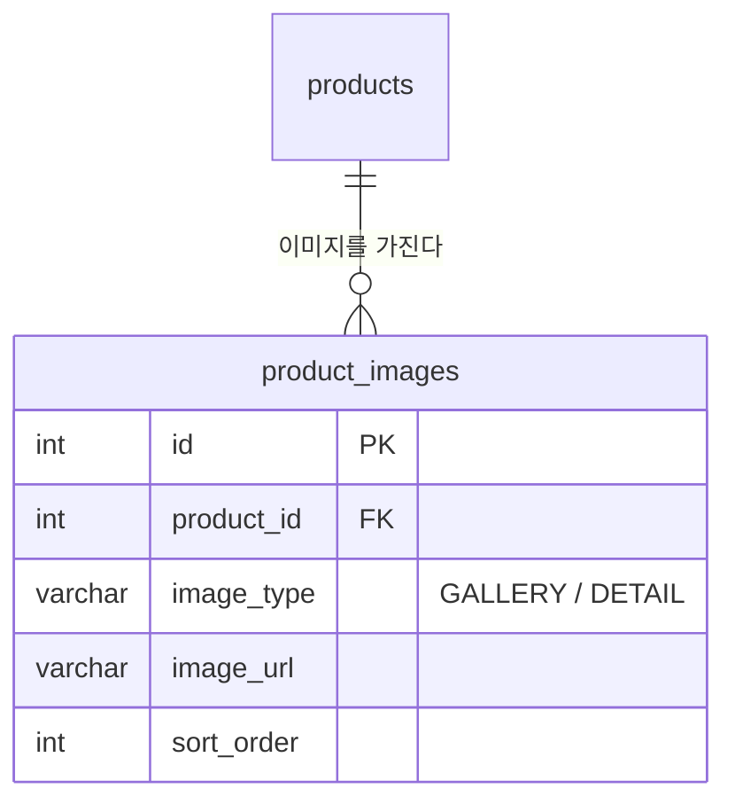
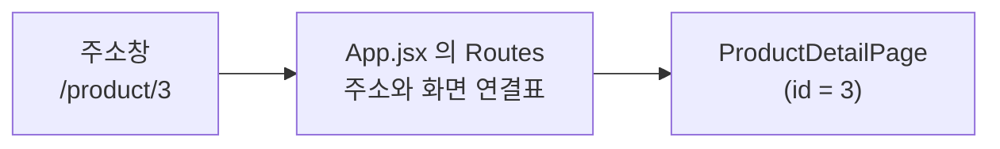
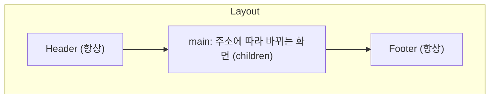
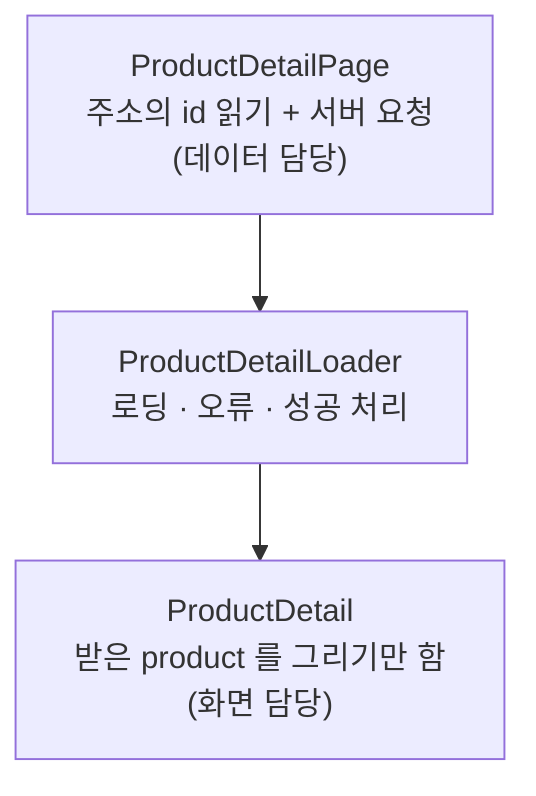
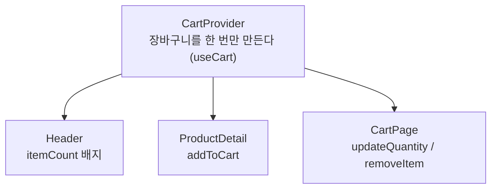

# 3일차. MVP-1 상품 상세 · 화면 이동 · 장바구니

> **오늘의 한 줄 목표** : 카드를 누르면 상세 화면으로 이동하고, 수량을 골라 **장바구니에 담아** 장바구니 화면에서 수량을 바꾸고 지울 수 있다.

| 항목 | 내용 |
|---|---|
| 만드는 것 | `GET /products/{id}` API, 상세 화면, 라우팅, 장바구니 (담기/수량/삭제) |
| 새로 설치 | 프론트 `react-router-dom` |
| 새 테이블 | `product_images` (`sql/step-03_product_images.sql`) |
| 관련 요구사항 | FR-02 상세, FR-10~13 장바구니, FR-04 품절 담기 막기 |
| 끝나면 | 목록 → 상세 → 장바구니가 이어진다. 새로고침해도 장바구니가 남는다 |

완성 스냅샷 : `docs/steps/day03/`

---

## 시간표 (8시간)

| 시간 | 내용 | 방식 |
|---|---|---|
| 09:00 ~ 09:30 | 2일차 복습, 과제 확인 | |
| 09:30 ~ 10:30 | `product_images` 테이블, `GET /products/{id}` (404 / 422) | 실습 |
| 10:30 ~ 12:00 | **라우팅** : 주소에 따라 화면 바꾸기, `Layout`, `Header` | 강의 + 실습 |
| 12:00 ~ 13:00 | 점심 | |
| 13:00 ~ 15:00 | **상세 화면** : state, 수량 버튼, 이미지 갤러리 | 실습 |
| 15:00 ~ 16:30 | **장바구니 상태 공유** : `useCart`, Context, `localStorage` | 강의 + 실습 |
| 16:30 ~ 17:30 | 장바구니 화면 읽기·시험 (제공 코드) | 읽기 + 실습 |
| 17:30 ~ 18:00 | 정리, 퀴즈 | |

> 오늘은 양이 많습니다. ✍️ 표시는 **직접 입력**하고, 📦 표시는 **완성본에서 복사해서 읽고 이해**합니다.
> `docs/steps/day03/` 에 오늘의 모든 파일이 들어 있습니다.

---

## 1. 백엔드 : 상품 상세 API

### 1-1. 상세 이미지용 테이블 만들기

상세 화면에는 사진이 여러 장 필요합니다. 상품 1개에 이미지 N개이므로 **표를 따로** 만듭니다.



| image_type | 어디에 쓰나 |
|---|---|
| `GALLERY` | 상세 화면 왼쪽의 **대표 사진 + 작은 사진들** (sort_order 1 = 대표) |
| `DETAIL` | "상세 보기"를 눌렀을 때 펼쳐지는 **긴 설명 이미지** |

mysql 에서 실행합니다. (경로는 각자 맞게)

```sql
source C:/work/miniShop/docs/sql/step-03_product_images.sql
```

마지막에 `GALLERY 74 / DETAIL 35` 처럼 개수가 나오면 성공입니다. 이미지 파일은 2일차에 복사한 `backend/products/images/` 안에 이미 있습니다 (`detail/` 하위 폴더 포함).

> 💡 컬럼 설명은 [4. 테이블 설명과 SQL](../04_tables_and_sql.md) 2-3 을 보세요.

### 1-2. ✍️ `backend/app/product.py` — 상세 함수 추가

2일차 파일 **아래에** 이어서 추가합니다. (전체 파일은 `docs/steps/day03/backend/app/product.py`)

**상품 1개 + 이미지 조회 (SQL 함수)**

```python
def find_product_by_id(product_id):
    conn = get_connection()
    try:
        with conn.cursor() as cursor:
            # %s : 값이 들어갈 "빈칸". 값은 execute 의 두 번째 인자로 따로 넘긴다. (파라미터 바인딩)
            #   -> SQL 인젝션 공격을 막아 준다. f-string 으로 SQL 에 직접 이어 붙이지 않는다.
            # 목록과 달리 상세 화면에서는 description(설명)도 함께 꺼낸다.
            sql = """
                SELECT id, name, price, stock, image_url, description
                FROM products
                WHERE id = %s AND is_active = 1
            """
            # (product_id,) : 값이 하나여도 튜플로 넘긴다. 끝의 쉼표를 빼먹지 않는다.
            cursor.execute(sql, (product_id,))

            # fetchone : 한 행만 꺼낸다. 결과가 없으면 None 이다.
            return cursor.fetchone()
    finally:
        conn.close()


# -----------------------------------------------------------------------------
# 상품 이미지 조회 (3일차) : product_images 테이블
#   GALLERY : 상세 화면의 대표 이미지 / 썸네일 (sort_order 가 작은 것이 먼저, 첫 번째 = 대표)
#   DETAIL  : "상세 보기" 를 눌렀을 때 보여 줄 상세 설명 이미지
#   돌려주는 모양 : {"gallery_images": ["경로", ...], "detail_images": ["경로", ...]}
# -----------------------------------------------------------------------------
def find_product_images(product_id):
    conn = get_connection()
    try:
        with conn.cursor() as cursor:
            sql = """
                SELECT image_type, image_url
                FROM product_images
                WHERE product_id = %s
                ORDER BY sort_order, id
            """
            cursor.execute(sql, (product_id,))
            rows = cursor.fetchall()

        return {
            "gallery_images": [r["image_url"] for r in rows if r["image_type"] == "GALLERY"],
            "detail_images": [r["image_url"] for r in rows if r["image_type"] == "DETAIL"],
        }
    finally:
        conn.close()
```

**API 함수**

```python
# GET /products/{product_id} : 상품 상세
#   product_id: int 라고 적으면 FastAPI 가 숫자인지 검사해 준다. (/products/abc → 422)
@router.get("/products/{product_id}")
def get_product(product_id: int):
    try:
        product = find_product_by_id(product_id)
        if product is not None:
            # 상세 화면용 이미지 목록을 응답에 덧붙인다
            product.update(find_product_images(product_id))
    except Exception as e:
        logger.error("상품 상세 조회 실패 id=%s: %s", product_id, e)
        raise HTTPException(status_code=500, detail="상품 상세 조회 에러")

    # 상품이 없는 경우 : 서버 오류(500)가 아니라 "찾을 수 없음(404)" 이다
    if product is None:
        raise HTTPException(status_code=404, detail="상품을 찾을 수 없습니다.")

    return product
```

### 1-3. 꼭 알아야 할 3가지

| 줄 | 설명 |
|---|---|
| `product_id: int` | 주소의 `{product_id}` 를 숫자로 받는다고 선언. `/products/abc` 를 요청하면 FastAPI 가 **422** 로 자동 거부 |
| `WHERE id = %s` + `(product_id,)` | **파라미터 바인딩**. 값을 SQL 문자열에 이어 붙이지 않는다 → SQL 인젝션 방지 |
| `404` vs `500` | 없는 상품은 **서버 고장이 아니라** 요청이 잘못된 것 → 404. 진짜 DB 오류만 500 |

> ⚠️ **SQL 인젝션 시연 (강사)** : 만약 `f"SELECT ... WHERE id = {product_id}"` 로 만들었다면 `1 OR 1=1` 같은 값이 들어와 전체 데이터가 나올 수 있습니다. 우리 코드는 `%s` 라서 안전합니다. **SQL 을 만들 때 f-string 으로 값을 넣지 않는다**를 오늘 약속으로 정합니다.

### 1-4. 시험 (`/docs`)

| 요청 | 기대 결과 |
|---|---|
| `GET /products/1` | 콜라 정보 + `gallery_images` 3개 + `detail_images` 1개 |
| `GET /products/9999` | `404` `상품을 찾을 수 없습니다.` |
| `GET /products/abc` | `422` |
| `GET /products/33` | `404` (판매중지 상품) |
| `GET /products/images/cola.jpg` | 이미지 (**상세 API 가 아니라** 이미지 파일이 나와야 한다) |

> 마지막 줄이 중요합니다. `/products/images/cola.jpg` 는 `/products/{product_id}` 와 모양이 비슷합니다. 2일차에 `main.py` 에서 이미지 공개를 **라우터보다 먼저** 등록한 이유입니다. 순서를 바꿔 보면 `422` 가 나옵니다. (시연 후 되돌리기)

---

## 2. 프론트엔드 : 화면이 여러 개가 된다

### 2-1. 패키지 설치

```powershell
cd frontend
npm install react-router-dom
```

> 지금까지는 화면이 `/` 하나였습니다. 이제 화면이 3개(목록, 상세, 장바구니)가 되므로, **주소에 따라 화면을 바꿔 주는** 라이브러리가 필요합니다.

### 2-2. 라우팅이란?



**새로고침 없이** 화면만 바뀌고, 주소는 그대로 바뀌어서 **뒤로 가기**, **링크 공유**가 됩니다.

### 2-3. ✍️ `frontend/src/main.jsx` — 앱 전체를 감싸기

```jsx
import { StrictMode } from 'react'
import { createRoot } from 'react-dom/client'
import { BrowserRouter } from 'react-router-dom'
import './index.css'
import CartProvider from './context/CartProvider.jsx'
import App from './App.jsx'

// BrowserRouter : 주소(URL)에 따라 화면을 바꾸는 기능을 앱 전체에 제공한다
// CartProvider  : 장바구니를 앱 전체(헤더, 상세, 장바구니 화면)가 함께 쓰게 한다
createRoot(document.getElementById('root')).render(
  <StrictMode>
    <BrowserRouter>
      <CartProvider>
        <App />
      </CartProvider>
    </BrowserRouter>
  </StrictMode>,
)
```

| 감싸는 것 | 역할 |
|---|---|
| `BrowserRouter` | 주소 기능을 앱 전체에 제공 |
| `CartProvider` | 장바구니를 앱 전체가 **같이** 쓰게 함 (2-8에서 만든다) |

> `CartProvider` 파일은 아직 없으므로, 이 단계에서는 빨간 오류가 납니다. 2-8까지 만들고 나면 사라집니다. 급하면 `CartProvider` 줄을 잠시 지우고 진행하세요.

### 2-4. ✍️ `frontend/src/App.jsx` — 주소 → 화면 연결표

```jsx
import { Routes, Route } from 'react-router-dom'
import Layout from './layout/Layout'
import ProductList from './pages/ProductList'
import ProductDetailPage from './pages/ProductDetailPage'
import CartPage from './pages/CartPage'
import { useCartContext } from './context/cartContext'

function App() {
  // 헤더 🛒 배지에 보여 줄 "담은 상품 수" (수량의 합이 아니다. 장바구니는 CartProvider 가 관리한다)
  const { itemCount } = useCartContext()

  return (
    <Layout cartCount={itemCount}>
      {/* 주소에 따라 본문이 바뀐다
          /             → 상품 목록
          /product/:id  → 상품 상세 (:id 는 상품 번호)
          /cart         → 장바구니
          ※ 화면 주소를 /products/... 로 만들면 Vite 프록시가 백엔드로 보내 버리므로 단수형(product)을 쓴다 */}
      <Routes>
        <Route path="/" element={<ProductList />} />
        <Route path="/product/:id" element={<ProductDetailPage />} />
        <Route path="/cart" element={<CartPage />} />
      </Routes>
    </Layout>
  )
}

export default App
```

> 💡 **화면 주소는 `/product/3`(단수), API 주소는 `/products/3`(복수)입니다.** 만약 화면 주소도 `/products/3` 이었다면, 새로고침할 때 Vite 프록시가 "이건 API 요청이네" 하고 서버로 보내 버려 JSON 이 화면에 나옵니다. 주소 이름이 겹치지 않게 짓는 것이 이유입니다.

### 2-5. ✍️ 머리글과 바닥글

화면 위(로고, 장바구니 아이콘)와 아래(약관)는 **모든 화면에서 같습니다.** 한 번만 만들어 두고 본문만 갈아 끼웁니다.



**`frontend/src/layout/Header.jsx`**

```jsx
import { Link } from 'react-router-dom'
import './Header.css'

// 머리글 : 로고(홈 링크) + 장바구니 (담은 상품 수 배지)
// props: cartCount (장바구니에 담은 상품 수)
function Header({ cartCount }) {
  return (
    <header className="site-header">
      <div className="header-top">
        {/* a 태그는 페이지를 통째로 새로 불러오지만, Link 는 화면만 바꿔서 빠르다 */}
        <Link to="/" className="logo">🥤 음료 쇼핑몰</Link>

        <div className="header-actions" style={{ marginLeft: 'auto' }}>
          <Link to="/cart" className="cart-link" aria-label="장바구니">
            🛒
            {cartCount > 0 && <span className="cart-badge">{cartCount}</span>}
          </Link>
        </div>
      </div>
    </header>
  )
}

export default Header
```

📦 **제공 파일** (완성본에서 그대로 복사)

| 파일 | 설명 |
|---|---|
| `layout/Layout.jsx` | Header + 본문(`children`) + Footer 를 쌓는 틀 |
| `layout/Footer.jsx`, `Footer.css` | 바닥글 |
| `layout/Header.css` | 머리글 모양 |

`Layout.jsx` 는 짧으니 읽어 봅니다.

```jsx
import Header from './Header'
import Footer from './Footer'

// children: 레이아웃 안에 끼워 넣을 본문
function Layout({ children, ...headerProps }) {
  return (
    <div className="layout">
      <Header {...headerProps} />
      <main className="content">{children}</main>
      <Footer />
    </div>
  )
}

export default Layout
```

> `{children}` 은 `<Layout> 이 안쪽 </Layout>` 사이에 넣은 내용입니다. App.jsx 에서 `<Routes>` 가 바로 그 자리에 들어갑니다.

### 2-6. ✍️ 카드를 링크로 — `ProductCard.jsx`

2일차의 카드를 **`Link` 로 감싸서** 누르면 `/product/번호` 로 이동하게 바꾸고, 재고가 적으면 알려 줍니다.

```jsx
import { Link } from "react-router-dom";
import "./ProductCard.css";

// 이 값 이하이면 "재고 N개 남음" 으로 알려준다
const LOW_STOCK_THRESHOLD = 20;

// 재고 문구를 결정한다. 표시할 게 없으면 null
function getStockLabel(stock) {
  if (stock === 0) return "품절";
  if (stock <= LOW_STOCK_THRESHOLD) return `재고 ${stock}개 남음`;
  return null;
}

// props: product (상품 1개 : { id, name, price, stock, image_url })
function ProductCard({ product }) {
  const soldOut = product.stock === 0;
  const stockLabel = getStockLabel(product.stock);

  // 카드 전체를 링크로 감싸서 클릭하면 /product/{id} (상세 화면) 으로 이동한다
  // 품절 상품도 상세 정보는 볼 수 있어야 하므로 링크를 막지 않는다
  return (
    <Link to={`/product/${product.id}`} className="card-link">
      <div className={soldOut ? "card sold-out" : "card"}>
        
        <h3 className="card-name">{product.name}</h3>
        <p className="card-price">{product.price.toLocaleString()}원</p>
        {/* 문구가 없어도 줄 높이는 유지해서 카드 높이가 들쭉날쭉해지지 않게 한다 ("\u00A0" = 눈에 안 보이는 공백) */}
        <p className="card-stock">{stockLabel ?? "\u00A0"}</p>
      </div>
    </Link>
  );
}

export default ProductCard;
```

> `<a href>` 는 페이지를 **통째로 다시 불러오고**, `<Link>` 는 **화면만 바꿔서** 빠릅니다. 앱 안에서 이동할 때는 항상 `Link` 를 씁니다.

### 2-7. ✍️ `api/products.js` — 상세 요청 추가

```javascript
// 백엔드 상품 API 를 부르는 함수 모음
//   화면(컴포넌트)은 fetch 를 직접 쓰지 않고 이 파일의 함수만 부른다.

// 공통 요청 함수 : 실패하면 서버가 준 메시지로 Error 를 던진다
//   signal : 요청을 도중에 취소할 때 쓰는 신호 (화면을 떠날 때 진행 중인 요청을 끊는다)
async function request(url, signal) {
    const res = await fetch(url, { signal })

    if (!res.ok) {
        const body = await res.json().catch(() => ({}))
        throw new Error(body.detail || `서버 오류 (${res.status})`)
    }

    return res.json()
}

// 상품 목록 : GET /products
export function fetchProducts(signal) {
    return request('/products', signal)
}

// 상품 상세 : GET /products/{id}
export function fetchProductDetail(id, signal) {
    return request(`/products/${id}`, signal)
}
```

두 가지가 달라졌습니다.

1. `fetchProductDetail(id, signal)` 추가
2. **`signal`** : 화면을 떠날 때 **진행 중인 요청을 취소**하는 신호입니다. 상세 화면에서 곧바로 뒤로 가기를 눌렀을 때, 늦게 도착한 응답이 엉뚱한 화면을 바꾸는 것을 막습니다.

---

## 3. 상세 화면

화면은 **두 부분**으로 나눕니다.



### 3-1. 📦 `pages/ProductDetailPage.jsx` (데이터 담당)

완성본에서 복사해서 **읽습니다.**

```jsx
function ProductDetailLoader({ id }) {
  const [product, setProduct] = useState(null);
  const [error, setError] = useState(null);

  useEffect(() => {
    const controller = new AbortController();

    fetchProductDetail(id, controller.signal)
      .then((p) => {
        const name = p.name;
        setProduct({
          ...p,
          name,
          image_url: toImagePath(p.image_url, p.id, name),
          gallery_images: (p.gallery_images ?? []).map((url) => toImagePath(url)),
          detail_images: (p.detail_images ?? []).map((url) => toImagePath(url)),
        });
      })
      .catch((err) => {
        if (err.name === "AbortError") return; // 취소된 요청은 에러가 아님
        setError(err.message);
      });

    // 화면을 떠나면 진행 중인 요청을 취소한다
    return () => controller.abort();
  }, [id]);

  if (error) return <p className="detail-message error">⚠️ {error}</p>;
  if (!product) return <p className="detail-message">상품을 불러오는 중...</p>;

  // key : 상품이 바뀌면 ProductDetail 을 새로 만들어 수량이 1 로 초기화되게 한다
  return <ProductDetail key={product.id} product={product} />;
}

// 상품 상세 "페이지" : 주소의 id 를 읽어 ProductDetailLoader 에 넘긴다
//   ProductDetail 은 product 를 props 로 받아 그리기만 하고, 데이터 요청은 Loader 가 맡는다.
function ProductDetailPage() {
  // 주소 /product/:id 의 :id 값 (항상 문자열)
  const { id } = useParams();

  return (
    <div className="detail-page">
      <Link to="/" className="detail-back">← 목록으로</Link>
      <ProductDetailLoader key={id} id={id} />
    </div>
  );
}

export default ProductDetailPage;
```

| 핵심 | 설명 |
|---|---|
| `const { id } = useParams()` | 주소 `/product/:id` 의 `:id` 값을 꺼낸다 (항상 **문자열**) |
| `useEffect(..., [id])` | `id` 가 바뀔 때마다 서버에서 다시 가져온다 |
| `return () => controller.abort()` | 화면을 떠나면 요청 취소 (**정리 함수**) |
| `key={id}` | 다른 상품으로 이동하면 컴포넌트를 **새로 만들어** 이전 상품의 값이 남지 않게 한다 |

### 3-2. ✍️ `pages/ProductDetail.jsx` (화면 담당)

파일이 길어서 **조각으로 나눠** 만듭니다. 전체는 `docs/steps/day03/frontend/src/pages/ProductDetail.jsx` 입니다. 스타일 `ProductDetail.css` 는 📦 완성본에서 복사합니다.

#### ① state 와 계산값

```jsx
function ProductDetail({ product }) {
  // ① state : 원본은 수량 하나뿐
  const [quantity, setQuantity] = useState(1);
  // 지금 대표 이미지로 보여 주는 이미지의 순서 (0 = 첫 번째)
  const [imageIndex, setImageIndex] = useState(0);
  // "상세 보기" 버튼으로 상세 이미지를 펼쳤는지 (처음에는 접혀 있다)
  const [detailOpen, setDetailOpen] = useState(false);
  // 열려 있는 대화상자 : null(없음) | "added"(담았습니다) | "stock"(재고 부족)
  const [dialog, setDialog] = useState(null);
  // 코드로 화면(주소)을 이동시키는 함수 : navigate("/cart") → 장바구니 화면
  const navigate = useNavigate();
  // 앱 전체가 공유하는 장바구니
  const { addToCart, getQuantity } = useCartContext();

  const soldOut = product.stock === 0;

  // ── 이미지 ──
  // gallery_images : 대표 이미지 + 썸네일 (DB 의 product_images, GALLERY)
  // 등록된 이미지가 없으면 목록에서 쓰던 대표 이미지(image_url) 한 장만 보여 준다
  const gallery = product.gallery_images ?? [];
  const images = gallery.length > 0 ? gallery : [product.image_url];
  const mainImage = images[imageIndex] ?? images[0];
  // detail_images : "상세 보기" 에 이어 붙여 보여 줄 상세 이미지 (DETAIL)
  const detailImages = product.detail_images ?? [];

  // ② 계산값 : state 가 아니라 렌더링할 때마다 계산한다
  const itemAmount = product.price * quantity;
  const totalAmount = itemAmount;
```

| state | 용도 |
|---|---|
| `quantity` | 고른 수량. **원본 데이터는 이것 하나뿐** |
| `imageIndex` | 지금 대표로 보여 주는 이미지 번호 |
| `detailOpen` | "상세 보기" 가 펼쳐져 있는지 |
| `dialog` | 열려 있는 대화상자 (`null` / `"added"` / `"stock"`) |

> 💡 **금액은 state 로 만들지 않습니다.** `itemAmount = product.price * quantity` 는 `quantity` 가 바뀔 때 자동으로 다시 계산되는 **계산값**입니다. 같은 정보를 state 두 곳에 두면 서로 어긋나는 버그의 원인이 됩니다.

#### ② 수량 버튼

```jsx
  // ③ 수량 변경 핸들러
  function handleMinus() {
    setQuantity(clampQuantity(quantity - 1, product.stock));
  }

  function handlePlus() {
    setQuantity(clampQuantity(quantity + 1, product.stock));
  }

  function handleInput(e) {
    // input 의 값은 문자열이므로 숫자로 바꿔서 보정한다
    setQuantity(clampQuantity(parseInt(e.target.value, 10), product.stock));
  }
```

`clampQuantity` 는 `utils/quantity.js` 의 작은 함수입니다. 수량을 **1 ~ 재고** 사이로 맞춥니다.

```javascript
// 수량을 1 ~ 재고 사이로 맞춘다. 숫자가 아니면 1
//   상세 화면과 장바구니가 같은 규칙을 쓰도록 한 곳에 둔다.
export function clampQuantity(value, stock) {
  const n = Number.isNaN(value) ? 1 : value;
  return Math.min(Math.max(n, 1), stock);
}
```

> 재고가 5개인데 `+` 를 6번 눌러도 5에서 멈춥니다. 직접 `99` 를 입력해도 5로 바뀝니다. 같은 규칙을 상세와 장바구니가 같이 쓰도록 한 곳에 뒀습니다.

#### ③ 장바구니에 담기

```jsx
  // 장바구니 담기
  // 이미 담긴 수량 (렌더링할 때마다 장바구니에서 읽는다)
  const inCart = getQuantity(product.id);

  // 장바구니 버튼 : 바로 담고, 결과 대화상자를 연다
  //    이미 담긴 수량 + 이번 수량이 재고를 넘으면 담지 않고 "재고 부족" 안내
  function handleAddToCart() {
    if (inCart + quantity > product.stock) {
      setDialog("stock");
      return;
    }

    addToCart(product, quantity);
    setDialog("added");
  }

  // [장바구니로] : 대화상자를 닫고 장바구니 화면(/cart)으로 이동한다
  function handleGoCart() {
    setDialog(null);
    navigate("/cart");
  }

  // 구매하기 : 장바구니를 거치지 않고, 이 상품 1개와 지금 고른 수량으로 바로 주문결제 화면을 연다
  //   장바구니에는 담지 않는다. (장바구니에 이미 담긴 같은 상품도 건드리지 않는다)
  //   주문결제 화면은 장바구니 항목과 같은 모양의 객체 한 개를 directItem 으로 받는다.
  function handleBuyNow() {
    navigate("/checkout", {
      state: {
        directItem: {
          id: product.id,
          name: product.name,
          price: product.price,
          image_url: product.image_url,
          stock: product.stock,
          quantity,
        },
      },
    });
  }
```

| 함수 | 하는 일 |
|---|---|
| `handleAddToCart` | **이미 담은 수량 + 이번 수량 > 재고** 이면 담지 않고 "재고 부족" 대화상자. 아니면 담고 "담았습니다" |
| `handleGoCart` | 대화상자를 닫고 `/cart` 로 이동 (`navigate`) |
| `handleBuyNow` | 장바구니를 거치지 않고 바로 `/checkout` 으로 이동 (4일차에 사용) |

> 지금은 `/checkout` 화면이 없어서 **구매하기** 버튼을 누르면 빈 화면이 나옵니다. 4일차에 만듭니다.

#### ④ 이미지 갤러리 (JSX)

```jsx
      {/* ───── 왼쪽 : 이미지 영역 ───── */}
      <div className="detail-left">
        <div className="detail-main-image box">
          
        </div>

        {/* 썸네일 버튼 : 눌린 순서(i)를 imageIndex 에 저장하면 위의 대표 이미지가 바뀐다 */}
        {images.length > 1 && (
          <div className="detail-thumbs" role="group" aria-label="상품 이미지 선택">
            {images.map((src, i) => (
              <button
                key={src}
                type="button"
                className={i === imageIndex ? "detail-thumb active" : "detail-thumb"}
                aria-label={`이미지 ${i + 1} 보기`}
                aria-pressed={i === imageIndex}
                onClick={() => setImageIndex(i)}
              >
                
              </button>
            ))}
          </div>
        )}

        {/* 상세 보기 버튼 : 누를 때마다 상세 이미지를 펼치고 접는다 */}
        <button
          type="button"
          className={detailOpen ? "detail-more-btn open" : "detail-more-btn"}
          aria-expanded={detailOpen}
          aria-controls="detail-more-content"
          onClick={() => setDetailOpen(!detailOpen)}
        >
          상세 보기 <span className="detail-more-arrow" aria-hidden="true">▼</span>
        </button>

        {/* 펼쳤을 때만 상세 이미지를 세로로 이어 붙여 보여 준다 */}
        {detailOpen && (
          <section id="detail-more-content" className="detail-more">
            {detailImages.length > 0 ? (
              detailImages.map((src, i) => (
                
              ))
            ) : (
              <p className="detail-more-empty">등록된 상세 이미지가 없습니다.</p>
            )}
          </section>
        )}
      </div>
```

- 썸네일을 누르면 `setImageIndex(i)` → 위의 큰 사진이 바뀐다.
- "상세 보기" 는 `detailOpen` 을 반대로 뒤집는다 (`!detailOpen`).
- `{조건 && <요소>}` : 조건이 참일 때만 그린다.

#### ⑤ 구매 영역 (JSX)

```jsx
      {/* ───── 오른쪽 : 구매 영역 ───── */}
      <div className="detail-right">
        <div className="box detail-name">{product.name}</div>

        <div className="box">가격 · 평점</div>

        <div className="box">옵션 선택 (색상 / 사이즈 / 수량)</div>

        {/* 수량 줄 : [−] [입력] [+]            금액 */}
        <div className="box detail-qty-row">
          <div className="qty-control">
            <button
              type="button"
              className="qty-btn"
              onClick={handleMinus}
              disabled={soldOut || quantity <= 1}
            >
              −
            </button>

            <input
              className="qty-input"
              type="number"
              min="1"
              max={product.stock}
              value={quantity}
              onChange={handleInput}
              disabled={soldOut}
            />

            <button
              type="button"
              className="qty-btn"
              onClick={handlePlus}
              disabled={soldOut || quantity >= product.stock}
            >
              +
            </button>
          </div>

          <span className="item-amount">{itemAmount.toLocaleString()}원</span>
        </div>

        {/* 총 구매액 줄 */}
        <div className="box detail-total">
          총 구매액 : <strong>{totalAmount.toLocaleString()}원</strong>
        </div>

        {/* 버튼 줄 : 오른쪽 영역의 맨 아래에 세로로 배치 (장바구니 / 구매하기) */}
        <div className="detail-buttons">
          <button
            type="button"
            className="btn"
            onClick={handleAddToCart}
            disabled={soldOut}
          >
            장바구니
          </button>
          <button
            type="button"
            className="btn"
            onClick={handleBuyNow}
            disabled={soldOut}
          >
            구매하기
          </button>
        </div>
      </div>
```

#### ⑥ 📦 대화상자 부품

`Dialog` 는 "담았습니다" 같은 알림창입니다. 완성본에서 복사해 쓰고 **쓰는 법만** 읽습니다.

```text
components/Dialog.jsx, Dialog.css, CartPlusIcon.jsx   (완성본에서 복사)
```

```jsx
<Dialog
  open={dialog === "stock"}      // true 면 보인다
  title="재고가 부족합니다"
  onConfirm={() => setDialog(null)}   // 확인 누르면 닫는다
>
  본문 내용
</Dialog>
```

> `window.alert()` 는 화면 전체를 멈추고 모양을 바꿀 수 없어서, 앱 디자인에 맞는 **공용 부품**을 만들어 둔 것입니다.

---

## 4. 장바구니 : 여러 화면이 같은 데이터를 쓴다

### 4-1. 문제

장바구니는 **여러 곳**에서 쓰입니다.

| 어디서 | 무엇을 |
|---|---|
| 상세 화면 | 담기 |
| 장바구니 화면 | 수량 변경, 삭제 |
| 헤더 | 🛒 배지의 숫자 |

각 화면이 따로 state 를 가지면 서로 모릅니다. 한 곳에서 담았는데 헤더 숫자가 안 바뀌는 문제가 생깁니다.

### 4-2. 해결 : Context (앱 전체의 공용 보관함)



세 파일이 역할을 나눕니다.

| 파일 | 역할 |
|---|---|
| `hooks/useCart.js` | 장바구니의 **상태와 기능**(담기, 수량 변경 ...)을 만든다 |
| `context/cartContext.js` | 공용 보관함을 만들고, 꺼내 쓰는 `useCartContext()` 를 제공 |
| `context/CartProvider.jsx` | `useCart()` 를 **한 번만** 실행해서 보관함에 넣는다 |

### 4-3. ✍️ `hooks/useCart.js`

**① 저장·불러오기 (localStorage)**

```javascript
// localStorage 에 장바구니를 저장하는 이름표(key)
const STORAGE_KEY = "vm-cart";

// 저장된 장바구니를 읽는다. 없거나 깨져 있으면 빈 배열
//   시크릿 모드 등에서 localStorage 접근이 실패해도 화면이 멈추지 않게 try / catch 로 감싼다
function loadCart() {
  try {
    const raw = localStorage.getItem(STORAGE_KEY);
    const data = raw ? JSON.parse(raw) : [];
    return Array.isArray(data) ? data : [];
  } catch {
    return [];
  }
}
```

```javascript
export function useCart() {
  // 처음 한 번만 localStorage 에서 읽어 온다 (함수를 넘기면 최초 렌더링 때만 실행된다)
  const [cart, setCart] = useState(loadCart);

  // cart 가 바뀔 때마다 localStorage 에 자동 저장
  useEffect(() => {
    try {
      localStorage.setItem(STORAGE_KEY, JSON.stringify(cart));
    } catch {
      // 저장 공간이 부족하거나 막혀 있어도 화면은 계속 동작한다
    }
  }, [cart]);
```

> 새로고침하면 state 는 사라집니다. 그래서 `cart` 가 바뀔 때마다 `localStorage`(브라우저의 작은 저장소)에 **자동 저장**하고, 처음 시작할 때 읽어 옵니다. (FR-12)
> `useState(loadCart)` 처럼 **함수 자체**를 넘기면 처음 한 번만 실행됩니다.

**② 담기**

```javascript
  // 담기 : 이미 있는 상품이면 수량을 더하고, 없으면 새 항목을 추가한다
  function addToCart(product, quantity) {
    setCart((prev) => {
      const found = prev.find((item) => item.id === product.id);

      if (found) {
        return prev.map((item) =>
          item.id === product.id
            ? {
                ...item,
                stock: product.stock, // 최신 재고로 갱신
                quantity: clampQuantity(item.quantity + quantity, product.stock),
              }
            : item
        );
      }

      return [
        ...prev,
        {
          id: product.id,
          name: product.name,
          price: product.price,
          image_url: product.image_url,
          stock: product.stock,
          quantity: clampQuantity(quantity, product.stock),
        },
      ];
    });
  }
```

- 이미 있는 상품이면 **수량을 더한다**. 없으면 **새 항목을 추가**한다.
- state 를 바꿀 때 `prev` 를 받는 함수 형태 `setCart((prev) => ...)` 를 쓴다. 이전 값을 기준으로 바꾸므로 안전하다.
- 원본 배열을 고치지 않고 **새 배열**을 만들어 넘긴다. (`map`, `filter`, 전개 `...`) React 는 새 배열이어야 변화를 알아챈다.

**③ 계산값**

```javascript
  // 계산값은 state 로 따로 만들지 않고 cart 에서 매번 계산한다
  // itemCount  : 담은 "상품 수" (콜라 5개 + 생수 1개 → 2)   → 헤더 🛒 배지
  // totalCount : 모든 "수량의 합" (콜라 5개 + 생수 1개 → 6) → 장바구니 화면의 총 수량
  const itemCount = cart.length;
  const totalCount = cart.reduce((sum, item) => sum + item.quantity, 0);
  const totalPrice = cart.reduce((sum, item) => sum + item.price * item.quantity, 0);
```

| 값 | 예 : 콜라 5개 + 생수 1개 | 쓰는 곳 |
|---|---|---|
| `itemCount` | 2 (상품 수) | 헤더 🛒 배지 |
| `totalCount` | 6 (수량의 합) | 장바구니 총 수량 |
| `totalPrice` | 합계 금액 | 금액 표시 |

### 4-4. ✍️ 공용 보관함

**`context/cartContext.js`**

```javascript
import { createContext, useContext } from "react";

// 장바구니를 앱 어디서나(헤더, 상세, 장바구니 화면) 꺼내 쓰기 위한 "공용 보관함"
export const CartContext = createContext(null);

// 사용하는 쪽에서는 이 함수만 부르면 된다 : const { cart, addToCart } = useCartContext()
export function useCartContext() {
  const value = useContext(CartContext);
  if (!value) {
    throw new Error("useCartContext 는 <CartProvider> 안에서만 사용할 수 있습니다.");
  }
  return value;
}
```

**`context/CartProvider.jsx`**

```jsx
import { CartContext } from "./cartContext";
import { useCart } from "../hooks/useCart";

// 앱 바깥쪽에서 한 번만 감싸 주면, 안쪽 모든 화면이 같은 장바구니를 공유한다
function CartProvider({ children }) {
  const cart = useCart();   // 장바구니 상태는 여기서 단 하나만 만든다

  return <CartContext.Provider value={cart}>{children}</CartContext.Provider>;
}

export default CartProvider;
```

이제 `main.jsx` 의 오류가 사라지고, 어느 화면에서든 한 줄로 꺼내 씁니다.

```jsx
const { cart, addToCart, itemCount } = useCartContext()
```

### 4-5. 📦 장바구니 화면 `pages/CartPage.jsx`

완성본에서 복사해 **읽고 시험**합니다. (`CartPage.css`, `utils/pricing.js` 도 함께 복사)

핵심 한 군데만 읽어 봅니다. **선택(체크박스) 상태를 어떻게 저장했을까요?**

```jsx
  // 체크가 "해제된" 상품의 id 모음. (기본은 모두 선택 상태)
  //   선택된 상품을 따로 저장하지 않고 "해제된 것" 을 저장하면,
  //   새로 담은 상품은 자동으로 선택 상태가 되고 삭제된 상품을 정리할 필요도 없다.
  const [unselected, setUnselected] = useState(() => new Set());
  // "선택삭제" 확인 대화상자가 열려 있는지
  const [deleteOpen, setDeleteOpen] = useState(false);
```

> 선택된 것을 저장하면 새 상품이 담길 때마다 "선택 목록에 추가"를 해야 합니다. 반대로 **"해제된 것"만 저장**하면 새 상품은 자동으로 선택 상태가 되고, 삭제된 상품을 정리할 필요도 없습니다. 이런 **저장할 값을 줄이는 발상**이 상태 설계의 핵심입니다.

**계산값 블록**

```jsx
  // ── 계산값 : state 로 따로 만들지 않고 매번 계산한다 ──
  const selectedItems = cart.filter((item) => !unselected.has(item.id));
  const allSelected = selectedItems.length === cart.length;
  const productAmount = selectedItems.reduce((sum, item) => sum + item.price * item.quantity, 0);
  const shippingFee = selectedItems.length > 0 ? SHIPPING_FEE : 0;
  const payAmount = productAmount - DISCOUNT_AMOUNT + shippingFee;
  const noneSelected = selectedItems.length === 0;
```

선택한 상품만 합산해서 화면 오른쪽의 결제 금액을 만듭니다. 이것도 state 가 아니라 **매번 계산**합니다.

---

## 5. 체크포인트

- [ ] 목록에서 카드를 누르면 `/product/번호` 로 이동하고 상세가 나온다
- [ ] 주소창에 `/product/9999` 를 직접 입력하면 "상품을 찾을 수 없습니다" 가 나온다
- [ ] 상세에서 `+`, `-`, 직접 입력이 **1 ~ 재고** 사이에서만 동작한다
- [ ] 썸네일을 누르면 큰 이미지가 바뀌고, "상세 보기"로 긴 이미지가 펼쳐진다
- [ ] 재고 0 상품은 담기·구매 버튼이 비활성화되어 있다
- [ ] "장바구니" → "담았습니다" 창 → "장바구니로" → 장바구니 화면에 상품이 있다
- [ ] 같은 상품을 또 담으면 수량이 늘어난다. 재고를 넘기면 "재고가 부족합니다" 가 나온다
- [ ] 헤더 🛒 배지 숫자가 담은 **상품 수**와 같다
- [ ] **새로고침**해도 장바구니가 그대로다
- [ ] F12 → Application → Local Storage 에서 `vm-cart` 를 볼 수 있다

### 지금까지 폴더 모습 (새로 생긴 것)

```text
frontend/src/
├─ main.jsx · App.jsx            ← 바뀜
├─ api/products.js               ← 바뀜 (상세 추가)
├─ layout/   Layout, Header, Footer (+css)
├─ components/ ProductCard(바뀜), Dialog, CartPlusIcon
├─ context/  cartContext.js, CartProvider.jsx
├─ hooks/    useCart.js
├─ utils/    quantity.js, pricing.js
└─ pages/    ProductList, ProductDetailPage, ProductDetail, CartPage
backend/app/product.py            ← 바뀜 (상세 추가)
```

---

## 6. 자주 하는 실수

| 증상 | 원인 | 해결 |
|---|---|---|
| `Failed to resolve import "react-router-dom"` | 패키지 설치 안 함 | `npm install react-router-dom` 후 Vite 재시작 |
| `useNavigate() may be used only in the context of a <Router>` | `BrowserRouter` 로 감싸지 않음 | `main.jsx` 확인 |
| `useCartContext 는 <CartProvider> 안에서만...` | `main.jsx` 에 `CartProvider` 누락 | 2-3 확인 |
| 새로고침하면 상세 화면에 JSON 이 나옴 | 화면 주소가 `/products/..` (복수) | 화면은 `/product/..` (단수) |
| 새로고침하면 장바구니가 빔 | `localStorage` 저장 코드 누락 | `useEffect` 의 `setItem` 확인 |
| 담기를 눌러도 헤더 숫자가 안 변함 | `useCart()` 를 화면마다 따로 호출 | `useCart()` 는 `CartProvider` 에서 **한 번만** 호출 |
| 이미지가 안 나옴 | 이미지 폴더 복사 누락(`detail/` 포함) / `step-03` 미실행 | 이미지 폴더, SQL 실행 확인 |
| 수량에 `0`, 음수가 들어감 | `clampQuantity` 를 거치지 않음 | 핸들러가 `clampQuantity` 를 쓰는지 확인 |
| `/products/images/...` 가 422 | `main.py` 에서 이미지 공개가 라우터보다 뒤에 있음 | 순서 바로잡기 |

---

## 7. 오늘의 핵심 정리

1. **주소가 곧 화면**이다. `Routes` 는 "주소 → 화면 연결표"이고, `useParams` 로 주소의 값을 읽는다.
2. 없는 데이터는 **404**, 잘못된 형식은 **422**, 서버 고장만 **500** 이다.
3. SQL 의 값은 **`%s` 로** 넣는다. f-string 으로 이어 붙이지 않는다.
4. 계산으로 얻을 수 있는 값(금액, 개수)은 **state 로 만들지 않는다.**
5. 여러 화면이 같은 데이터를 쓸 땐 **Context**, 새로고침해도 남기려면 **localStorage**.
6. state 를 바꿀 때는 원본을 고치지 않고 **새 값**을 만든다.

## 퀴즈

1. `/product/3` 과 `/products/3` 중 화면 주소는? 왜 둘을 구분했나요?
2. `setCart(prev => ...)` 처럼 함수를 넘기는 이유는?
3. 장바구니의 `quantity` 를 서버에 보내 가격을 계산해 달라고 하는 대신, 화면에서 `price * quantity` 를 계산했습니다. 이 금액을 **주문 결제에 그대로 믿고 써도 될까요?** (→ 안 된다. 4일차 BR-01)

## 과제

- **기본** : 장바구니 화면에서 "비우기" 버튼(전체 삭제)을 추가해 보기. (힌트 : `useCart` 에 이미 `clearCart` 가 있다)
- **기본** : 상세 화면에서 재고가 5개 이하일 때 "품절 임박" 문구 보이기.
- **도전** : 상세 화면에 이미 장바구니에 담긴 수량("장바구니에 3개 담김")을 보이기. (힌트 : `getQuantity`)

## 내일 예고

4일차에는 **구매하기** 를 만듭니다. 주문 테이블을 만들고, 결제하면 **재고가 줄어드는** MVP 의 마지막 퍼즐입니다.

---

## 📌 강사 메모

- **Context 는 "문제 → 해결" 순서로** 설명하세요. 먼저 헤더 숫자가 안 바뀌는 상황을 (`useCart` 를 두 곳에서 호출한 코드로) 직접 만들어 보여 주면 필요성이 단번에 이해됩니다.
- `useEffect` 정리 함수(`abort`)는 처음엔 어렵습니다. "화면을 떠나면 요청도 취소한다" 한 문장으로 충분합니다. 시연 : 네트워크 속도를 느리게 하고(F12 → Network → Slow 3G) 상세 → 뒤로가기를 눌러 보세요.
- 시간이 부족하면 `CartPage` 는 **복사 후 동작 확인**만 하고, 읽는 구간은 "선택 상태 저장" 한 부분만 설명하세요.
- 비전공자는 `...item`, `map`, `filter` 같은 문법에서 막힐 수 있습니다. useCart 의 `addToCart` 를 **종이에 손으로 한 줄씩 따라가며** 보여 주세요.
