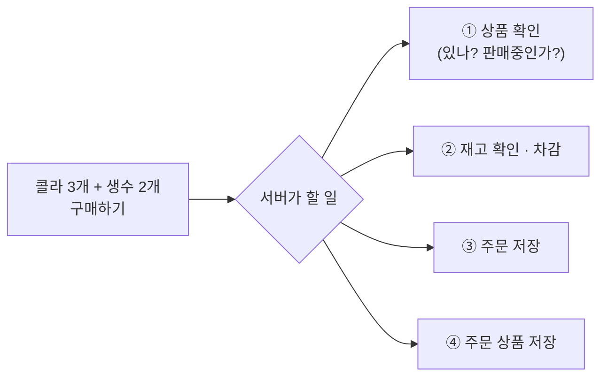
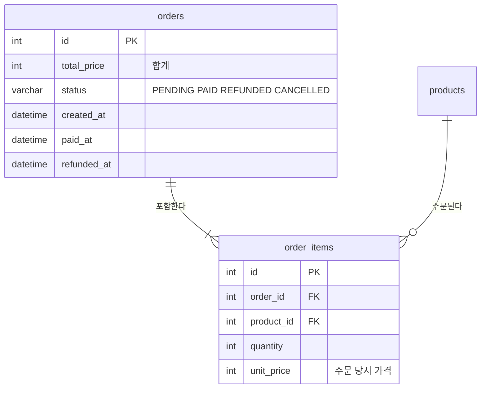
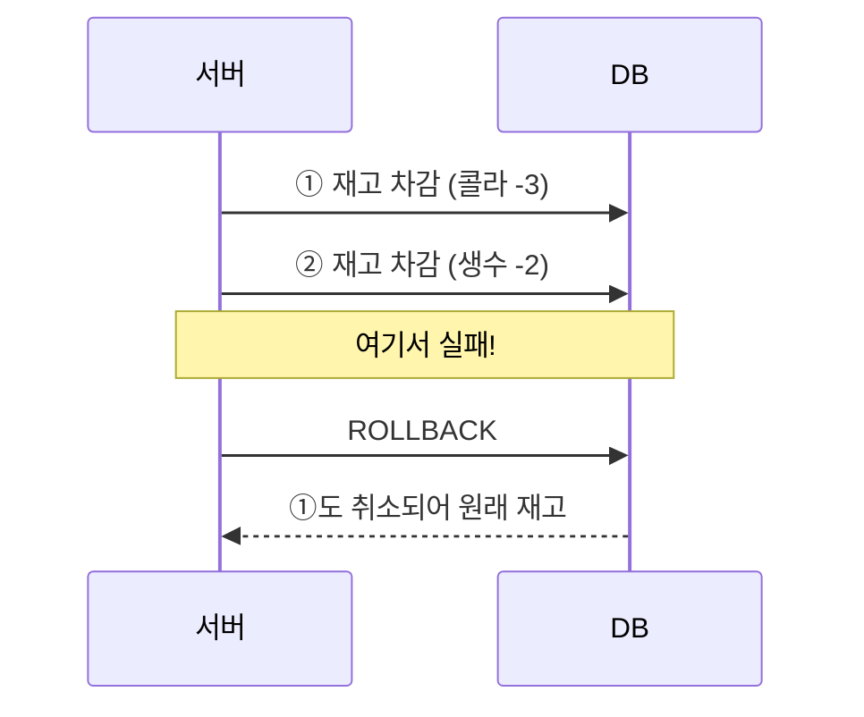
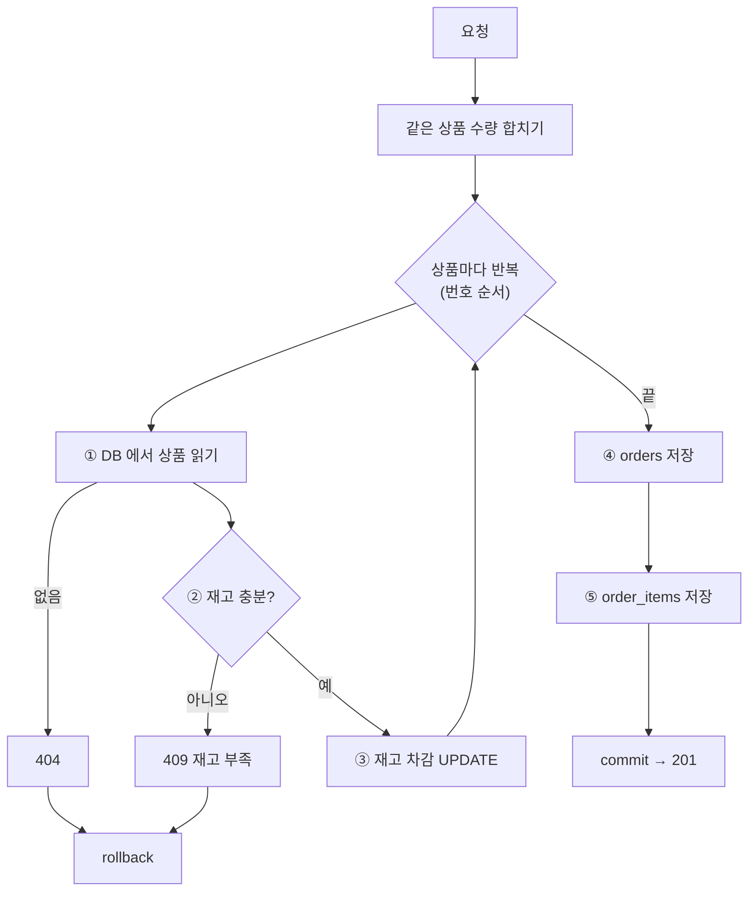
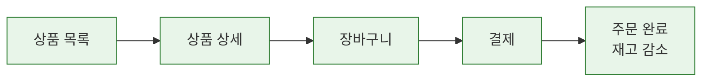

# 4일차. MVP-2 주문 · 결제 · 재고 차감

> **오늘의 한 줄 목표** : 장바구니에서 **구매하기** → 결제하기를 누르면 **주문이 저장되고 재고가 줄어든다.** 재고가 모자라면 아무것도 바뀌지 않는다.

| 항목 | 내용 |
|---|---|
| 만드는 것 | `POST /orders` API, 주문결제 화면, 주문완료 화면 |
| 새로 설치 | 없음 |
| 새 테이블 | `orders`, `order_items` (`sql/step-04_orders.sql`) — **비회원 버전** |
| 관련 요구사항 | FR-20~22, FR-24, FR-25, BR-01, BR-03, BR-04, BR-07 |
| 끝나면 | **MVP 1차 완성.** 상품 → 상세 → 장바구니 → 구매 → 재고 감소 |

완성 스냅샷 : `docs/steps/day04/`

---

## 시간표 (8시간)

| 시간 | 내용 | 방식 |
|---|---|---|
| 09:00 ~ 09:30 | 3일차 복습, 오늘의 질문 : "구매하면 DB 에는 무슨 일이 일어날까?" | 토의 |
| 09:30 ~ 10:30 | 주문 설계 : `orders` + `order_items`, 왜 두 표로 나눌까? | 강의 + 활동 |
| 10:30 ~ 11:00 | `step-04` 실행, 표 구조 확인 | 실습 |
| 11:00 ~ 12:00 | **트랜잭션** (전부 성공 or 전부 취소) | 강의 + 시연 |
| 12:00 ~ 13:00 | 점심 | |
| 13:00 ~ 15:30 | **`POST /orders` 만들기** | 실습 |
| 15:30 ~ 16:00 | `/docs` 로 시험 (성공 / 재고 부족 / 롤백) | 실습 |
| 16:00 ~ 17:30 | **결제 화면, 완료 화면** 만들기 | 실습 |
| 17:30 ~ 18:00 | 정리, 내일의 복선 | |

---

## 1. 오늘의 질문



> **활동 : 종이에 써 보기 (10분)**
> 위 ①~④ 중 **2번째 줄(생수)에서 실패**했다면, 1번째 줄(콜라)에서 이미 줄여 둔 재고는 어떻게 되어야 할까요?

→ 원래대로 **되돌려야** 합니다. 이것을 한 번에 처리하는 것이 **트랜잭션**입니다.

---

## 2. DB : 주문 테이블

### 2-1. 왜 두 개의 표인가?

주문 하나에는 상품이 여러 개 들어갑니다. 한 표에 다 넣으면 어떻게 될까요?

| (나쁜 설계) orders 한 표 | | | |
|---|---|---|---|
| 주문번호 | 상품1 | 상품2 | 상품3 ... |
| 1 | 콜라 | 생수 | (비어 있음) |

→ 상품이 몇 개까지 가능한지 정해야 하고, 비어 있는 칸이 생기고, "콜라가 팔린 총 개수" 같은 계산이 어렵습니다.

그래서 **주문(머리말)** 과 **주문 상품(한 줄 한 줄)** 로 나눕니다.



| 주문번호(orders.id) | 합계 | order_items |
|---|---|---|
| 1 | 6,500원 | (주문 1, 콜라, 3개, 1,500원) + (주문 1, 생수, 2개, 1,000원) |

### 2-2. 설계 질문 두 개

> **Q1. `unit_price` 는 `products.price` 와 같은 값인데 왜 또 저장할까요?**
> → 내일 콜라 가격이 2,000원이 되면, 어제 산 주문의 금액도 바뀌어 버립니다. **주문 당시 가격을 복사**해 두어야 합니다. (BR-07)
>
> **Q2. `total_price` 는 합계 계산이면 되는데 왜 저장할까요?**
> → 목록을 볼 때마다 계산하면 느리고, 당시 결제 금액을 **기록**으로 남겨야 합니다.

### 2-3. step-04 실행

```sql
source C:/work/miniShop/docs/sql/step-04_orders.sql
```

```sql
DESCRIBE orders;
DESCRIBE order_items;
```

> 이 단계의 `orders` 에는 **"누가 샀는지(`user_id`)"가 없습니다.** 회원 기능이 아직 없기 때문입니다. 7일차에 `ALTER TABLE` 로 컬럼을 추가합니다.

> `status` 는 4가지 값만 가능합니다. (`CHECK` 제약) `'PAID'` 대신 `'PAD'` 라고 넣으면 DB 가 거부합니다. `INSERT` 로 직접 시험해 보세요.

---

## 3. 트랜잭션

### 3-1. 은행 이체 비유

**A 계좌에서 1만 원을 빼고, B 계좌에 1만 원을 넣는다.** 중간에 전원이 나가면?



| 명령 | 뜻 |
|---|---|
| (시작) | 연결을 만들고 첫 SQL 을 실행하면 트랜잭션이 시작된다 |
| `conn.commit()` | **확정** : 지금까지의 모든 변경을 한꺼번에 반영 |
| `conn.rollback()` | **취소** : 지금까지의 모든 변경을 없던 일로 |

### 3-2. 시연 (강사) : mysql 두 창으로 보기

창 A 와 창 B 두 개를 열어 같은 DB 에 접속합니다.

```sql
-- 창 A
START TRANSACTION;
UPDATE products SET stock = stock - 1 WHERE id = 1;
SELECT stock FROM products WHERE id = 1;     -- A 에서는 49 로 보인다
```

```sql
-- 창 B (A 가 아직 확정 전)
SELECT stock FROM products WHERE id = 1;     -- B 에서는 아직 50 으로 보인다
```

```sql
-- 창 A
ROLLBACK;        -- 또는 COMMIT;
```

> **확정(COMMIT) 전에는 다른 사람에게 보이지 않습니다.** 그래서 실패하면 조용히 되돌릴 수 있습니다.
> 시연 후 `SELECT stock FROM products WHERE id = 1;` 이 원래 값인지 확인하세요.

---

## 4. 백엔드 : `POST /orders`

### 4-1. ✍️ `backend/app/order.py` (새 파일)

> 이 코드는 **처음 떠올리는 방법 그대로** 만들었습니다. 오늘은 "동작하는 것"이 목표이고, **내일** 이 코드의 약점을 직접 찾아서 고칩니다. (복선 🔍)

```python
"""주문 API (4일차) : 장바구니의 상품을 한 번에 구매한다  POST /orders

용어
  주문 = 결제 전의 한시적 상태(PENDING), 구매 = 결제 완료(PAID)
  이 파일의 POST /orders 는 주문과 결제를 한 번에 처리해서 곧바로 PAID 로 만든다. (실제 결제 연동은 하지 않는다)

4일차 버전 : 로그인 없이(비회원) 주문한다. 6~7일차에 회원 기능을 만들고 "누가 샀는지" 를 연결한다.
"""
import logging

from fastapi import APIRouter, HTTPException
from pydantic import BaseModel, Field

from .database import get_connection
from .product import find_product_by_id

logger = logging.getLogger(__name__)
router = APIRouter(tags=["orders"])


# -----------------------------------------------------------------------------
# 요청 본문(JSON) 모양
#   화면이 보내는 JSON 이 이 모양과 다르면 FastAPI 가 함수 실행 전에 422 로 거부한다.
#   ※ 가격은 받지 않는다. 가격은 서버가 DB 에서 읽는다. (화면이 보낸 가격은 조작될 수 있다)
# -----------------------------------------------------------------------------
class OrderItemIn(BaseModel):
    product_id: int
    quantity: int = Field(ge=1, le=99)         # 1 ~ 99 개


class OrderIn(BaseModel):
    items: list[OrderItemIn] = Field(min_length=1)    # 최소 1개 이상


# -----------------------------------------------------------------------------
# POST /orders : 구매하기 (주문 + 결제)
#   하나라도 실패하면 전체를 되돌린다 (rollback).
# -----------------------------------------------------------------------------
@router.post("/orders", status_code=201)
def create_order(body: OrderIn):
    # 같은 상품이 여러 줄이면 수량을 합친다. {상품번호: 수량}
    wanted: dict[int, int] = {}
    for it in body.items:
        wanted[it.product_id] = wanted.get(it.product_id, 0) + it.quantity
    if any(q > 99 for q in wanted.values()):
        raise HTTPException(status_code=422, detail="상품당 수량은 99개까지입니다.")

    conn = get_connection()
    try:
        with conn.cursor() as cur:
            lines, total = [], 0
            for pid in sorted(wanted):                 # 번호 순서로 처리 (순서를 고정하면 동시 주문 때 서로 엉키는 일이 줄어든다)
                qty = wanted[pid]

                # ① 상품을 DB 에서 읽는다 : 3일차에 만든 함수를 다시 쓴다. 가격과 재고는 항상 DB 값을 쓴다
                p = find_product_by_id(pid)
                if p is None:
                    raise HTTPException(status_code=404, detail=f"상품을 찾을 수 없습니다. (id={pid})")

                # ② 재고가 충분한지 확인한다
                if p["stock"] < qty:
                    raise HTTPException(status_code=409, detail=f"재고가 부족합니다. ({p['name']})")

                # ③ 재고를 줄인다
                cur.execute("UPDATE products SET stock = stock - %s WHERE id = %s", (qty, pid))

                lines.append((pid, p["name"], qty, p["price"]))
                total += qty * p["price"]                  # 합계도 서버가 계산한다

            # ④ 주문 1건 저장
            cur.execute(
                "INSERT INTO orders (total_price, status, paid_at) VALUES (%s, 'PAID', NOW())",
                (total,),
            )
            order_id = cur.lastrowid                       # 방금 저장한 주문의 번호

            # ⑤ 주문 상품 저장 (unit_price : 주문 당시 가격을 복사해 둔다)
            cur.executemany(
                "INSERT INTO order_items (order_id, product_id, quantity, unit_price) VALUES (%s, %s, %s, %s)",
                [(order_id, pid, qty, price) for pid, _, qty, price in lines],
            )

        conn.commit()                                      # 여기까지 오면 전부 성공 → 한꺼번에 확정
    except HTTPException:
        conn.rollback()                                    # 재고 부족 등 : 지금까지 한 일을 전부 되돌린다
        raise
    except Exception as e:
        conn.rollback()
        logger.error("구매 처리 실패: %s", e)
        raise HTTPException(status_code=500, detail="구매 처리 에러")
    finally:
        conn.close()

    logger.info("구매 완료 order_id=%s total=%s", order_id, total)
    return {
        "order_id": order_id,
        "status": "PAID",
        "total_price": total,
        "items": [
            {"product_id": pid, "product_name": name, "quantity": qty, "unit_price": price}
            for pid, name, qty, price in lines
        ],
    }
```

### 4-2. 코드 읽기

**① 요청 모양 : `OrderIn`**

```json
{ "items": [ { "product_id": 1, "quantity": 3 }, { "product_id": 12, "quantity": 2 } ] }
```

| 필드 | 규칙 | 어기면 |
|---|---|---|
| `product_id` | 정수 | 422 |
| `quantity` | 1 ~ 99 | 422 (BR-04) |
| `items` | 1개 이상 | 422 |

> **가격(`price`)은 받지 않습니다.** 화면이 "콜라 1원"이라고 보내도 믿지 않고, 서버가 DB 의 가격으로 계산합니다. (BR-01) 브라우저 개발자 도구에서 누구나 요청을 바꿀 수 있기 때문입니다.

**② 처리 순서**



**③ 코드 속의 약속들**

| 코드 | 이유 |
|---|---|
| `sorted(wanted)` | 항상 번호 순서로 처리. 두 주문이 서로 반대 순서로 잠그다가 멈추는 일(교착)을 줄인다 |
| `409 Conflict` | "지금 상태와 충돌한다" = 재고 부족. 404(없음)·422(형식 오류)와 구분 |
| `except HTTPException: rollback; raise` | 우리가 일부러 던진 오류도 **되돌린 뒤** 그대로 응답한다 |
| `except Exception` → 500 | 예상 못 한 오류. 사용자에게는 일반 문구만, 자세한 내용은 로그에만 |
| `cur.lastrowid` | 방금 `INSERT` 한 행의 자동 증가 번호 (`orders.id`) |
| `executemany` | 같은 SQL 을 값만 바꿔 여러 번 실행 |
| `finally: conn.close()` | 성공하든 실패하든 연결은 닫는다 |

### 4-3. ✍️ `main.py` 에 연결

두 줄을 추가합니다.

```python
from .order import router as order_router          # 맨 위 import 쪽에

app.include_router(order_router)     # 주문 API (/orders)    ← 상품 라우터 아래에
```

전체 파일은 `docs/steps/day04/backend/app/main.py` 입니다.

### 4-4. 시험 (`/docs`)

`/docs` → `POST /orders` → **Try it out** 에서 아래 값을 하나씩 넣어 봅니다.

| # | 보내는 값 | 기대 결과 |
|---|---|---|
| ① | `{"items":[{"product_id":1,"quantity":3},{"product_id":12,"quantity":2}]}` | `201`, `total_price` 6500 |
| ② | 같은 요청 후 `GET /products/1` | 콜라 재고가 3 줄었다 |
| ③ | `{"items":[{"product_id":9999,"quantity":1}]}` | `404` |
| ④ | `{"items":[{"product_id":1,"quantity":0}]}` | `422` |
| ⑤ | `{"items":[]}` | `422` |
| ⑥ | **롤백 확인** : 콜라 1개 + 망고주스(재고 8) 99개 → 그리고 콜라 재고 확인 | `409` + **콜라 재고가 그대로**(되돌려졌다) |
| ⑦ | 품절 상품(체리콜라, id 3) 1개 | `409` |
| ⑧ | 판매중지 상품(id 33) | `404` |

DB 에서도 확인합니다.

```sql
SELECT * FROM orders;
SELECT * FROM order_items;
SELECT id, name, stock FROM products WHERE id IN (1, 12);
```

> ⑥ 이 오늘 가장 중요한 시험입니다. **실패했는데 앞 상품의 재고가 줄어 있으면** `rollback` 이 안 된 것입니다.

---

## 5. 프론트엔드 : 결제 화면

### 5-1. 프록시에 `/orders` 추가 — `vite.config.js`

```js
proxy: {
  '/products': 'http://localhost:8000',
  '/orders': 'http://localhost:8000',     // ← 추가
},
```

> 바꿨으면 **Vite 를 껐다 켭니다.** (2일차의 그 실수!)

### 5-2. ✍️ `api/orders.js`

```javascript
// 백엔드 주문 API : POST /orders

// 구매하기 (주문 + 결제를 한 번에 처리한다)
//   items : [{ product_id, quantity }]   ※ 가격은 보내지 않는다. 서버가 DB 에서 읽는다.
//   성공  : { order_id, status: "PAID", total_price, items: [...] }
//   실패  : 서버가 준 메시지(재고 부족 등)로 Error 를 던진다.
export async function createOrder(items) {
    const res = await fetch('/orders', {
        method: 'POST',
        headers: { 'Content-Type': 'application/json' },   // 보내는 데이터가 JSON 이라고 알려 준다
        body: JSON.stringify({ items }),                   // 객체 → JSON 글자
    })

    if (!res.ok) {
        const data = await res.json().catch(() => ({}))
        // 422 (입력 형식 오류) 는 detail 이 배열로 올 수 있어 일반 문구로 바꾼다
        throw new Error(typeof data.detail === 'string' ? data.detail : '입력한 내용을 확인해 주세요.')
    }
    return res.json()
}
```

2일차의 `GET` 요청과 달라진 점 :

| 달라진 점 | 이유 |
|---|---|
| `method: 'POST'` | 데이터를 **보내서** 새로 만드는 요청 |
| `headers: Content-Type: application/json` | 보내는 데이터가 JSON 이라고 알려 준다 |
| `body: JSON.stringify(...)` | 자바스크립트 객체 → JSON 글자 |
| `items` 만 보낸다 | **가격은 보내지 않는다** |

### 5-3. ✍️ `pages/CheckoutPage.jsx`

```jsx
import { useState } from "react";
import { Navigate, useLocation, useNavigate } from "react-router-dom";
import { useCartContext } from "../context/cartContext";
import { createOrder } from "../api/orders";
import { won } from "../utils/pricing";
import "./CheckoutPage.css";

// 주문결제 화면 (4일차 간단 버전)
//   이 화면으로 들어오는 길은 두 가지이고, 둘 다 navigate 의 state 로 정보를 받는다.
//     ① 장바구니의 구매하기   : state.ids        → 선택한 상품의 id 목록 (장바구니에서 찾는다)
//     ② 상품 상세의 구매하기  : state.directItem → 그 상품 1개와 수량 (장바구니와 무관)
function CheckoutPage() {
  const { cart, removeItems } = useCartContext();
  const navigate = useNavigate();
  const location = useLocation();
  const ids = location.state?.ids;
  const directItem = location.state?.directItem;

  const [paying, setPaying] = useState(false);   // 결제 처리 중 (버튼 중복 클릭 방지)
  const [error, setError] = useState("");        // 결제 실패 메시지
  const [paid, setPaid] = useState(false);       // 결제 성공 후 장바구니가 비어도 /cart 로 튕기지 않게 한다

  // 주문할 상품 목록
  let items = [];
  if (directItem) items = [directItem];
  else if (ids) items = cart.filter((item) => ids.includes(item.id));

  // 주소를 직접 입력해서 들어왔거나(선택 정보 없음) 상품이 모두 사라졌으면 장바구니로 돌려보낸다
  if (items.length === 0) {
    return paid ? null : <Navigate to="/cart" replace />;
  }

  // 화면에 보여 줄 합계 (※ 실제 결제 금액은 서버가 DB 가격으로 다시 계산한다)
  const total = items.reduce((sum, item) => sum + item.price * item.quantity, 0);

  // 결제하기 : 서버에는 "어떤 상품을 몇 개" 만 보낸다 (가격은 보내지 않는다)
  async function handlePay() {
    setPaying(true);
    setError("");
    try {
      const order = await createOrder(items.map((i) => ({ product_id: i.id, quantity: i.quantity })));
      setPaid(true);
      // 장바구니에서 온 구매면, 구매한 상품을 장바구니에서 뺀다
      if (!directItem) removeItems(items.map((i) => i.id));
      // replace : 뒤로 가기로 결제 화면에 다시 오지 못하게 기록을 바꿔치기한다
      navigate("/order-complete", { replace: true, state: { order } });
    } catch (e) {
      setError(e.message);     // 예 : "재고가 부족합니다. (콜라)"
      setPaying(false);
    }
  }

  return (
    <div className="checkout-page">
      <h2 className="checkout-title">주문 / 결제</h2>

      <ul className="checkout-list">
        {items.map((item) => (
          <li key={item.id}>
            
            <span className="checkout-name">{item.name} × {item.quantity}개</span>
            <strong>{won(item.price * item.quantity)}</strong>
          </li>
        ))}
      </ul>

      <div className="checkout-total">
        <span>결제 금액</span>
        <strong>{won(total)}</strong>
      </div>

      {error && <p className="checkout-error">⚠️ {error}</p>}

      <button type="button" className="checkout-pay" disabled={paying} onClick={handlePay}>
        {paying ? "결제 처리 중..." : `${won(total)} 결제하기`}
      </button>
    </div>
  );
}

export default CheckoutPage;
```

스타일 `CheckoutPage.css` 는 📦 `docs/steps/day04/frontend/src/pages/CheckoutPage.css` 를 복사합니다.

**읽어 볼 곳**

| 코드 | 설명 |
|---|---|
| `location.state?.directItem / ids` | 3일차에 `navigate("/checkout", { state: ... })` 로 **넘겨 준 값**을 받는다. 구매하기를 누른 길이 두 가지(상세 / 장바구니)이기 때문 |
| `<Navigate to="/cart" replace />` | 주소창에 `/checkout` 을 직접 쳐서 들어오면 상품 정보가 없다 → 장바구니로 돌려보낸다 |
| `paying` state | 결제 중에는 버튼을 막는다. **더블 클릭하면 주문이 두 번** 만들어지기 때문 |
| `paid` state | 결제가 끝나 장바구니가 비면 위의 `Navigate` 로 튕기지 않게 한다 |
| `total` | 화면에 보여 주기 위한 합계일 뿐. **진짜 금액은 서버가 계산**한다 |
| `replace: true` | 결제 화면을 기록에서 바꿔치기해서 뒤로 가기로 **다시 결제하는 것**을 막는다 |
| `catch (e) { setError(e.message) }` | 서버가 준 "재고가 부족합니다. (콜라)" 를 그대로 보여 준다 |

### 5-4. ✍️ `pages/OrderCompletePage.jsx`

```jsx
import { Link, Navigate, useLocation } from "react-router-dom";
import { won } from "../utils/pricing";
import "./OrderCompletePage.css";

// 주문완료(구매 완료) 화면
//   결제하기 성공 후 navigate 의 state.order 로 서버 응답을 받아서 보여 준다.
//   주소를 직접 입력해서 들어오면(state 없음) 홈으로 돌려보낸다.
function OrderCompletePage() {
  const order = useLocation().state?.order;
  if (!order) return <Navigate to="/" replace />;

  return (
    <div className="complete-page">
      <h2 className="complete-title">✅ 결제가 완료되었습니다</h2>
      <p className="complete-sub">주문번호 {order.order_id} · 구매가 확정되었습니다.</p>

      <ul className="complete-list">
        {order.items.map((item) => (
          <li key={item.product_id}>
            <span>{item.product_name} × {item.quantity}개</span>
            <strong>{won(item.unit_price * item.quantity)}</strong>
          </li>
        ))}
      </ul>

      <div className="complete-total">
        <span>결제 금액 (상품 합계)</span>
        <strong>{won(order.total_price)}</strong>
      </div>

      <Link to="/" className="complete-home">쇼핑 계속하기</Link>
    </div>
  );
}

export default OrderCompletePage;
```

스타일 `OrderCompletePage.css` 는 📦 완성본에서 복사합니다.

### 5-5. ✍️ `App.jsx` 에 두 화면 추가

```jsx
import CheckoutPage from './pages/CheckoutPage'
import OrderCompletePage from './pages/OrderCompletePage'

<Route path="/checkout" element={<CheckoutPage />} />
<Route path="/order-complete" element={<OrderCompletePage />} />
```

전체 파일은 `docs/steps/day04/frontend/src/App.jsx` 입니다.

> 화면 주소를 `/order-complete` 로 한 이유 : API 주소 `/orders` 와 시작이 겹치지 않게 하기 위해서입니다.

---

## 6. 체크포인트

- [ ] 상세 화면 **구매하기** → 결제 화면 → 결제하기 → 완료 화면
- [ ] 장바구니에서 상품을 선택하고 **구매하기** → 같은 흐름. 완료 후 **구매한 상품이 장바구니에서 빠진다**
- [ ] 구매 후 목록/상세에서 **재고가 줄어 있다**
- [ ] 재고보다 많이 담아(장바구니에 담은 뒤 DB 에서 재고를 줄여 보세요) 결제하면 "재고가 부족합니다" 가 화면에 나온다
- [ ] 완료 화면에서 새로고침하면 홈으로 돌아간다
- [ ] 결제하기 버튼을 연타해도 `orders` 에 **한 건만** 생긴다
- [ ] `orders`, `order_items` 에 데이터가 쌓이고 `unit_price` 가 주문 당시 가격이다

### 🎉 MVP 1차 완성



---

## 7. 자주 하는 실수

| 증상 | 원인 | 해결 |
|---|---|---|
| `Failed to fetch` / `404` on `/orders` | 프록시에 `/orders` 추가 후 Vite 재시작 안 함 | Vite 껐다 켜기 |
| `405 Method Not Allowed` | 화면이 `GET` 으로 보냄 | `method: 'POST'` 확인 |
| `422` | JSON 모양이 다름 (`items` 이름, `product_id` 오타) | 개발자 도구 Network → Payload 확인 |
| 재고가 줄었는데 주문이 없음 | `commit` 전에 오류 / `rollback` 누락 | `except` 블록의 `conn.rollback()` 확인 |
| 결제 후 장바구니가 안 빠짐 | `removeItems` 호출 누락 | `handlePay` 확인 |
| 결제하자마자 장바구니 화면으로 튕김 | `paid` 처리 누락 | `setPaid(true)` 확인 |
| `Cannot read properties of undefined (reading 'items')` | 완료 화면에서 `order` 없음 | `state?.order` 와 `Navigate` 확인 |
| 한글 상품명 주문 시 오류 | DB 문자셋 문제 | `database.py` 의 `charset="utf8mb4"` 확인 |

---

## 8. 오늘의 핵심 정리

1. 주문은 **머리말(orders) + 한 줄 한 줄(order_items)** 두 표로 나눈다.
2. 가격과 합계는 **서버가** DB 값으로 계산한다. 화면이 보낸 금액은 믿지 않는다.
3. 여러 단계가 **전부 성공하거나 전부 취소**되어야 할 때 트랜잭션(`commit` / `rollback`)을 쓴다.
4. 상태 코드로 상황을 구분한다 : **404** 없음, **409** 충돌(재고 부족), **422** 형식 오류, **500** 서버 오류.
5. 결제 버튼은 **중복 클릭을 막는다.**

## 퀴즈

1. `INSERT INTO orders ...` 와 `INSERT INTO order_items ...` 사이에서 서버가 꺼지면 어떻게 될까요? (트랜잭션이 확정되기 전이라 둘 다 반영되지 않는다)
2. 이미 `404` 를 던지는 코드에서 왜 `rollback` 을 또 하나요? (앞 상품에서 이미 줄인 재고를 되돌리려고)
3. 화면에서 계산한 `total` 을 서버에 같이 보내면 안 되나요?

## 과제

- **기본** : 주문 후 `SELECT * FROM order_items WHERE order_id = ?;` 로 `unit_price` 가 저장된 것을 확인하고, **상품 가격을 바꿔도** 이미 저장된 주문의 `unit_price` 가 그대로인 것을 확인하기.
- **기본** : 완료 화면에 "주문 상품 N종, 총 M개" 를 보여 주기.
- **도전** : 결제 화면에 상품이 하나도 없을 때(`items.length === 0`) 어떤 일이 일어나는지 설명해 보기.

## 🔍 내일 예고 (복선)

오늘 만든 재고 차감 코드에는 **약점**이 있습니다. 5일차에는 **여러 명이 동시에** 같은 상품을 주문하게 해서 무슨 일이 생기는지 눈으로 확인하고, 직접 고칩니다.

---

## 📌 강사 메모

- 오늘의 **핵심 장면** 은 4-4 의 ⑥ 롤백 시험입니다. "실패했는데 재고가 안 줄었다"를 DB 에서 직접 확인하게 해 주세요.
- 재고 차감 코드를 일부러 **단순한 방식**(읽고, 비교하고, 줄이기)으로 만들었습니다. "이게 틀린 코드냐?"라는 질문이 나오면 **"내일 확인해 봅시다"** 로 넘기세요. 학생이 스스로 문제를 발견하는 것이 목적입니다.
- 트랜잭션 시연(3-2)은 mysql 창 두 개를 **화면 분할**로 보여 주면 효과가 큽니다.
- 시간이 남으면 `order_items` 와 `products` 를 JOIN 해서 "주문 1번의 상세"를 조회해 보세요. (04번 문서 4장의 SQL)
