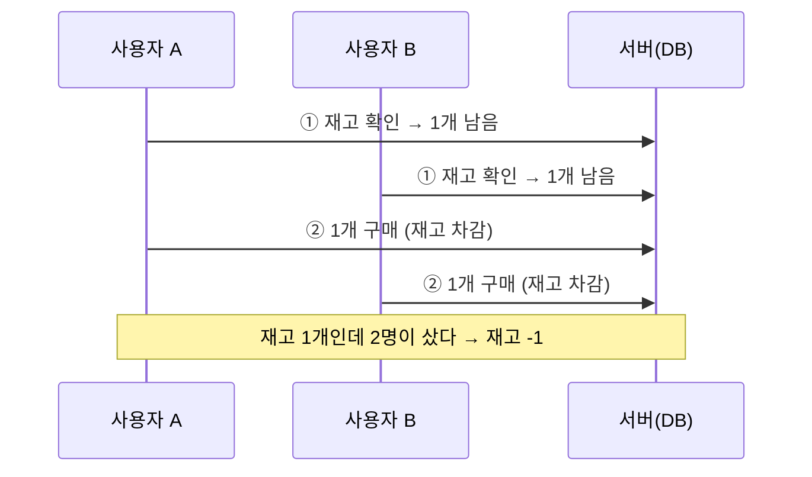
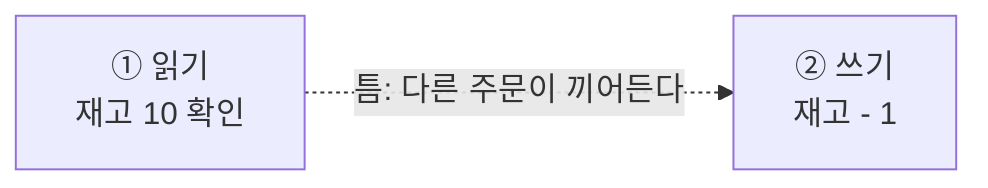
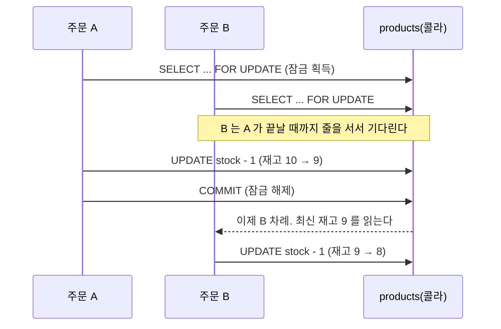

# 5일차. MVP 완성 : 동시 주문 실험과 재고 지키기

> **오늘의 한 줄 목표** : 여러 명이 **동시에** 같은 상품을 주문해도 재고가 음수가 되지 않고, 모자라면 "재고 부족"으로 정확히 안내한다. 그리고 MVP 를 **조별로 발표**한다.

| 항목 | 내용 |
|---|---|
| 만드는 것 | 재고 차감 코드 수정 (`order.py`), 동시 주문 실험 스크립트 (`race_test.py`) |
| 새로 설치 | 없음 |
| 새 테이블 | 없음 |
| 관련 요구사항 | FR-23, BR-02, BR-03 |
| 끝나면 | **MVP 최종 완성** (1~5일차). 회원 없이도 쓸 수 있는 쇼핑몰 |

완성 스냅샷 : `docs/steps/day05/`

---

## 시간표 (8시간)

| 시간 | 내용 | 방식 |
|---|---|---|
| 09:00 ~ 09:40 | 4일차 복습. "어제 만든 코드, 문제 없을까?" | 토의 |
| 09:40 ~ 10:40 | **경쟁 상태(race condition)** 개념 : 은행 창구 비유 | 강의 |
| 10:40 ~ 12:00 | **실험 ①②** : 일부러 틀린 코드로 문제를 눈으로 보기 | 실습 |
| 12:00 ~ 13:00 | 점심 | |
| 13:00 ~ 14:30 | **고치기** : 조건부 UPDATE → 행 잠금(`FOR UPDATE`) | 실습 |
| 14:30 ~ 15:30 | 오류 응답 정리 (404 / 409 / 422 / 500), 로그 읽기 | 강의 + 실습 |
| 15:30 ~ 16:30 | **MVP 점검** : 시나리오 표로 전체 시험 | 실습 (조별) |
| 16:30 ~ 17:30 | **MVP 발표** (조별 5분 + 질문) | 발표 |
| 17:30 ~ 18:00 | 1주차 회고 (잘된 점 / 어려웠던 점) | 토의 |

---

## 1. 문제 : "동시에" 사면 어떻게 될까?

### 1-1. 은행 창구 비유

통장에 잔액이 **1만 원**뿐인데, 두 사람이 **동시에** 1만 원씩 출금하려고 합니다.



> **"확인하고, 그다음에 행동한다"** (check-then-act) 사이에 **틈**이 있으면 그 틈에 다른 사람이 끼어듭니다. 이 틈 때문에 생기는 오류를 **경쟁 상태(race condition)** 라고 합니다.

### 1-2. 어제 만든 코드를 다시 봅니다

```python
# ① 확인
p = find_product_by_id(pid)
if p["stock"] < qty:
    raise HTTPException(status_code=409, detail="재고가 부족합니다.")

# ② 행동
cur.execute("UPDATE products SET stock = stock - %s WHERE id = %s", (qty, pid))
```

> **질문 : ① 과 ② 사이에 틈이 있을까요? 있다면 어디일까요?**
> 평소에는 눈 깜짝할 새라 거의 안 부딪힙니다. 하지만 **이벤트 때 수백 명이 동시에** 들어오면 반드시 부딪힙니다.

---

## 2. 실험 : 문제를 눈으로 보기

### 2-1. 📦 실험 스크립트 `backend/race_test.py` (제공)

`docs/steps/day05/backend/race_test.py` 를 `backend` 폴더에 복사합니다. 읽을 부분은 아래뿐입니다.

```python
# ---- 실행 : 모든 주문자가 준비될 때까지 기다렸다가(barrier) 한꺼번에 출발
barrier = threading.Barrier(workers)
codes = []


def worker():
    barrier.wait()
    codes.append(order_one())


threads = [threading.Thread(target=worker) for _ in range(workers)]
for t in threads:
    t.start()
for t in threads:
    t.join()
```

| 하는 일 | |
|---|---|
| 재고를 10개로 맞춘다 | 준비 |
| **20명**이 준비될 때까지 기다렸다가(`barrier`) **한꺼번에** 주문한다 | 동시에 출발 |
| 성공(201) / 재고 부족(409) / 그 외 개수, 실제 팔린 수량, 최종 재고를 센다 | 결과 |

**올바른 결과** : 성공 10건, 재고 부족 10건, 최종 재고 0, 팔린 수량 10개.

> ⚠️ 이 스크립트는 **연습용 DB** 의 `products` 재고를 바꾸고 주문 기록을 남깁니다. 서버(8000)가 켜져 있어야 합니다.

### 2-2. 실험 ① 일부러 틈을 벌려서 실행

실제 서버가 빠르면 틈이 너무 작아 문제가 잘 안 보입니다. 그래서 **일부러 틈을 벌립니다.**

`order.py` 맨 위에 `import time` 을 추가하고, ② 확인과 ③ 줄이기 **사이**에 한 줄을 넣습니다.

```python
import time          # 맨 위 import 에 추가
...
                # ② 재고가 충분한지 확인한다
                if p["stock"] < qty:
                    raise HTTPException(status_code=409, detail=f"재고가 부족합니다. ({p['name']})")

                time.sleep(0.05)     # ← 실험용 : 확인과 차감 사이를 일부러 벌린다 (끝나면 지운다!)

                # ③ 재고를 줄인다
                cur.execute("UPDATE products SET stock = stock - %s WHERE id = %s", (qty, pid))
```

> 💡 실제 서비스에서는 DB 가 바쁘거나 서버가 느려질 때 **저절로** 이런 틈이 생깁니다. 우리는 그것을 재현하는 것입니다.

서버를 다시 시작하고(자동 반영이 안 되면 껐다 켜기) 실행합니다.

```powershell
python race_test.py 10 10 20
```

**예상되는 결과 (숫자는 매번 조금씩 다릅니다)**

```text
주문 성공(201)     : 10건   (올바른 값 10)
재고 부족(409)     : 8건    (올바른 값 10)
그 밖의 응답        : 2건  [500]
실제로 팔린 수량   : 10개
최종 재고          : 0개
```

**500 오류가 나온 이유를 서버 로그에서 찾아봅니다.**

서버 터미널에서 `[ERROR]` 줄을 찾으세요. 우리 DB 에는 `CHECK (stock >= 0)` 라는 **안전망**이 있습니다. 확인 단계를 몰래 통과한 주문이 재고를 -1 로 만들려고 하면 **DB 가 거부**합니다.

> 정리 : **음수 재고는 DB 가 막아 주었습니다.** 하지만 사용자는 "재고가 부족합니다"가 아니라 **"서버 오류(500)"** 를 봅니다. 안전망은 있었지만, 우리 코드가 제대로 처리한 것은 아닙니다.

### 2-3. 실험 ② 안전망을 치워 보기

DB 의 안전망이 **없었다면** 어떻게 되었을까요? mysql 에서 일시적으로 제거합니다.

```sql
ALTER TABLE products DROP CONSTRAINT chk_products_stock;
```

다시 실행합니다.

```powershell
python race_test.py 10 10 20
```

```text
주문 성공(201)     : 12건   (올바른 값 10)
실제로 팔린 수량   : 12개   (재고가 10개였으니 10개를 넘으면 안 된다)
최종 재고          : -2개

[문제] 초과 판매! 재고는 10개인데 12개를 팔았습니다.
```

**재고가 없는 물건을 팔았습니다.** 실제 쇼핑몰이라면 고객에게 "죄송하지만 물건이 없습니다"를 말해야 합니다.

> 🔔 **실험이 끝났으면 반드시 되돌립니다.**
> ```sql
> UPDATE products SET stock = 0 WHERE stock < 0;
> ALTER TABLE products ADD CONSTRAINT chk_products_stock CHECK (stock >= 0);
> ```

### 2-4. 무엇이 문제였나



**읽기와 쓰기가 따로**라서 문제입니다. 해결의 방향은 두 가지입니다.

| 방향 | 방법 |
|---|---|
| 확인과 차감을 **한 문장**으로 | 조건부 UPDATE |
| 읽는 동안 다른 사람이 못 건드리게 **잠그기** | `SELECT ... FOR UPDATE` |

---

## 3. 고치기

### 3-1. 고치기 ① 조건부 UPDATE : 확인과 차감을 하나로

```sql
UPDATE products
SET stock = stock - 3
WHERE id = 1 AND stock >= 3;     -- 재고가 3개 이상일 때만 줄어든다
```

DB 는 이 한 문장을 **쪼갤 수 없는 하나의 일**로 처리합니다. 그리고 **몇 행이 바뀌었는지**(`rowcount`)를 알려 줍니다.

| 결과 | 뜻 |
|---|---|
| `rowcount = 1` | 재고가 충분해서 줄었다 |
| `rowcount = 0` | 조건에 안 맞았다 = **재고 부족** |

**`order.py` 의 ① ② ③ 을 아래로 바꿉니다.** (실험용 `time.sleep` 은 **그대로 두고** 먼저 시험합니다)

```python
                # ① 상품을 읽는다 : 이름과 가격만 필요하다. (재고는 여기서 읽어 비교하지 않는다)
                cur.execute("SELECT id, name, price FROM products WHERE id = %s AND is_active = 1", (pid,))
                p = cur.fetchone()
                if p is None:
                    raise HTTPException(status_code=404, detail=f"상품을 찾을 수 없습니다. (id={pid})")

                # ② 재고 확인과 차감을 "한 문장" 으로 한다
                cur.execute(
                    "UPDATE products SET stock = stock - %s WHERE id = %s AND stock >= %s",
                    (qty, pid, qty),
                )
                if cur.rowcount == 0:                      # 바뀐 행이 0개 = 재고 부족
                    raise HTTPException(status_code=409, detail=f"재고가 부족합니다. ({p['name']})")
```

이제 더 이상 `from .product import find_product_by_id` 는 필요 없습니다.
서버를 다시 시작하고 `python race_test.py 10 10 20` 을 실행합니다.

> 🔍 **결과가 DB 버전에 따라 다릅니다.**
> - **MariaDB 11.6 이상**(최근 버전)에서는 **일부 주문이 500 오류**가 날 수 있습니다. 서버 로그에 `Record has changed since last read in table 'products'` 가 보이면 그것입니다.
> - 이전 버전에서는 이미 깔끔하게 `성공 10 / 재고 부족 10` 이 나올 수 있습니다.
>
> 어느 쪽이든 **다음 단계(고치기 ②)** 까지 하는 것이 안전합니다.

### 3-2. 왜 500 이 났을까? (최근 DB 의 새 규칙)

최근 MariaDB 는 "**내가 읽은 뒤에 남이 바꾼 행을, 내가 덮어쓰려고 하면 막는다**"(스냅샷 격리)는 규칙이 기본입니다. 우리 코드는 상품을 **읽고**(①) 나서 **고치려**(②) 하는데, 그 사이에 다른 주문이 같은 행을 바꾸면 DB 가 "잠깐, 네가 읽은 값이 이미 낡았어" 하고 오류를 냅니다.

해결책은 **읽을 때부터 잠그는 것**입니다.

### 3-3. 고치기 ② 행 잠금 : `SELECT ... FOR UPDATE`

```sql
SELECT id, name, price FROM products WHERE id = 1 AND is_active = 1 FOR UPDATE;
```

`FOR UPDATE` 는 "**이 행을 내가 쓸 테니 다른 사람은 내가 끝날 때까지 기다려라**" 라는 뜻입니다.



**`order.py` 의 ① 을 이렇게 고칩니다.** (SQL 끝에 `FOR UPDATE` 한 단어)

```python
                # ① 상품을 읽는다 : 이름과 가격만 필요하다. (재고는 여기서 읽어 비교하지 않는다)
                #    FOR UPDATE : 이 상품 행을 "잠그고" 최신 값을 읽는다.
                #    같은 상품을 동시에 주문하는 다른 요청은 이 주문이 끝날 때까지 줄을 서서 기다린다.
                cur.execute("SELECT id, name, price FROM products WHERE id = %s AND is_active = 1 FOR UPDATE", (pid,))
                p = cur.fetchone()
                if p is None:
                    raise HTTPException(status_code=404, detail=f"상품을 찾을 수 없습니다. (id={pid})")

                # ② 재고 확인과 차감을 "한 문장" 으로 한다 : 재고가 충분할 때만 줄어든다.
                #    (잠금이 있어도 이 조건이 마지막 안전장치다. 다른 코드가 잠그는 것을 잊어도 재고는 음수가 되지 않는다)
                cur.execute(
                    "UPDATE products SET stock = stock - %s WHERE id = %s AND stock >= %s",
                    (qty, pid, qty),
                )
                if cur.rowcount == 0:                      # 바뀐 행이 0개 = 재고가 부족해서 조건이 맞지 않았다
                    raise HTTPException(status_code=409, detail=f"재고가 부족합니다. ({p['name']})")
```

두 장치의 역할은 다릅니다.

| 장치 | 지키는 것 |
|---|---|
| `FOR UPDATE` | 같은 상품 주문을 **한 줄로 세운다.** 최신 값을 읽는다 (위 500 오류 방지) |
| `WHERE ... stock >= 수량` + `rowcount` | **재고가 음수가 되지 않는 마지막 보증.** 잠금을 잊은 다른 코드가 있어도 안전 |

> 🧱 **안전장치는 여러 겹으로** 둡니다. (화면 확인 → 서버 확인 → 조건부 UPDATE → DB `CHECK`) 한 곳이 뚫려도 다음 장치가 막습니다.

### 3-4. 다시 실험

서버를 다시 시작하고 (실험용 `time.sleep` 이 남아 있어도 됩니다) 실행합니다.

```powershell
python race_test.py 10 10 20
python race_test.py 10 10 50
```

```text
주문 성공(201)     : 10건   (올바른 값 10)
재고 부족(409)     : 40건   (올바른 값 40)
실제로 팔린 수량   : 10개
최종 재고          : 0개

[정상] 재고가 정확합니다.
```

**500 이 하나도 없고**, 성공은 정확히 10건, 나머지는 모두 "재고 부족(409)" 입니다. 🎉

### 3-5. 정리하기 🧹

- [ ] `order.py` 의 `import time` 과 `time.sleep(0.05)` 줄을 **지운다**
- [ ] `chk_products_stock` 제약이 다시 있는지 확인 : `SHOW CREATE TABLE products;`
- [ ] 서버를 다시 시작하고 `python race_test.py 10 10 20` 을 한 번 더 실행해 정상인지 확인
- [ ] 실험으로 쌓인 주문이 거슬리면 `step-04_orders.sql` 을 다시 실행해 비운다 (재고는 `step-01` 로 복구)

---

## 4. 오류 응답 정리

서버가 돌려주는 **상태 코드**는 "무슨 일이 일어났는지"를 화면에 알려 주는 약속입니다.

| 코드 | 이름 | 의미 | 우리 코드의 예 |
|---|---|---|---|
| 200 | OK | 성공 | 상품 목록 |
| 201 | Created | 새로 만들었다 | 주문 완료 |
| 404 | Not Found | 없다 | 없는 상품 / 판매중지 상품 |
| 409 | Conflict | 지금 상태와 충돌 | **재고 부족** |
| 422 | Unprocessable | 요청 모양이 틀림 | 수량 0, `items` 비어 있음 |
| 500 | Server Error | **서버 쪽 고장** | DB 오류, 예상 못 한 오류 |

> 💡 사용자가 잘못한 일(4xx)과 서버가 잘못한 일(5xx)을 구분해야 합니다. **재고 부족이 500 으로 나가면 안 되는 이유**입니다. 사용자는 "서버가 고장 났나?" 하고 다시 시도하지만, 409 라면 "다른 상품을 고르자"고 판단합니다.

### 서버 로그 읽는 법

```text
2026-11-15 17:50:01 [ERROR] app.order: 구매 처리 실패: (1020, "Record has changed ...")
INFO:     127.0.0.1:49695 - "POST /orders HTTP/1.1" 500 Internal Server Error
```

| 부분 | 뜻 |
|---|---|
| `[ERROR]` | 심각도 (INFO < WARNING < ERROR) |
| `app.order` | 어느 파일에서 남긴 로그인지 |
| `(1020, "...")` | DB 가 보낸 오류 번호와 내용 (원인을 찾는 단서) |
| `POST /orders ... 500` | 어떤 요청이 어떤 상태로 끝났는지 |

> 화면에는 "구매 처리 에러" 같은 **일반 문구만** 보여 주고, 자세한 오류 내용은 **로그에만** 남기는 것이 보안의 기본입니다. (DB 오류에는 테이블 이름 같은 내부 정보가 들어 있습니다.)

---

## 5. MVP 점검 : 시나리오 시험

조별로 아래 표를 위에서부터 하나씩 직접 눌러 보고, 결과를 ✅ / ❌ 로 적습니다. **❌ 가 나오면 원인을 찾아 고칩니다.**

| # | 시나리오 | 기대 결과 | 결과 |
|---|---|---|---|
| 1 | 목록을 연다 | 판매중 33개, 판매중지 없음 | |
| 2 | 품절 상품 카드 | 흐리게 + "품절" | |
| 3 | 카드를 눌러 상세로 간다 | 이미지·가격·설명 | |
| 4 | 품절 상품 상세 | 담기·구매 버튼 비활성 | |
| 5 | 수량을 재고보다 크게 입력 | 재고 수량으로 보정 | |
| 6 | 장바구니에 담기 | 담았습니다 창, 헤더 배지 +1 | |
| 7 | 같은 상품을 또 담기 | 수량이 합쳐진다 | |
| 8 | 새로고침 | 장바구니 유지 | |
| 9 | 장바구니에서 수량 변경 · 삭제 | 금액이 바로 바뀐다 | |
| 10 | 일부만 선택해서 구매하기 | 선택한 상품만 결제 화면에 | |
| 11 | 결제하기 | 완료 화면, 장바구니에서 구매한 것만 빠짐 | |
| 12 | 구매 후 재고 확인 | 구매 수량만큼 줄어 있다 | |
| 13 | 재고보다 많은 수량 결제 | "재고가 부족합니다" 가 화면에 나온다 | |
| 14 | 없는 주소 `/product/9999` | "상품을 찾을 수 없습니다" | |
| 15 | `race_test.py` | 정상 | |

### 발견한 문제 기록하기 (버그 리포트)

개발에서는 "어떤 문제를 어떻게 재현하는지"를 글로 남깁니다.

| 항목 | 예 |
|---|---|
| 제목 | 결제하기를 연타하면 주문이 두 건 생긴다 |
| 재현 순서 | ① 콜라를 담는다 ② 결제 화면에서 결제하기를 빠르게 두 번 클릭 |
| 기대 결과 | 주문 1건 |
| 실제 결과 | 주문 2건 |
| 원인 / 해결 | |

---

## 6. 🏁 MVP 발표 (조별 5분)

발표 순서 (예시)
1. 우리 조가 만든 **쇼핑몰 시연** (목록 → 상세 → 장바구니 → 구매) — 2분
2. **가장 어려웠던 부분**과 해결 과정 — 1분
3. **동시 주문 실험**에서 알게 된 점 — 1분
4. 다음 주에 만들고 싶은 기능 — 1분

---

## 7. 체크포인트

- [ ] `race_test.py` 결과가 **성공 10 / 재고 부족 10 / 재고 0** (500 없음)
- [ ] 실험용 `time.sleep` 이 코드에서 **지워졌다**
- [ ] DB 의 `chk_products_stock` 제약이 **복구**되었다
- [ ] 시나리오 15개가 모두 ✅

---

## 8. 자주 하는 실수

| 증상 | 원인 | 해결 |
|---|---|---|
| `race_test.py` 에서 `ModuleNotFoundError: app` | `backend` 폴더가 아닌 곳에서 실행 | `cd backend` 후 실행 |
| `Connection refused` | 서버(8000)가 꺼져 있음 | 서버 먼저 실행 |
| 코드를 고쳤는데 결과가 같음 | 서버가 새 코드로 다시 안 시작됨 | 서버 껐다 켜기 (`--reload` 면 저장 확인) |
| `ADD CONSTRAINT` 가 실패 | 재고에 음수가 남아 있음 | `UPDATE products SET stock = 0 WHERE stock < 0;` 먼저 |
| 항상 500 | `FOR UPDATE` 오타 / SQL 문법 오류 | 서버 로그의 `[ERROR]` 내용 읽기 |
| 모두 성공(201)으로 나옴 | 재고가 너무 많음 | `python race_test.py 10 10 20` 처럼 재고 인자 확인 |

---

## 9. 오늘의 핵심 정리

1. **확인하고 행동하는 사이의 틈**에서 경쟁 상태가 생긴다. 평소엔 안 보이지만 사용자가 몰리면 반드시 나온다.
2. 해결의 기본은 **확인과 행동을 한 문장**으로 합치는 것 (`WHERE stock >= 수량`) + 필요하면 **행을 잠그는 것** (`FOR UPDATE`).
3. DB 의 `CHECK` 같은 **마지막 안전망**은 있어야 하지만, 안전망에 걸린 오류를 사용자에게 500 으로 보여 주면 안 된다.
4. 사용자가 일으킨 문제(4xx)와 서버의 문제(5xx)를 **상태 코드로 구분**한다.
5. **문제는 눈으로 재현해야** 고쳤는지 알 수 있다. (실험 → 수정 → 다시 실험)

## 퀴즈

1. 조건부 UPDATE 만으로도 재고가 음수가 되는 것은 막힙니다. 그런데 왜 `FOR UPDATE` 를 추가했나요?
2. 재고 부족이 `500` 이 아니라 `409` 여야 하는 이유는?
3. 주문하는 상품을 **번호 순서로** 처리(`sorted`)한 이유를 `FOR UPDATE` 와 연결해서 설명해 보세요. (두 주문이 서로 반대 순서로 잠그면 서로를 기다리며 멈춘다)

## 과제

- **기본** : `race_test.py` 의 동시 주문자 수를 100 으로 늘려서 결과 확인하기.
- **기본** : 시나리오 표에서 ❌ 였던 항목의 **버그 리포트** 1건 작성하기.
- **도전** : 같은 사람이 상품 2개를 담은 주문(콜라+생수)을 두 사람이 **반대 순서**로(A: 콜라→생수, B: 생수→콜라) 동시에 보낸다면 어떤 일이 일어날지 예상해 보기. (왜 `sorted` 로 순서를 고정했을까)

## 다음 주 예고

6일차부터는 **회원**을 만듭니다. "누가 샀는지"를 알아야 구매내역과 배송지를 만들 수 있기 때문입니다. 이메일로 **인증 코드**를 받는 기능도 만들어서, 실제 Gmail 로 메일이 오게 합니다.

---

## 📌 강사 메모

- **오늘의 하이라이트** : 실험 ②에서 **재고가 음수**가 나오는 순간입니다. 학생들이 "정말 이런 일이 생기네?" 하고 놀라는 장면이 이 과정의 핵심 경험입니다. 실험 ① → ② 순서를 지켜 주세요. (먼저 DB 안전망이 막아 주는 모습을 보여 주고, 그다음 안전망을 치웁니다)
- **DB 버전 차이** : 학생 PC 의 MariaDB 버전에 따라 3-1 의 결과가 다릅니다. 둘 다 정상입니다. "버전에 따라 DB 의 기본 규칙이 다르다 → 그래서 코드에서 명시적으로 잠그는 것이 안전하다"는 메시지로 연결하세요. (`SELECT VERSION();` 으로 확인)
- 스레드(`threading`)는 **설명하지 않아도** 됩니다. "20명이 동시에 주문 버튼을 누르는 것을 흉내 낸다" 로 충분합니다.
- 발표는 완성도보다 **"무엇을 알게 되었는지"** 를 말하게 해 주세요. 1주차 회고를 통해 다음 주 진도의 속도를 조절하면 좋습니다.
- **1주차가 끝나는 시점**입니다. 이후 일정은 기능을 하나씩 얹는 반복이므로, 뒤처진 학생에게는 `docs/steps/day05` 까지의 코드를 배포해 같은 출발선에 서게 하세요.
