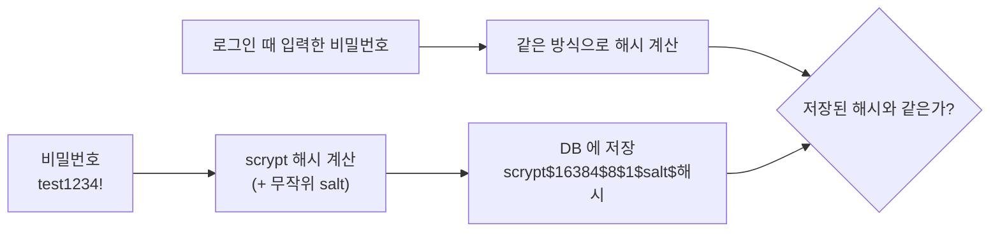
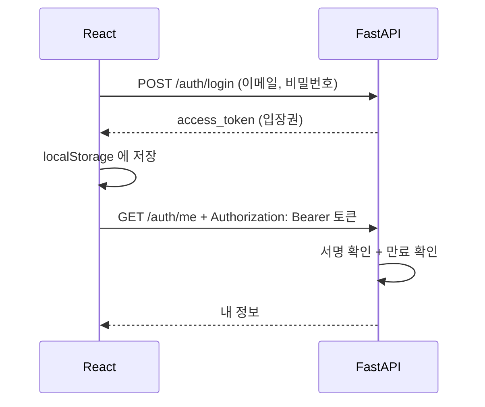
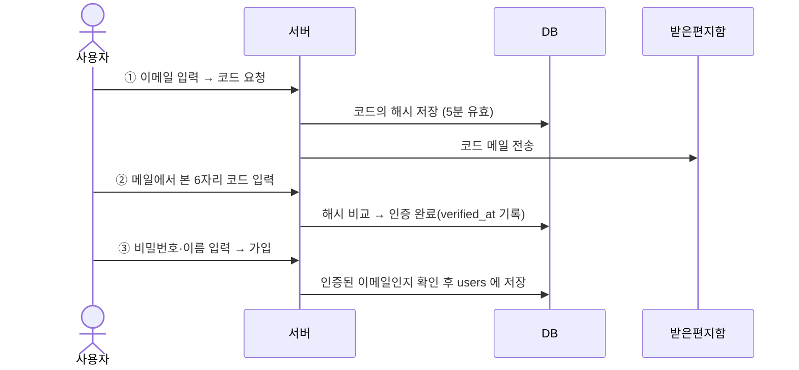
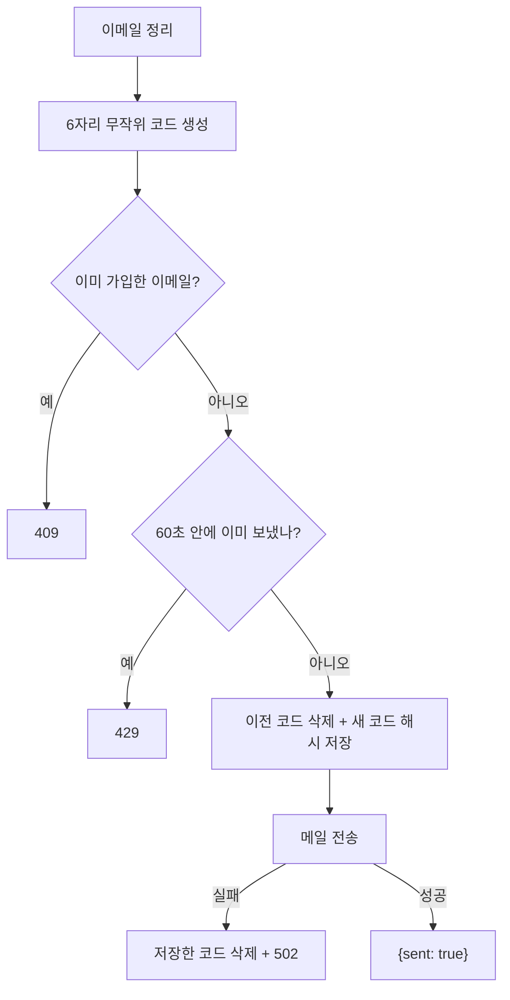
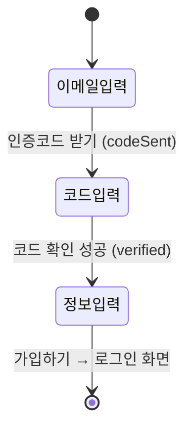

# 6일차. 회원 : 이메일 인증 · 회원가입 · 로그인

> **오늘의 한 줄 목표** : 이메일로 받은 6자리 코드로 본인을 확인하고 **가입**하고, **로그인**하면 헤더에 내 이름이 보인다. 새로고침해도 로그인이 유지된다.

| 항목 | 내용 |
|---|---|
| 만드는 것 | `/auth` API 5개, 가입·로그인 화면, 로그인 상태 공유 |
| 새로 설치 | **없음** (비밀번호 해시·토큰·메일 모두 파이썬 기본 기능으로 구현) |
| 새 테이블 | `users`, `email_verifications` (`sql/step-06_users.sql`) |
| 관련 요구사항 | FR-30~33, BR-11~13 |
| 준비물 | [Gmail 앱 비밀번호 가이드](../guide_gmail_smtp.md) (**수업 전날 준비**) |
| 끝나면 | 가입 → 로그인 → 헤더에 `OOO님` / 로그아웃 |

완성 스냅샷 : `docs/steps/day06/`

---

## 시간표 (8시간)

| 시간 | 내용 | 방식 |
|---|---|---|
| 09:00 ~ 09:30 | 1주차 회고 정리, 오늘의 질문 : "서버는 내가 누군지 어떻게 알까?" | 토의 |
| 09:30 ~ 10:30 | 비밀번호는 왜 **해시**로 저장하나? 시연 | 강의 + 시연 |
| 10:30 ~ 12:00 | `users` 테이블, **로그인 API** (해시, JWT) | 실습 |
| 12:00 ~ 13:00 | 점심 | |
| 13:00 ~ 14:30 | **이메일 인증 API** (코드 발송 · 확인 · 가입) — 먼저 **개발 모드** | 실습 |
| 14:30 ~ 15:30 | [Gmail 연동](../guide_gmail_smtp.md) : 실제 메일 받아 보기 | 실습 |
| 15:30 ~ 17:30 | **화면** : 가입 · 로그인 · 로그인 상태 공유 (Context) | 실습 |
| 17:30 ~ 18:00 | 정리, 퀴즈 | |

> 오늘 코드는 **길고 보안 개념이 많습니다.** 모든 줄을 직접 치지 않고 ✍️ 는 입력, 📦 는 복사 후 **읽기**로 진행합니다. 완성 코드는 `docs/steps/day06/` 에 있습니다.

---

## 1. 개념 : 로그인은 어떻게 동작하나

### 1-1. 비밀번호를 그대로 저장하면?

| 방식 | DB 가 유출되면 |
|---|---|
| 원문 저장 `test1234!` | 모든 회원의 비밀번호가 그대로 노출 😱 |
| **해시 저장** `scrypt$...$9f3a...` | 원문을 알 수 없다 (되돌리는 계산이 불가능) |

**해시** = 입력을 섞어 **되돌릴 수 없는 긴 글자**로 바꾸는 계산입니다.



- **salt** : 사용자마다 다른 무작위 값을 섞는다. 같은 비밀번호도 해시가 달라져서, 미리 계산해 둔 표(레인보우 테이블)로 뚫지 못한다.
- **scrypt** : 일부러 **느리고 메모리를 많이 쓰게** 만든 해시. 무작위 대입을 어렵게 한다.

> 💡 **시연 (강사)** : 같은 비밀번호 `test1234!` 로 가입한 두 계정의 `password_hash` 가 **서로 다른 것**을 보여 주세요. (`SELECT email, password_hash FROM users;` — 시드 계정은 같은 해시를 쓰지만, 새로 가입하면 다르다)

### 1-2. 서버는 "누구인지" 기억하지 않는다 → 토큰(JWT)

HTTP 는 요청마다 **독립적**입니다. 로그인했는지 매번 알려 줘야 합니다. 로그인 성공 시 서버가 **입장권(토큰)** 을 주고, 이후 요청마다 입장권을 보여 줍니다.



JWT 는 `헤더.내용.서명` 세 조각입니다.

```text
eyJhbGci...  .  eyJzdWIiOiI5Iiwicm9sZSI6IlVTRVIi...  .  4Xk9...
   헤더              내용(회원 id, 권한, 만료시각)            서명
```

- **내용은 누구나 읽을 수 있습니다** (그냥 인코딩일 뿐). 그래서 비밀번호 같은 건 넣지 않습니다. (https://jwt.io 에 붙여 넣어 보세요)
- **서명**은 서버의 비밀키(`JWT_SECRET`)로 만듭니다. 내용을 한 글자라도 바꾸면 서명이 맞지 않아 서버가 거부합니다. → **위조 불가**

### 1-3. 왜 이메일 인증을 하나요?

아무 이메일이나 입력해 가입하면 **남의 이메일로 가입**하거나, **가짜 계정**이 쌓입니다. 가입 **전에** 그 이메일의 주인인지 확인합니다.



---

## 2. DB : 회원 테이블

### 2-1. step-06 실행

```sql
source C:/work/miniShop/docs/sql/step-06_users.sql
```

| 표 | 용도 |
|---|---|
| `users` | 회원. `email` 은 **UNIQUE** (같은 이메일로 두 번 가입 불가). `role` 로 일반/관리자 구분 |
| `email_verifications` | 인증 코드 임시 보관. **코드 원문이 아니라 해시**를 저장 |

> 자세한 컬럼 설명은 [4. 테이블 설명과 SQL](../04_tables_and_sql.md) 2-6, 2-7.

테스트 회원도 같이 들어갑니다. (비밀번호는 모두 `test1234!`)

```sql
SELECT id, email, name, role FROM users;
```

| 계정 | 권한 |
|---|---|
| `admin@test.local` | 관리자 (9일차에 사용) |
| `user1@test.local` ~ `user7@test.local` | 일반 회원 |

---

## 3. 백엔드

### 3-1. 설정 : `.env` 에 비밀키 추가

토큰 서명용 비밀키를 만들어 `backend/.env` 에 추가합니다.

```powershell
python -c "import secrets; print(secrets.token_hex(32))"
```

출력된 긴 글자를 복사해서:

```ini
# 이 파일을 .env 로 복사한 뒤 값을 채운다.  (cp .env.example .env)
# .env 는 비밀번호가 들어 있으므로 깃허브에 올리지 않는다. (.gitignore 에 등록됨)

DB_HOST=localhost
DB_PORT=3306
DB_USER=vmshop_user
DB_PASSWORD=여기에_비밀번호
# 운영 DB : vmShop  /  테스트 DB(sql 폴더 스크립트로 생성) : test_vmshop
DB_NAME=test_vmshop

# 로그인 토큰(JWT) 서명 비밀키 : 길고 무작위인 값으로 채운다.  예) python -c "import secrets; print(secrets.token_hex(32))"
JWT_SECRET=여기에_무작위_문자열

# 이메일 인증 코드 발송용 SMTP (비워 두면 개발 모드 : 메일을 보내지 않고 서버 콘솔에 코드를 출력한다)
SMTP_HOST=
SMTP_PORT=587
SMTP_USER=
SMTP_PASSWORD=
SMTP_FROM=
```

> 🔐 `JWT_SECRET` 을 아는 사람은 **누구든 관리자 토큰을 만들 수 있습니다.** 길고 무작위여야 하고, 절대 공유하지 않습니다.
> SMTP 항목은 우선 **비워 둡니다.** (개발 모드 : 메일 대신 서버 콘솔에 코드 출력)

### 3-2. 📦 `backend/app/mailer.py` (제공)

메일 발송 도구입니다. 완성본에서 복사하고 **개발 모드 부분만** 읽습니다.

```python
def send_mail(to: str, subject: str, body: str) -> None:
    host = os.getenv("SMTP_HOST")
    if not host:
        logger.warning("[개발 모드: 메일 미발송] to=%s subject=%s\n%s", to, subject, body)
        return
```

> `SMTP_HOST` 가 비어 있으면 **메일을 보내지 않고 로그에 출력**합니다. 덕분에 메일 설정 없이도 가입 기능을 개발·시험할 수 있습니다.

### 3-3. ✍️ `backend/app/auth.py` (새 파일) — 조각별로

전체는 `docs/steps/day06/backend/app/auth.py` 입니다. 아래 순서로 **위에서부터** 만듭니다.

#### ① 상수와 준비

```python
CODE_TTL_MIN = 5            # 인증 코드 유효 시간 (분)
RESEND_SEC = 60             # 같은 이메일로 다시 보낼 수 있는 간격 (초)
MAX_ATTEMPTS = 5            # 코드 입력 시도 횟수
VERIFIED_TTL_MIN = 30       # 인증 후 가입까지 허용하는 시간 (분)
TOKEN_TTL_SEC = 60 * 60 * 12

EMAIL_RE = re.compile(r"^[A-Za-z0-9._%+\-]+@[A-Za-z0-9.\-]+\.[A-Za-z]{2,}$")
```

| 상수 | 뜻 |
|---|---|
| `CODE_TTL_MIN` | 인증 코드 유효 시간 5분 |
| `RESEND_SEC` | 같은 이메일로 다시 보내려면 60초 간격 (메일 폭탄 방지) |
| `MAX_ATTEMPTS` | 코드 입력 5회까지 (무작위 대입 방지) |
| `VERIFIED_TTL_MIN` | 인증 후 30분 안에 가입해야 함 |

> 이런 **숫자 규칙은 상수로 맨 위에** 둡니다. 정책이 바뀌면 한 곳만 고치면 됩니다.

#### ② 비밀번호 해시

```python
# ─────────────────────────── 비밀번호 해시 (scrypt) ───────────────────────────
_SCRYPT_N, _SCRYPT_R, _SCRYPT_P = 2 ** 14, 8, 1


def hash_password(password: str) -> str:
    salt = secrets.token_bytes(16)
    digest = hashlib.scrypt(password.encode(), salt=salt, n=_SCRYPT_N, r=_SCRYPT_R, p=_SCRYPT_P)
    return f"scrypt${_SCRYPT_N}${_SCRYPT_R}${_SCRYPT_P}${salt.hex()}${digest.hex()}"


def verify_password(password: str, stored: str) -> bool:
    try:
        algo, n, r, p, salt, digest = stored.split("$")
        if algo != "scrypt":
            return False
        calc = hashlib.scrypt(password.encode(), salt=bytes.fromhex(salt), n=int(n), r=int(r), p=int(p))
        return hmac.compare_digest(calc, bytes.fromhex(digest))
    except Exception:           # 형식이 다른 값(예: 시드의 'test-hash')은 로그인 불가
        return False


_DUMMY_HASH = hash_password("dummy-password")   # 없는 이메일도 같은 시간이 걸리게 한다
```

| 코드 | 설명 |
|---|---|
| `secrets.token_bytes(16)` | 암호용 **무작위** 16바이트 = salt |
| `hashlib.scrypt(...)` | 파이썬 기본 도구로 scrypt 해시 계산 |
| 저장 형식 `scrypt$N$r$p$salt$해시` | 나중에 검증할 때 **같은 설정**으로 다시 계산할 수 있게 함께 저장 |
| `hmac.compare_digest` | 두 값을 비교하되 **걸리는 시간이 같게** 비교 (시간차로 값을 추측하는 공격 방지) |
| `_DUMMY_HASH` | 없는 이메일로 로그인해도 해시 계산을 한 번 하게 해서, 응답 시간으로 "이 이메일은 가입 안 됨"을 알아내지 못하게 한다 |

#### ③ 토큰(JWT) 만들기·확인

```python
# ─────────────────────────── JWT (HS256) ───────────────────────────
def _secret() -> bytes:
    key = os.getenv("JWT_SECRET")
    if not key:
        raise RuntimeError("JWT_SECRET 이 .env 에 없습니다.")
    return key.encode()


def _b64(data: bytes) -> str:
    return base64.urlsafe_b64encode(data).rstrip(b"=").decode()


def _unb64(text: str) -> bytes:
    return base64.urlsafe_b64decode(text + "=" * (-len(text) % 4))


def create_token(user_id: int, role: str) -> str:
    head = _b64(json.dumps({"alg": "HS256", "typ": "JWT"}).encode())
    body = _b64(json.dumps({"sub": str(user_id), "role": role, "exp": int(time.time()) + TOKEN_TTL_SEC}).encode())
    sig = _b64(hmac.new(_secret(), f"{head}.{body}".encode(), hashlib.sha256).digest())
    return f"{head}.{body}.{sig}"


def decode_token(token: str) -> dict | None:
    try:
        head, body, sig = token.split(".")
        expected = _b64(hmac.new(_secret(), f"{head}.{body}".encode(), hashlib.sha256).digest())
        if not hmac.compare_digest(sig, expected):
            return None
        payload = json.loads(_unb64(body))
        return payload if payload.get("exp", 0) > time.time() else None
    except Exception:
        return None
```

| 함수 | 하는 일 |
|---|---|
| `create_token(user_id, role)` | 내용(회원 id, 권한, 만료시각)을 만들고 **비밀키로 서명** |
| `decode_token(token)` | 서명이 맞는지, **만료되지 않았는지** 확인. 이상하면 `None` |

> 라이브러리(PyJWT 등) 없이 직접 만들어 **원리**를 봅니다. 실무에서는 검증된 라이브러리를 씁니다.

#### ④ 로그인한 사용자 확인 : `get_current_user`

```python
# ─────────────────────────── 로그인 사용자 의존성 ───────────────────────────
bearer = HTTPBearer(auto_error=False)


def get_current_user(cred: HTTPAuthorizationCredentials | None = Depends(bearer)) -> dict:
    """Authorization: Bearer <토큰> 을 확인해 로그인한 사용자 {id, email, name, role} 를 돌려준다."""
    payload = decode_token(cred.credentials) if cred else None
    if payload is None:
        raise HTTPException(status_code=401, detail="로그인이 필요합니다.")
    conn = get_connection()
    try:
        with conn.cursor() as cur:
            cur.execute("SELECT id, email, name, role, status FROM users WHERE id = %s", (payload["sub"],))
            user = cur.fetchone()
    finally:
        conn.close()
    if user is None:
        raise HTTPException(status_code=401, detail="로그인이 필요합니다.")
    if user["status"] != "ACTIVE":
        raise HTTPException(status_code=403, detail="이용이 제한된 계정입니다.")
    user.pop("status")
    return user
```

이 함수가 **가장 중요한 부품**입니다. 다른 API 가 로그인을 요구하고 싶으면 파라미터에 한 줄만 쓰면 됩니다.

```python
@router.get("/me")
def me(user: dict = Depends(get_current_user)):   # ← 이 한 줄이 "로그인 필수" 를 뜻한다
    return user
```

| 상황 | 결과 |
|---|---|
| 토큰이 없다 / 위조 / 만료 | `401 로그인이 필요합니다.` |
| 토큰은 맞지만 그 회원이 DB 에 없다 | `401` |
| 차단된 회원(`BLOCKED`) | `403 이용이 제한된 계정입니다.` |

> 💡 **401 vs 403** : 401 = "누군지 모르겠다(로그인 안 함)", 403 = "누군지는 알지만 **권한이 없다**".

#### ⑤ 요청 모양 정의

```python
# ─────────────────────────── 요청 모양 ───────────────────────────
def _norm_email(email: str) -> str:
    email = email.strip().lower()
    if len(email) > 100 or not EMAIL_RE.match(email):
        raise HTTPException(status_code=422, detail="이메일 형식이 올바르지 않습니다.")
    return email


class EmailIn(BaseModel):
    email: str


class VerifyIn(BaseModel):
    email: str
    code: str = Field(pattern=r"^\d{6}$")


class SignupIn(BaseModel):
    email: str
    password: str = Field(min_length=8, max_length=64)
    name: str = Field(min_length=1, max_length=50)


class LoginIn(BaseModel):
    email: str
    password: str = Field(min_length=1, max_length=64)


def _check_password(password: str) -> None:
    if not (re.search(r"[A-Za-z]", password) and re.search(r"\d", password)):
        raise HTTPException(status_code=422, detail="비밀번호는 영문과 숫자를 모두 포함해야 합니다.")


def _code_hash(email: str, code: str) -> str:
    return hmac.new(_secret(), f"{email}:{code}".encode(), hashlib.sha256).hexdigest()
```

- `EmailStr` 같은 도구 없이 정규식(`EMAIL_RE`)으로 이메일 모양을 확인합니다.
- `_norm_email` : 공백을 지우고 **소문자로** 통일합니다. (`A@x.com` 과 `a@x.com` 이 다른 사람이 되지 않게)

#### ⑥ 인증 코드 발송 `POST /auth/email/send`

```python
# ─────────────────────────── 1) 인증 코드 발송 ───────────────────────────
@router.post("/email/send")
def send_code(body: EmailIn):
    email = _norm_email(body.email)
    code = f"{secrets.randbelow(1_000_000):06d}"

    conn = get_connection()
    try:
        with conn.cursor() as cur:
            cur.execute("SELECT 1 FROM users WHERE email = %s", (email,))
            if cur.fetchone():
                raise HTTPException(status_code=409, detail="이미 가입된 이메일입니다.")

            cur.execute(
                "SELECT TIMESTAMPDIFF(SECOND, created_at, NOW()) AS age FROM email_verifications "
                "WHERE email = %s AND purpose = 'SIGNUP' ORDER BY id DESC LIMIT 1", (email,))
            last = cur.fetchone()
            if last and last["age"] < RESEND_SEC:
                raise HTTPException(status_code=429, detail=f"{RESEND_SEC - last['age']}초 후에 다시 요청해 주세요.")

            cur.execute("DELETE FROM email_verifications WHERE email = %s AND purpose = 'SIGNUP'", (email,))
            cur.execute(
                "INSERT INTO email_verifications (email, purpose, code_hash, expires_at) "
                "VALUES (%s, 'SIGNUP', %s, NOW() + INTERVAL %s MINUTE)", (email, _code_hash(email, code), CODE_TTL_MIN))
        conn.commit()
    finally:
        conn.close()

    try:
        send_mail(email, "[음료 쇼핑몰] 이메일 인증 코드",
                  f"인증 코드 : {code}\n\n{CODE_TTL_MIN}분 안에 입력해 주세요. 본인이 요청하지 않았다면 무시하세요.")
    except Exception as e:
        logger.error("인증 메일 발송 실패: %s", e)
        conn = get_connection()
        try:
            with conn.cursor() as cur:
                cur.execute("DELETE FROM email_verifications WHERE email = %s AND purpose = 'SIGNUP'", (email,))
            conn.commit()
        finally:
            conn.close()
        raise HTTPException(status_code=502, detail="인증 메일을 보내지 못했습니다. 잠시 후 다시 시도해 주세요.")

    return {"sent": True, "expires_in": CODE_TTL_MIN * 60, "resend_after": RESEND_SEC}
```

순서를 따라 읽어 보세요.



| 코드 | 이유 |
|---|---|
| `secrets.randbelow(1_000_000)` | **암호용** 난수. `random` 모듈은 예측될 수 있어서 보안에 쓰지 않는다 |
| `f"{...:06d}"` | `42` → `"000042"` 처럼 앞을 0으로 채워 6자리로 |
| `_code_hash` (HMAC + 비밀키) | 코드를 그대로 저장하지 않는다. DB 가 유출돼도 코드를 못 안다 |
| `NOW() + INTERVAL %s MINUTE` | 만료 시각을 **DB 시계 기준**으로 계산 (서버와 DB 시계가 달라도 일관) |
| 메일 실패 시 코드 삭제 | 보내지도 못한 코드가 남아 "60초 후 재요청" 에 걸리는 것을 방지 |
| `429 Too Many Requests` | 너무 자주 요청 |
| `502 Bad Gateway` | 우리 서버가 아니라 **바깥(메일 서버)** 문제 |

#### ⑦ 코드 확인 `POST /auth/email/verify`

```python
# ─────────────────────────── 2) 코드 확인 ───────────────────────────
@router.post("/email/verify")
def verify_code(body: VerifyIn):
    email = _norm_email(body.email)
    conn = get_connection()
    try:
        with conn.cursor() as cur:
            cur.execute(
                "SELECT id, code_hash, attempts, (expires_at < NOW()) AS expired, verified_at "
                "FROM email_verifications WHERE email = %s AND purpose = 'SIGNUP' ORDER BY id DESC LIMIT 1 FOR UPDATE", (email,))
            row = cur.fetchone()
            if row is None:
                raise HTTPException(status_code=400, detail="인증 코드를 먼저 요청해 주세요.")
            if row["verified_at"] is None:
                if row["expired"]:
                    raise HTTPException(status_code=400, detail="인증 코드가 만료되었습니다. 다시 요청해 주세요.")
                if row["attempts"] >= MAX_ATTEMPTS:
                    raise HTTPException(status_code=429, detail="시도 횟수를 초과했습니다. 코드를 다시 요청해 주세요.")
                if not hmac.compare_digest(row["code_hash"], _code_hash(email, body.code)):
                    cur.execute("UPDATE email_verifications SET attempts = attempts + 1 WHERE id = %s", (row["id"],))
                    conn.commit()
                    left = MAX_ATTEMPTS - row["attempts"] - 1
                    raise HTTPException(status_code=400, detail=f"인증 코드가 일치하지 않습니다. (남은 시도 {left}회)")
                cur.execute(
                    "UPDATE email_verifications SET verified_at = NOW(), expires_at = NOW() + INTERVAL %s MINUTE "
                    "WHERE id = %s", (VERIFIED_TTL_MIN, row["id"]))
        conn.commit()
    finally:
        conn.close()
    return {"verified": True}
```

- `FOR UPDATE` : 5일차에 배운 **행 잠금**입니다. 같은 코드를 동시에 여러 번 시도해 5회 제한을 우회하는 것을 막습니다.
- 틀리면 `attempts + 1` 을 **저장하고 commit 한 뒤에** 오류를 던집니다. (오류를 던지면 rollback 되어 횟수가 안 올라가기 때문)
- 성공하면 `verified_at` 을 기록하고 유효 시간을 **30분**으로 늘립니다. (가입 화면에서 시간을 줘야 하므로)

#### ⑧ 회원가입 `POST /auth/signup`

```python
# ─────────────────────────── 3) 회원가입 ───────────────────────────
@router.post("/signup", status_code=201)
def signup(body: SignupIn):
    email = _norm_email(body.email)
    name = body.name.strip()
    if not name:
        raise HTTPException(status_code=422, detail="이름을 입력해 주세요.")
    _check_password(body.password)

    conn = get_connection()
    try:
        with conn.cursor() as cur:
            cur.execute(
                "SELECT 1 FROM email_verifications WHERE email = %s AND purpose = 'SIGNUP' AND verified_at IS NOT NULL "
                "AND expires_at > NOW()",
                (email,))
            if cur.fetchone() is None:
                raise HTTPException(status_code=400, detail="이메일 인증이 필요합니다.")
            try:
                cur.execute("INSERT INTO users (email, password_hash, name) VALUES (%s, %s, %s)",
                            (email, hash_password(body.password), name))
            except pymysql.err.IntegrityError:
                raise HTTPException(status_code=409, detail="이미 가입된 이메일입니다.")
            user_id = cur.lastrowid
            cur.execute("DELETE FROM email_verifications WHERE email = %s AND purpose = 'SIGNUP'", (email,))
        conn.commit()
    finally:
        conn.close()
    logger.info("회원가입 user_id=%s", user_id)
    return {"id": user_id, "email": email, "name": name}
```

- **인증이 끝난 이메일**(`verified_at IS NOT NULL` 이고 만료 전)만 가입할 수 있습니다. 화면에서 인증 단계를 건너뛰고 직접 `/auth/signup` 을 호출해도 막힙니다. → **검증은 항상 서버에서!**
- `INSERT` 에서 `IntegrityError` 가 나면 `UNIQUE` 제약에 걸린 것 → 409. 동시에 가입을 눌러도 DB 가 중복을 막아 줍니다.
- 가입 후 인증 기록은 지웁니다.

#### ⑨ 로그인 · 내 정보

```python
# ─────────────────────────── 4) 로그인 ───────────────────────────
@router.post("/login")
def login(body: LoginIn):
    email = body.email.strip().lower()
    conn = get_connection()
    try:
        with conn.cursor() as cur:
            cur.execute("SELECT id, email, name, role, status, password_hash FROM users WHERE email = %s", (email,))
            user = cur.fetchone()
    finally:
        conn.close()

    ok = verify_password(body.password, user["password_hash"] if user else _DUMMY_HASH)
    if not user or not ok:
        raise HTTPException(status_code=401, detail="이메일 또는 비밀번호가 올바르지 않습니다.")   # 어느 쪽이 틀렸는지 알려 주지 않는다
    if user["status"] != "ACTIVE":
        raise HTTPException(status_code=403, detail="이용이 제한된 계정입니다.")

    return {
        "access_token": create_token(user["id"], user["role"]),
        "token_type": "bearer",
        "user": {"id": user["id"], "email": user["email"], "name": user["name"], "role": user["role"]},
    }


# ─────────────────────────── 5) 내 정보 ───────────────────────────
@router.get("/me")
def me(user: dict = Depends(get_current_user)):
    return user
```

로그인 실패 시 **"이메일 또는 비밀번호가 올바르지 않습니다"** 라고만 합니다. (BR-13) 어느 쪽이 틀렸는지 알려 주면 공격자가 "이 이메일은 가입되어 있구나"를 알아냅니다.

### 3-4. ✍️ `main.py` 에 연결

```python
from .auth import router as auth_router                      # import 쪽에

app.include_router(auth_router)      # 회원 API (/auth)      ← 라우터 등록 쪽에
```

### 3-5. 시험 (`/docs`) — 개발 모드

서버를 다시 시작합니다. (`.env` 에 `JWT_SECRET` 추가했으므로)

| # | 순서 | 기대 결과 |
|---|---|---|
| ① | `POST /auth/login` : `admin@test.local` / `test1234!` | `access_token` 이 나온다 |
| ② | 틀린 비밀번호 | `401 이메일 또는 비밀번호가 올바르지 않습니다.` |
| ③ | `/docs` 오른쪽 위 **Authorize** → 토큰 붙여 넣기 → `GET /auth/me` | 내 정보 (`role: ADMIN`) |
| ④ | Authorize 해제 후 `GET /auth/me` | `401` |
| ⑤ | `POST /auth/email/send` (`me@test.local`) | `sent: true`. **서버 터미널**에 `인증 코드 : 483920` 이 출력된다 |
| ⑥ | 같은 요청 바로 한 번 더 | `429` (60초 제한) |
| ⑦ | `POST /auth/email/verify` 틀린 코드 | `400 ... (남은 시도 4회)` |
| ⑧ | 맞는 코드 | `verified: true` |
| ⑨ | `POST /auth/signup` (`password`: 영문+숫자 8자 이상) | `201` |
| ⑩ | 같은 이메일로 코드 요청 | `409 이미 가입된 이메일입니다.` |
| ⑪ | 방금 가입한 계정으로 로그인 | 성공 |

> 💡 `/docs` 의 **Authorize** 는 "Bearer 토큰"을 모든 요청의 헤더에 자동으로 붙여 줍니다. 앞으로 로그인이 필요한 API 를 시험할 때 계속 씁니다.

### 3-6. Gmail 로 진짜 메일 받아 보기

개발 모드로 흐름이 동작하는 것을 확인한 뒤, **[Gmail 앱 비밀번호 가이드](../guide_gmail_smtp.md)** 를 따라 `.env` 의 SMTP 항목을 채웁니다. 코드는 **한 줄도 바꾸지 않습니다.**

```ini
SMTP_HOST=smtp.gmail.com
SMTP_PORT=587
SMTP_USER=내계정@gmail.com
SMTP_PASSWORD=앱비밀번호16자리
```

서버를 다시 시작하고 ⑤ 를 반복하면 **받은편지함에 코드가 도착**합니다. 📬

---

## 4. 프론트엔드

### 4-1. 프록시에 `/auth` 추가 — `vite.config.js`

```js
'/auth': 'http://localhost:8000',
```

(Vite 재시작!)

### 4-2. ✍️ `api/auth.js`

로그인이 필요한 요청을 **한 곳에서** 처리하는 `apiFetch` 가 핵심입니다.

```javascript
// 백엔드 회원 API : 이메일 인증, 회원가입, 로그인, 내 정보
//   로그인 토큰(JWT)은 localStorage 에 저장하고, 로그인이 필요한 요청의 Authorization 헤더에 실어 보낸다.

const TOKEN_KEY = 'vm-token'

export function getToken() {
    try {
        return localStorage.getItem(TOKEN_KEY)
    } catch {
        return null
    }
}

export function setToken(token) {
    try {
        if (token) localStorage.setItem(TOKEN_KEY, token)
        else localStorage.removeItem(TOKEN_KEY)
    } catch {
        // 저장이 막혀 있어도 화면은 계속 동작한다 (새로고침하면 로그아웃된다)
    }
}

// 로그인이 필요한 요청에 붙이는 헤더 :  Authorization: Bearer 토큰
export function authHeaders() {
    const token = getToken()
    return token ? { Authorization: `Bearer ${token}` } : {}
}

// 공통 요청 : 실패하면 서버가 준 메시지로 Error 를 던진다 (error.status 에 상태코드)
//   auth: true 이면 로그인 토큰을 함께 보낸다
export async function apiFetch(url, { method = 'GET', body, auth = false } = {}) {
    const res = await fetch(url, {
        method,
        headers: {
            ...(body ? { 'Content-Type': 'application/json' } : {}),
            ...(auth ? authHeaders() : {}),
        },
        body: body ? JSON.stringify(body) : undefined,
    })

    if (!res.ok) {
        const data = await res.json().catch(() => ({}))
        // 422 (입력 형식 오류) 는 detail 이 배열로 올 수 있어 일반 문구로 바꾼다
        const message = typeof data.detail === 'string' ? data.detail : '입력한 내용을 확인해 주세요.'
        const error = new Error(message)
        error.status = res.status
        throw error
    }
    return res.json()
}

export const sendEmailCode = (email) => apiFetch('/auth/email/send', { method: 'POST', body: { email } })
export const verifyEmailCode = (email, code) => apiFetch('/auth/email/verify', { method: 'POST', body: { email, code } })
export const signup = (email, password, name) => apiFetch('/auth/signup', { method: 'POST', body: { email, password, name } })
export const loginRequest = (email, password) => apiFetch('/auth/login', { method: 'POST', body: { email, password } })
export const fetchMe = () => apiFetch('/auth/me', { auth: true })
```

| 부분 | 설명 |
|---|---|
| `getToken / setToken` | 토큰을 `localStorage` 에 저장·읽기 (`try/catch` : 저장이 막힌 브라우저 대비) |
| `authHeaders()` | `Authorization: Bearer 토큰` 헤더를 만든다 |
| `apiFetch(url, { auth: true })` | `auth: true` 이면 토큰을 붙여서 요청. 실패하면 `error.status` 에 상태 코드를 담아 던진다 |
| 마지막 줄들 | 화면이 쓰기 쉽게 이름 붙인 함수들 (`loginRequest`, `fetchMe` ...) |

> 4일차의 `createOrder` 는 직접 `fetch` 를 썼습니다. 7일차에 이 `apiFetch` 로 바꿉니다. (로그인이 필요해지므로)

### 4-3. ✍️ 로그인 상태 공유 (Context)

3일차 장바구니와 **똑같은 구조**입니다. 이미 배운 패턴이라 빠르게 갑니다.

| 파일 | 역할 |
|---|---|
| `context/authContext.js` | 공용 보관함 + `useAuthContext()` |
| `context/AuthProvider.jsx` | 로그인 상태(`user`)와 `login`, `logout` 을 관리 |

```jsx
import { useEffect, useState } from "react";
import { AuthContext } from "./authContext";
import { fetchMe, getToken, loginRequest, setToken } from "../api/auth";

// 앱 바깥쪽에서 한 번만 감싸 주면, 안쪽 모든 화면이 같은 로그인 상태를 공유한다
function AuthProvider({ children }) {
  const [user, setUser] = useState(null);
  const [ready, setReady] = useState(() => !getToken());   // 저장된 토큰이 없으면 확인할 것이 없다

  // 새로고침해도 로그인이 유지되도록, 저장된 토큰으로 내 정보를 다시 가져온다
  useEffect(() => {
    if (!getToken()) return;
    fetchMe()
      .then(setUser)
      .catch(() => setToken(null))        // 만료되었거나 잘못된 토큰은 버린다
      .finally(() => setReady(true));
  }, []);

  async function login(email, password) {
    const data = await loginRequest(email, password);
    setToken(data.access_token);
    setUser(data.user);
    return data.user;
  }

  function logout() {
    setToken(null);
    setUser(null);
  }

  return <AuthContext.Provider value={{ user, ready, login, logout }}>{children}</AuthContext.Provider>;
}

export default AuthProvider;
```

**읽을 곳**

| 코드 | 설명 |
|---|---|
| `useState(() => !getToken())` | 저장된 토큰이 없으면 확인할 것이 없으니 `ready` 를 처음부터 `true` |
| `useEffect(() => { fetchMe()... }, [])` | **새로고침해도 로그인 유지** : 저장된 토큰으로 내 정보를 다시 가져온다 |
| `.catch(() => setToken(null))` | 만료되었거나 잘못된 토큰은 버린다 |
| `ready` | "로그인 확인 중"인 동안 화면이 잠깐 로그인 안 된 것처럼 깜빡이는 것을 막는 신호 |

`authContext.js` 는 📦 완성본에서 복사합니다 (장바구니의 `cartContext.js` 와 같은 모양).

### 4-4. ✍️ `main.jsx` — 감싸기

`AuthProvider` 를 `CartProvider` **바깥**에 추가합니다.

```jsx
<BrowserRouter>
  <AuthProvider>
    <CartProvider>
      <App />
    </CartProvider>
  </AuthProvider>
</BrowserRouter>
```

(+ `import AuthProvider from './context/AuthProvider.jsx'`)

### 4-5. ✍️ 로그인 화면 `pages/LoginPage.jsx`

```jsx
import { useState } from "react";
import { Link, Navigate, useLocation } from "react-router-dom";
import { useAuthContext } from "../context/authContext";
import "./Auth.css";

// 로그인 화면
//   결제처럼 로그인이 필요한 화면에서 넘어왔으면 (state.from) 로그인 뒤에 그 화면으로 되돌아간다.
function LoginPage() {
  const { user, login } = useAuthContext();
  const location = useLocation();
  const from = location.state?.from ?? "/";
  const fromState = location.state?.fromState;

  const [email, setEmail] = useState(location.state?.email ?? "");
  const [password, setPassword] = useState("");
  const [error, setError] = useState("");
  const [loading, setLoading] = useState(false);

  // 이미 로그인한 상태라면 로그인 화면이 필요 없다 (로그인 직후에도 여기서 이동한다)
  if (user) return <Navigate to={from} state={fromState} replace />;

  async function handleSubmit(e) {
    e.preventDefault();        // 폼 제출 때 페이지가 새로고침되는 것을 막는다
    setError("");
    setLoading(true);
    try {
      await login(email, password);
      // 로그인에 성공하면 user 가 생겨서, 위의 <Navigate> 가 이동을 처리한다
    } catch (err) {
      setError(err.message);   // 예 : "이메일 또는 비밀번호가 올바르지 않습니다."
      setLoading(false);
    }
  }

  return (
    <div className="auth-page">
      <h2 className="auth-title">로그인</h2>

      {location.state?.signedUp && <p className="auth-notice">가입이 완료되었습니다. 로그인해 주세요.</p>}

      <form className="auth-form" onSubmit={handleSubmit}>
        <label className="auth-field">
          이메일
          <input
            type="email"
            value={email}
            onChange={(e) => setEmail(e.target.value)}
            autoComplete="email"
            required
          />
        </label>
        <label className="auth-field">
          비밀번호
          <input
            type="password"
            value={password}
            onChange={(e) => setPassword(e.target.value)}
            autoComplete="current-password"
            required
          />
        </label>

        {error && <p className="auth-error" role="alert">{error}</p>}

        <button type="submit" className="auth-btn wide" disabled={loading}>
          {loading ? "로그인 중..." : "로그인"}
        </button>
      </form>

      <p className="auth-foot">
        아직 회원이 아니신가요? <Link to="/signup" state={{ from, fromState }}>회원가입</Link>
      </p>
    </div>
  );
}

export default LoginPage;
```

스타일 `pages/Auth.css` 는 📦 완성본에서 복사합니다.

| 코드 | 설명 |
|---|---|
| `e.preventDefault()` | `<form>` 의 기본 동작(페이지 새로고침)을 막는다 |
| `if (user) return <Navigate .../>` | 로그인에 성공하면 `user` 가 생기고, 이 줄이 알아서 이동시킨다. **이미 로그인한 사람이 `/login` 에 와도** 돌려보낸다 |
| `location.state?.from` | 7일차에 "결제하려면 로그인" 흐름에서 **돌아갈 곳**을 받는다 |
| `loading` | 로그인 중 버튼 비활성화 (중복 요청 방지) |

### 4-6. 📦 가입 화면 `pages/SignupPage.jsx`

가입 화면은 **단계가 나뉘는** 화면이라 길어서 복사 후 읽습니다.



핵심은 **state 두 개(`codeSent`, `verified`)로 화면 단계를 나눈다**는 것입니다.

```jsx
        {/* ① 이메일 */}
        <label className="auth-field">
          이메일
          <span className="auth-row">
            <input
              type="email"
              value={email}
              onChange={(e) => setEmail(e.target.value)}
              disabled={verified}
              autoComplete="email"
              required
            />
            {!verified && (
              <button type="button" className="auth-btn sub" onClick={handleSend} disabled={busy || cooldown > 0 || !email}>
                {codeSent ? (cooldown > 0 ? `재발송 (${cooldown})` : "재발송") : "인증코드 받기"}
              </button>
            )}
          </span>
        </label>

        {/* ② 인증 코드 */}
        {codeSent && !verified && (
          <>
            <label className="auth-field">
              인증코드 6자리
              <span className="auth-row">
                <input
                  value={code}
                  onChange={(e) => setCode(e.target.value.replace(/\D/g, "").slice(0, 6))}
                  inputMode="numeric"
                  autoComplete="one-time-code"
                  placeholder="000000"
                />
                <button type="button" className="auth-btn" onClick={handleVerify} disabled={busy || code.length !== 6}>
                  확인
                </button>
              </span>
            </label>
            <p className="auth-hint">이메일로 보낸 코드를 5분 안에 입력해 주세요.</p>
          </>
        )}
        {verified && <p className="auth-ok">✓ 이메일 인증이 완료되었습니다.</p>}
```

- `cooldown` : 재발송 대기 초를 1초마다 줄이는 타이머 (`useEffect` + `setTimeout`)
- `run(task)` : 서버 요청의 공통 처리 (중복 클릭 방지 + 오류 표시)를 한 함수로 모았다
- 코드 입력칸은 `replace(/\D/g, "")` 로 **숫자만** 받는다
- **화면의 단계 구분은 편의일 뿐**, 진짜 검증은 서버가 한다 (3-3 ⑧)

### 4-7. ✍️ 머리글에 로그인 표시 — `layout/Header.jsx`

```jsx
import { Link } from 'react-router-dom'
import './Header.css'
import { useAuthContext } from '../context/authContext'

// 머리글 : 로고(홈 링크) + 로그인 / 회원 메뉴 + 장바구니 (담은 상품 수 배지)
// props: cartCount (장바구니에 담은 상품 수)
function Header({ cartCount }) {
  const { user, logout } = useAuthContext()   // 로그인한 회원 (없으면 null)

  return (
    <header className="site-header">
      <div className="header-top">
        <Link to="/" className="logo">🥤 음료 쇼핑몰</Link>

        <div className="header-actions" style={{ marginLeft: 'auto' }}>
          {user ? (
            <>
              <span className="user-name">{user.name}님</span>
              <button type="button" className="logout-btn" onClick={logout}>로그아웃</button>
            </>
          ) : (
            <>
              <Link to="/login">로그인</Link>
              <Link to="/signup">회원가입</Link>
            </>
          )}
          <Link to="/cart" className="cart-link" aria-label="장바구니">
            🛒
            {cartCount > 0 && <span className="cart-badge">{cartCount}</span>}
          </Link>
        </div>
      </div>
    </header>
  )
}

export default Header
```

`user` 가 있으면 이름과 로그아웃, 없으면 로그인·회원가입 링크를 보여 줍니다.

> 로그아웃은 서버에 요청할 필요가 없습니다. 브라우저의 토큰을 **지우기만** 하면 입장권이 없는 상태가 됩니다. (`logout` → `setToken(null)`)

### 4-8. ✍️ `App.jsx` 에 화면 2개 추가

```jsx
import LoginPage from './pages/LoginPage'
import SignupPage from './pages/SignupPage'

<Route path="/login" element={<LoginPage />} />
<Route path="/signup" element={<SignupPage />} />
```

---

## 5. 체크포인트

- [ ] `/signup` → 이메일 입력 → **인증코드 받기** → (서버 콘솔 또는 메일에서 코드 확인) → 코드 입력 → 비밀번호·이름 → 가입
- [ ] 같은 이메일로 다시 가입하려 하면 "이미 가입된 이메일입니다."
- [ ] 틀린 코드를 5번 입력하면 "시도 횟수를 초과했습니다."
- [ ] 60초 안에 재요청하면 "N초 후에 다시 요청해 주세요."
- [ ] `/login` 에서 로그인하면 홈으로 가고 **헤더에 `OOO님` 과 로그아웃**이 보인다
- [ ] **새로고침해도 로그인이 유지**된다 (F12 → Application → Local Storage 의 `vm-token`)
- [ ] 로그아웃하면 로그인·회원가입 링크가 다시 나온다
- [ ] 틀린 비밀번호는 빨간 오류 문구
- [ ] DB `users.password_hash` 가 `scrypt$...` 로 시작한다 (원문이 아니다)
- [ ] (선택) Gmail 로 실제 인증 메일이 왔다

---

## 6. 자주 하는 실수

| 증상 | 원인 | 해결 |
|---|---|---|
| 서버 시작이 안 되고 `JWT_SECRET 이 .env 에 없습니다` | `.env` 에 `JWT_SECRET` 없음 | 3-1 후 서버 재시작 |
| 화면에서 `/auth/...` 가 `404` | 프록시에 `/auth` 추가 후 Vite 재시작 안 함 | Vite 재시작 |
| 인증코드를 눌렀는데 메일이 안 오고 `502` | SMTP 설정 오류 | [가이드 6장](../guide_gmail_smtp.md) 의 문제 해결 표, 서버 로그의 `[ERROR]` |
| 코드를 못 찾음 (개발 모드) | 서버 터미널이 아닌 곳을 봄 | **uvicorn 이 실행 중인 터미널**에서 `[개발 모드: 메일 미발송]` 아래 줄 확인 |
| 로그인했는데 새로고침하면 풀림 | `AuthProvider` 의 `fetchMe` 가 실패 | F12 Network 에서 `/auth/me` 상태 확인 (401 이면 토큰/서버 `JWT_SECRET` 변경 여부) |
| `JWT_SECRET` 을 바꿨더니 전부 로그아웃 | 이전 토큰의 서명이 새 키와 안 맞음 | 정상 동작. 다시 로그인 |
| 가입 시 `이메일 인증이 필요합니다` | 인증 30분 경과 또는 코드 확인 안 함 | 코드를 다시 받아 인증 |
| `Cannot read properties of null (reading 'name')` | `user` 가 `null` 인데 `user.name` 접근 | `user ? ... : ...` 로 먼저 확인 |
| 한글 이름 가입 시 오류 | DB 연결 `charset` 누락 | `database.py` 확인 |

---

## 7. 오늘의 핵심 정리

1. 비밀번호는 **해시(+salt)** 로 저장한다. 원문은 서버도 모른다.
2. 서버는 요청마다 독립적이라 **토큰(JWT)** 으로 "누구인지"를 증명한다. 토큰은 **서명**으로 위조를 막는다.
3. `Depends(get_current_user)` **한 줄**이 "로그인 필수" API 를 만든다. 권한 문제는 401(로그인 안 함) / 403(권한 없음).
4. 인증 코드·비밀번호처럼 **민감한 값은 해시로** 저장하고, **시도 횟수·시간·재요청 간격**을 제한한다.
5. **검증은 항상 서버에서.** 화면의 단계 구분은 편의일 뿐이다.
6. 로그인 상태는 장바구니처럼 **Context** 로 앱 전체가 공유한다. 새로고침 유지를 위해 토큰을 `localStorage` 에 저장한다.

## 퀴즈

1. DB 가 해킹당해 `users` 표가 전부 유출되었다. 공격자는 비밀번호를 알 수 있을까요? 왜 그런가요?
2. JWT 의 **내용 부분은 누구나 읽을 수 있다**고 했습니다. 그런데 왜 위조는 못 할까요?
3. 로그인 실패 시 "이메일이 틀렸습니다 / 비밀번호가 틀렸습니다"로 따로 알려 주면 안 되는 이유는?
4. 인증 코드는 왜 `random` 이 아니라 `secrets` 로 만들까요?

## 과제

- **기본** : 새 계정으로 가입 → 로그인 → `/auth/me` 호출까지 `/docs` 에서 모두 해 보고 `users` 표의 새 행(`password_hash`)을 캡처하기.
- **기본** : [jwt.io](https://jwt.io) 에 내 토큰을 붙여 넣고 **내용(payload)** 에 무엇이 들어 있는지 읽어 보기. 만료 시각(`exp`)은 지금으로부터 몇 시간 뒤일까요?
- **도전** : 비밀번호가 8자 미만일 때 서버와 화면 **양쪽**에서 어떻게 막는지 찾아보기. (서버 : `Field(min_length=8)` / 화면 : `minLength`)

## 내일 예고

7일차에는 **주문을 회원과 연결**합니다. 로그인한 사람만 결제할 수 있고, **구매내역**과 **배송지**가 생깁니다. `orders` 표에 컬럼을 추가하는 `ALTER TABLE` 도 처음 해 봅니다.

---

## 📌 강사 메모

- **가장 큰 위험은 시간**입니다. 오전에 개념 → 로그인 API, 오후에 이메일 인증 → 화면 순서로 진행하되, 이메일 인증 코드가 어려우면 **`docs/steps/day06/backend/app/auth.py` 를 복사해 주고 "읽고 시험"** 으로 전환하세요. 해시/JWT 의 **개념 이해**가 코드 암기보다 중요합니다.
- 해시는 **시연**이 가장 효과적입니다. `python -c "import hashlib; print(hashlib.sha256(b'1234').hexdigest())"` 처럼 같은 입력은 같은 출력이 나오는 것을 보여 주고, salt 를 섞으면 달라지는 것을 보여 주세요.
- 토큰 위조 시연 : 토큰의 가운데 조각(내용)에서 `"role":"USER"` 를 `"ADMIN"` 으로 바꿔 인코딩해 보내면 서버가 거부하는 것을 보여 주세요. (9일차 관리자 권한과 연결됩니다)
- **Gmail 은 오후에.** 오전부터 메일 문제로 막히는 학생이 생기면 개발 모드로 계속 진행시키세요. 교실 네트워크가 587 포트를 막는지 사전에 확인하세요.
- 앱 비밀번호가 **화면에 노출되지 않도록** 학생들에게 `.env` 를 공유 화면에 띄우지 말라고 안내하세요.
