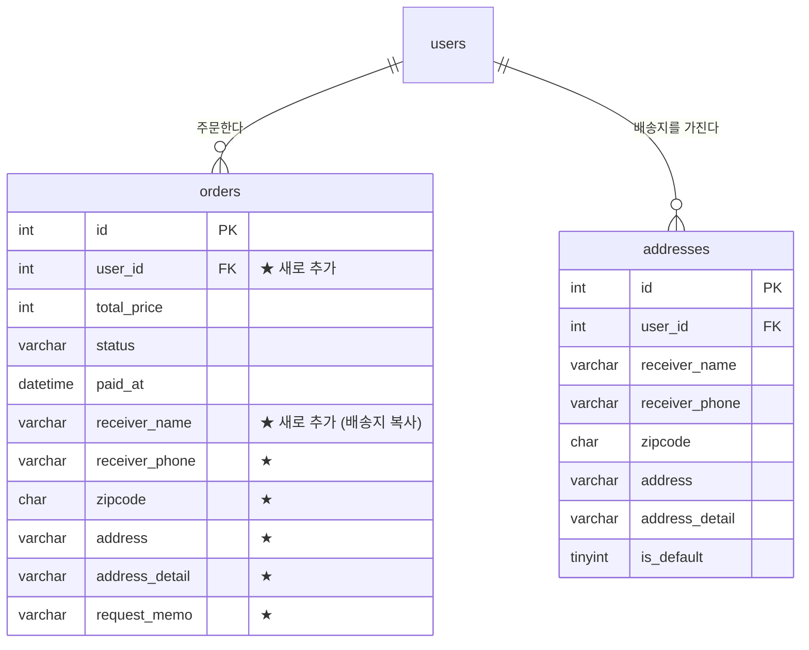
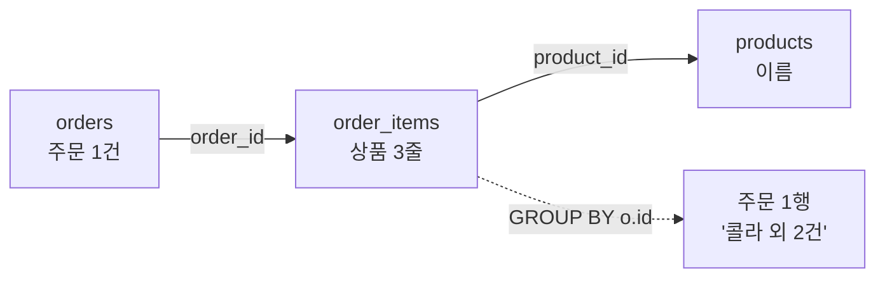

# 7일차. 회원과 주문 연결 : 구매내역 · 배송지

> **오늘의 한 줄 목표** : **로그인한 사람만** 결제할 수 있고, 주문에는 **누가·어디로**가 기록된다. 내 **구매내역**에서 결제 완료한 주문만 볼 수 있다.

| 항목 | 내용 |
|---|---|
| 만드는 것 | 주문에 회원·배송지 연결, `GET /orders`, `GET /purchases`, 배송지 저장, 결제 화면(배송지 입력), 구매내역 화면 |
| 새로 설치 | 없음 (우편번호는 다음(Daum) 서비스의 스크립트를 화면에서 불러온다) |
| 새 테이블 / 변경 | `addresses` 생성, **`orders` 에 컬럼 추가 (`ALTER TABLE`)** (`sql/step-07_member_orders.sql`) |
| 관련 요구사항 | FR-26, FR-27, FR-34, FR-40~42, BR-08, BR-09 |
| 끝나면 | 로그인 → 담기 → 배송지 입력 → 결제 → 구매내역에서 확인 |

완성 스냅샷 : `docs/steps/day07/`

---

## 시간표 (8시간)

| 시간 | 내용 | 방식 |
|---|---|---|
| 09:00 ~ 09:30 | 6일차 복습, 오늘의 질문 | 토의 |
| 09:30 ~ 10:30 | **테이블 변경(`ALTER TABLE`)** : 왜 처음부터 완벽하게 설계하지 않나? | 강의 + 실습 |
| 10:30 ~ 12:00 | **주문 API 에 회원 연결** (`Depends(get_current_user)`, 배송지 저장) | 실습 |
| 12:00 ~ 13:00 | 점심 | |
| 13:00 ~ 14:30 | **구매내역 API** (JOIN, GROUP BY, 기간 조회) | 실습 |
| 14:30 ~ 16:30 | **결제 화면** : 로그인 확인, 배송지 입력, 우편번호 검색 | 읽기 + 실습 |
| 16:30 ~ 17:30 | **구매내역 화면** | 실습 |
| 17:30 ~ 18:00 | 정리, 퀴즈 | |

> 결제 화면(`CheckoutPage.jsx`)은 길고 모양(CSS)도 많아서 📦 **완성본을 복사**하고, 오늘의 핵심 로직만 골라 읽고 시험합니다.

---

## 1. 오늘의 질문

4일차에 만든 주문에는 **누가 샀는지**가 없었습니다.


> **활동 (10분)** : 쇼핑몰의 **"내 구매내역"** 을 만들려면 `orders` 표에 어떤 정보가 있어야 할까요? 5분 동안 적어 보고 발표해 봅시다.

정답의 핵심은 **`user_id`** (누가), **배송지**(어디로) 입니다.

---

## 2. DB : 테이블을 고치다

### 2-1. 왜 `ALTER TABLE` 인가?

4일차에 `orders` 를 만들 때 `user_id` 를 넣지 않았습니다. 회원 기능이 **그때는 없었기** 때문입니다. 실무에서도 처음부터 모든 것을 알 수는 없습니다. 기능이 자라면서 **표를 고쳐 나가는 일**이 흔합니다. 이것을 **마이그레이션**(migration)이라고 부릅니다.



### 2-2. 순서가 중요하다

`user_id` 를 `NOT NULL` 로 추가하려는데, 기존 **비회원 주문**(user_id 없음)이 남아 있으면 어떻게 될까요? → 값을 넣을 수 없어서 오류가 납니다. 그래서 `step-07` 은 **테스트 주문을 먼저 비운 뒤** 컬럼을 추가합니다.

```sql
-- =============================================================================
-- [7일차] 주문을 회원에 연결 + 배송지
--
--   1) 4일차에 만든 비회원 테스트 주문을 비운다. (user_id 가 없는 주문은 새 규칙(NOT NULL)에 맞지 않는다)
--   2) orders 에 user_id 와 배송지 컬럼을 ALTER TABLE 로 추가한다.
--   3) addresses (회원 배송지) 테이블을 만든다.
--   먼저 step-04, step-06 이 실행되어 있어야 한다.
-- =============================================================================

USE test_vmshop;

-- 1) 비회원 테스트 주문 비우기 (자식 → 부모 순서)
DELETE FROM order_items;
DELETE FROM orders;

-- 2) 주문에 구매자(user_id) + 주문 시점의 배송지를 복사해 둘 컬럼 추가
ALTER TABLE orders
  ADD COLUMN user_id        INT          NOT NULL AFTER id,
  ADD COLUMN receiver_name  VARCHAR(50)  NULL,                    -- 받는 사람 (주문 시점의 값을 복사해 둔다)
  ADD COLUMN receiver_phone VARCHAR(20)  NULL,                    -- 연락처
  ADD COLUMN zipcode        CHAR(5)      NULL,                    -- 우편번호
  ADD COLUMN address        VARCHAR(255) NULL,                    -- 주소
  ADD COLUMN address_detail VARCHAR(100) NULL,                    -- 상세주소
  ADD COLUMN request_memo   VARCHAR(100) NULL,                    -- 배송 요청사항
  ADD KEY idx_orders_user_id (user_id),
  ADD KEY idx_orders_purchase (user_id, status, paid_at),         -- 구매내역(최근 1년) 조회용
  ADD CONSTRAINT fk_orders_user FOREIGN KEY (user_id) REFERENCES users (id);

-- 3) 회원 배송지 (회원 1 : 배송지 N)
DROP TABLE IF EXISTS addresses;

CREATE TABLE addresses (
  id             INT          NOT NULL AUTO_INCREMENT,
  user_id        INT          NOT NULL,
  receiver_name  VARCHAR(50)  NOT NULL,
  receiver_phone VARCHAR(20)  NOT NULL,
  zipcode        CHAR(5)      NOT NULL,
  address        VARCHAR(255) NOT NULL,
  address_detail VARCHAR(100) NULL,
  is_default     TINYINT(1)   NOT NULL DEFAULT 0,
  created_at     DATETIME     NOT NULL DEFAULT CURRENT_TIMESTAMP,
  PRIMARY KEY (id),
  KEY idx_addresses_user (user_id),
  CONSTRAINT fk_addresses_user FOREIGN KEY (user_id) REFERENCES users (id) ON DELETE CASCADE
) ENGINE=InnoDB DEFAULT CHARSET=utf8mb4 COLLATE=utf8mb4_general_ci;

DESCRIBE orders;
```

| 구문 | 설명 |
|---|---|
| `DELETE FROM order_items; DELETE FROM orders;` | 자식(`order_items`) 먼저, 부모(`orders`) 나중에. (외래키 때문에 순서가 거꾸로면 오류) |
| `ADD COLUMN user_id INT NOT NULL AFTER id` | 컬럼 추가. `AFTER id` 는 위치 |
| `ADD CONSTRAINT fk_orders_user FOREIGN KEY ...` | **외래키** : `orders.user_id` 는 `users.id` 에 **있는 값**만 가능 (없는 회원의 주문을 막는다) |
| `ADD KEY idx_orders_purchase (user_id, status, paid_at)` | 구매내역 조회(`내 + PAID + 기간`)를 빠르게 하는 **인덱스** |
| `addresses` | 회원 1 : 배송지 N. 회원이 지워지면 배송지도 같이(`ON DELETE CASCADE`) |

mysql 에서 실행합니다.

```sql
source C:/work/miniShop/docs/sql/step-07_member_orders.sql
```

마지막의 `DESCRIBE orders;` 결과에 `user_id` 와 배송지 컬럼이 보이면 성공입니다.

> ⚠️ 이 SQL 은 **지금까지 만든 테스트 주문을 지웁니다.** (우리 DB 는 연습용입니다. 실제 서비스라면 기존 데이터를 옮기는 계획이 필요합니다.)

### 2-3. 배송지를 주문에 왜 또 복사하나요?

> **질문 : `addresses` 가 있는데 `orders` 에도 배송지 컬럼을 두는 이유는?**
> 회원이 배송지를 **고치거나 지우면**, 이미 보낸 주문의 배송지까지 바뀌면 안 됩니다. 주문 **당시 값을 복사**해 두는 것입니다. (BR-08) `order_items.unit_price` 와 같은 원리입니다.

---

## 3. 백엔드

### 3-1. ✍️ `order.py` 변경

4일차 → 5일차 코드에서 **무엇이 달라지는지**를 중심으로 봅니다. 전체 완성본은 `docs/steps/day07/backend/app/order.py` 입니다.

**① 요청 모양에 배송지 추가**

```python
class OrderItemIn(BaseModel):
    product_id: int
    quantity: int = Field(ge=1, le=99)          # 가격은 받지 않는다. 서버가 DB 에서 읽는다.


class ShippingIn(BaseModel):
    receiver_name: str = Field(min_length=1, max_length=50)       # 받는 사람
    receiver_phone: str = Field(pattern=r"^[0-9]{2,4}-?[0-9]{3,4}-?[0-9]{4}$")   # 연락처
    zipcode: str = Field(pattern=r"^[0-9]{5}$")                   # 우편번호 (다음 주소 검색)
    address: str = Field(min_length=5, max_length=255)            # 주소 (다음 주소 검색 결과)
    address_detail: str | None = Field(None, max_length=100)      # 상세주소 (동, 호수 등)
    request_memo: str | None = Field(None, max_length=100)        # 배송 요청사항 (선택)
    save_address: bool = True                                     # 이 배송지를 내 배송지로 저장


class OrderIn(BaseModel):
    items: list[OrderItemIn] = Field(min_length=1)
    shipping: ShippingIn
```

| 필드 | 규칙 |
|---|---|
| `receiver_phone` | 정규식 `pattern` 으로 전화번호 모양 확인 (`010-1234-5678` / `01012345678`) |
| `zipcode` | 숫자 5자리 |
| `address` | 5자 이상 — 우편번호 검색 결과가 들어온다 |
| `save_address` | 이 배송지를 내 배송지 목록에도 저장할지 (기본 `True`) |

**② 주문 생성 함수**

```python
@router.post("/orders", status_code=201)
def create_order(body: OrderIn, user: dict = Depends(get_current_user)):
    # 같은 상품이 여러 줄이면 수량을 합친다. id 순으로 처리해 동시 주문 때 교착(deadlock)을 줄인다.
    wanted: dict[int, int] = {}
    for it in body.items:
        wanted[it.product_id] = wanted.get(it.product_id, 0) + it.quantity
    if any(q > 99 for q in wanted.values()):
        raise HTTPException(status_code=422, detail="상품당 수량은 99개까지입니다.")

    ship = body.shipping
    receiver_name = ship.receiver_name.strip()
    address = ship.address.strip()
    address_detail = (ship.address_detail or "").strip() or None
    if not receiver_name or not address:
        raise HTTPException(status_code=422, detail="받는 사람과 주소를 입력해 주세요.")

    conn = get_connection()
    try:
        with conn.cursor() as cur:
            lines, total = [], 0
            for pid in sorted(wanted):
                qty = wanted[pid]
                # FOR UPDATE : 이 상품 행을 잠그고 "최신 값" 을 읽는다. 같은 상품을 동시에 주문하는 다른 요청은
                #   이 주문이 끝날 때까지 기다린다. (잠그지 않고 읽으면 MariaDB 11.6+ 에서는 동시 주문 때
                #   "Record has changed since last read" 오류가 나서 재고 부족(409) 대신 서버 오류(500)가 된다)
                cur.execute("SELECT id, name, price FROM products WHERE id = %s AND is_active = 1 FOR UPDATE", (pid,))
                p = cur.fetchone()
                if p is None:
                    raise HTTPException(status_code=404, detail=f"상품을 찾을 수 없습니다. (id={pid})")

                # 재고 확인과 차감을 한 문장으로 : 동시에 사도 재고가 음수가 되지 않는다
                cur.execute("UPDATE products SET stock = stock - %s WHERE id = %s AND stock >= %s", (qty, pid, qty))
                if cur.rowcount == 0:
                    raise HTTPException(status_code=409, detail=f"재고가 부족합니다. ({p['name']})")

                lines.append((pid, p["name"], qty, p["price"]))
                total += qty * p["price"]

            cur.execute(
                "INSERT INTO orders (user_id, total_price, status, paid_at, receiver_name, receiver_phone, "
                "zipcode, address, address_detail, request_memo) VALUES (%s, %s, 'PAID', NOW(), %s, %s, %s, %s, %s, %s)",
                (user["id"], total, receiver_name, ship.receiver_phone, ship.zipcode, address, address_detail,
                 (ship.request_memo or "").strip() or None),
            )
            order_id = cur.lastrowid
            if ship.save_address:        # 같은 트랜잭션에서 회원 배송지로 저장 (결제가 실패하면 함께 취소된다)
                save_address(cur, user["id"], receiver_name, ship.receiver_phone, ship.zipcode, address, address_detail)
            cur.executemany(
                "INSERT INTO order_items (order_id, product_id, quantity, unit_price) VALUES (%s, %s, %s, %s)",
                [(order_id, pid, qty, price) for pid, _, qty, price in lines],
            )
        conn.commit()
    except HTTPException:
        conn.rollback()
        raise
    except Exception as e:
        conn.rollback()
        logger.error("구매 처리 실패: %s", e)
        raise HTTPException(status_code=500, detail="구매 처리 에러")
    finally:
        conn.close()
```

4일차·5일차와 달라진 점만 짚어 봅니다.

| 달라진 곳 | 설명 |
|---|---|
| `user: dict = Depends(get_current_user)` | 6일차에 만든 부품. **이 한 줄로 로그인이 필수**가 되고, `user["id"]` 로 구매자를 안다 |
| `INSERT INTO orders (user_id, ..., receiver_name, ...)` | 구매자와 **주문 시점의 배송지**를 함께 저장 |
| `save_address(cur, ...)` | **같은 트랜잭션** 안에서 내 배송지로도 저장. 결제가 실패해 `rollback` 되면 배송지 저장도 함께 취소된다 |
| `FOR UPDATE` · `stock >= %s` | 5일차에 배운 안전장치 그대로 |

> 🔐 **구매자를 요청 본문(JSON)에서 받지 않고, 토큰에서 알아냅니다.** 만약 `{"user_id": 3, ...}` 를 화면이 보내게 하면 **남의 이름으로 주문**할 수 있기 때문입니다. "누구인지"는 항상 서버가 토큰으로 확인합니다.

### 3-2. ✍️ `address.py` (새 파일) : 배송지 저장

📦 `docs/steps/day07/backend/app/address.py` 를 복사합니다. 핵심 함수만 읽습니다.

```python
def save_address(cur, user_id, receiver_name, receiver_phone, zipcode, address, address_detail):
    """주문한 배송지를 회원 배송지로 저장한다. (주문과 같은 트랜잭션 안에서 호출)

    - 같은 배송지가 이미 있으면 새로 만들지 않는다.
    - 첫 배송지는 기본 배송지가 된다.
    - 이미 MAX_ADDRESSES 개를 저장했으면 더 저장하지 않는다. (주문은 계속 진행된다)
    """
    cur.execute(
        "SELECT 1 FROM addresses WHERE user_id = %s AND receiver_name = %s AND receiver_phone = %s "
        "AND zipcode = %s AND address = %s AND COALESCE(address_detail, '') = %s",
        (user_id, receiver_name, receiver_phone, zipcode, address, address_detail or ""),
    )
    if cur.fetchone():
        return
    cur.execute("SELECT COUNT(*) AS cnt FROM addresses WHERE user_id = %s", (user_id,))
    count = cur.fetchone()["cnt"]
    if count >= MAX_ADDRESSES:
        return
    cur.execute(
        "INSERT INTO addresses (user_id, receiver_name, receiver_phone, zipcode, address, address_detail, is_default) "
        "VALUES (%s, %s, %s, %s, %s, %s, %s)",
        (user_id, receiver_name, receiver_phone, zipcode, address, address_detail or None, 1 if count == 0 else 0),
    )
```

| 규칙 | 코드 |
|---|---|
| 같은 배송지는 중복 저장하지 않는다 | `SELECT 1 FROM addresses WHERE ...` |
| 최대 10개까지 | `count >= MAX_ADDRESSES` (넘으면 저장만 건너뛰고 **주문은 계속 진행**) |
| 첫 배송지는 기본 배송지 | `1 if count == 0 else 0` |

이 파일에는 `GET /addresses`(목록), `PUT /addresses/{id}/default`, `DELETE /addresses/{id}` 도 있습니다. 결제 화면에서 **저장된 배송지 목록**을 불러올 때 `GET` 을 씁니다.

> **`cur` 를 받는 이유** : `save_address` 는 스스로 연결을 열지 않고 **호출한 쪽의 커서**를 받아 씁니다. 그래야 주문과 **같은 트랜잭션**으로 묶입니다. (연결을 새로 열면 별도의 트랜잭션이 되어 주문이 롤백돼도 배송지는 남는다)

### 3-3. ✍️ 내 주문 조회 : 남의 주문은 못 본다

```python
@router.get("/orders/{order_id}")
def get_order(order_id: int, user: dict = Depends(get_current_user)):
    head = _fetch_list(
        "SELECT id AS order_id, total_price, status, created_at, paid_at, refunded_at, "
        "receiver_name, receiver_phone, zipcode, address, address_detail, request_memo "
        "FROM orders WHERE id = %s AND user_id = %s",
        (order_id, user["id"]),
    )
    if not head:
        raise HTTPException(status_code=404, detail="주문을 찾을 수 없습니다.")
    items = _fetch_list(
        """
        SELECT oi.product_id, p.name AS product_name, oi.quantity, oi.unit_price,
               oi.quantity * oi.unit_price AS line_total
        FROM order_items oi JOIN products p ON p.id = oi.product_id
        WHERE oi.order_id = %s ORDER BY oi.id
        """,
        (order_id,),
    )
    return {**head[0], "items": items}
```

핵심은 SQL 의 **`WHERE id = %s AND user_id = %s`** 입니다. 주소의 주문 번호만 바꿔서 남의 주문을 보려 해도, 내 `user_id` 가 아니라서 **404** 가 나옵니다. (남의 주문이라고 알려 주지 않고 "없다"고 답한다)

> 이런 약점을 **권한 검증 누락(IDOR)** 이라고 부르고, 실제 사고가 가장 많이 나는 유형 중 하나입니다. 시험해 봅시다 (3-6).

### 3-4. ✍️ 구매내역 `GET /purchases`

```python
PERIOD_DAYS = {"1m": 30, "3m": 90, "6m": 180, "1y": 365}


@router.get("/purchases")
def list_purchases(
    period: str = Query("1y", pattern="^(1m|3m|6m|1y)$"),
    page: int = Query(1, ge=1),
    size: int = Query(20, ge=1, le=100),
    user: dict = Depends(get_current_user),
):
    since = datetime.now() - timedelta(days=PERIOD_DAYS[period])
    return _fetch_list(
        """
        SELECT o.id AS order_id, o.total_price, o.paid_at,
               MIN(p.name) AS first_product_name, COUNT(oi.id) AS item_count
        FROM orders o
        JOIN order_items oi ON oi.order_id = o.id
        JOIN products p ON p.id = oi.product_id
        WHERE o.user_id = %s AND o.status = 'PAID' AND o.paid_at >= %s
        GROUP BY o.id, o.total_price, o.paid_at
        ORDER BY o.paid_at DESC, o.id DESC
        LIMIT %s OFFSET %s
        """,
        (user["id"], since, size, (page - 1) * size),
    )
```

SQL 을 한 줄씩 읽어 봅니다.

```sql
SELECT o.id AS order_id, o.total_price, o.paid_at,
       MIN(p.name) AS first_product_name,        -- 주문의 대표 상품 이름
       COUNT(oi.id) AS item_count                -- 주문 안의 상품 종류 수
FROM orders o
JOIN order_items oi ON oi.order_id = o.id        -- 주문 ↔ 주문 상품
JOIN products p     ON p.id = oi.product_id      -- 주문 상품 ↔ 상품(이름을 얻으려고)
WHERE o.user_id = %s                             -- 내 주문
  AND o.status = 'PAID'                          -- 결제 완료만 (환불·취소·미결제 제외)
  AND o.paid_at >= %s                            -- 기간 안
GROUP BY o.id, o.total_price, o.paid_at          -- 주문 1건 = 1행으로 묶는다
ORDER BY o.paid_at DESC, o.id DESC               -- 최근 것이 위
LIMIT %s OFFSET %s                               -- 페이지
```



| 개념 | 설명 |
|---|---|
| `JOIN` | 여러 표를 **키로 이어서** 한 번에 본다 |
| `GROUP BY` | 같은 주문의 여러 줄(상품 3줄)을 **한 행으로 묶는다** |
| `COUNT`, `MIN` | 묶은 행에 대한 계산 (개수, 최솟값) |
| `period` 검증 `pattern="^(1m\|3m\|6m\|1y)$"` | 정해진 값만 받는다. 그 밖의 값은 422 |

> 💡 **용어 복습** : 구매내역은 **PAID 만** 나옵니다. 9일차에 환불(`REFUNDED`)하면 구매내역에서 **사라집니다.** (BR-09)

### 3-5. ✍️ `main.py` 에 배송지 라우터 추가

```python
from .address import router as address_router
app.include_router(address_router)   # 회원 배송지 API (/addresses) - 로그인 필요
```

(`order_router` 는 4일차에 이미 등록했습니다.)

### 3-6. 시험 (`/docs`)

먼저 **Authorize** 로 토큰을 붙입니다. (`user1@test.local` / `test1234!` 로 `POST /auth/login` → 토큰 복사 → Authorize)

| # | 요청 | 기대 결과 |
|---|---|---|
| ① | Authorize **없이** `POST /orders` | `401` |
| ② | Authorize 후 `POST /orders` (배송지 포함, 아래 JSON) | `201` |
| ③ | `GET /addresses` | 방금 배송지가 **기본**으로 저장되어 있다 |
| ④ | `GET /purchases` | 방금 주문이 보인다 |
| ⑤ | `GET /orders/{방금 번호}` | 상품 목록과 배송지 |
| ⑥ | **다른 계정**(`user2@test.local`)으로 로그인해 같은 `GET /orders/{번호}` | **`404`** (남의 주문) |
| ⑦ | 전화번호를 `abc` 로 해서 `POST /orders` | `422` |
| ⑧ | 같은 배송지로 또 주문 후 `GET /addresses` | 배송지가 **늘지 않는다** |

```json
{
  "items": [{ "product_id": 1, "quantity": 2 }, { "product_id": 12, "quantity": 1 }],
  "shipping": {
    "receiver_name": "홍길동",
    "receiver_phone": "010-1234-5678",
    "zipcode": "04524",
    "address": "서울특별시 중구 세종대로 110",
    "address_detail": "301호",
    "save_address": true
  }
}
```

---

## 4. 프론트엔드

### 4-1. 프록시 추가 — `vite.config.js`

```js
'/addresses': 'http://localhost:8000',
'/purchases': 'http://localhost:8000',
```

(Vite 재시작!)

### 4-2. ✍️ API 함수 3개

`api/orders.js` 는 4일차의 `fetch` 대신 6일차의 **`apiFetch`** 로 바꿉니다. 한 줄로 줄고 **토큰이 자동으로 붙습니다.**

```javascript
// 백엔드 주문 / 구매 API : POST /orders  (로그인 필요)
import { apiFetch } from './auth'

// 구매하기 (주문 + 결제를 한 번에 처리한다)
//   items    : [{ product_id, quantity }]   ※ 가격은 보내지 않는다. 서버가 DB 에서 읽는다.
//   shipping : { receiver_name, receiver_phone, address, request_memo }  배송지 (주문에 저장된다)
//   성공 : { order_id, status: "PAID", total_price, items: [...] }
//   실패 : 서버가 준 메시지(재고 부족 등)로 Error 를 던진다. 로그인이 풀렸으면 error.status === 401
export function createOrder(items, shipping) {
    return apiFetch('/orders', { method: 'POST', body: { items, shipping }, auth: true })
}
```

`api/purchases.js`, `api/addresses.js` 는 📦 복사합니다. 모양이 같습니다.

```javascript
// 백엔드 구매내역 API (로그인 필요)
//   구매내역 = 결제 완료(PAID) 만. 환불된 주문, 결제 전 주문은 나오지 않는다.
import { apiFetch } from './auth'

// 구매내역 목록 : GET /purchases?period=1y&page=1&size=10
//   period : 1m(1개월) / 3m / 6m / 1y(1년), 결제 시각(paid_at) 기준
//   돌려주는 값 : [{ order_id, total_price, paid_at, first_product_name, item_count }]
export function fetchPurchases(period, page, size) {
    return apiFetch(`/purchases?period=${period}&page=${page}&size=${size}`, { auth: true })
}

// 주문(구매) 상세 : GET /orders/{id}  → 상품 목록 + 배송지
export function fetchOrderDetail(orderId) {
    return apiFetch(`/orders/${orderId}`, { auth: true })
}
```

> `{ auth: true }` 만 붙이면 로그인이 필요한 요청이 됩니다. **함수를 `api/` 폴더에 모아 둔 보람**입니다.

### 4-3. 📦 결제 화면 `pages/CheckoutPage.jsx`

4일차의 간단한 결제 화면을 **완성본으로 교체**합니다. (`CheckoutPage.css`, `data/mockMember.js`, `utils/daumPostcode.js` 도 함께 복사) 전체를 읽지 않고 **오늘의 핵심 4곳**만 봅니다.

**① 로그인한 사람만 : 로그인 가드**

```jsx
  // 로그인 확인 중이면 잠시 기다리고, 로그인 전이면 로그인 화면으로 보낸다 (로그인 뒤 이 화면으로 되돌아온다)
  if (!ready) return null;
  if (!user && !paid) {
    return <Navigate to="/login" replace state={{ from: location.pathname, fromState: location.state }} />;
  }

  // 직접 주소를 입력해서 들어왔거나(선택 정보 없음) 상품이 모두 사라졌으면 장바구니로 돌려보낸다
  if (items.length === 0) {
    return paid ? null : <Navigate to="/cart" replace />;
  }
```

- `ready` : 새로고침 직후 **로그인 확인 중**에는 `null` 을 보여 주고 기다립니다. (이 줄이 없으면 로그인한 사람도 잠깐 로그인 화면으로 튕긴다)
- `state={{ from: ..., fromState: ... }}` : 로그인 화면에 "**끝나면 여기로 돌려보내 줘**" 라고 알려 준다. 6일차 `LoginPage` 의 `from` 이 이것을 받는다.

**② 배송지를 서버에 보낼 모양으로 만들기**

```jsx
  // 배송지 입력값 (서버로 보내는 모양)
  const shipping = {
    receiver_name: (receiver ?? user?.name ?? "").trim(),
    receiver_phone: phone.trim(),
    zipcode,
    address: address.trim(),
    address_detail: addressDetail.trim() || null,
    request_memo: request || null,
    save_address: saveAddress,
  };
```

**③ 화면에서도 먼저 확인** (서버가 다시 확인하지만, 사용자에게 **빨리** 알려 주려고)

```jsx
  // 결제하기 버튼 : 배송지를 확인하고, 이상이 없으면 최종 확인 대화상자를 연다
  function handlePayClick() {
    if (!shipping.receiver_name) return setShipError("받는 사람을 입력해 주세요.");
    if (!/^[0-9]{2,4}-?[0-9]{3,4}-?[0-9]{4}$/.test(shipping.receiver_phone)) {
      return setShipError("연락처를 올바르게 입력해 주세요. (예: 010-1234-5678)");
    }
    if (!/^[0-9]{5}$/.test(shipping.zipcode) || shipping.address.length < 5) {
      return setShipError("[주소 검색] 으로 주소를 찾아 주세요.");
    }
    setShipError("");
    setConfirmOpen(true);
  }
```

> **화면 검증 + 서버 검증, 둘 다 합니다.** 화면 검증은 **친절**을 위해, 서버 검증은 **안전**을 위해 있습니다. 화면만 믿으면 안 되고, 서버만 있으면 사용자가 불편합니다.

**④ 결제하기**

```jsx
  // 결제하기 확정 : 서버에 구매 요청 (가격은 보내지 않는다)
  async function handlePay() {
    setPaying(true);
    try {
      const order = await createOrder(
        items.map((item) => ({ product_id: item.id, quantity: item.quantity })),
        shipping
      );
      setPaid(true);
      if (!directItem) removeItems(items.map((item) => item.id));   // 장바구니에서 온 경우만 구매한 상품을 뺀다
      navigate("/order-complete", { state: { order }, replace: true });
    } catch (e) {
      setConfirmOpen(false);
      if (e.status === 401) {
        logout();                 // 로그인이 만료되었으면 로그아웃 처리 → 로그인 화면으로 (이 화면으로 되돌아온다)
        return;
      }
      setPayError(e.message);     // 재고 부족 등 서버 메시지를 그대로 보여 준다
    } finally {
      setPaying(false);
    }
  }
```

- `e.status === 401` : 결제 도중 **로그인이 만료**되었으면 `logout()` → 로그인 화면으로 이동 (돌아오면 이 화면)
- 그 밖의 오류(재고 부족 등)는 서버 메시지를 그대로 알림 창에 보여 준다

**⑤ 우편번호 검색 : 외부 서비스 연동**

```jsx
  async function handleSearchAddress() {
    try {
      await openPostcode(({ zipcode: z, address: a }) => {
        setZipcode(z);
        setAddress(a);
        setSelectedId(null);                           // 직접 검색한 주소는 저장 배송지가 아니다
      });
    } catch (e) {
      setShipError(e.message);
    }
  }
```

`utils/daumPostcode.js` 는 **다음(카카오) 우편번호 서비스**의 스크립트를 **처음 눌렀을 때 한 번만** 불러와서 주소 검색 팝업을 엽니다. 주소를 고르면 `zipcode`, `address` 가 채워집니다. (API 키 없이 무료)

> 💡 쇼핑몰의 주소 입력은 직접 타이핑하지 않고 **검색해서 고르게** 합니다. 오타로 배송이 안 되는 것을 막기 위해서입니다. 이렇게 **이미 있는 서비스를 가져다 쓰는** 경험도 개발의 중요한 부분입니다.

> 쿠폰·적립은 **가상 값**(`pricing.js` 의 비율)으로 화면에만 보입니다. 서버가 계산하는 실제 금액은 **상품 가격 × 수량**입니다.

### 4-4. 📦 `OrderCompletePage.jsx` 교체

4일차 버전에서 "구매내역 보기" 링크가 추가된 완성본으로 바꿉니다.

### 4-5. 📦 구매내역 화면 `pages/PurchasesPage.jsx`

(`PurchasesPage.css` 함께 복사) 읽을 곳은 **"펼칠 때 한 번만 불러오기"** 입니다.

```jsx
  function toggle() {
    const next = !open;
    setOpen(next);
    if (next && !detail) {
      setError("");
      fetchOrderDetail(purchase.order_id).then(setDetail).catch((e) => setError(e.message));
    }
  }
```

- 처음에는 **목록**만 가져오고(가볍다), 항목을 **펼칠 때** 그 주문의 상세를 요청합니다.
- `!detail` 조건 : 한 번 불러온 상세는 **다시 요청하지 않는다**.
- 기간 버튼(1개월 / 3개월 / 6개월 / 1년)과 페이지 이동은 같은 파일에서 `period`, `page` state 로 처리합니다. 3일·8일차의 패턴과 같습니다.

### 4-6. ✍️ 머리글과 라우트

**`layout/Header.jsx`** : 로그인 시 `구매내역` 링크를 추가합니다.

```jsx
<Link to="/mypage/purchases">구매내역</Link>
```

**`App.jsx`** :

```jsx
import PurchasesPage from './pages/PurchasesPage'

<Route path="/mypage/purchases" element={<PurchasesPage />} />
```

> 구매내역 화면 주소가 `/mypage/purchases` 인 이유 : API 가 `/purchases` 이므로, 화면이 같은 이름이면 프록시가 가로챕니다. (3일차부터의 규칙)

---

## 5. 체크포인트

- [ ] **로그아웃 상태**에서 구매하기 → 로그인 화면으로 가고 "결제하려면 로그인이 필요합니다" 가 보인다
- [ ] 로그인하면 **결제 화면으로 자동 복귀**하고 장바구니 선택이 유지된다
- [ ] **주소 검색** 팝업이 뜨고, 고르면 우편번호·주소가 채워진다
- [ ] 연락처를 틀리게 쓰고 결제하면 화면에 오류 문구가 나온다
- [ ] 결제 완료 → **구매내역**에 방금 주문이 보인다. 펼치면 상품과 배송지가 나온다
- [ ] 두 번째 주문에서는 **저장된 배송지 버튼**이 보이고, 누르면 입력칸이 채워진다
- [ ] 다른 계정으로 로그인하면 **내 구매내역이 보이지 않는다**
- [ ] DB 에서 `SELECT user_id, status, receiver_name, address FROM orders;` 에 구매자와 배송지가 있다
- [ ] 기간을 `1개월` 로 바꾸면 요청이 `period=1m` 으로 간다 (F12 → Network)

---

## 6. 자주 하는 실수

| 증상 | 원인 | 해결 |
|---|---|---|
| `step-07` 실행 중 `Cannot add or update a child row` / `Field 'user_id' doesn't have a default` | 비회원 주문이 남아 있음 | `DELETE FROM order_items; DELETE FROM orders;` 후 다시 `ALTER` |
| `Duplicate column name 'user_id'` | `step-07` 을 이미 실행함 | 이미 반영된 것. `step-04` → `step-06` → `step-07` 순서로 다시 초기화하거나 그대로 진행 |
| 결제 시 항상 `401` | 토큰이 없다 / 만료 / 서버 `JWT_SECRET` 이 바뀜 | 다시 로그인 |
| 결제 시 `422` | 배송지(`shipping`) 누락, 우편번호 5자리 아님 | 개발자 도구 Payload 확인 |
| 주소 검색이 안 열림 | 인터넷 차단, 팝업 차단 | 네트워크 확인, 팝업 허용 |
| 결제 후 구매내역이 비어 있음 | 기간 필터(`period`)·`status` 확인 | `SELECT status, paid_at FROM orders` 로 `PAID` 인지 확인 |
| 구매내역 `404` / `JSON` 이 화면에 나옴 | 프록시 `/purchases` 누락 또는 화면 주소를 `/purchases` 로 함 | 화면은 `/mypage/purchases` |
| 로그인 직후 결제 화면이 아닌 홈으로 감 | `state.from` 전달 누락 | CheckoutPage 의 `<Navigate ... state={{ from ... }}>` 확인 |
| 새로고침하면 결제 화면이 장바구니로 감 | `state` 는 새로고침에 남지만 장바구니가 비었음 | 정상. 상품을 다시 담는다 |

---

## 7. 오늘의 핵심 정리

1. 설계는 완벽할 수 없다. **`ALTER TABLE`** 로 표를 고쳐 나가고, 데이터와 충돌하지 않게 **순서**를 생각한다.
2. **"누구인지"는 서버가 토큰으로** 알아낸다. 요청 본문의 `user_id` 를 믿지 않는다.
3. 남의 데이터를 막으려면 조회에 **`AND user_id = 내 id`** 를 반드시 붙인다. (없으면 404)
4. **주문 당시의 값**(가격, 배송지)은 복사해서 저장한다. 나중에 원본이 바뀌어도 기록은 그대로.
5. 여러 저장(주문 + 배송지)은 **같은 트랜잭션**으로 묶는다.
6. 검증은 **화면(친절) + 서버(안전)** 둘 다 한다.

## 퀴즈

1. `orders.user_id` 에 외래키가 없으면 어떤 문제가 생길 수 있나요? (존재하지 않는 회원의 주문이 저장될 수 있다)
2. `GET /orders/{id}` 에서 `AND user_id = %s` 를 빼면 어떤 일이 일어날까요?
3. 구매내역 SQL 에서 `GROUP BY` 를 빼면 한 주문이 몇 줄로 나올까요? (상품 수만큼)
4. `save_address` 가 스스로 DB 연결을 열지 않고 `cur` 를 받는 이유는?

## 과제

- **기본** : 두 개의 계정으로 각각 주문한 뒤, 서로의 `GET /orders/{id}` 를 호출해 `404` 를 확인하고 캡처하기.
- **기본** : `PUT /addresses/{id}/default` 를 `/docs` 에서 호출해 **기본 배송지를 바꾸고**, 결제 화면에서 기본 배송지가 바뀌는 것을 확인하기.
- **도전** : 구매내역에서 `1개월` 이내만 조회될 때와 `1년`일 때가 어떻게 다른지, `paid_at` 을 `UPDATE` 로 과거로 바꿔서 확인해 보기.

## 내일 예고

8일차에는 쇼핑몰다운 **카테고리·검색·정렬·페이지**를 만듭니다. 상품이 33개나 되어 "찾기"가 필요해졌습니다. `LIKE`, `LEFT JOIN`, `LIMIT/OFFSET` 과 **SQL 인젝션 방어**를 배웁니다.

---

## 📌 강사 메모

- 오늘 가장 중요한 장면은 **⑥ 남의 주문 조회 시 404** 입니다. "로그인만 확인하고 끝내면 안 된다"를 보여 주세요. `AND user_id = %s` 를 일부러 지우고 호출해서 **남의 주문이 보이는** 것을 시연한 뒤 되돌리면 인상이 오래 갑니다.
- `ALTER TABLE` 은 비전공자에게 낯설 수 있습니다. "집을 지은 뒤 방을 하나 더 만드는 증축"에 비유하세요. 기존 데이터(주문)가 있으면 방(컬럼)을 못 만드는 상황을 **일부러** 만들어 오류를 보여 주면 이해가 빠릅니다.
- **결제 화면은 복사해서 쓰는 것이 현실적**입니다. 4-3 의 ①~⑤만 설명하고, 나머지(쿠폰·적립 계산 등)는 "가상 값이라 화면에만 있다"로 넘기세요.
- 우편번호 팝업은 교실 네트워크가 외부 스크립트를 막으면 열리지 않습니다. 사전에 확인하세요. 막힌 경우 우편번호·주소를 직접 입력하게 임시로 바꿔(`readOnly` 제거) 진행할 수 있습니다.
- 진도가 느리면 **8일차의 정렬·페이지는 일부를 생략**할 수 있도록, 오늘은 7일차 완성(`docs/steps/day07`)을 목표로 합니다.
