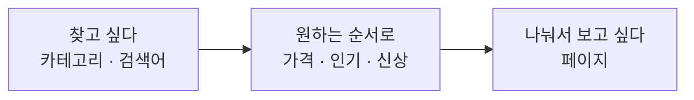
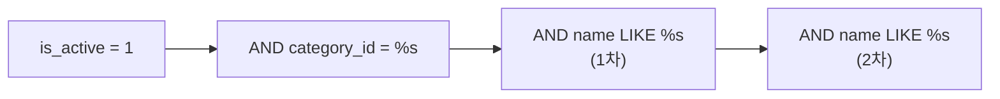
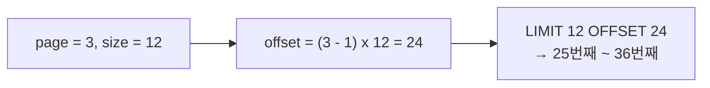
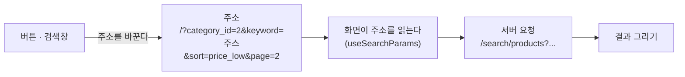

# 8일차. 찾기 : 카테고리 · 검색 · 정렬 · 페이지

> **오늘의 한 줄 목표** : 카테고리 버튼으로 거르고, 검색어로 찾고(결과 안에서 다시 검색도), 원하는 순서로 정렬하고, **12개씩 나눠서** 본다. 이 모든 조건이 **주소(URL)** 에 담겨서 새로고침·뒤로 가기·링크 공유가 된다.

| 항목 | 내용 |
|---|---|
| 만드는 것 | `/search/products`, `/search/categories`, `/search/sort-options` API, 카테고리 메뉴, 검색창, 정렬, 페이지 번호 |
| 새로 설치 | 없음 |
| 새 테이블 | 없음 (`step-08` 샘플 주문 데이터만 추가) |
| 관련 요구사항 | FR-05~08, BR-05 |
| 끝나면 | 쇼핑몰다운 목록 화면 |

완성 스냅샷 : `docs/steps/day08/`

---

## 시간표 (8시간)

| 시간 | 내용 | 방식 |
|---|---|---|
| 09:00 ~ 09:30 | 7일차 복습, 오늘의 질문 : "상품이 1,000개라면?" | 토의 |
| 09:30 ~ 10:30 | **검색 SQL** : `LIKE`, `%` 와 `_` 의 함정 | 강의 + 실습 |
| 10:30 ~ 12:00 | **검색 API** : 조건 조립, 카테고리, 1차·2차 검색 | 실습 |
| 12:00 ~ 13:00 | 점심 | |
| 13:00 ~ 14:00 | **정렬** : 판매 인기순(JOIN), 화이트리스트로 인젝션 막기 | 실습 |
| 14:00 ~ 14:30 | **페이지** : `LIMIT / OFFSET`, 전체 페이지 수 | 실습 |
| 14:30 ~ 17:00 | **화면** : 카테고리 메뉴, 검색창, 정렬, 페이지 번호 | 실습 |
| 17:00 ~ 18:00 | 시험·정리, 퀴즈 | |

---

## 1. 오늘의 질문

상품이 33개일 때는 한 화면에 다 보였습니다. **1,000개라면?** 사용자는 세 가지를 원합니다.



---

## 2. DB : 인기순을 확인할 데이터

### 2-1. 판매 인기순은 어디서 알까요?

`products` 표에는 "얼마나 팔렸는지"가 **없습니다.** 대신 **`order_items` 에서 계산**합니다. (같은 정보를 두 곳에 저장하지 않는다)

```sql
-- 상품별 판매 수량 : 결제 완료(PAID) 주문만 센다
SELECT oi.product_id, SUM(oi.quantity) AS sold_qty
FROM order_items oi
JOIN orders o ON o.id = oi.order_id
WHERE o.status = 'PAID'
GROUP BY oi.product_id;
```

### 2-2. 샘플 주문 넣기

직접 주문한 데이터가 적어서 순위가 안 보입니다. **샘플 주문 16건**을 넣습니다.

```sql
source C:/work/miniShop/docs/sql/step-08_sample_orders.sql
```

> ⚠️ 이 SQL 은 **지금까지 만든 주문을 지우고** 샘플로 바꿉니다. (연습용 DB 이므로 괜찮습니다)

샘플 데이터에는 **함정**이 들어 있습니다.

| 주문 | 의도 |
|---|---|
| 15번 : **판매중지 상품**(단종 콜라) 50개 | 많이 팔렸어도 목록에 나오면 안 된다 |
| 16번 : **취소(CANCELLED)** 주문 | 판매량에 들어가면 안 된다 (홍차 60개, 생수 20개) |

SQL 마지막 `SELECT` 의 **예상 결과** : 생수 500ml(40) > 콜라(35) > 아메리카노(28) > 바나나우유(20) > 사이다(15).

---

## 3. 백엔드 : 검색 API

### 3-1. 요청과 응답 모양

```text
GET /search/products?category_id=2&keyword=오렌지&sub_keyword=100&sort=price_low&page=1&size=12
```

| 파라미터 | 뜻 | 기본값 |
|---|---|---|
| `category_id` | 이 카테고리만 | 전체 |
| `keyword` | 1차 검색어 (상품명에 포함) | 전체 |
| `sub_keyword` | **결과 안에서** 다시 검색 (AND) | 없음 |
| `sort` | 정렬 | `recommend`(추천순) |
| `page`, `size` | 페이지 번호(1부터), 한 페이지 개수 | 1, 20 |

```json
{ "total": 33, "total_pages": 3, "page": 1, "size": 12, "items": [ {"id": 12, "name": "생수 500ml", "sold_qty": 40, ... } ] }
```

> 주소를 `/products/search` 가 아니라 **`/search/products`** 로 한 이유 : `GET /products/{product_id}` 가 먼저 있어서 `/products/search` 의 `search` 를 상품 번호로 착각해 **422** 가 나기 때문입니다. (3일차에 만난 문제와 같은 종류)

### 3-2. 정렬 옵션 정하기 : `Enum`

```python
class SortOption(str, Enum):
    recommend = "recommend"     # 추천순 (기본값)
    popular = "popular"         # 판매 인기순
    newest = "newest"           # 신규상품순
    price_low = "price_low"     # 낮은 가격순
    price_high = "price_high"   # 높은 가격순
```

`Enum` 으로 허용 값을 정해 두면, 이 목록에 **없는 값**(`sort=evil`)은 FastAPI 가 **422** 로 알아서 거부합니다.

### 3-3. ⚠️ ORDER BY 와 SQL 인젝션

지금까지 값은 `%s` 로 안전하게 넣었습니다. 그런데 **`ORDER BY` 의 컬럼 이름은 `%s` 로 넣을 수 없습니다.** (`%s` 는 "값"의 자리이지 "이름"의 자리가 아니다)

```python
# ❌ 위험 : 사용자가 보낸 글자를 SQL 에 그대로 붙인다
sql = f"SELECT ... ORDER BY {sort}"       # sort 에 "1; DROP TABLE products" 가 오면?
```

해결 : 사용자의 글자를 쓰지 않고, **미리 정해 둔 문장 중에서 고른다.** (화이트리스트)

```python
ORDER_BY_SQL = {
    SortOption.recommend: "(p.stock > 0) DESC, sold_qty DESC, p.created_at DESC, p.id DESC",
    SortOption.popular: "sold_qty DESC, p.id DESC",
    SortOption.newest: "p.created_at DESC, p.id DESC",
    SortOption.price_low: "p.price ASC, p.id DESC",
    SortOption.price_high: "p.price DESC, p.id DESC",
}
```

| 정렬 | 기준 |
|---|---|
| `recommend` 추천순 | ① 재고 있는 것 먼저 → ② 많이 팔린 것 → ③ 최근 등록 |
| `popular` 판매 인기순 | 판매 수량 많은 순 |
| `newest` 신규순 | 등록일 최근 순 |
| `price_low / price_high` | 가격 오름차순 / 내림차순 |

> 💡 **끝의 `p.id DESC` 는 왜 붙였나요?** 가격이 같은 상품끼리 순서가 **매번 달라지면**, 페이지를 넘길 때 같은 상품이 두 번 나오거나 빠집니다. 항상 같은 순서가 되도록 **마지막 기준**을 하나 더 둡니다.

### 3-4. 검색어와 `LIKE` 의 함정

`LIKE '%주스%'` 는 "이름에 주스가 **들어간**" 상품입니다. `%` 는 "아무 글자 여러 개", `_` 는 "아무 글자 한 개"라는 **특수 기호**입니다.

> **질문 : 사용자가 검색창에 `%` 하나만 입력하면?**
> `LIKE '%%%'` 가 되어 **모든 상품**이 나옵니다. (`100% 오렌지주스` 만 나와야 맞다)

그래서 사용자가 입력한 `%`, `_` 앞에 `\` 를 붙여 **진짜 글자**로 취급하게 만듭니다.

```python
def to_like_pattern(text):
    """검색어를 LIKE 용 '%검색어%' 로 만든다.

    사용자가 입력한 % 나 _ 는 LIKE 에서 "아무 글자" 라는 특수 기호라서,
    그대로 두면 "%" 하나만 입력해도 전체 상품이 검색된다.
    앞에 \\ 를 붙여 "진짜 글자 % / _" 로 취급하게 바꾼다. (MariaDB 기본 이스케이프 문자가 \\ 이다)
    """
    escaped = text.replace("\\", "\\\\").replace("%", "\\%").replace("_", "\\_")
    return f"%{escaped}%"
```

### 3-5. 조건 조립 : `build_where`

```python
def build_where(keyword, sub_keyword, category_id=None):
    """카테고리 / 1차 / 2차 검색 조건으로 WHERE 문장과 값 목록을 만든다.

    조건 문장에는 %s 빈칸만 넣고, 실제 값은 params 리스트로 따로 넘긴다. (파라미터 바인딩)
    """
    conditions = ["p.is_active = 1"]   # 판매 중인 상품만
    params = []

    if category_id is not None:        # 카테고리 필터
        conditions.append("p.category_id = %s")
        params.append(category_id)

    if keyword:                        # 1차 검색 (상단 검색창)
        conditions.append("p.name LIKE %s")
        params.append(to_like_pattern(keyword))

    if sub_keyword:                    # 2차 검색 (결과 내 재검색) → AND 로 한 번 더 좁힌다
        conditions.append("p.name LIKE %s")
        params.append(to_like_pattern(sub_keyword))

    return " AND ".join(conditions), params
```

- 조건 **문장**에는 `%s` 빈칸만 넣고, **값**은 `params` 리스트에 따로 모읍니다.
- `p.is_active = 1` 이 **항상 첫 조건**입니다. (BR-05 판매중지 제외)
- 카테고리 · 1차 · 2차 검색이 모두 `AND` 로 연결됩니다.



### 3-6. 검색 SQL : 전체 건수와 현재 페이지

**① 전체 건수 (`COUNT`)** : 화면의 "총 33개"와 **페이지 번호**를 만들려면 필요합니다.

```python
    where_sql, where_params = build_where(keyword, sub_keyword, category_id)
    order_sql = ORDER_BY_SQL[sort]
    offset = (page - 1) * size

    conn = get_connection()
    try:
        with conn.cursor() as cursor:
            # ① 전체 건수 : 화면에 "검색 결과 N개" 와 페이지 번호를 보여 주기 위해 필요
            count_sql = f"""
                SELECT COUNT(*) AS total
                FROM products p
                WHERE {where_sql}
            """
            cursor.execute(count_sql, where_params)
            total = cursor.fetchone()["total"]
```

**② 현재 페이지 상품 + 판매량**

```python
            # ② 현재 페이지 상품 목록
            #   LEFT JOIN (판매량 집계)
            #     - 결제 완료(PAID) 주문의 상품별 판매 수량 합계를 먼저 구해서 붙인다.
            #     - LEFT JOIN 이라 한 번도 안 팔린 상품도 빠지지 않는다. (그때 sold_qty 는 NULL)
            #     - COALESCE(값, 0) : NULL 이면 0 으로 바꾼다.
            #   {where_sql}, {order_sql} 은 위에서 우리가 만든 고정 문장이라 f-string 으로 붙여도 안전하다.
            #   사용자가 입력한 검색어는 반드시 %s 빈칸으로만 들어간다.
            list_sql = f"""
                SELECT
                    p.id,
                    p.name,
                    p.price,
                    p.stock,
                    p.image_url,
                    p.created_at,
                    p.category_id,
                    c.name AS category_name,
                    COALESCE(s.sold_qty, 0) AS sold_qty
                FROM products p
                -- 카테고리 이름 : LEFT JOIN 이라 카테고리가 없는(NULL) 상품도 빠지지 않는다
                LEFT JOIN categories c ON c.id = p.category_id
                LEFT JOIN (
                    SELECT oi.product_id, SUM(oi.quantity) AS sold_qty
                    FROM order_items oi
                    JOIN orders o ON o.id = oi.order_id
                    WHERE o.status = 'PAID'
                    GROUP BY oi.product_id
                ) s ON s.product_id = p.id
                WHERE {where_sql}
                ORDER BY {order_sql}
                LIMIT %s OFFSET %s
            """
            cursor.execute(list_sql, where_params + [size, offset])
            items = cursor.fetchall()

            # SUM 결과는 Decimal 로 오기 때문에 JSON 에서 다루기 쉽게 int 로 바꾼다.
            for item in items:
                item["sold_qty"] = int(item["sold_qty"])

            return total, items
```

| 부분 | 설명 |
|---|---|
| `LEFT JOIN categories c` | 카테고리 이름을 붙인다. **`LEFT`** 라서 카테고리가 없는(NULL) 상품도 **빠지지 않는다** (`JOIN` 이었다면 사라진다) |
| `LEFT JOIN ( ... ) s` | 위 2-1 의 판매량 집계를 **붙인다**. 한 번도 안 팔린 상품은 `sold_qty` 가 `NULL` |
| `COALESCE(s.sold_qty, 0)` | `NULL` 이면 `0` 으로 |
| `LIMIT 12 OFFSET 24` | "24개를 건너뛰고 12개" = 3페이지 |
| `int(item["sold_qty"])` | `SUM` 결과는 소수 타입(`Decimal`)이라 JSON 이 다루기 쉬운 정수로 바꾼다 |



> `{where_sql}` 과 `{order_sql}` 을 f-string 으로 SQL 에 넣었는데 괜찮을까요? **네.** 둘 다 **우리가 코드 안에서 만든 고정 문장**(화이트리스트, `%s` 빈칸뿐인 조건)이기 때문입니다. **사용자가 입력한 글자는 단 한 글자도** 들어가지 않습니다. (검색어는 `params` 로만)

### 3-7. API 함수

```python
@router.get("/search/products", tags=["search"])
def search_products(
    category_id: int | None = Query(None, ge=1, description="카테고리 id"),
    keyword: str | None = Query(None, max_length=50, description="1차 검색어 (상품명)"),
    sub_keyword: str | None = Query(None, max_length=50, description="2차 검색어 (결과 내 재검색)"),
    sort: SortOption = Query(SortOption.recommend, description="정렬 옵션"),
    page: int = Query(1, ge=1, description="페이지 번호 (1부터)"),
    size: int = Query(20, ge=1, le=100, description="한 페이지 상품 수"),
):
    # 앞뒤 공백 제거. 공백만 입력한 경우는 검색어가 없는 것으로 본다.
    keyword = keyword.strip() if keyword else None
    sub_keyword = sub_keyword.strip() if sub_keyword else None

    try:
        total, items = search_products_sql(keyword, sub_keyword, sort, page, size, category_id)
    except Exception as e:
        logger.error(
            "상품 검색 실패 category_id=%s keyword=%s sub_keyword=%s sort=%s: %s",
            category_id, keyword, sub_keyword, sort.value, e,
        )
        raise HTTPException(status_code=500, detail="상품 검색 에러")

    logger.info(
        "상품 검색 category_id=%s keyword=%s sub_keyword=%s sort=%s page=%s → %s건",
        category_id, keyword, sub_keyword, sort.value, page, total,
    )

    return {
        "category_id": category_id,
        "keyword": keyword,
        "sub_keyword": sub_keyword,
        "sort": sort.value,
        "page": page,
        "size": size,
        "total": total,
        "total_pages": (total + size - 1) // size,   # 올림 나눗셈
        "items": items,
    }
```

| 코드 | 설명 |
|---|---|
| `Query(None, max_length=50)` | 검색어 최대 50자 (너무 긴 값 거부) |
| `Query(20, ge=1, le=100)` | `size` 는 1~100 (100만 개를 한 번에 달라는 요청 차단) |
| `.strip()` | 공백만 입력한 검색어는 "검색어 없음" 취급 |
| `(total + size - 1) // size` | **올림 나눗셈** : 33개 / 12 → 3페이지 (12+12+9) |

### 3-8. 카테고리 · 정렬 옵션 API

**카테고리 목록** (화면의 카테고리 버튼용)

```python
@router.get("/search/categories", tags=["search"])
def categories():
    conn = get_connection()
    try:
        with conn.cursor() as cursor:
            cursor.execute("""
                SELECT c.id, c.name, COUNT(p.id) AS product_count
                FROM categories c
                LEFT JOIN products p ON p.category_id = c.id AND p.is_active = 1
                GROUP BY c.id, c.name
                ORDER BY c.id
            """)
            return cursor.fetchall()
    except Exception as e:
        logger.error("카테고리 조회 실패: %s", e)
        raise HTTPException(status_code=500, detail="카테고리 조회 에러")
    finally:
        conn.close()
```

> **`LEFT JOIN ... AND p.is_active = 1` 의 위치가 중요합니다.** 조건을 `WHERE` 에 쓰면 판매 중인 상품이 **0개인 카테고리가 목록에서 통째로 사라집니다.** `ON` 안에 쓰면 카테고리는 남고 개수만 0 이 됩니다.

**정렬 옵션 목록** (`GET /search/sort-options`) : 화면의 드롭다운에 보여 줄 `{value, label}` 목록을 서버가 알려 줍니다. 전체 코드는 `docs/steps/day08/backend/app/product.py` 를 보세요.

### 3-9. ✍️ 시험 (`/docs`)

서버를 다시 시작하고, `GET /search/products` 에서 확인합니다.

| 요청 | 기대 결과 |
|---|---|
| (조건 없음) | `total` 33 |
| `keyword=콜라` | 콜라, 제로콜라, 체리콜라 (3개, **단종 콜라 제외**) |
| `keyword=주스` | 6개 (**테스트 주스 제외**) |
| `keyword=수` | 6개 (생수 500ml, 생수 2L, 탄산수, 레몬 탄산수, 옥수수수염차, 수정과) |
| `keyword=수` + `sub_keyword=생` | 생수 500ml, 생수 2L (**2개**) |
| `keyword=%` | `100% 오렌지주스` **1개만** (전체가 나오면 안 된다) |
| `keyword=_` | `언더바_테스트 음료` 1개 |
| `category_id=2` | 주스 6개 |
| `sort=popular` | 생수 500ml(40) → 콜라(35) → 아메리카노(28) → 바나나우유(20) → 사이다(15) ... |
| `sort=price_low`, `size=4` | 가격 낮은 순, `total_pages` 9 |
| `sort=evil` | **422** |
| `GET /search/categories` | 탄산 7, 주스 6, 물 2, 커피 4, 차 5, 우유 3, 기타 5 |

> 💡 **단종 콜라**가 인기순에 **나오지 않는** 것을 꼭 확인하세요. 판매량이 50개로 가장 많지만 판매중지라서 `is_active = 1` 조건에 걸러집니다.

---

## 4. 프론트엔드

### 4-1. 설계 : 검색 조건은 "주소"에 담는다



조건을 `useState` 에 넣는 방법도 있지만, **주소에 담으면** 이런 점이 좋습니다.

| 장점 | 설명 |
|---|---|
| 새로고침해도 유지 | 주소가 그대로 남는다 |
| **뒤로 가기**가 동작 | 이전 검색 조건으로 돌아간다 |
| 링크 공유 | 주소를 복사해 친구에게 보낼 수 있다 |

버튼은 **주소만 바꾸고**, 화면은 **주소가 바뀌면 다시 요청**합니다. 이 한 방향 흐름이 핵심입니다.

### 4-2. 프록시와 API 함수

**`vite.config.js`** 에 추가 (Vite 재시작!)

```js
'/search': 'http://localhost:8000',
```

**`api/products.js`** 에 검색 함수 3개를 추가합니다.

```javascript
// [검색] 상품 검색 : GET /search/products?category_id=&keyword=&sub_keyword=&sort=&page=&size=
//   값이 없는 항목은 주소에서 뺀다.
export function searchProducts(params, signal) {
    const qs = new URLSearchParams()
    Object.entries(params).forEach(([k, v]) => {
        if (v !== undefined && v !== null && v !== '') qs.set(k, v)
    })
    return request(`/search/products?${qs}`, signal)
}
```

> 값이 없는 항목(`''`, `null`)은 **주소에서 뺍니다.** `?keyword=&sub_keyword=` 처럼 빈 값이 서버로 가는 것을 막기 위해서입니다. `URLSearchParams` 는 글자를 주소에 안전하게(한글 포함) 인코딩해 줍니다.

### 4-3. ✍️ 카테고리 메뉴 `layout/CategoryNav.jsx`

```jsx
import { useEffect, useState } from 'react'
import { useSearchParams, useNavigate } from 'react-router-dom'
import { fetchCategories } from '../api/products'

// 카테고리 버튼 줄. 목록은 서버(/search/categories)에서 받고, 선택값은 주소(?category_id=)에 담는다.
function CategoryNav() {
  const [categories, setCategories] = useState([])
  const [params] = useSearchParams()
  const navigate = useNavigate()
  const selected = params.get('category_id')

  useEffect(() => {
    const controller = new AbortController()
    fetchCategories(controller.signal)
      .then(setCategories)
      .catch(() => {})          // 실패해도 "전체" 버튼은 보인다
    return () => controller.abort()
  }, [])

  // 카테고리를 바꾸면 검색어/정렬은 초기화하고 1페이지부터 보여 준다
  const select = (id) => navigate(id ? `/?category_id=${id}` : '/')

  return (
    <nav className="category-nav">
      <button
        className={!selected ? 'category-item active' : 'category-item'}
        onClick={() => select(null)}
      >
        전체
      </button>
      {categories.map((c) => (
        <button
          key={c.id}
          className={String(c.id) === selected ? 'category-item active' : 'category-item'}
          onClick={() => select(c.id)}
        >
          {c.name}
        </button>
      ))}
    </nav>
  )
}

export default CategoryNav
```

- 목록은 **서버**(`/search/categories`)에서 받는다. 화면에 `['탄산', '주스', ...]` 를 직접 적지 않는다. (카테고리가 바뀌면 화면 코드도 고쳐야 하는 문제 방지)
- 선택된 값은 **주소**(`?category_id=`)에서 읽는다.
- 카테고리를 바꾸면 검색어·정렬은 **초기화**하고 1페이지부터 (`navigate(\`/?category_id=${id}\`)`)

### 4-4. ✍️ 머리글에 검색창 : `layout/Header.jsx`

검색창은 `Header` 에 있습니다. 제출하면 **주소를 바꿔서** 목록 화면이 알아서 다시 검색합니다.

```jsx
  const handleSubmit = (e) => {
    e.preventDefault()              // 폼 제출 시 페이지 새로고침 방지
    // 검색하면 현재 카테고리는 유지하고, 정렬/2차 검색어/페이지는 초기화한다
    const qs = new URLSearchParams()
    const categoryId = params.get('category_id')
    if (categoryId) qs.set('category_id', categoryId)
    if (keyword.trim()) qs.set('keyword', keyword.trim())
    navigate(qs.toString() ? `/?${qs}` : '/')
  }
```

- `e.preventDefault()` : 폼 제출 때 새로고침 방지
- 검색해도 **현재 카테고리는 유지**하고, 정렬·2차 검색어·페이지는 초기화
- `Header` 의 로고 아래에 `<CategoryNav />` 를 붙입니다. (완성본 `Header.jsx` 를 복사하면 됩니다. `docs/steps/day08/frontend/src/layout/Header.jsx`)

### 4-5. ✍️ 목록 화면 `pages/ProductList.jsx` 개편

2일차의 단순한 목록을 **주소가 이끄는 검색 화면**으로 바꿉니다. 전체는 📦 `docs/steps/day08/frontend/src/pages/ProductList.jsx` 입니다. (`ProductList.css`, 개선된 `ProductCard.jsx` 도 함께 복사)

**① 주소에서 조건 읽기**

```jsx
// 상품 목록 + 검색 화면
//   검색 조건(카테고리, 검색어, 2차 검색어, 정렬, 페이지)은 모두 주소의 ?쿼리 에 담는다.
//   → 새로고침해도 유지되고, 뒤로가기/링크 공유가 된다.
function ProductList() {
    const [params, setParams] = useSearchParams();
    const categoryId = params.get("category_id") ?? "";
    const keyword = params.get("keyword") ?? "";
    const subKeyword = params.get("sub_keyword") ?? "";
    const sort = params.get("sort") ?? "recommend";
    const page = Math.max(1, Number(params.get("page")) || 1);
```

`params.get("category_id") ?? ""` : 값이 없으면 빈 글자. 페이지는 **숫자가 아니거나 0 이하이면 1** 로 보정합니다 (`Math.max(1, ...)`). 사용자가 주소를 직접 고쳐 `page=-5` 를 넣을 수도 있기 때문입니다.

**② 조건이 바뀔 때마다 서버에서 다시 검색**

```jsx
    // 검색 조건이 바뀔 때마다 서버에서 다시 검색
    useEffect(() => {
        const controller = new AbortController();
        searchProducts(
            { category_id: categoryId, keyword, sub_keyword: subKeyword, sort, page, size: PAGE_SIZE },
            controller.signal
        )
            .then((data) => {
                setState({
                    key: queryKey,
                    error: null,
                    data: {
                        ...data,
                        items: data.items.map((p) => ({ ...p, image_url: toImagePath(p.image_url, p.id, p.name) })),
                    },
                });
            })
            .catch((err) => {
                if (err.name === "AbortError") return;
                setState({ key: queryKey, data: null, error: err.message });
            });
        return () => controller.abort();
    }, [queryKey]);  // eslint-disable-line react-hooks/exhaustive-deps
```

- `useEffect(..., [queryKey])` : **조건이 바뀔 때만** 다시 요청 (`queryKey` 는 조건들을 `|` 로 이은 글자)
- `controller.abort()` : 조건을 빠르게 바꾸면 **이전 요청을 취소**한다. 늦게 도착한 옛날 결과가 새 결과를 덮어쓰지 않게 한다.

**③ 로딩 상태를 계산으로**

```jsx
    // 서버 응답과 "어떤 조건의 응답인지"(key) 를 함께 보관한다. 현재 조건과 key 가 다르면 로딩 중이다.
    const [state, setState] = useState({ key: null, data: null, error: null });
    const queryKey = [categoryId, keyword, subKeyword, sort, page].join("|");
    const loading = state.key !== queryKey;
    const result = state.data;
    const error = state.key === queryKey ? state.error : null;
```

2일차에는 `loading` 을 따로 `useState` 로 두었습니다. 여기서는 **응답에 "어떤 조건의 응답인지(`key`)"를 같이 저장**하고, **지금 조건과 다르면 로딩 중**으로 계산합니다. 조건을 바꿀 때 `setLoading(true)` 를 따로 호출할 필요가 없어서 실수가 줄어듭니다. ("계산할 수 있는 값은 state 로 만들지 않는다" 3일차의 원칙과 같습니다.)

**④ 주소를 바꾸는 함수**

```jsx
    // 주소 쿼리 일부를 바꾼다. 조건이 바뀌면 1페이지로 돌아간다.
    const update = (changes, keepPage = false) => {
        const next = new URLSearchParams(params);
        Object.entries(changes).forEach(([k, v]) => (v ? next.set(k, v) : next.delete(k)));
        if (!keepPage) next.delete("page");
        setParams(next);
    };
```

- 바꿀 조건만 받아서 **기존 주소와 합친다.**
- 조건이 바뀌면 **1페이지로** (`keepPage` 가 `false` 일 때 `page` 삭제). 페이지 번호 버튼만 `keepPage=true`.
- 정렬 드롭다운, 결과 내 재검색, 페이지 버튼은 모두 `update({...})` 한 함수를 부릅니다.

**⑤ 나머지** — 정렬 드롭다운(`sort-box`), 결과 내 재검색 입력(`SubSearch`), 페이지 번호(`pagination`), 재고 표시 체크박스는 **같은 패턴의 반복**이라 복사한 코드를 **읽고 동작만 확인**합니다. 정렬 옵션은 서버(`/search/sort-options`)에서 받고, 못 받으면 코드의 `FALLBACK_SORTS` 를 씁니다.

---

## 5. 체크포인트

- [ ] 카테고리 버튼(`전체 / 탄산 / 주스 ...`)을 누르면 해당 카테고리 상품만 나오고, 주소에 `?category_id=2` 가 붙는다
- [ ] 검색창에 `주스` → 6개. 카테고리가 **유지된 채** 검색된다
- [ ] 결과 안에서 `오렌지` 재검색 → 줄어든다. 칩의 `×` 로 지우면 원래대로
- [ ] 정렬을 바꾸면 순서가 바뀌고 **1페이지로** 돌아간다. 판매 인기순 1위는 **생수 500ml**
- [ ] 전체 목록은 **12개씩 3페이지**. 페이지 번호·이전·다음이 동작한다
- [ ] **새로고침해도** 검색 조건이 유지된다. **뒤로 가기**를 누르면 이전 조건으로 돌아간다
- [ ] 검색창에 `%` 만 입력하면 "100% 오렌지주스" 1개만 나온다
- [ ] 주소에서 `sort=evil` 로 고치면 오류 문구가 나온다 (422)
- [ ] 검색 결과가 없으면 "조건에 맞는 상품이 없습니다."

---

## 6. 자주 하는 실수

| 증상 | 원인 | 해결 |
|---|---|---|
| 화면에서 `/search/...` 가 `404` | 프록시 `/search` 추가 후 Vite 재시작 안 함 | 재시작 |
| 인기순인데 모두 `sold_qty` 0 | `step-08` 샘플 주문을 넣지 않음 | step-08 실행 |
| 한글 검색이 안 됨 (curl 등에서) | 주소의 한글 인코딩 문제 | 브라우저·`URLSearchParams` 를 쓴다 / `/docs` 에서 시험 |
| 2페이지에서 검색하면 결과가 없음 | 새 조건인데 `page=2` 가 남아 있음 | 조건 변경 시 `page` 삭제 (`keepPage`) |
| 카테고리 개수가 0 인 카테고리가 사라짐 | `is_active` 조건을 `ON` 이 아닌 `WHERE` 에 둠 | `LEFT JOIN ... ON ... AND p.is_active = 1` |
| `sort=popular` 가 `500` | `sold_qty` 컬럼 이름 불일치 | `COALESCE(...) AS sold_qty` 와 `ORDER_BY_SQL` 확인 |
| `LIKE` 결과가 이상함 | `%` 가 `\%` 로 바뀌지 않음 | `to_like_pattern` 확인 |
| 검색할 때마다 화면이 깜빡임 | 조건이 바뀔 때마다 데이터를 비움 | 이전 결과를 흐리게(`loading` 클래스) 남겨 둔다 |

---

## 7. 오늘의 핵심 정리

1. **값은 `%s` 로, 이름(ORDER BY)은 화이트리스트로.** 사용자가 입력한 글자를 SQL 문장에 이어 붙이지 않는다.
2. `LIKE` 의 `%` `_` 는 특수 기호다. 사용자 입력은 **이스케이프**한다.
3. `JOIN` 은 양쪽에 있어야 나오고, **`LEFT JOIN`** 은 한쪽에 없어도 나온다. 판매량처럼 **없을 수 있는 값**에 쓴다.
4. 페이지는 `LIMIT 개수 OFFSET (페이지-1)×개수`, 전체 페이지는 **올림 나눗셈**.
5. 같은 정렬 값이 있으면 **마지막 기준(`id`)** 을 더해 순서를 고정한다.
6. **검색 조건은 주소에 담는다.** 버튼은 주소를 바꾸고, 화면은 주소를 읽어 요청한다.
7. 판매량처럼 계산할 수 있는 값은 **저장하지 않고 집계**한다.

## 퀴즈

1. `ORDER BY %s` 로 정렬 컬럼을 바인딩하면 안 되는 이유는? 우리는 대신 무엇을 했나요?
2. 상품 33개, 한 페이지 12개일 때 `total_pages` 는? 계산식을 써 보세요. (3, `(33 + 12 - 1) // 12`)
3. `LEFT JOIN` 을 `JOIN` 으로 바꾸면 "언더바_테스트 음료"(카테고리 없음)는 어떻게 될까요?
4. 검색 조건을 `useState` 가 아닌 주소에 담으면 뒤로 가기가 왜 동작할까요?

## 과제

- **기본** : `size` 를 6 으로 바꿔 보고(주소를 직접 `...&size=6`) 페이지 수가 어떻게 바뀌는지 확인하기. (화면에서는 `PAGE_SIZE` 상수를 고친다)
- **기본** : 정렬 옵션에 "이름순"(`name_asc`)을 추가하기. (서버 `SortOption`, `SORT_LABELS`, `ORDER_BY_SQL` 세 곳)
- **도전** : 가격 범위 검색 (`min_price`, `max_price`) 을 `build_where` 에 추가하기.

## 내일 예고

9일차에는 **관리자**가 됩니다. 상품을 등록·수정·삭제하고, 주문을 보고 **환불**하면 재고가 되돌아옵니다. 일반 회원이 관리자 API 를 호출하면 **403** 이 나오도록 **권한**을 만듭니다.

---

## 📌 강사 메모

- **SQL 인젝션 시연** : 오늘 꼭 보여 주세요. `ORDER BY` 에 f-string 을 쓴 **일부러 위험한 버전**을 만들어 `sort=price DESC, (SELECT SLEEP(5))` 같은 값을 넣으면 응답이 5초 느려지는 것을 보여 줄 수 있습니다. (연습용 DB, 시연 후 반드시 되돌리기) 그 뒤 Enum 이 422 로 막는 것을 보여 주면 "왜 이렇게까지 하는지"가 납득됩니다.
- `LEFT JOIN` 은 벤 다이어그램보다 **실제 결과**로 설명하세요. 샘플 데이터의 "판매 기록이 없는 상품"이 `JOIN` 에서는 사라지고 `LEFT JOIN` 에서는 `NULL` 로 남는 것을 `SELECT` 로 직접 비교합니다.
- 오후 화면 작업은 **복사한 `ProductList.jsx` 를 먼저 동작**시키고, 4-5 의 ①~④ 를 읽는 순서가 안전합니다. 정렬 드롭다운 등 반복 패턴은 읽기만 하세요.
- 8일차가 길어지면 **페이지 번호 UI 는 과제**로 돌리고 `이전 / 다음` 만 확인해도 됩니다.
