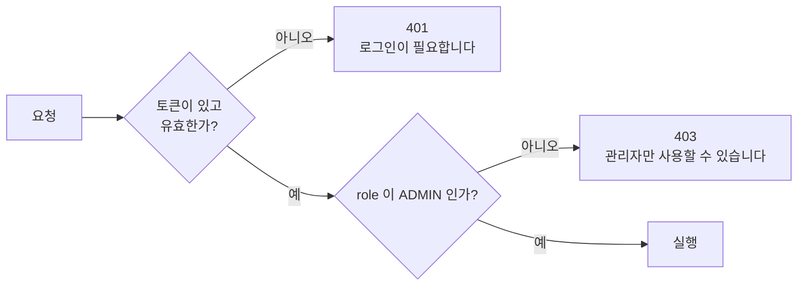
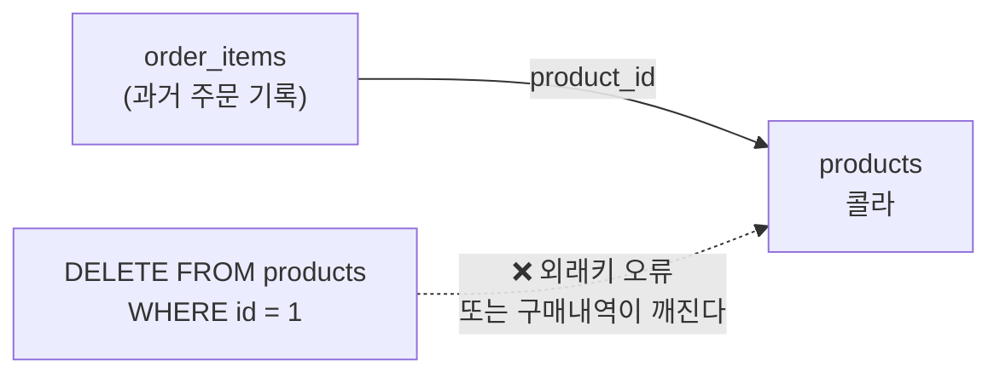
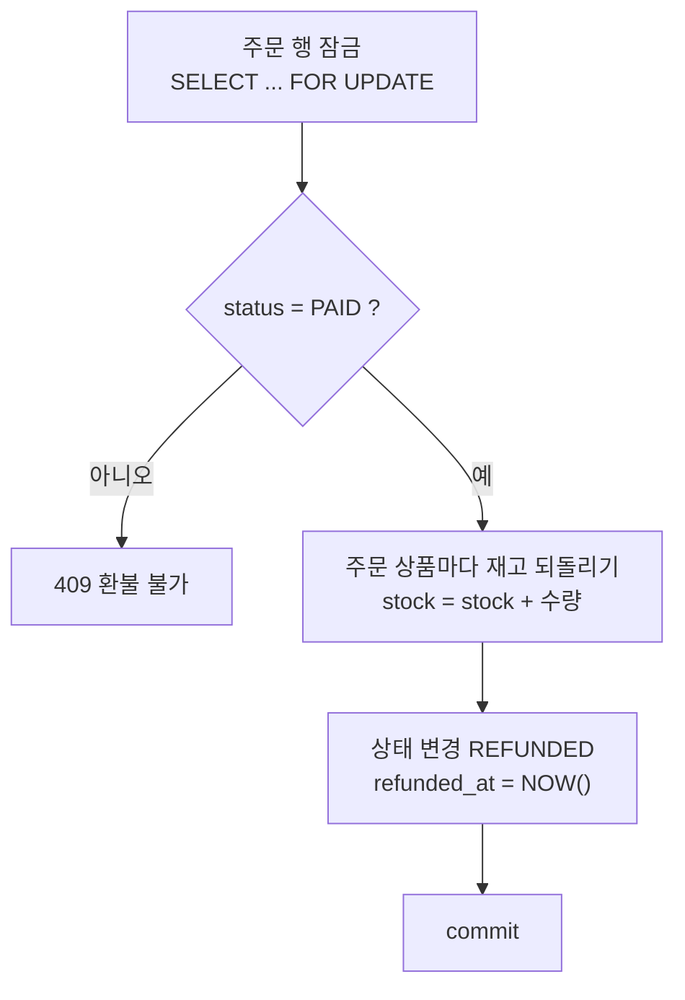
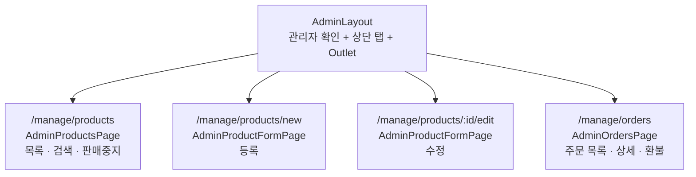

# 9일차. 관리자 : 상품 관리 · 주문 관리 · 환불 · 권한

> **오늘의 한 줄 목표** : **관리자만** 들어갈 수 있는 화면에서 상품을 **등록·수정·삭제(판매중지)** 하고, 전체 주문을 보고 **환불**하면 재고가 되돌아온다. 일반 회원이 관리자 API 를 호출하면 **403** 으로 막힌다.

| 항목 | 내용 |
|---|---|
| 만드는 것 | 권한 확인(`require_admin`), 상품 `POST/PUT/DELETE`, `/admin` API(목록·상세·환불), 관리자 화면 3개 |
| 새로 설치 | 없음 |
| 새 테이블 | 없음 |
| 관련 요구사항 | FR-50~54, BR-06, BR-09, BR-10 |
| 끝나면 | 관리자 로그인 → 상품 등록·수정·판매중지 → 주문 환불 → 구매내역에서 사라짐 |

완성 스냅샷 : `docs/steps/day09/`

---

## 시간표 (8시간)

| 시간 | 내용 | 방식 |
|---|---|---|
| 09:00 ~ 09:30 | 8일차 복습, 오늘의 질문 : "관리자는 누가, 어떻게 가려낼까?" | 토의 |
| 09:30 ~ 10:30 | **권한(Authorization)** : 401 vs 403, `require_admin` | 강의 + 실습 |
| 10:30 ~ 12:00 | **상품 등록·수정·삭제 API** (POST / PUT / DELETE) | 실습 |
| 12:00 ~ 13:00 | 점심 | |
| 13:00 ~ 14:30 | **관리자 조회 API**, **환불 API** (트랜잭션, 잠금) | 실습 |
| 14:30 ~ 17:00 | **관리자 화면** : 상품 목록, 등록·수정 폼, 주문 관리 | 실습 |
| 17:00 ~ 18:00 | 시나리오 시험, 정리, 퀴즈 | |

---

## 1. 개념

### 1-1. 인증과 권한은 다르다

| 용어 | 질문 | 실패하면 | 우리 코드 |
|---|---|---|---|
| **인증**(Authentication) | 당신은 **누구**입니까? | `401` | `get_current_user` (6일차) |
| **권한**(Authorization) | 당신은 이 일을 **해도** 됩니까? | `403` | `require_admin` (오늘) |



### 1-2. 화면에서 막으면 충분할까요?

화면(React)에서 관리자 메뉴를 **숨기는 것**은 편의일 뿐입니다. 누구나 개발자 도구나 `/docs` 로 **API 를 직접 호출**할 수 있습니다. **진짜 방어는 서버**에서 해야 합니다.

> 🧪 **시연 (강사)** : 일반 회원으로 로그인해 `/docs` 에서 `POST /products` 를 호출 → 서버가 `403` 으로 막는 것을 보여 줍니다.

### 1-3. 왜 "삭제"가 아니라 "판매중지"인가?



과거 주문(`order_items`)이 상품을 **참조**하고 있어서, 행을 지우면 오류가 나거나 지난 구매내역이 깨집니다. 그래서 **`is_active = 0`** 으로 바꿔 "숨기기"만 합니다. (BR-06) 8일차까지의 모든 조회에 `is_active = 1` 조건이 있던 이유입니다.

---

## 2. 백엔드

### 2-1. ✍️ 관리자 확인 부품 — `auth.py` 에 추가

6일차의 `get_current_user` **아래에** 추가합니다.

```python
def require_admin(user: dict = Depends(get_current_user)) -> dict:
    """관리자(role = ADMIN) 만 통과시킨다. 일반 회원이면 403."""
    if user["role"] != "ADMIN":
        raise HTTPException(status_code=403, detail="관리자만 사용할 수 있습니다.")
    return user
```

```python
@router.post("/products")
def create_product(item: ProductIn, admin: dict = Depends(require_admin)):   # ← 관리자만
```

> **`Depends` 는 겹쳐 쓸 수 있습니다.** `require_admin` 은 `get_current_user` 를 다시 사용합니다. 그래서 토큰이 없으면 `401`, 토큰은 있는데 일반 회원이면 `403` 입니다.

### 2-2. ✍️ 상품 등록 · 수정 · 삭제 — `product.py` 에 추가

**① 요청 모양 : `ProductIn`**

```python
class ProductIn(BaseModel):
    name: str = Field(min_length=1, max_length=50)       # 상품 이름 (빈 문자열 금지)
    price: int = Field(ge=0, le=10_000_000)              # 가격 (0 이상)
    stock: int = Field(ge=0, le=1_000_000)               # 재고 (0 이상)
    category_id: int | None = None                       # 카테고리 (없으면 미분류)
    description: str | None = Field(None, max_length=255)
    image_url: str | None = Field(None, max_length=255)  # 이미지 경로 (예: /products/images/cola.jpg)
    is_active: bool = True                               # 판매 여부 (False = 판매중지)
    is_recommended: bool = False                         # 추천 상품 여부
    recommend_rank: int = Field(0, ge=0, le=9999)        # 추천 순서 (클수록 위)
```

`Field(ge=0, le=10_000_000)` 처럼 **범위를 서버에서 강제**합니다. 가격 `-5` 나 재고 `99999999999` 가 들어오면 `422` 로 거부됩니다.

**② 카테고리 검사**

```python
def _check_category(cursor, category_id):
    """카테고리가 있는 값인지 확인한다. (없는 id 를 넣으면 422)"""
    if category_id is None:
        return
    cursor.execute("SELECT 1 FROM categories WHERE id = %s", (category_id,))
    if cursor.fetchone() is None:
        raise HTTPException(status_code=422, detail="존재하지 않는 카테고리입니다.")
```

(함수 이름 앞의 `_` 는 "이 파일 안에서만 쓰는 도우미"라는 관습입니다.)

**③ 등록 `POST /products` → 201**

```python
@router.post("/products", status_code=201)
def create_product(item: ProductIn, admin: dict = Depends(require_admin)):
    if not item.name.strip():
        raise HTTPException(status_code=422, detail="상품명을 입력해 주세요.")
    conn = get_connection()
    try:
        with conn.cursor() as cursor:
            _check_category(cursor, item.category_id)
            cursor.execute(
                """INSERT INTO products
                   (name, price, stock, category_id, description, image_url, is_active, is_recommended, recommend_rank)
                   VALUES (%s, %s, %s, %s, %s, %s, %s, %s, %s)""",
                _product_values(item),
            )
            product_id = cursor.lastrowid
        conn.commit()
    except HTTPException:
        conn.rollback()
        raise
    except Exception as e:
        conn.rollback()
        logger.error("상품 등록 실패: %s", e)
        raise HTTPException(status_code=500, detail="상품 등록 중 오류가 발생했습니다.")
    finally:
        conn.close()
    logger.info("상품 등록 id=%s name=%s by=%s", product_id, item.name, admin["email"])
    return {"id": product_id}
```

**④ 수정 `PUT /products/{id}`**

```python
@router.put("/products/{product_id}")
def update_product(product_id: int, item: ProductIn, admin: dict = Depends(require_admin)):
    if not item.name.strip():
        raise HTTPException(status_code=422, detail="상품명을 입력해 주세요.")
    conn = get_connection()
    try:
        with conn.cursor() as cursor:
            _check_category(cursor, item.category_id)
            cursor.execute(
                """UPDATE products
                   SET name = %s, price = %s, stock = %s, category_id = %s, description = %s,
                       image_url = %s, is_active = %s, is_recommended = %s, recommend_rank = %s
                   WHERE id = %s""",
                _product_values(item) + (product_id,),
            )
            # 값이 그대로여도 rowcount 가 0 일 수 있어, 존재 여부는 따로 확인한다
            cursor.execute("SELECT 1 FROM products WHERE id = %s", (product_id,))
            if cursor.fetchone() is None:
                raise HTTPException(status_code=404, detail="상품을 찾을 수 없습니다.")
        conn.commit()
    except HTTPException:
        conn.rollback()
        raise
    except Exception as e:
        conn.rollback()
        logger.error("상품 수정 실패 id=%s: %s", product_id, e)
        raise HTTPException(status_code=500, detail="상품 수정 중 오류가 발생했습니다.")
    finally:
        conn.close()
    logger.info("상품 수정 id=%s by=%s", product_id, admin["email"])
    return {"id": product_id}
```

- `PUT` 은 **통째로 교체**합니다. 모든 필드를 보냅니다. (일부만 고치는 `PATCH` 와 구별)
- 값이 그대로여도 `rowcount` 가 0 일 수 있어서, 존재 여부는 **따로 `SELECT 1`** 로 확인합니다.

**⑤ 삭제 `DELETE /products/{id}` → 판매중지**

```python
@router.delete("/products/{product_id}")
def delete_product(product_id: int, admin: dict = Depends(require_admin)):
    conn = get_connection()
    try:
        with conn.cursor() as cursor:
            cursor.execute("SELECT 1 FROM products WHERE id = %s", (product_id,))
            if cursor.fetchone() is None:
                raise HTTPException(status_code=404, detail="상품을 찾을 수 없습니다.")
            cursor.execute("UPDATE products SET is_active = 0 WHERE id = %s", (product_id,))
        conn.commit()
    except HTTPException:
        conn.rollback()
        raise
    except Exception as e:
        conn.rollback()
        logger.error("상품 삭제 실패 id=%s: %s", product_id, e)
        raise HTTPException(status_code=500, detail="상품 삭제 중 오류가 발생했습니다.")
    finally:
        conn.close()
    logger.info("상품 판매중지(삭제) id=%s by=%s", product_id, admin["email"])
    return {"id": product_id, "is_active": False}
```

> 💡 등록·수정·삭제는 모두 **같은 틀**입니다 : `연결 → 검사 → SQL → commit / (오류면 rollback) → 연결 닫기`. 이 틀이 눈에 익으면 어떤 쓰기 API 도 만들 수 있습니다.

### 2-3. ✍️ 관리자 조회 · 환불 — `admin.py` (새 파일)

📦 `docs/steps/day09/backend/app/admin.py` 를 복사하고 핵심만 읽습니다.

**① 모든 API 를 한 번에 관리자 전용으로**

```python
router = APIRouter(prefix="/admin", tags=["admin"], dependencies=[Depends(require_admin)])
```

`dependencies=[Depends(require_admin)]` 를 **라우터 전체**에 걸면, 이 파일의 모든 API 에 일일이 쓰지 않아도 됩니다. (실수로 빠뜨리는 것을 막는다)

**② 왜 `/admin/products` 가 따로 필요한가?**

`/products`(일반 목록)는 **판매 중인 것만** 줍니다. 관리자는 **판매중지 상품도** 봐야 하므로 상태 필터(`all / active / inactive`)가 있는 별도 API 를 둡니다.

**③ 환불 `POST /admin/orders/{id}/refund`**

```python
# POST /admin/orders/{id}/refund : 환불 (PAID → REFUNDED)
#   환불되면 구매가 아니므로 구매내역에서 빠지고, 가져갔던 재고는 되돌린다.
#   한 트랜잭션 : 주문 행을 잠그고(FOR UPDATE) 상태를 확인한 뒤 재고 복구와 상태 변경을 함께 처리한다.
#   이미 환불된 주문 / 결제 전 주문은 409 (두 번 눌러도 재고가 두 번 늘지 않는다).
# -----------------------------------------------------------------------------
@router.post("/orders/{order_id}/refund")
def refund_order(order_id: int, admin: dict = Depends(require_admin)):
    conn = get_connection()
    try:
        with conn.cursor() as cur:
            cur.execute("SELECT status FROM orders WHERE id = %s FOR UPDATE", (order_id,))
            row = cur.fetchone()
            if row is None:
                raise HTTPException(status_code=404, detail="주문을 찾을 수 없습니다.")
            if row["status"] != "PAID":
                raise HTTPException(status_code=409, detail="결제 완료(구매) 상태의 주문만 환불할 수 있습니다.")

            # 교착(deadlock)을 줄이려고 상품 id 순으로 재고를 되돌린다
            cur.execute(
                "SELECT product_id, quantity FROM order_items WHERE order_id = %s ORDER BY product_id",
                (order_id,),
            )
            for it in cur.fetchall():
                cur.execute(
                    "UPDATE products SET stock = stock + %s WHERE id = %s", (it["quantity"], it["product_id"])
                )
            cur.execute(
                "UPDATE orders SET status = 'REFUNDED', refunded_at = NOW() WHERE id = %s AND status = 'PAID'",
                (order_id,),
            )
        conn.commit()
    except HTTPException:
        conn.rollback()
        raise
    except Exception as e:
        conn.rollback()
        logger.error("환불 실패 order_id=%s: %s", order_id, e)
        raise HTTPException(status_code=500, detail="환불 처리 중 오류가 발생했습니다.")
    finally:
        conn.close()
    logger.info("환불 order_id=%s by=%s", order_id, admin["email"])
    return {"order_id": order_id, "status": "REFUNDED"}
```

환불은 **한 트랜잭션**으로 세 가지를 합니다.



| 코드 | 이유 |
|---|---|
| `FOR UPDATE` | **같은 주문을 두 번 환불**하는 요청이 동시에 와도, 한 명씩 처리하게 줄을 세운다 (5일차의 잠금) |
| `status != 'PAID'` → 409 | 이미 환불된 주문을 또 환불하면 **재고가 두 번 늘어나는** 사고. 상태로 막는다 |
| `WHERE id = %s AND status = 'PAID'` | 마지막 UPDATE 에도 조건을 한 번 더 (안전장치) |
| 상품 id 순서로 재고 복구 | 5일차의 `sorted` 와 같은 이유 (교착 방지) |

> 환불하면 `status` 가 `REFUNDED` 가 되어 **7일차 구매내역에서 사라지고**, 8일차 **판매 인기순에서도 빠집니다.** (`status = 'PAID'` 만 집계하기 때문) 모든 기능이 **상태값 하나**로 연결되어 있습니다.

### 2-4. ✍️ `main.py` 에 관리자 라우터 추가

```python
from .admin import router as admin_router
app.include_router(admin_router)     # 관리자 API (/admin) - 관리자만
```

### 2-5. 시험 (`/docs`)

**Authorize** 에 **관리자 토큰**(`admin@test.local` / `test1234!`)과 **일반 회원 토큰**(`user1@test.local`)을 번갈아 씁니다.

| # | 요청 | 기대 결과 |
|---|---|---|
| ① | Authorize 없이 `POST /products` | `401` |
| ② | **일반 회원** 토큰으로 `POST /products` | **`403`** `관리자만 사용할 수 있습니다.` |
| ③ | **관리자** 토큰으로 `POST /products` (`name`, `price`, `stock`, `category_id`=1) | `201` + 새 `id` |
| ④ | 없는 카테고리(`category_id` = 999) | `422` |
| ⑤ | `PUT /products/{새 id}` 로 이름·가격 수정 | `200`, `GET /admin/products/{id}` 에서 바뀐 값 확인 |
| ⑥ | `DELETE /products/{새 id}` | `200` `is_active: false` |
| ⑦ | `GET /products/{새 id}` (일반 상세) | **404** (판매중지) |
| ⑧ | `GET /admin/products?status=inactive` | 방금 상품이 **보인다** (판매중지 포함) |
| ⑨ | `GET /admin/orders?status=PAID` | 샘플 주문 15건 |
| ⑩ | `GET /admin/orders/{id}` | 구매자(이메일)·배송지·상품 |
| ⑪ | 주문 하나의 상품 재고 확인 → `POST /admin/orders/{id}/refund` → 재고 확인 | **구매 수량만큼 재고가 늘어난다** |
| ⑫ | 같은 주문을 **다시 환불** | **`409`** (재고가 또 늘지 않는다) |
| ⑬ | 일반 회원 토큰으로 환불 | `403` |
| ⑭ | 환불한 주문 주인의 `GET /purchases` | 그 주문이 **사라졌다** |

---

## 3. 프론트엔드

### 3-1. 프록시 추가 — `vite.config.js`

```js
'/admin': 'http://localhost:8000',
```

(Vite 재시작!) 화면 주소는 `/manage/...` 로 정했습니다. API 가 `/admin` 이라 **화면이 같은 이름이면 프록시가 가로채기** 때문입니다.

### 3-2. 화면 구성



**중첩 라우트** : `/manage` 아래의 화면들은 **같은 틀(`AdminLayout`)** 을 공유합니다. `AdminLayout` 안의 `<Outlet />` 자리에 주소에 맞는 화면이 들어옵니다.

### 3-3. ✍️ `App.jsx` 에 관리자 라우트 추가

```jsx
<Route path="/manage" element={<AdminLayout />}>
  <Route index element={<Navigate to="products" replace />} />        {/* /manage → /manage/products */}
  <Route path="products" element={<AdminProductsPage />} />
  <Route path="products/new" element={<AdminProductFormPage />} />
  <Route path="products/:id/edit" element={<AdminProductFormPage />} />
  <Route path="orders" element={<AdminOrdersPage />} />
</Route>
```

> 등록(`new`)과 수정(`:id/edit`)이 **같은 컴포넌트**를 씁니다. 주소에 `id` 가 있으면 수정, 없으면 등록입니다.

### 3-4. ✍️ 관리자만 들어오는 문 — `AdminLayout.jsx`

```jsx
import { NavLink, Navigate, Outlet, useLocation } from "react-router-dom";
import { useAuthContext } from "../../context/authContext";
import "./Admin.css";

// 관리자 화면 공통 : 관리자만 들어올 수 있고, 위쪽에 "상품 관리 / 주문 관리" 탭을 보여 준다.
//   (화면에서 막는 것은 편의일 뿐이고, 실제 권한 확인은 서버(/admin, 403)가 한다)
function AdminLayout() {
  const { user, ready } = useAuthContext();
  const location = useLocation();

  if (!ready) return <p className="admin-message">확인하는 중...</p>;
  if (!user) return <Navigate to="/login" replace state={{ from: location.pathname }} />;
  if (user.role !== "ADMIN") return <p className="admin-message error">관리자만 접근할 수 있습니다.</p>;

  return (
    <div className="admin-page">
      <h2 className="admin-title">관리자</h2>
      <nav className="admin-tabs">
        <NavLink to="/manage/products">상품 관리</NavLink>
        <NavLink to="/manage/orders">주문 관리</NavLink>
      </nav>
      <Outlet />
    </div>
  );
}

export default AdminLayout;
```

세 가지 상태를 순서대로 처리합니다.

| 상태 | 처리 |
|---|---|
| `!ready` | 로그인 확인 중 → 기다린다 |
| `!user` | 로그인 안 함 → 로그인 화면으로 |
| `role !== "ADMIN"` | 일반 회원 → "관리자만 접근할 수 있습니다" |

> ⚠️ 이것은 **화면 편의**입니다. 일반 회원이 주소를 직접 쳐서 들어와 화면을 열어도, 서버가 모든 `/admin` 요청에 **403** 을 주기 때문에 **데이터는 볼 수 없습니다.** 이 이중 구조가 중요합니다.

### 3-5. ✍️ API 함수 — `api/admin.js`

```javascript
// 관리자 API (관리자 로그인 필요) : 상품 관리, 주문 관리
//   화면 주소는 /manage/..., API 주소는 /admin/... 이다. (/admin 은 Vite 프록시가 백엔드로 보내기 때문)
import { apiFetch } from './auth'

// 값이 있는 항목만 ?쿼리 로 만든다
function qs(params) {
    const q = new URLSearchParams()
    Object.entries(params).forEach(([k, v]) => {
        if (v !== undefined && v !== null && v !== '') q.set(k, v)
    })
    return q.toString()
}

// ---- 상품 관리 ----
// 목록 (판매중지 포함) : GET /admin/products?keyword=&status=all|active|inactive&page=&size=
export const adminListProducts = (params) => apiFetch(`/admin/products?${qs(params)}`, { auth: true })
// 수정 화면용 1개 : GET /admin/products/{id}
export const adminGetProduct = (id) => apiFetch(`/admin/products/${id}`, { auth: true })
// 등록 : POST /products
export const createProduct = (body) => apiFetch('/products', { method: 'POST', body, auth: true })
// 수정 : PUT /products/{id}
export const updateProduct = (id, body) => apiFetch(`/products/${id}`, { method: 'PUT', body, auth: true })
// 삭제(판매중지) : DELETE /products/{id}
export const deleteProduct = (id) => apiFetch(`/products/${id}`, { method: 'DELETE', auth: true })

// ---- 주문 관리 ----
// 목록 : GET /admin/orders?status=&keyword=&page=&size=
export const adminListOrders = (params) => apiFetch(`/admin/orders?${qs(params)}`, { auth: true })
// 상세 : GET /admin/orders/{id}
export const adminGetOrder = (id) => apiFetch(`/admin/orders/${id}`, { auth: true })
// 환불 : POST /admin/orders/{id}/refund
export const refundOrder = (id) => apiFetch(`/admin/orders/${id}/refund`, { method: 'POST', auth: true })
```

`{ auth: true }` 로 토큰이 자동으로 붙습니다. (6일차의 `apiFetch`)

### 3-6. 📦 헤더에 관리자 메뉴

`layout/Header.jsx` 에서 관리자일 때만 링크가 보입니다. (완성본을 복사)

```jsx
{user.role === 'ADMIN' && <Link to="/manage">관리자</Link>}
```

### 3-7. 📦 상품 관리 목록 `AdminProductsPage.jsx`

(`Admin.css` 함께 복사) 읽을 곳 : **삭제 확인 대화상자**.

```jsx
      <Dialog
        open={removing !== null}
        title="상품을 삭제할까요?"
        confirmText="삭제"
        cancelText="취소"
        onConfirm={remove}
        onCancel={() => setRemoving(null)}
      >
        <p>"{removing?.name}" 상품은 <strong>판매중지</strong>로 바뀌어 목록과 검색에서 사라집니다.<br />지난 주문 내역은 그대로 남고, 수정에서 "판매 중"으로 되돌릴 수 있습니다.</p>
      </Dialog>
```

- 삭제는 되돌리기 어려운 동작이라 **확인 창**을 한 번 거칩니다. (3일차의 `Dialog` 재사용)
- 목록은 **판매중지 상품도** 보이고, 상태 필터(전체 / 판매중 / 판매중지)와 검색, 페이지가 있습니다. (8일차 패턴)
- 등록/수정을 마치고 돌아오면 `location.state.notice` 로 **"저장했습니다"** 안내를 보여 줍니다.

### 3-8. ✍️ 등록 · 수정 폼 `AdminProductFormPage.jsx`

이 화면은 오늘의 **주 실습**입니다. (이미지는 10일차에 추가합니다)

**① 입력값을 하나의 객체로**

```jsx
const [form, setForm] = useState({ name: "", price: "", stock: "", ... });
const set = (name, value) => setForm((f) => ({ ...f, [name]: value }));   // set("name", "콜라")
```

입력칸이 8개인데 `useState` 를 8번 쓰는 대신 **객체 하나**로 관리하고, 칸 하나만 바꾸는 `set` 함수를 만듭니다. (3일차의 `...item` 전개 문법)

**② 저장**

```jsx
  async function save() {
    setError("");
    // ---- 화면에서 먼저 확인 (서버도 같은 검사를 한다) ----
    if (!form.name.trim()) return setError("상품명을 입력해 주세요.");
    const price = Number(form.price), stock = Number(form.stock);
    if (form.price === "" || !Number.isInteger(price) || price < 0) return setError("가격은 0 이상의 정수로 입력해 주세요.");
    if (form.stock === "" || !Number.isInteger(stock) || stock < 0) return setError("재고는 0 이상의 정수로 입력해 주세요.");

    const body = {
      name: form.name.trim(), price, stock,
      category_id: form.category_id === "" ? null : Number(form.category_id),
      description: form.description.trim() || null,
      image_url: product?.image_url ?? null,
      is_active: form.is_active, is_recommended: form.is_recommended,
      recommend_rank: Number(form.recommend_rank) || 0,
    };

    setSaving(true);
    try {
      if (editing) await updateProduct(product.id, body);   // PUT  /products/{id}
      else await createProduct(body);                       // POST /products
    } catch (e) {
      setSaving(false);
      return setError(e.message);
    }
    // 목록으로 돌아가면서 "저장했습니다" 안내를 넘긴다
    navigate("/manage/products", { state: { notice: editing ? "상품을 수정했습니다." : "상품을 등록했습니다." } });
  }
```

| 코드 | 설명 |
|---|---|
| 화면에서 먼저 검사 | 가격이 숫자인지, 0 이상인지. 서버도 같은 검사를 하지만 **빨리** 알려 준다 |
| `Number(form.price)` | `input` 의 값은 **글자**라서 숫자로 바꿔서 보낸다 |
| `editing ? updateProduct : createProduct` | 같은 폼, 다른 API (`PUT` / `POST`) |
| `saving` | 저장 중 버튼 비활성 (중복 클릭 방지) |
| `navigate(..., { state: { notice } })` | 목록으로 돌아가며 안내 문구 전달 |

**③ 수정 화면은 기존 값을 먼저 불러온다**

```jsx
  // 수정이면 기존 상품 불러오기. alive : 화면을 떠난 뒤 도착한 응답은 무시한다
  useEffect(() => {
    if (!id) return;
    let alive = true;
    adminGetProduct(id)
      .then((product) => alive && setState({ id, product, error: "" }))
      .catch((e) => alive && setState({ id, product: null, error: e.message }));
    return () => { alive = false; };
  }, [id]);
```

- `alive` 플래그 : 불러오는 도중 **화면을 떠나면** 늦게 도착한 응답이 상태를 바꾸지 않게 한다. (8일차 `AbortController` 와 같은 목적의 다른 방법)
- `ProductForm key={id ?? "new"}` : 다른 상품으로 바뀌면 폼을 **새로 만들어** 이전 입력이 남지 않게 한다.

### 3-9. 📦 주문 관리 `AdminOrdersPage.jsx`

상태 필터(전체 / 결제완료 / 환불 ...), 이메일·이름·주문번호 검색, 상세 대화상자, **환불 확인** 창이 있습니다. 읽을 곳은 환불 버튼 처리입니다.

```jsx
await refundOrder(id)       // POST /admin/orders/{id}/refund
// 성공하면 목록을 다시 불러와 상태가 REFUNDED 로 바뀐 것을 보여 준다
```

> 서버가 `409` 를 주면(이미 환불됨) 그 **메시지를 그대로** 화면에 보여 줍니다. 서버가 정한 규칙을 화면이 다시 만들지 않습니다.

---

## 4. 시나리오 시험

| # | 시나리오 | 기대 결과 |
|---|---|---|
| 1 | 로그아웃 상태에서 주소창에 `/manage` | 로그인 화면으로 이동 |
| 2 | **일반 회원**으로 로그인 후 `/manage` | "관리자만 접근할 수 있습니다." (헤더에 "관리자" 메뉴도 없음) |
| 3 | **관리자**(`admin@test.local`)로 로그인 | 헤더에 **관리자** 메뉴, `/manage/products` 열림 |
| 4 | **상품 등록** : 이름 `신상 음료`, 가격 1500, 재고 10, 카테고리 선택 | 목록에 "상품을 등록했습니다." |
| 5 | 일반 화면(`/`)의 목록 | 방금 상품이 **보인다** (이미지는 임시 그림) |
| 6 | **수정** : 재고를 0 으로 | 일반 목록에서 "품절" |
| 7 | **삭제** → 확인 | 관리자 목록에서 "판매중지" 표시, 일반 목록에서 **사라짐** |
| 8 | 판매중지 필터로 보기 → 수정 화면에서 **판매 중** 체크 | 다시 판매된다 |
| 9 | **주문 관리** → 결제완료 필터 → 주문 상세 | 구매자·배송지·상품 |
| 10 | 환불 → 확인 | 상태 `REFUNDED`, 상품 **재고 증가** |
| 11 | 같은 주문의 환불 버튼 | 사라졌거나 오류 안내 |
| 12 | 그 주문 주인으로 로그인 → 구매내역 | 환불한 주문이 **없다** |
| 13 | 일반 회원 토큰으로 `/docs` 에서 `GET /admin/orders` | **403** |

---

## 5. 체크포인트

- [ ] 일반 회원은 관리자 API 에서 **403**, 관리자는 성공
- [ ] 상품 **등록 · 수정 · 삭제(판매중지)** 가 화면에서 동작하고 일반 목록에 반영된다
- [ ] 판매중지한 상품이 DB 에서 **지워지지 않고** `is_active = 0` 이다
- [ ] 주문 환불 시 **재고가 되돌아오고**, 구매내역에서 사라진다
- [ ] 같은 주문의 **두 번째 환불**은 `409`
- [ ] 서버를 거치지 않고(화면만으로) 관리자 기능을 쓸 수 없다

---

## 6. 자주 하는 실수

| 증상 | 원인 | 해결 |
|---|---|---|
| 관리자 화면이 `404` / JSON 이 보임 | 화면 주소를 `/admin` 으로 만들거나, 프록시 `/admin` 추가 후 Vite 재시작 안 함 | 화면은 `/manage` |
| 관리자인데 `403` | 토큰이 일반 회원의 것 / 로그인 전 토큰 | 다시 로그인, `users.role` 이 `'ADMIN'` 인지 확인 |
| `POST /products` 가 `422` | `price`/`stock` 에 글자나 음수 | JSON 을 숫자로 |
| 수정 저장했는데 목록이 그대로 | 수정 폼이 `PUT` 대신 `POST` 호출 | `editing ? updateProduct : createProduct` 확인 |
| 삭제했는데 일반 목록에 남음 | `DELETE` 가 `is_active = 0` 으로 바꾸지 못함 | 서버 로그와 `SELECT is_active FROM products WHERE id = ?` |
| 환불했는데 재고가 안 늘어남 | `stock = stock + ...` 누락 / 커밋 누락 | `conn.commit()` 와 SQL 확인 |
| 환불이 두 번 되어 재고가 이중으로 늘어남 | `status != 'PAID'` 검사 누락 | 2-3 ③ 의 상태 확인 |
| 새로고침하면 관리자 화면에서 로그인 화면으로 튕김 | `ready` 확인 누락 | `AdminLayout` 의 `ready` 처리 |

---

## 7. 오늘의 핵심 정리

1. **인증**(누구냐 = 401)과 **권한**(해도 되냐 = 403)은 다르다.
2. 권한 검사는 **서버에서** 한다. 화면에서 숨기는 것은 편의일 뿐이다.
3. 지난 기록이 참조하는 데이터는 **지우지 않고 숨긴다** (소프트 삭제).
4. 쓰기 API 의 틀 : **입력 검사 → 트랜잭션 → commit / rollback → 연결 닫기.**
5. 환불처럼 **돈과 재고가 걸린 일**은 한 트랜잭션 + 행 잠금 + 상태 확인으로 **한 번만** 일어나게 한다.
6. 하나의 **상태값**(`status`)이 구매내역, 인기순, 환불까지 여러 기능을 연결한다.
7. 등록과 수정은 **같은 폼**을 재사용한다.

## 퀴즈

1. 일반 회원이 `POST /products` 를 호출하면 몇 번 오류인가요? 토큰이 아예 없으면요?
2. `DELETE FROM products WHERE id = 1` 을 실행하지 않고 `is_active = 0` 으로 바꾸는 이유는?
3. 환불 API 에서 `FOR UPDATE` 를 빼면 어떤 일이 생길 수 있나요?
4. `/manage` 화면이 관리자인지 확인하는데, 서버도 `/admin` 에서 또 확인합니다. 왜 두 번 하나요?

## 과제

- **기본** : 관리자 계정으로 상품 3개를 등록하고, 그중 하나를 판매중지했다가 다시 판매로 되돌리기.
- **기본** : 일반 회원 토큰으로 `/admin/...` 의 **모든** API 를 `/docs` 에서 호출해 모두 `403` 인지 확인하기.
- **도전** : 주문 관리 목록에서 **환불된 주문만** 보도록 `status=REFUNDED` 필터가 동작하는지 확인하고, 환불 건수가 구매내역 합계와 어떻게 다른지 설명해 보기.

## 내일 예고

마지막 날(10일차)에는 **상품 이미지 업로드**(대표 3장, 상세 10장, 자동 썸네일)를 만들고, **비밀번호 재설정**을 선택 과제로 하며, 전체를 점검하고 **발표**합니다.

---

## 📌 강사 메모

- **하이라이트** : 일반 회원 토큰으로 관리자 API 를 호출해 **403** 이 나오는 장면과, 화면에서 메뉴를 숨겼더라도 `/docs` 로 호출할 수 있다는 점을 **함께** 보여 주세요. 보안 감각을 심어 주는 가장 좋은 순간입니다.
- **토큰 위조 시연**(6일차 예고) : JWT 의 가운데 조각을 `"role":"ADMIN"` 으로 바꿔 보내면 서버가 **서명 불일치로 401** 을 주는 것을 보여 주세요.
- 환불 시연은 **재고 숫자**를 화면 두 곳(관리자 목록 / 일반 상세)에 띄워 놓고 하면 직관적입니다.
- 관리자 화면 CSS·목록 화면은 길어서 **복사해 쓰는 것**이 현실적입니다. 오늘 **직접 입력**할 부분은 권한(2-1), 상품 CRUD(2-2), 환불(2-3), 폼(3-8)입니다.
- 시간이 부족하면 **주문 관리 화면은 시연**으로 대체하고, API 만 `/docs` 로 시험해도 목표를 달성합니다.
