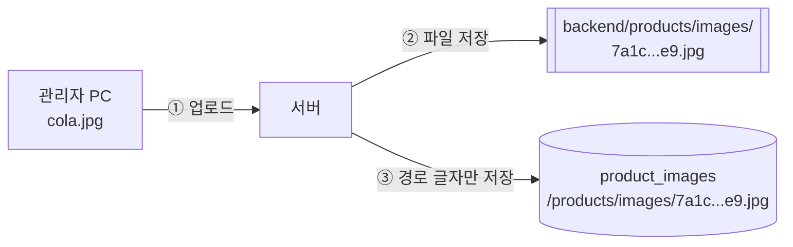
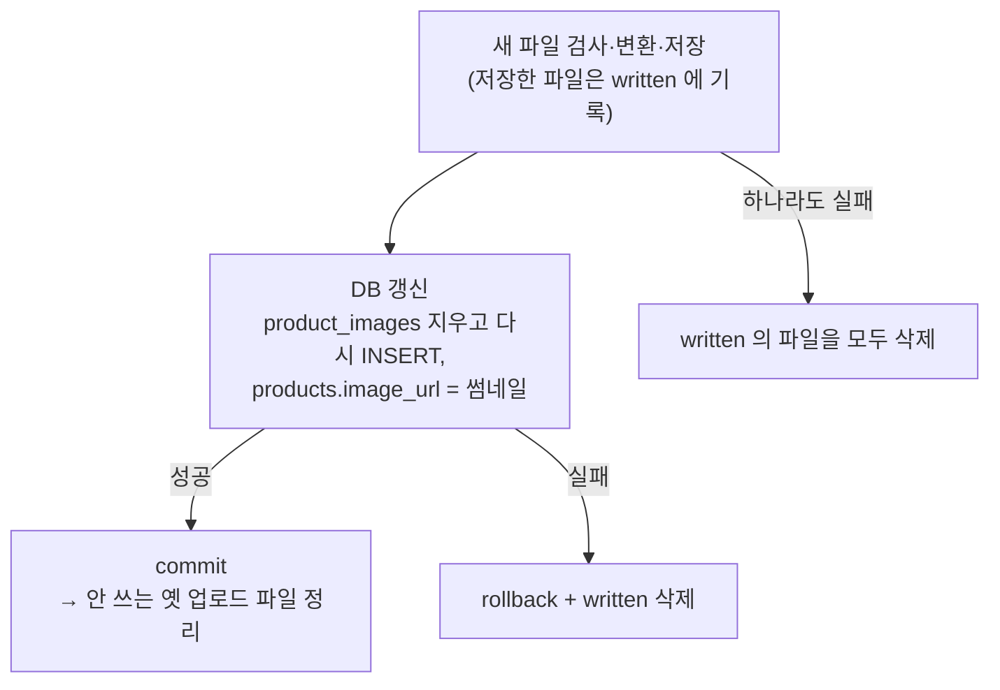
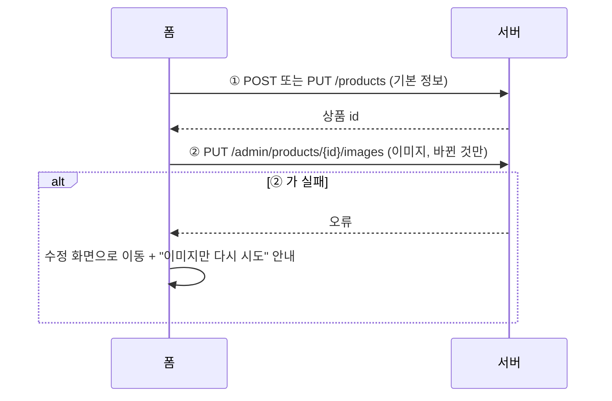
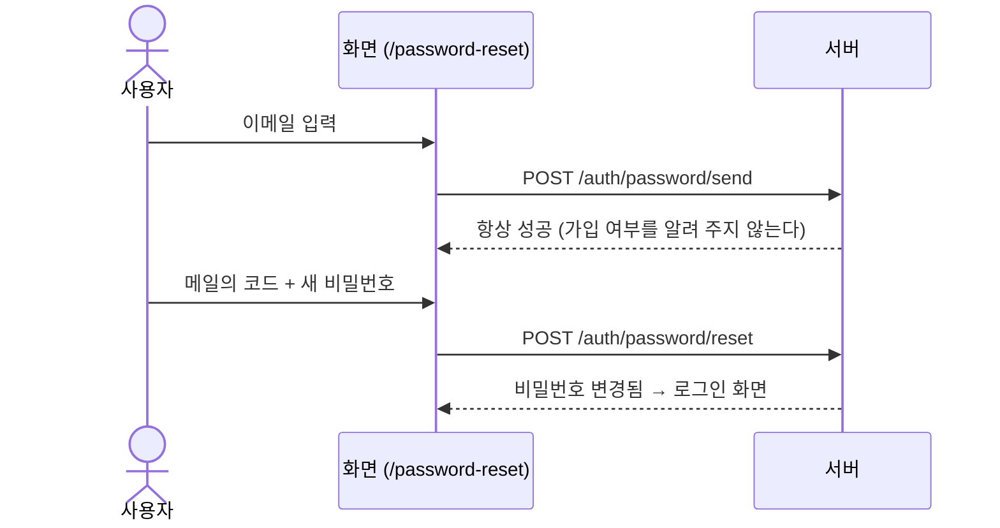
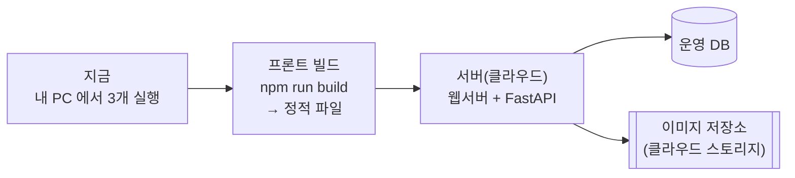

# 10일차. 이미지 업로드 · 마무리 · 발표

> **오늘의 한 줄 목표** : 관리자가 **상품 이미지를 올리면** 서버가 안전하게 검사하고 크기를 줄여 저장·썸네일까지 만든다. 그리고 우리가 만든 쇼핑몰 전체를 **점검하고 발표**한다.

| 항목 | 내용 |
|---|---|
| 만드는 것 | 이미지 업로드 API(`PUT /admin/products/{id}/images`), 대표 3장·상세 10장 편집 화면, (선택) 비밀번호 재설정 |
| 새로 설치 | 백엔드 `python-multipart` `pillow` |
| 새 테이블 | 없음 (3일차의 `product_images` 사용) |
| 관련 요구사항 | FR-55, BR-14, (선택) FR-35 |
| 끝나면 | **전체 프로젝트 완성**, `requirements.txt` 정리, 발표 |

완성 스냅샷 : `docs/steps/day10/` (= 완성본과 같은 기능)

---

## 시간표 (8시간)

| 시간 | 내용 | 방식 |
|---|---|---|
| 09:00 ~ 09:30 | 9일차 복습, 오늘의 질문 : "사용자가 올린 파일을 믿어도 될까?" | 토의 |
| 09:30 ~ 10:30 | **파일 업로드 개념** (multipart), 이미지 보안 | 강의 |
| 10:30 ~ 12:00 | **`images.py`** : 검사 · 크기 줄이기 · 썸네일 | 읽기 + 실습 |
| 12:00 ~ 13:00 | 점심 | |
| 13:00 ~ 14:30 | **업로드 API** + 화면(대표 3장 / 상세 10장 편집기) | 읽기 + 실습 |
| 14:30 ~ 15:30 | (선택) 비밀번호 재설정 / 못 끝낸 기능 마무리 | 실습 |
| 15:30 ~ 16:30 | **전체 점검** (시나리오), 정리 (`requirements.txt`, README, git) | 실습 |
| 16:30 ~ 17:30 | **최종 발표** (조별 7분) | 발표 |
| 17:30 ~ 18:00 | 열흘 회고, 앞으로의 학습 안내 | 토의 |

> 오늘 이미지 코드는 **가장 길고 어렵습니다.** 직접 입력하기보다 **📦 복사 → 읽기 → 시험**으로 진행하고, 핵심 아이디어(검사·변환·정리·롤백)를 이해하는 것을 목표로 합니다.

---

## 1. 개념 : 파일 업로드

### 1-1. 파일은 DB 에 저장하지 않는다



- DB 에는 **경로(글자)** 만 저장하고, 파일은 **폴더**에 둔다. (1일차부터 그래 왔다)
- 화면은 `` 로 서버가 공개한 폴더에서 가져온다. (2일차 `StaticFiles`)

### 1-2. 올라온 파일을 믿으면 안 된다

| 위험 | 예 | 대응 |
|---|---|---|
| **가짜 확장자** | 실행 파일 이름을 `cola.jpg` 로 바꿔 올림 | 확장자가 아니라 **파일 내용**을 열어서 확인 (Pillow) |
| **SVG 스크립트** | SVG 그림 안에 자바스크립트 숨김 | SVG 는 **받지 않는다** (JPG, PNG, WEBP 만) |
| **엄청나게 큰 파일** | 서버 메모리/디스크를 채움 | **2MB** 제한, **2,500만 화소** 제한 |
| **파일 이름 조작** | `../../main.py` 로 서버 파일을 덮어씀 | 이름은 **서버가 무작위(uuid)로** 정한다 |
| **개인정보** | 사진에 촬영 위치(EXIF)가 들어 있음 | **다시 저장**하면서 메타데이터를 버린다 |

### 1-3. multipart/form-data

지금까지는 JSON(`Content-Type: application/json`)을 보냈습니다. **파일은 JSON 에 담을 수 없어서** 글자와 파일을 **여러 조각**으로 나눠 보내는 형식(`multipart/form-data`)을 씁니다.

```text
PUT /admin/products/5/images
  ├─ main_layout   = [{"keep":"..."},{"new":0},null]     ← 글자 조각
  ├─ detail_layout = [{"new":1}]                          ← 글자 조각
  ├─ files         = (파일 0번)                           ← 파일 조각
  └─ files         = (파일 1번)                           ← 파일 조각
```

> 파일을 보낼 때는 `Content-Type` 을 **직접 쓰지 않습니다.** 브라우저가 조각을 나누는 경계(boundary)를 넣어서 알아서 정합니다. 6일차 `apiFetch` 가 `FormData` 일 때 헤더를 건드리지 않는 이유입니다.

---

## 2. 백엔드

### 2-1. 패키지 설치

```powershell
python -m pip install python-multipart pillow
```

| 패키지 | 역할 |
|---|---|
| `python-multipart` | FastAPI 가 파일 업로드(`multipart`)를 받으려면 필요하다 |
| `pillow` | 이미지를 열고 검사하고 크기를 줄이고 저장한다 |

### 2-2. 📦 `backend/app/images.py` (새 파일)

완성본 `docs/steps/day10/backend/app/images.py` 를 복사하고 **정책 상수**부터 읽습니다.

```python
MAX_BYTES = 2 * 1024 * 1024
MAX_PIXELS = 25_000_000
ALLOWED_FORMATS = {"JPEG", "PNG", "WEBP"}

MAIN_MAX = 1000          # 대표 이미지 한 변 최대 px
THUMB_MAX = 400          # 썸네일 한 변 최대 px
DETAIL_MAX_WIDTH = 1000  # 상세 이미지 가로 최대 px
MAIN_SLOTS = 3           # 대표 이미지 최대 장수
DETAIL_MAX = 10          # 상세 이미지 최대 장수
```

**① 검사 : 파일 내용으로 판단**

```python
def load_image(upload: UploadFile) -> Image.Image:
    """업로드 파일을 검사하고 Pillow 이미지로 돌려준다. 문제가 있으면 422."""
    name = upload.filename or "파일"
    data = upload.file.read(MAX_BYTES + 1)
    if len(data) > MAX_BYTES:
        raise bad_image(f"{name} : 파일 크기는 {MAX_BYTES // 1024 // 1024}MB 이하여야 합니다.")
    try:
        probe = Image.open(BytesIO(data))
        if probe.format not in ALLOWED_FORMATS:
            raise bad_image(f"{name} : JPG, PNG, WEBP 이미지만 올릴 수 있습니다.")
        if probe.width * probe.height > MAX_PIXELS:
            raise bad_image(f"{name} : 이미지 해상도가 너무 큽니다.")
        probe.verify()                       # 깨진 파일 검사 (verify 뒤에는 다시 열어야 한다)
        img = Image.open(BytesIO(data))
        img.load()
    except HTTPException:
        raise
    except (UnidentifiedImageError, OSError, SyntaxError, ValueError):
        raise bad_image(f"{name} : 이미지 파일이 아니거나 손상되었습니다.")
    return img
```

| 줄 | 의미 |
|---|---|
| `upload.file.read(MAX_BYTES + 1)` | 한도보다 **1바이트 더** 읽어 본다. 넘으면 거부 (전체를 읽지 않아 메모리를 아낀다) |
| `probe.format not in ALLOWED_FORMATS` | **실제 형식**이 JPEG/PNG/WEBP 인가 (이름은 보지 않는다) |
| `width * height > MAX_PIXELS` | 아주 큰 해상도 거부 |
| `probe.verify()` | 깨진 파일 검사 |
| 모든 오류 → `422` + 한글 메시지 | 사용자가 이유를 알 수 있게 |

**② 변환 : 모두 JPG 로 다시 저장**

```python
def to_rgb(img: Image.Image) -> Image.Image:
    img = ImageOps.exif_transpose(img)       # 휴대폰 사진의 회전 정보 반영
    if img.mode in ("RGBA", "LA", "P"):      # 투명 배경은 흰색으로 채운다 (JPG 는 투명을 못 쓴다)
        img = img.convert("RGBA")
        background = Image.new("RGB", img.size, "white")
        background.paste(img, mask=img.getchannel("A"))
        return background
    return img.convert("RGB")
```

- `exif_transpose` : 휴대폰 사진의 **회전 정보**를 반영한다 (사진이 옆으로 누워 보이는 문제 방지)
- 투명 PNG 는 **흰 배경**으로 채운다. (JPG 는 투명을 못 쓴다)

**③ 저장 : 크기 줄이기 + 이름은 서버가**

```python
def save_main(img: Image.Image, written: list) -> str:
    """대표 이미지 1장 저장 (한 변 최대 1000px). 주소를 돌려준다. 저장한 파일은 written 에 기록한다."""
    img = to_rgb(img)
    img.thumbnail((MAIN_MAX, MAIN_MAX))
    name = _new_name()
    _save_jpeg(img, IMAGES_DIR / name)
    written.append(IMAGES_DIR / name)
    return URL_PREFIX + name
```

```python
def save_thumbnail(img: Image.Image, written: list) -> str:
    """썸네일 저장 (한 변 최대 400px). 주소를 돌려준다."""
    img = to_rgb(img)
    img.thumbnail((THUMB_MAX, THUMB_MAX))
    name = _new_name("_thumb")
    _save_jpeg(img, IMAGES_DIR / name, quality=85)
    written.append(IMAGES_DIR / name)
    return URL_PREFIX + name
```

| 부분 | 설명 |
|---|---|
| `img.thumbnail((1000, 1000))` | 비율을 유지하며 **긴 변이 1000px 이하**가 되게 줄인다 (이미 작으면 그대로) |
| `uuid.uuid4().hex` | 겹치지 않는 **무작위 이름**. 올린 사람이 보낸 이름은 쓰지 않는다 |
| `_thumb` 접미사, 400px | 목록 카드용 **썸네일** |
| `written.append(...)` | 저장한 파일을 **기록**해 둔다 → 나중에 실패하면 이 목록의 파일을 지운다 |

**④ 지울 때의 안전장치**

```python
GENERATED_RE = re.compile(r"^[0-9a-f]{32}(_thumb)?\.jpg$")
```

옛 이미지를 정리할 때 **우리 서버가 만든 이름 모양**(`uuid.jpg`, `uuid_thumb.jpg`)의 파일만 지웁니다. 처음에 넣어 둔 `cola.jpg` 같은 **기본 이미지는 절대 지우지 않습니다.** (`url_to_path` 는 이미지 폴더 **밖**의 경로를 거부해 `../` 조작도 막습니다.)

### 2-3. 📦 `admin.py` 에 업로드 API 추가

9일차의 `admin.py` 를 **완성본**으로 교체합니다 (이미지 저장 API 가 추가된 버전). 핵심 구조만 읽습니다.

**① 요청 모양 : "최종 모습(layout)"을 보낸다**

```python
@router.put("/products/{product_id}/images")
def save_product_images(
    product_id: int,
    main_layout: str | None = Form(None),
    detail_layout: str | None = Form(None),
    files: list[UploadFile] = File(default=[]),
    admin: dict = Depends(require_admin),
):
```

화면은 "이번에 이렇게 바꿔 줘"가 아니라 **"저장 후의 최종 모습"** 을 보냅니다.

```json
main_layout   = [ {"keep": "/products/images/old.jpg"},  {"new": 0},  null ]
detail_layout = [ {"new": 1}, {"keep": "/products/images/detail/b.jpg"} ]
```

| 칸의 값 | 뜻 |
|---|---|
| `{"keep": 주소}` | 기존 이미지를 **그대로** 둔다 |
| `{"new": 번호}` | 이번에 올린 `files` 의 **번호번째** 파일을 쓴다 |
| `null` | (대표 이미지 3칸 중) 빈 칸 |

> 💡 "추가/삭제/순서 변경"을 따로따로 API 로 만들지 않고 **최종 모습 하나**로 표현하면 API 가 단순해지고, 순서 변경·교체·삭제를 **한 번에** 처리할 수 있습니다.

**② 서버의 방어**

| 검사 | 이유 |
|---|---|
| `keep` 은 **이 상품이 지금 가진 이미지만** 허용 | 남의 파일이나 임의 경로를 끌어오지 못하게 |
| `new` 번호가 범위 안, 중복 없음 | 존재하지 않는 파일 번호 / 같은 파일 두 번 사용 방지 |
| 대표 이미지는 최소 1장 | 대표가 없는 상품 방지 |
| 형식·장수 검사 | 대표 ≤ 3, 상세 ≤ 10 |

**③ 저장은 "전부 성공 or 전부 취소"** — 4일차 트랜잭션의 파일 버전



DB 는 `rollback` 으로 되돌릴 수 있지만 **파일은 `rollback` 이 없습니다.** 그래서 **저장한 파일 목록(`written`)을 들고 있다가 실패하면 직접 지웁니다.**

**④ 썸네일** : 대표 이미지 **1번**이 바뀌면 그것을 400px 로 줄여 `products.image_url` (목록 카드) 로 씁니다. 목록은 작은 그림만 불러와 **빠르게** 뜹니다.

### 2-4. ✍️ `main.py` 업데이트

`IMAGES_DIR` 을 `images.py` 에서 가져오고, 개발 중에는 이미지를 브라우저가 저장해 두지 않게(`no-store`) 합니다. 완성본 `main.py` 로 교체합니다.

> 같은 이름의 이미지를 바꿔도 **옛 그림이 남아 보이는** 일을 막기 위한 개발용 설정입니다. 배포할 때는 캐시를 허용해 속도를 높입니다.

### 2-5. 시험 (`/docs`)

관리자 토큰으로 `PUT /admin/products/{id}/images` 를 시험합니다. (파일 업로드는 `/docs` 에서 **Choose File** 로 선택)

| # | 시험 | 기대 결과 |
|---|---|---|
| ① | 일반 JPG 1장 + `main_layout=[{"new":0}]` | 저장됨. `backend/products/images/` 에 `uuid.jpg`, `uuid_thumb.jpg` 생성 |
| ② | 3000×2000 사진 | 저장된 파일이 **긴 변 1000px 이하**, 썸네일 400px 이하 |
| ③ | `.svg` 파일 | `422` JPG, PNG, WEBP 만 가능 |
| ④ | 이름만 `.jpg` 인 텍스트 파일 | `422` 이미지 파일이 아니거나 손상 |
| ⑤ | 2MB 넘는 파일 | `422` 크기 초과 |
| ⑥ | 일반 회원 토큰 | `403` |
| ⑦ | 같은 대표 이미지를 다른 파일로 교체 | 옛 업로드 파일이 **삭제**된다 (기본 이미지는 남는다) |
| ⑧ | 2번째 파일이 깨진 파일 | `422` + 1번째 파일도 **저장되지 않았다** (롤백) |

---

## 3. 프론트엔드

### 3-1. 📦 화면 파일 복사

| 파일 | 역할 |
|---|---|
| `utils/imageFile.js` | 화면에서 **먼저** 하는 파일 검사 (형식·2MB), 미리보기 주소 만들기 |
| `pages/admin/ImageDropZone.jsx` | 파일을 **끌어다 놓거나 클릭**해서 고르는 칸 |
| `pages/admin/MainImagesEditor.jsx` | 대표 이미지 3칸 + 썸네일 미리보기 |
| `pages/admin/DetailImagesEditor.jsx` | 상세 이미지 여러 장 추가, ▲▼ 순서 변경, 삭제 |
| `pages/admin/AdminProductFormPage.jsx` | 9일차 폼을 **탭(기본 정보 / 대표 이미지 / 상세 이미지)** 이 있는 완성본으로 교체 |
| `api/admin.js`, `api/auth.js` | `saveProductImages`, `FormData` 지원 `apiFetch` 가 추가된 완성본 |

### 3-2. 화면 검사 (서버도 똑같이 검사)

```javascript
// 이미지 업로드 파일 검사 (화면에서 먼저 거른다. 서버도 같은 검사를 해야 한다)
//   SVG 는 안에 스크립트를 넣을 수 있어 허용하지 않는다.
export const ALLOWED_TYPES = ['image/jpeg', 'image/png', 'image/webp']
export const MAX_MB = 2
export const ACCEPT = ALLOWED_TYPES.join(',')

// 문제가 없으면 '' 를, 있으면 사용자에게 보여 줄 문구를 돌려준다
export function validateImageFile(file) {
    if (!ALLOWED_TYPES.includes(file.type)) return 'JPG, PNG, WEBP 이미지만 올릴 수 있습니다.'
    if (file.size > MAX_MB * 1024 * 1024) return `파일 크기는 ${MAX_MB}MB 이하여야 합니다. (${(file.size / 1024 / 1024).toFixed(1)}MB)`
    return ''
}

export const formatSize = (bytes) =>
    bytes >= 1024 * 1024 ? `${(bytes / 1024 / 1024).toFixed(1)}MB` : `${Math.max(1, Math.round(bytes / 1024))}KB`

// 고른 파일의 미리보기 주소. 화면을 떠날 때 revokeAllPreviews() 로 한꺼번에 반납한다.
const previews = new Set()
export function createPreview(file) {
    const url = URL.createObjectURL(file)
    previews.add(url)
    return url
}
export function revokeAllPreviews() {
    previews.forEach((u) => URL.revokeObjectURL(u))
    previews.clear()
}

// 상세 이미지 최대 장수 (서버의 DETAIL_MAX 와 같게 둔다)
export const DETAIL_MAX = 10
// 목록에서 항목을 구별하는 임시 번호
let nextKey = 1
export const newDetailKey = () => nextKey++
```

> 서버가 최종 판단을 하지만, **2MB 넘는 파일을 올리고 한참 기다렸다가 거부당하는 것**은 불편합니다. 화면에서 먼저 막는 것은 **친절**입니다.

### 3-3. 파일 보내기 : `FormData`

```javascript
// 이미지 저장 : PUT /admin/products/{id}/images  (multipart/form-data)
//   mainLayout / detailLayout : 대표(3칸) / 상세 이미지의 최종 모습. 바뀌지 않았으면 null 로 보내 그대로 둔다.
//     칸 하나 : { keep: "기존 이미지 주소" } | { new: 파일번호 } | null(대표 이미지의 빈 칸)
//   files : 새로 올리는 파일들 (layout 의 new 번호가 이 배열의 위치)
export function saveProductImages(id, { mainLayout, detailLayout, files }) {
    const form = new FormData()
    if (mainLayout) form.append('main_layout', JSON.stringify(mainLayout))
    if (detailLayout) form.append('detail_layout', JSON.stringify(detailLayout))
    files.forEach((f) => form.append('files', f))
    return apiFetch(`/admin/products/${id}/images`, { method: 'PUT', body: form, auth: true })
```

- `FormData` 는 "여러 조각"을 담는 상자입니다. `append(이름, 값)` 으로 글자(`JSON.stringify(layout)`)와 **파일**(`files.forEach(...)`)을 담습니다.
- `layout` 이 `null` 이면 **보내지 않습니다.** (바뀌지 않은 부분은 서버가 그대로 둔다)

### 3-4. 두 단계 저장 : 폼의 `save()`

```jsx
    let productId = product?.id;
    try {
      // ① 기본 정보 저장
      if (editing) await updateProduct(productId, body);
      else productId = (await createProduct(body)).id;
    } catch (e) {
      setSaving(false);
      return fail(e.message);
    }

    try {
      // ② 이미지 저장 (바뀐 것만)
      if (mainChanged || detailChanged) {
        await saveProductImages(productId, {
          mainLayout: mainChanged ? buildMainLayout(slots, files) : null,
          detailLayout: detailChanged ? buildDetailLayout(details, files) : null,
          files,
        });
      }
    } catch (e) {
      setSaving(false);
      // 상품 정보는 이미 저장되었다. 새로 등록한 경우 수정 화면으로 옮겨 이미지만 다시 시도하게 한다.
      const message = `상품 정보는 저장되었지만 이미지 저장에 실패했습니다. (${e.message}) 이미지를 다시 선택해 저장해 주세요.`;
      if (!editing) navigate(`/manage/products/${productId}/edit`, { replace: true, state: { notice: message } });
      else fail(message);
      return;
    }
    navigate("/manage/products", { state: { notice: editing ? "상품을 수정했습니다." : "상품을 등록했습니다." } });
```



> **왜 두 번 나눠서 보낼까요?** 상품을 **새로 등록**할 때는 상품 `id` 가 아직 없어서, 이미지를 붙이려면 상품이 **먼저 만들어져야** 합니다. 대신 이미지 저장이 실패해도 **상품 정보는 이미 저장**되었으므로, 사용자를 수정 화면으로 보내 **이미지만 다시** 올리게 합니다. (작업을 쪼갰을 때의 실패 처리 설계)

### 3-5. 시험

- [ ] `/manage/products/new` → **기본 정보** 입력 → **대표 이미지** 탭에서 사진 1장 이상 → **상품 등록**
- [ ] 일반 목록의 카드에 **방금 올린 사진(썸네일)** 이 보인다
- [ ] 상세 화면에 대표 이미지 · 작은 이미지 · **상세 보기**에 상세 이미지가 나온다
- [ ] 수정 화면에서 이미지를 **교체 / 삭제 / 순서 변경**하면 반영된다
- [ ] 3MB 파일을 고르면 **화면에서 바로** 오류가 나온다
- [ ] SVG 를 고르면 거부된다
- [ ] `backend/products/images/` 폴더에 파일이 생기고, 교체하면 옛 파일이 사라진다

---

## 4. (선택) 비밀번호 재설정

시간이 남는 학생은 **6일차 이메일 인증을 재사용**해 비밀번호 재설정을 만들어 봅니다. 새로 배울 개념은 거의 없습니다.



**핵심 설계 : 가입 여부를 알려 주지 않는다**

```python
# ─────────────────────────── 6) 비밀번호 재설정 : 코드 발송 ───────────────────────────
@router.post("/password/send")
def send_reset_code(body: PasswordEmailIn):
    """가입한 이메일이면 재설정 코드를 보낸다.

    가입하지 않은 이메일, 차단된 계정, 너무 빠른 재요청도 **똑같이 성공 응답**을 준다.
    (응답으로 "이 이메일은 가입되어 있다/없다" 를 알아내지 못하게 하기 위해서)
    """
    email = _norm_email(body.email)
    answer = {"sent": True, "expires_in": CODE_TTL_MIN * 60, "resend_after": RESEND_SEC}
    code = f"{secrets.randbelow(1_000_000):06d}"

    conn = get_connection()
    try:
        with conn.cursor() as cur:
            cur.execute("SELECT status FROM users WHERE email = %s", (email,))
            user = cur.fetchone()
            if user is None or user["status"] != "ACTIVE":
                return answer
            cur.execute(
                "SELECT TIMESTAMPDIFF(SECOND, created_at, NOW()) AS age FROM email_verifications "
                "WHERE email = %s AND purpose = 'RESET' ORDER BY id DESC LIMIT 1", (email,))
            last = cur.fetchone()
            if last and last["age"] < RESEND_SEC:
                return answer
            cur.execute("DELETE FROM email_verifications WHERE email = %s AND purpose = 'RESET'", (email,))
            cur.execute(
                "INSERT INTO email_verifications (email, purpose, code_hash, expires_at) "
                "VALUES (%s, 'RESET', %s, NOW() + INTERVAL %s MINUTE)", (email, _code_hash(email, code), CODE_TTL_MIN))
        conn.commit()
    finally:
        conn.close()

    try:
        send_mail(email, "[음료 쇼핑몰] 비밀번호 재설정 코드",
                  f"비밀번호 재설정 코드 : {code}\n\n{CODE_TTL_MIN}분 안에 입력해 주세요. "
                  "본인이 요청하지 않았다면 이 메일을 무시하세요. (비밀번호는 바뀌지 않습니다)")
    except Exception as e:
        logger.error("재설정 메일 발송 실패: %s", e)
        conn = get_connection()
        try:
            with conn.cursor() as cur:
                cur.execute("DELETE FROM email_verifications WHERE email = %s AND purpose = 'RESET'", (email,))
            conn.commit()
        finally:
            conn.close()
        raise HTTPException(status_code=502, detail="메일을 보내지 못했습니다. 잠시 후 다시 시도해 주세요.")
    return answer
```

- 가입하지 않은 이메일이어도 **똑같이 성공 응답**을 줍니다. "이 이메일은 가입되어 있지 않습니다"라고 답하면, 공격자가 **특정 사람의 가입 여부**를 알아낼 수 있기 때문입니다.
- 6일차의 코드 발송과 거의 같고, 목적을 구분하는 컬럼 `purpose = 'RESET'` 만 다릅니다.

**코드 확인 + 비밀번호 변경**

```python
# ─────────────────────────── 7) 비밀번호 재설정 : 코드 확인 + 변경 ───────────────────────────
@router.post("/password/reset")
def reset_password(body: ResetIn):
    email = _norm_email(body.email)
    _check_password(body.new_password)
    bad = HTTPException(status_code=400, detail="인증 코드가 올바르지 않거나 만료되었습니다. 코드를 다시 요청해 주세요.")

    conn = get_connection()
    try:
        with conn.cursor() as cur:
            cur.execute(
                "SELECT id, code_hash, attempts, (expires_at < NOW()) AS expired FROM email_verifications "
                "WHERE email = %s AND purpose = 'RESET' ORDER BY id DESC LIMIT 1 FOR UPDATE", (email,))
            row = cur.fetchone()
            if row is None or row["expired"] or row["attempts"] >= MAX_ATTEMPTS:
                raise bad
            if not hmac.compare_digest(row["code_hash"], _code_hash(email, body.code)):
                cur.execute("UPDATE email_verifications SET attempts = attempts + 1 WHERE id = %s", (row["id"],))
                conn.commit()
                raise bad
            cur.execute("UPDATE users SET password_hash = %s WHERE email = %s AND status = 'ACTIVE'",
                        (hash_password(body.new_password), email))
            cur.execute("DELETE FROM email_verifications WHERE email = %s AND purpose = 'RESET'", (email,))
        conn.commit()
    finally:
        conn.close()
    logger.info("비밀번호 재설정 완료")
    return {"reset": True}
```

- 틀린 코드, 만료, 시도 초과를 **모두 같은 메시지**로 알립니다. (어느 쪽이 문제인지 알려 주지 않는다)
- 변경이 끝나면 인증 기록을 **지웁니다.** (같은 코드를 다시 쓰지 못하게)

화면은 📦 `pages/PasswordResetPage.jsx` 와, 재설정 링크가 있는 완성본 `LoginPage.jsx` 를 복사합니다. `App.jsx` 에는 `/password-reset` 라우트를 추가합니다. (`api/auth.js` 완성본에 `sendResetCode`, `resetPassword` 가 들어 있습니다.)

---

## 5. 전체 점검 : 처음부터 끝까지

조별로 **새 브라우저 창(시크릿 모드)** 에서 아래 흐름을 처음부터 따라가며 ✅ / ❌ 를 적습니다.

| # | 흐름 | 확인 |
|---|---|---|
| 1 | 비로그인으로 목록 · 검색 · 정렬 · 카테고리 · 페이지 | |
| 2 | 상세 → 장바구니 담기 → 새로고침해도 유지 | |
| 3 | 구매하기 → **로그인 화면** → 회원가입(이메일 인증) → 로그인 → 결제 화면 복귀 | |
| 4 | 배송지 입력(주소 검색) → 결제 → 완료 화면 | |
| 5 | 구매내역에서 방금 주문 확인(상품·배송지) | |
| 6 | 같은 상품 재고가 구매 수량만큼 줄었는지 | |
| 7 | 두 번째 주문에서 저장된 배송지 사용 | |
| 8 | **관리자**로 로그인 → 상품 등록(이미지 포함) → 일반 목록에서 확인 | |
| 9 | 관리자: 주문 환불 → 재고 복구 → 구매내역에서 사라짐 | |
| 10 | 일반 회원으로 `/manage` 접근 → 거부 | |
| 11 | `python race_test.py` → 재고 정확 | |
| 12 | 로그아웃 후 `/mypage/purchases` 접근 | 로그인 화면 |

---

## 6. 마무리 : 프로젝트 정리

### 6-1. `requirements.txt` — 내 프로젝트가 쓰는 패키지 목록

다른 사람(또는 내일의 나)이 **같은 환경**을 만들 수 있게 패키지 목록을 파일로 남깁니다.

```powershell
cd backend
python -m pip freeze > requirements.txt
```

완성본의 `requirements.txt` :

```
fastapi==0.162.0
uvicorn==0.54.0
PyMySQL==1.2.3
python-dotenv==1.2.4
python-multipart==0.0.33
Pillow==13.0.0
```

설치할 때는 한 줄이면 됩니다.

```powershell
python -m pip install -r requirements.txt
```

> 이것이 **"필요할 때 하나씩 설치"한 열흘간의 기록**입니다. 어느 날 무엇을 설치했는지 돌아보세요.

### 6-2. 프론트의 `package.json`

`npm install 패키지` 를 할 때마다 `package.json` 의 `dependencies` 에 자동 기록되었습니다. 새 PC 에서는 `npm install` 한 번이면 됩니다.

### 6-3. Git 으로 기록 남기기 (선택)

```powershell
cd C:\work\miniShop
git init
git add .
git status        # .env 와 node_modules 가 목록에 없는지 반드시 확인!
git commit -m "miniShop 완성"
```

> ⚠️ `git status` 에 **`.env` 가 보이면 절대 커밋하지 마세요.** 1일차의 `.gitignore` 가 제대로 있는지 확인합니다.

### 6-4. README 쓰기

완성본의 `README.md` 처럼, **처음 보는 사람이 이 프로젝트를 실행할 수 있게** 아래 항목을 적어 봅니다.

1. 무엇을 만들었나 (한 줄)
2. 주요 기능
3. 기술 스택
4. 실행 방법 (DB → 백엔드 → 프론트)
5. 테스트 계정
6. 알려진 한계

### 6-5. 배포는 어떻게 하나요? (맛보기)

이번 과정에서는 **내 컴퓨터에서만** 실행했습니다. 실제로 공개하려면 이런 일이 더 필요합니다. (참고만 합니다)



| 지금 | 배포하면 |
|---|---|
| Vite 개발 서버 + 프록시 | 빌드한 정적 파일 + 웹서버가 `/api` 를 전달 |
| `--reload` 서버 | 안정적인 프로세스 관리 |
| `.env` 파일 | 서버의 환경 변수 / 비밀 관리 |
| `http://localhost` | **HTTPS** + 도메인 |
| 이미지를 서버 폴더에 저장 | 서버가 여러 대면 **클라우드 스토리지** 필요 |
| 로그인 토큰 12시간 | 토큰 폐기, 로그인 시도 제한 등 보안 강화 |

---

## 7. 🏁 최종 발표 (조별 7분)

| 순서 | 내용 | 시간 |
|---|---|---|
| 1 | 우리 쇼핑몰 **시연** (비로그인 → 구매 → 관리자 환불까지 한 바퀴) | 3분 |
| 2 | 열흘 중 **가장 어려웠던 날**과 해결 방법 | 1분 |
| 3 | **가장 인상 깊었던 개념** (예 : 트랜잭션, 해시, 권한) | 1분 |
| 4 | 더 만들고 싶은 기능 | 1분 |
| 5 | 질문 | 1분 |

### 평가가 아니라 **되돌아보기**입니다

- 처음에 설정한 **MVP** 는 무엇이었고, 실제로 며칠째에 완성되었나요?
- 요구사항 명세서와 **실제로 만든 것**은 얼마나 같았나요?
- 가장 **많이 고친 코드**는 어디였고, 왜 고쳤나요? (예 : 4일차 재고 차감 → 5일차)

---

## 8. 체크포인트

- [ ] 관리자가 이미지를 올리면 **목록 카드(썸네일)** 와 **상세 화면**에 반영된다
- [ ] 이미지 규칙 위반(SVG, 가짜 파일, 큰 파일)은 거부된다
- [ ] 이미지 교체 시 옛 업로드 파일이 지워지고, 기본 이미지는 남는다
- [ ] (선택) 비밀번호 재설정이 동작한다
- [ ] 전체 점검 12개 흐름이 모두 ✅
- [ ] `requirements.txt` 가 정리되었다
- [ ] `.env` 가 저장소에 포함되지 않았다

---

## 9. 자주 하는 실수

| 증상 | 원인 | 해결 |
|---|---|---|
| `Form data requires "python-multipart" to be installed` | 패키지 미설치 | `pip install python-multipart` 후 서버 재시작 |
| `No module named 'PIL'` | pillow 미설치 | `pip install pillow` |
| 업로드가 `422` 파일 정보 오류 | `layout` 의 `new` 번호와 `files` 순서 불일치 | `files` 를 `layout` 에서 쓰는 **순서대로** `append` |
| 업로드가 `Content-Type` 오류 | `FormData` 를 보내면서 `Content-Type: application/json` 을 직접 지정 | `FormData` 일 때는 헤더를 직접 정하지 않는다 (`apiFetch`) |
| 올렸는데 화면에서 옛 이미지가 보임 | 브라우저 캐시 | 강력 새로고침(`Ctrl+Shift+R`) |
| 이미지가 깨져 보임 | `backend/products/images` 폴더 이름/위치 오류 | 폴더 위치, `/products/images/파일.jpg` 직접 열어 보기 |
| 폴더에 파일이 계속 쌓임 | 정리 로직 누락 | `is_generated` 와 `delete_files` 확인 |
| 휴대폰 사진이 옆으로 누움 | EXIF 회전 미반영 | `to_rgb` 의 `exif_transpose` |

---

## 10. 열흘의 핵심 정리

| 일차 | 배운 핵심 |
|---|---|
| 1 | 개발 과정 · 구조 · MVP · 환경 |
| 2 | 기능 하나 = **DB → API → 화면** |
| 3 | 라우팅 · 상태 공유(Context) · 404/422 |
| 4 | 주문 설계 · **트랜잭션** · 서버 계산 |
| 5 | **경쟁 상태** · 조건부 UPDATE · 잠금 |
| 6 | **해시** · **토큰(JWT)** · 이메일 인증 |
| 7 | 테이블 변경(**ALTER**) · 내 데이터만 · JOIN/GROUP BY |
| 8 | **SQL 인젝션 방어** · 검색 · 정렬 · 페이지 · URL 상태 |
| 9 | **권한(403)** · 소프트 삭제 · 환불 |
| 10 | **파일 업로드 보안** · 마무리 |

### 앞으로 더 해 볼 만한 것

| 주제 | 설명 |
|---|---|
| 자동 테스트 | `pytest` 로 API 를 자동으로 시험 (지금은 `/docs` 로 손으로) |
| 상품평(리뷰) | 새 테이블 + "상품평 많은순" 정렬 |
| 회원 직접 환불 / 배송지 관리 화면 | 범위 밖이었던 기능 |
| 간편 로그인 | 구글 OAuth |
| 배포 | 클라우드 서버, HTTPS, 클라우드 이미지 저장소 |
| 보안 강화 | 로그인 시도 제한, 토큰 폐기 |

---

## 📌 강사 메모

- **이미지 코드는 읽기 위주**로 진행하세요. 학생들이 모든 줄을 이해하지 않아도, ① 파일을 **믿지 않는다**(검사) ② 파일에는 **롤백이 없어** 직접 지운다 ③ 최종 모습(layout)으로 **API 를 단순하게** 한다 — 이 세 가지가 전달되면 성공입니다.
- **시연** : `.jpg` 로 이름만 바꾼 텍스트 파일을 올려 `422` 가 나는 장면, 휴대폰 세로 사진이 올바른 방향으로 저장되는 장면이 효과적입니다.
- **비밀번호 재설정은 선택**입니다. 이미지가 끝나지 않은 학생은 건너뛰어도 됩니다. 시간에 여유가 있는 조에게만 도전 과제로 주세요.
- 마지막 2시간은 **발표와 회고**에 온전히 쓰세요. 열흘 동안 쌓은 경험을 **말로 정리**하는 것이 학습을 오래 남게 합니다.
- 수강 후 지속 학습을 위해 `docs/steps/` 의 일차별 스냅샷, 완성본(`miniShop_ver1.0`), 이 문서들을 **전체 학습 자료로 공유**해 주세요.
